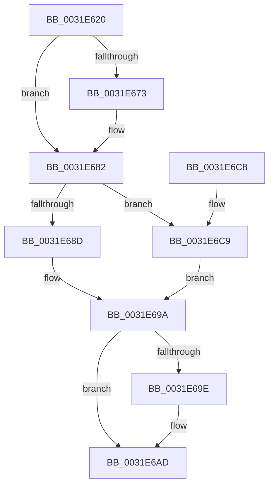

# MiSetZeroPageThreadPriority

- RVA: `0x0031E620`–`0x0031E6D0` (길이 `176` bytes)
- VA: `0x000000014031E620`
- 실행 섹션: `.text`
- PDB 이름 있음: `예`; PDB Function 태그: `아니요`
- unwind 정보 RVA: `0x00075210`
- 디코드: `47`개 명령, `176/176` bytes 표시
- 미해석 바이트: `0` (있으면 어셈블리에 `.byte`로 보존)

> 이 문서는 커널 이미지의 기계어와 PDB 기호를 분석해 생성했습니다. 4번과 5번은 함수 원형과 자료형을 바이너리 사용 방식에서 추정한 C 해석이며 원본 소스 복구 결과는 아닙니다.

## 1. Dependencies

- 직접 호출 지점: **3**; 고유 호출 대상: **3**
- 직접 호출자로 확인된 함수: **4**
- RIP 상대 이미지 참조: **0**

### Outgoing calls
- `0x0031E67A` → [ExAcquireSpinLockExclusive](../24/ExAcquireSpinLockExclusive_function_00248690.md) (function, `0x00248690`)
- `0x0031E693` → [KeSetActualBasePriorityThread](../3C/KeSetActualBasePriorityThread_function_003C4370.md) (function, `0x003C4370`)
- `0x0031E6A8` → [MiReleaseSpinLockExclusive](../24/MiReleaseSpinLockExclusive_function_002482C0.md) (function, `0x002482C0`)

### Direct callers
- [MiZeroThreadContextSetExiting](../2C/MiZeroThreadContextSetExiting_function_002CC590.md) at `0x002CC5B1`
- [MiBackgroundZeroLocalPages](MiBackgroundZeroLocalPages_function_0031EF30.md) at `0x0031EFF9`
- [MiBackgroundZeroLocalPages](MiBackgroundZeroLocalPages_function_0031EF30.md) at `0x0031F577`
- [MiFlushZeroPageHeatBatch](../47/MiFlushZeroPageHeatBatch_function_0047445C.md) at `0x0047448E`
- [MiFlushZeroPageHeatBatch](../47/MiFlushZeroPageHeatBatch_function_0047445C.md) at `0x004744A9`
- [MiZeroPageMakeHot](../69/MiZeroPageMakeHot_function_00696C08.md) at `0x00696CA3`
- [MiZeroPageMakeHot](../69/MiZeroPageMakeHot_function_00696C08.md) at `0x00696D49`

### Static image references
- 디코드된 RIP-relative 메모리 참조가 없습니다.

## 2. Other-region calls and transfers

- 다른 실행 섹션으로 향하는 call: **0**
- 별도 외부 분기/꼬리 이동을 확인하지 못했습니다.

## 3. Assembly (complete function range)

```asm
0031E620  48 89 5C 24 08                  mov qword ptr [rsp + 8], rbx
0031E625  48 89 6C 24 10                  mov qword ptr [rsp + 0x10], rbp
0031E62A  48 89 74 24 18                  mov qword ptr [rsp + 0x18], rsi
0031E62F  57                              push rdi
0031E630  41 56                           push r14
0031E632  41 57                           push r15
0031E634  48 83 EC 20                     sub rsp, 0x20
0031E638  65 4C 8B 3C 25 88 01 00 00      mov r15, qword ptr gs:[0x188]
0031E641  41 8B E8                        mov ebp, r8d
0031E644  48 8B 81 50 01 00 00            mov rax, qword ptr [rcx + 0x150]
0031E64B  44 8B F2                        mov r14d, edx
0031E64E  48 8B D9                        mov rbx, rcx
0031E651  40 B7 11                        mov dil, 0x11
0031E654  4C 8B 88 B0 00 00 00            mov r9, qword ptr [rax + 0xb0]
0031E65B  41 8B 41 38                     mov eax, dword ptr [r9 + 0x38]
0031E65F  48 69 F0 80 DF 00 00            imul rsi, rax, 0xdf80
0031E666  49 8B 41 30                     mov rax, qword ptr [r9 + 0x30]
0031E66A  48 03 70 10                     add rsi, qword ptr [rax + 0x10]
0031E66E  45 85 C0                        test r8d, r8d
0031E671  75 0F                           jne 0x14031e682
0031E673  48 8D 8E B0 3B 00 00            lea rcx, [rsi + 0x3bb0]
0031E67A  E8 11 A0 F2 FF                  call 0x140248690
0031E67F  40 8A F8                        mov dil, al
0031E682  8B 8B 80 01 00 00               mov ecx, dword ptr [rbx + 0x180]
0031E688  F6 C1 08                        test cl, 8
0031E68B  75 3C                           jne 0x14031e6c9
0031E68D  41 8B D6                        mov edx, r14d
0031E690  49 8B CF                        mov rcx, r15
0031E693  E8 D8 5C 0A 00                  call 0x1403c4370
0031E698  8B D8                           mov ebx, eax
0031E69A  85 ED                           test ebp, ebp
0031E69C  75 0F                           jne 0x14031e6ad
0031E69E  40 8A D7                        mov dl, dil
0031E6A1  48 8D 8E B0 3B 00 00            lea rcx, [rsi + 0x3bb0]
0031E6A8  E8 13 9C F2 FF                  call 0x1402482c0
0031E6AD  48 8B 6C 24 48                  mov rbp, qword ptr [rsp + 0x48]
0031E6B2  8B C3                           mov eax, ebx
0031E6B4  48 8B 5C 24 40                  mov rbx, qword ptr [rsp + 0x40]
0031E6B9  48 8B 74 24 50                  mov rsi, qword ptr [rsp + 0x50]
0031E6BE  48 83 C4 20                     add rsp, 0x20
0031E6C2  41 5F                           pop r15
0031E6C4  41 5E                           pop r14
0031E6C6  5F                              pop rdi
0031E6C7  C3                              ret
0031E6C8  CC                              int3
0031E6C9  BB 20 00 00 00                  mov ebx, 0x20
0031E6CE  EB CA                           jmp 0x14031e69a
```

## 4. C-style interpretation (structured pseudocode)

```c
__int64 __fastcall MiSetZeroPageThreadPriority(__int64 a1, int a2, int a3)
{
    __int64 result;
    __int64 v_rdi;
    __int64 v_rsi;
    __int64 v_rsp;
    unsigned __int64 v_stack_p10;
    unsigned __int64 v_stack_p18;
    unsigned __int64 v_stack_p8;

    v_stack_p8 = v_rbx;
    v_stack_p10 = v_rbp;
    v_stack_p18 = v_rsi;
    v_rsp = (v_rsp) - (32);
    v_rsi = (v_rsi) * ((unsigned int)(*(unsigned int *)(*(unsigned __int64 *)(*(unsigned __int64 *)(a1 + 336) + 176) + 56)));
    v_rsi = (v_rsi) + (*(unsigned __int64 *)(*(unsigned __int64 *)(*(unsigned __int64 *)(*(unsigned __int64 *)(a1 + 336) + 176) + 48) + 16));
    result = *(unsigned __int64 *)(*(unsigned __int64 *)(*(unsigned __int64 *)(a1 + 336) + 176) + 48);
    v_rdi = 17;
    if (a3 == 0) {
        a1 = v_rsi + 15280;
        result = ExAcquireSpinLockExclusive(a1, a2, a3, *(unsigned __int64 *)(*(unsigned __int64 *)(a1 + 336) + 176));
        v_rdi = (unsigned __int8)(result);
    }
    if ((((unsigned __int8)((unsigned int)(*(unsigned int *)(a1 + 384)))) & (8)) != 0) goto loc_0031E6C9;
    result = KeSetActualBasePriorityThread(*(unsigned __int64 *)(gs_base + (0 + 392)), (unsigned int)((unsigned int)((unsigned int)(a2))), a3, *(unsigned __int64 *)(*(unsigned __int64 *)(a1 + 336) + 176));
loc_0031E69A:
    if ((unsigned int)((unsigned int)(a3)) == 0) {
        a2 = (unsigned __int8)(v_rdi);
        a1 = v_rsi + 15280;
        result = MiReleaseSpinLockExclusive(a1, a2, a3, *(unsigned __int64 *)(*(unsigned __int64 *)(a1 + 336) + 176));
    }
    v_rsp = (v_rsp) + (32);
    return (unsigned int)((unsigned int)((unsigned int)((unsigned int)(result))));
loc_0031E6C9:
    goto loc_0031E69A;
}
```

## 5. (Beta) C Style

```c
int64_t MiSetZeroPageThreadPriority(void *Arg1, int32_t Arg2, int32_t Arg3)
{
    uint8_t *arg1 = (uint8_t *)Arg1;

    int64_t result;
    int64_t local_rdi;
    int64_t local_rsi;
    int64_t local_rsp;
    uint64_t v_stack_p10;
    uint64_t v_stack_p18;
    uint64_t v_stack_p8;

    v_stack_p8 = local_rbx;
    v_stack_p10 = local_rbp;
    v_stack_p18 = local_rsi;
    local_rsp = (local_rsp) - (32);
    local_rsi = (local_rsi) * ((uint32_t)(*(uint32_t *)(*(uint64_t *)(*(uint64_t *)(arg1 + 0x150) + 0xB0) + 0x38)));
    local_rsi = (local_rsi) + (*(uint64_t *)(*(uint64_t *)(*(uint64_t *)(*(uint64_t *)(arg1 + 0x150) + 0xB0) + 0x30) + 0x10));
    result = *(uint64_t *)(*(uint64_t *)(*(uint64_t *)(arg1 + 0x150) + 0xB0) + 0x30);
    local_rdi = 17;
    if (Arg3 == 0) {
        Arg1 = local_rsi + 15280;
        result = ExAcquireSpinLockExclusive(Arg1, Arg2, Arg3, *(uint64_t *)(*(uint64_t *)(arg1 + 0x150) + 0xB0));
        local_rdi = (uint8_t)(result);
    }
    if ((((uint8_t)((uint32_t)(*(uint32_t *)(arg1 + 0x180)))) & (8)) != 0) goto loc_0031E6C9;
    result = KeSetActualBasePriorityThread(*(uint64_t *)(gs_base + (0 + 0x188)), (uint32_t)((uint32_t)((uint32_t)(Arg2))), Arg3, *(uint64_t *)(*(uint64_t *)(arg1 + 0x150) + 0xB0));
loc_0031E69A:
    if ((uint32_t)((uint32_t)(Arg3)) == 0) {
        Arg2 = (uint8_t)(local_rdi);
        Arg1 = local_rsi + 15280;
        result = MiReleaseSpinLockExclusive(Arg1, Arg2, Arg3, *(uint64_t *)(*(uint64_t *)(arg1 + 0x150) + 0xB0));
    }
    local_rsp = (local_rsp) + (32);
    return (uint32_t)((uint32_t)((uint32_t)((uint32_t)(result))));
loc_0031E6C9:
    goto loc_0031E69A;
}
```

### 관측된 메모리 오프셋

구조체 형식이 확인되지 않은 접근은 인자 기준의 오프셋으로만 기록했습니다.

| 기준 인자 | 오프셋 표현 | 폭 (bit) | 접근 |
|---|---:|---:|---|
| `Arg1` | `+ 0x150` | `64` | `R` |
| `Arg1` | `+ 0x180` | `32` | `R` |

## 6. Execution-region graph

[열기: 2D/3D 그래프와 함수 탐색 컨트롤 패널](../../../control-panel.html?section=text&rva=0x0031E620&view=graph)

- 2D 그래프는 위에서 아래로 흐르고, 3D 그래프는 빈 공간을 드래그해 회전합니다. Shift+드래그는 이동, 휠은 확대·축소, 함수 노드 선택은 대상 보고서 이동입니다.

### Static fallback


