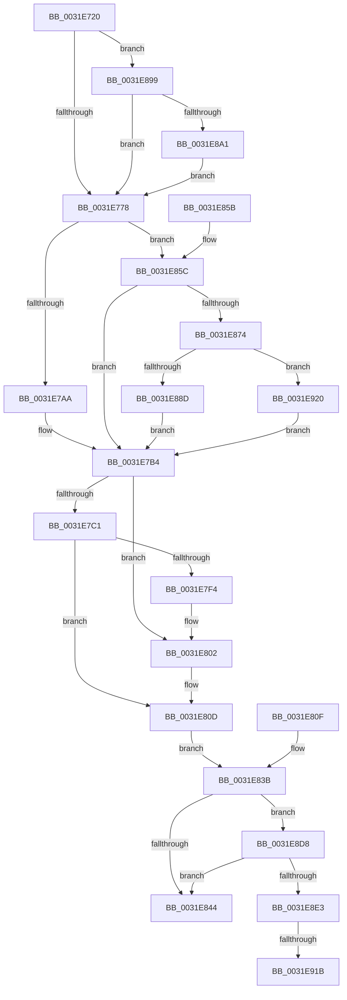

# MiTryZeroMemory

- RVA: `0x0031E720`–`0x0031E930` (길이 `528` bytes)
- VA: `0x000000014031E720`
- 실행 섹션: `.text`
- PDB 이름 있음: `예`; PDB Function 태그: `예`
- unwind 정보 RVA: `0x0007522C`
- 디코드: `115`개 명령, `528/528` bytes 표시
- 미해석 바이트: `0` (있으면 어셈블리에 `.byte`로 보존)

> 이 문서는 커널 이미지의 기계어와 PDB 기호를 분석해 생성했습니다. 4번과 5번은 함수 원형과 자료형을 바이너리 사용 방식에서 추정한 C 해석이며 원본 소스 복구 결과는 아닙니다.

## 1. Dependencies

- 직접 호출 지점: **6**; 고유 호출 대상: **5**
- 직접 호출자로 확인된 함수: **1**
- RIP 상대 이미지 참조: **3**

### Outgoing calls
- `0x0031E7EB` → [AccelFillMemory](../2C/AccelFillMemory_function_002C7C7C.md) (function, `0x002C7C7C`)
- `0x0031E808` → [KeZeroPages](../6B/KeZeroPages_function_006BA070.md) (function, `0x006BA070`)
- `0x0031E874` → [MiAllocateHardwareDescriptor](../4B/MiAllocateHardwareDescriptor_function_004B8738.md) (function, `0x004B8738`)
- `0x0031E8A4` → [MiGetZeroingContext](../43/MiGetZeroingContext_function_00434FB0.md) (function, `0x00434FB0`)
- `0x0031E8EB` → [MiZeroVaToActiveEntry](../43/MiZeroVaToActiveEntry_function_00434F28.md) (function, `0x00434F28`)
- `0x0031E8F6` → [MiGetZeroingContext](../43/MiGetZeroingContext_function_00434FB0.md) (function, `0x00434FB0`)

### Direct callers
- [MiBackgroundZeroLocalPages](MiBackgroundZeroLocalPages_function_0031EF30.md) at `0x0031F35E`

### Static image references
- `0x0031E763` → RVA `0x00011C60` (`.rdata`; read)
- `0x0031E7F4` → RVA `0x00EF508C` (`.data`; read)
- `0x0031E7FC` → RVA `0x00EF508C` (`.data`; write)

## 2. Other-region calls and transfers

- 다른 실행 섹션으로 향하는 call: **0**
- call이 아닌 외부 분기/꼬리 이동: **2**
  - `0x0031E915` → [sub_006E1734](../6E/Unknown_function_006E1734.md) (`tail-transfer`)
  - `0x0031E91B` → [sub_006E1734 + 0x27](../6E/Unknown_function_006E1734.md) (`tail-transfer`)

## 3. Assembly (complete function range)

```asm
0031E720  48 89 4C 24 08                  mov qword ptr [rsp + 8], rcx
0031E725  53                              push rbx
0031E726  56                              push rsi
0031E727  57                              push rdi
0031E728  41 54                           push r12
0031E72A  41 55                           push r13
0031E72C  41 56                           push r14
0031E72E  41 57                           push r15
0031E730  48 83 EC 60                     sub rsp, 0x60
0031E734  48 8B F9                        mov rdi, rcx
0031E737  48 C7 44 24 38 00 00 00 00      mov qword ptr [rsp + 0x38], 0
0031E740  C7 84 24 A8 00 00 00 00 00 00 00  mov dword ptr [rsp + 0xa8], 0
0031E74B  4C 8B E9                        mov r13, rcx
0031E74E  4C 8B B9 28 01 00 00            mov r15, qword ptr [rcx + 0x128]
0031E755  4C 89 BC 24 B8 00 00 00         mov qword ptr [rsp + 0xb8], r15
0031E75D  8B 91 40 01 00 00               mov edx, dword ptr [rcx + 0x140]
0031E763  48 8D 0D F6 34 CF FF            lea rcx, [rip - 0x30cb0a]
0031E76A  48 8B 0C D1                     mov rcx, qword ptr [rcx + rdx*8]
0031E76E  48 83 F9 01                     cmp rcx, 1
0031E772  0F 85 21 01 00 00               jne 0x14031e899
0031E778  4C 89 6C 24 48                  mov qword ptr [rsp + 0x48], r13
0031E77D  4D 8D A5 18 01 00 00            lea r12, [r13 + 0x118]
0031E784  4C 89 64 24 50                  mov qword ptr [rsp + 0x50], r12
0031E789  41 8B 1C 24                     mov ebx, dword ptr [r12]
0031E78D  48 0F AF D9                     imul rbx, rcx
0031E791  48 C1 E3 0C                     shl rbx, 0xc
0031E795  48 89 5C 24 40                  mov qword ptr [rsp + 0x40], rbx
0031E79A  48 8B 8F 50 01 00 00            mov rcx, qword ptr [rdi + 0x150]
0031E7A1  83 39 00                        cmp dword ptr [rcx], 0
0031E7A4  0F 84 B2 00 00 00               je 0x14031e85c
0031E7AA  33 F6                           xor esi, esi
0031E7AC  48 89 B4 24 B0 00 00 00         mov qword ptr [rsp + 0xb0], rsi
0031E7B4  45 33 F6                        xor r14d, r14d
0031E7B7  44 89 74 24 34                  mov dword ptr [rsp + 0x34], r14d
0031E7BC  48 85 F6                        test rsi, rsi
0031E7BF  74 41                           je 0x14031e802
0031E7C1  44 89 74 24 30                  mov dword ptr [rsp + 0x30], r14d
0031E7C6  C7 44 24 30 01 00 00 00         mov dword ptr [rsp + 0x30], 1
0031E7CE  C7 44 24 30 03 00 00 00         mov dword ptr [rsp + 0x30], 3
0031E7D6  48 C7 44 24 20 03 00 00 00      mov qword ptr [rsp + 0x20], 3
0031E7DF  45 33 C9                        xor r9d, r9d
0031E7E2  4C 8B C3                        mov r8, rbx
0031E7E5  49 8B D7                        mov rdx, r15
0031E7E8  48 8B CE                        mov rcx, rsi
0031E7EB  E8 8C 94 FA FF                  call 0x1402c7c7c
0031E7F0  85 C0                           test eax, eax
0031E7F2  79 19                           jns 0x14031e80d
0031E7F4  8B 05 92 68 BD 00               mov eax, dword ptr [rip + 0xbd6892]
0031E7FA  FF C0                           inc eax
0031E7FC  89 05 8A 68 BD 00               mov dword ptr [rip + 0xbd688a], eax
0031E802  48 8B D3                        mov rdx, rbx
0031E805  49 8B CF                        mov rcx, r15
0031E808  E8 63 B8 39 00                  call 0x1406ba070
0031E80D  EB 2C                           jmp 0x14031e83b
0031E80F  48 8B BC 24 A0 00 00 00         mov rdi, qword ptr [rsp + 0xa0]
0031E817  4C 8B BC 24 B8 00 00 00         mov r15, qword ptr [rsp + 0xb8]
0031E81F  44 8B 74 24 34                  mov r14d, dword ptr [rsp + 0x34]
0031E824  48 8B B4 24 B0 00 00 00         mov rsi, qword ptr [rsp + 0xb0]
0031E82C  48 8B 5C 24 40                  mov rbx, qword ptr [rsp + 0x40]
0031E831  4C 8B 6C 24 48                  mov r13, qword ptr [rsp + 0x48]
0031E836  4C 8B 64 24 50                  mov r12, qword ptr [rsp + 0x50]
0031E83B  45 85 F6                        test r14d, r14d
0031E83E  0F 88 94 00 00 00               js 0x14031e8d8
0031E844  8B 84 24 A8 00 00 00            mov eax, dword ptr [rsp + 0xa8]
0031E84B  48 83 C4 60                     add rsp, 0x60
0031E84F  41 5F                           pop r15
0031E851  41 5E                           pop r14
0031E853  41 5D                           pop r13
0031E855  41 5C                           pop r12
0031E857  5F                              pop rdi
0031E858  5E                              pop rsi
0031E859  5B                              pop rbx
0031E85A  C3                              ret
0031E85B  CC                              int3
0031E85C  48 8B B7 A8 02 00 00            mov rsi, qword ptr [rdi + 0x2a8]
0031E863  48 89 B4 24 B0 00 00 00         mov qword ptr [rsp + 0xb0], rsi
0031E86B  48 85 F6                        test rsi, rsi
0031E86E  0F 85 40 FF FF FF               jne 0x14031e7b4
0031E874  E8 BF 9E 19 00                  call 0x1404b8738
0031E879  48 8B F0                        mov rsi, rax
0031E87C  48 89 84 24 B0 00 00 00         mov qword ptr [rsp + 0xb0], rax
0031E884  48 85 C0                        test rax, rax
0031E887  0F 84 93 00 00 00               je 0x14031e920
0031E88D  48 89 87 A8 02 00 00            mov qword ptr [rdi + 0x2a8], rax
0031E894  E9 1B FF FF FF                  jmp 0x14031e7b4
0031E899  85 D2                           test edx, edx
0031E89B  0F 85 D7 FE FF FF               jne 0x14031e778
0031E8A1  48 8B CF                        mov rcx, rdi
0031E8A4  E8 07 67 11 00                  call 0x140434fb0
0031E8A9  4C 8B E8                        mov r13, rax
0031E8AC  48 8B 8F 48 02 00 00            mov rcx, qword ptr [rdi + 0x248]
0031E8B3  44 0F B7 BF 40 02 00 00         movzx r15d, word ptr [rdi + 0x240]
0031E8BB  49 C1 E7 15                     shl r15, 0x15
0031E8BF  4C 03 B9 30 02 00 00            add r15, qword ptr [rcx + 0x230]
0031E8C6  4C 89 BC 24 B8 00 00 00         mov qword ptr [rsp + 0xb8], r15
0031E8CE  B9 00 02 00 00                  mov ecx, 0x200
0031E8D3  E9 A0 FE FF FF                  jmp 0x14031e778
0031E8D8  41 83 3C 24 01                  cmp dword ptr [r12], 1
0031E8DD  0F 84 61 FF FF FF               je 0x14031e844
0031E8E3  48 8B 54 24 38                  mov rdx, qword ptr [rsp + 0x38]
0031E8E8  48 8B CF                        mov rcx, rdi
0031E8EB  E8 38 66 11 00                  call 0x140434f28
0031E8F0  48 8B D0                        mov rdx, rax
0031E8F3  48 8B CF                        mov rcx, rdi
0031E8F6  E8 B5 66 11 00                  call 0x140434fb0
0031E8FB  8B 88 40 01 00 00               mov ecx, dword ptr [rax + 0x140]
0031E901  48 8D 05 58 33 CF FF            lea rax, [rip - 0x30cca8]
0031E908  4C 8B 04 C8                     mov r8, qword ptr [rax + rcx*8]
0031E90C  45 33 C9                        xor r9d, r9d
0031E90F  48 8B 0A                        mov rcx, qword ptr [rdx]
0031E912  F6 C1 01                        test cl, 1
0031E915  0F 85 19 2E 3C 00               jne 0x1406e1734
0031E91B  E9 3B 2E 3C 00                  jmp 0x1406e175b
0031E920  C7 84 24 A8 00 00 00 01 00 00 00  mov dword ptr [rsp + 0xa8], 1
0031E92B  E9 84 FE FF FF                  jmp 0x14031e7b4
```

## 4. C-style interpretation (structured pseudocode)

```c
__int64 __fastcall MiTryZeroMemory(__int64 a1, __int64 a2, __int64 a3, int a4)
{
    __int64 result;
    __int64 v_r14;
    __int64 v_r15;
    __int64 v_rbx;
    __int64 v_rsi;
    __int64 v_rsp;
    unsigned __int64 v_stack_m48;
    unsigned __int64 v_stack_m50;
    unsigned __int64 v_stack_m58;
    unsigned __int64 v_stack_m60;
    unsigned int v_stack_m64;
    unsigned int v_stack_m68;
    unsigned __int64 v_stack_m78;
    unsigned int v_stack_p10;
    unsigned __int64 v_stack_p18;
    unsigned __int64 v_stack_p20;
    unsigned __int64 v_stack_p38;
    unsigned __int64 v_stack_p8;
    unsigned int v_stack_pA8;
    unsigned __int64 v_stack_pB0;
    unsigned __int64 v_stack_pB8;

    v_stack_p8 = a1;
    v_rsp = (v_rsp) - (96);
    v_stack_m60 = 0;
    v_stack_p10 = 0;
    v_stack_p20 = *(unsigned __int64 *)(a1 + 296);
    if ((*(unsigned __int64 *)(v_rip - 3197706 + (unsigned int)(*(unsigned int *)(a1 + 320)) * 8)) != 1) goto loc_0031E899;
loc_0031E778:
    v_stack_m50 = a1;
    v_stack_m48 = a1 + 280;
    v_rbx = ((unsigned int)(*(unsigned int *)(a1 + 280))) * (*(unsigned __int64 *)(v_rip - 3197706 + (unsigned int)(*(unsigned int *)(a1 + 320)) * 8));
    v_rbx = (v_rbx) << (12);
    v_stack_m58 = v_rbx;
    if ((*(unsigned int *)(*(unsigned __int64 *)(a1 + 336))) == 0) goto loc_0031E85C;
    v_rsi = 0;
    v_stack_p18 = 0;
loc_0031E7B4:
    v_r14 = 0;
    v_stack_m64 = 0;
    if (0 == 0) goto loc_0031E802;
    v_stack_m68 = 0;
    v_stack_m68 = 1;
    v_stack_m68 = 3;
    v_stack_m78 = 3;
    a4 = 0;
    result = AccelFillMemory(0, *(unsigned __int64 *)(a1 + 296), v_rbx, a4);
    if (!sign_flag) goto loc_0031E80D;
    result = (unsigned int)(((unsigned int)(*(unsigned int *)(v_rip + 12413074))) + 1);
    *(unsigned int *)(v_rip + 12413066) = (unsigned int)(result);
loc_0031E802:
    result = KeZeroPages(*(unsigned __int64 *)(a1 + 296), v_rbx, v_rbx, a4);
loc_0031E80D:
    goto loc_0031E83B;
loc_0031E83B:
    if (sign_flag) goto loc_0031E8D8;
loc_0031E844:
    v_rsp = (v_rsp) + (96);
    return (unsigned int)(v_stack_p10);
loc_0031E85C:
    v_stack_pB0 = *(unsigned __int64 *)(a1 + 680);
    if (*(unsigned __int64 *)(a1 + 680) != 0) goto loc_0031E7B4;
    result = MiAllocateHardwareDescriptor(*(unsigned __int64 *)(a1 + 296), v_rbx, v_rbx, a4);
    v_stack_pB0 = result;
    if (result == 0) goto loc_0031E920;
    *(unsigned __int64 *)(a1 + 680) = result;
    goto loc_0031E7B4;
loc_0031E899:
    if ((unsigned int)(v_rbx) != 0) goto loc_0031E778;
    result = MiGetZeroingContext(a1, v_rbx, v_rbx, a4);
    v_r15 = (*(unsigned __int16 *)(a1 + 576)) << (21);
    v_r15 = (v_r15) + (*(unsigned __int64 *)(*(unsigned __int64 *)(a1 + 584) + 560));
    v_stack_pB8 = v_r15;
    goto loc_0031E778;
loc_0031E8D8:
    if ((*(unsigned int *)(a1 + 280)) == 1) goto loc_0031E844;
    result = MiZeroVaToActiveEntry(a1, v_stack_p38, v_rbx, a4);
    result = MiGetZeroingContext(a1, result, v_rbx, a4);
    a4 = 0;
loc_0031E920:
    v_stack_pA8 = 1;
    goto loc_0031E7B4;
}
```

## 5. (Beta) C Style

```c
int64_t MiTryZeroMemory(void *Arg1, int64_t Arg2, int64_t Arg3, int32_t Arg4)
{
    uint8_t *arg1 = (uint8_t *)Arg1;

    int64_t result;
    int64_t local_r14;
    int64_t local_r15;
    int64_t local_rbx;
    int64_t local_rsi;
    int64_t local_rsp;
    uint64_t v_stack_m48;
    uint64_t v_stack_m50;
    uint64_t v_stack_m58;
    uint64_t v_stack_m60;
    uint32_t v_stack_m64;
    uint32_t v_stack_m68;
    uint64_t v_stack_m78;
    uint32_t v_stack_p10;
    uint64_t v_stack_p18;
    uint64_t v_stack_p20;
    uint64_t v_stack_p38;
    uint64_t v_stack_p8;
    uint32_t v_stack_pA8;
    uint64_t v_stack_pB0;
    uint64_t v_stack_pB8;

    v_stack_p8 = Arg1;
    local_rsp = (local_rsp) - (96);
    v_stack_m60 = 0;
    v_stack_p10 = 0;
    v_stack_p20 = *(uint64_t *)(arg1 + 0x128);
    if ((*(uint64_t *)(v_rip - 0x30CB0A + (uint32_t)(*(uint32_t *)(arg1 + 0x140)) * 8)) != 1) goto loc_0031E899;
loc_0031E778:
    v_stack_m50 = Arg1;
    v_stack_m48 = Arg1 + 280;
    local_rbx = ((uint32_t)(*(uint32_t *)(arg1 + 0x118))) * (*(uint64_t *)(v_rip - 0x30CB0A + (uint32_t)(*(uint32_t *)(arg1 + 0x140)) * 8));
    local_rbx = (local_rbx) << (12);
    v_stack_m58 = local_rbx;
    if ((*(uint32_t *)(*(uint64_t *)(arg1 + 0x150))) == 0) goto loc_0031E85C;
    local_rsi = 0;
    v_stack_p18 = 0;
loc_0031E7B4:
    local_r14 = 0;
    v_stack_m64 = 0;
    if (0 == 0) goto loc_0031E802;
    v_stack_m68 = 0;
    v_stack_m68 = 1;
    v_stack_m68 = 3;
    v_stack_m78 = 3;
    Arg4 = 0;
    result = AccelFillMemory(0, *(uint64_t *)(arg1 + 0x128), local_rbx, Arg4);
    if (!sign_flag) goto loc_0031E80D;
    result = (uint32_t)(((uint32_t)(*(uint32_t *)(v_rip + 0xBD6892))) + 1);
    *(uint32_t *)(v_rip + 0xBD688A) = (uint32_t)(result);
loc_0031E802:
    result = KeZeroPages(*(uint64_t *)(arg1 + 0x128), local_rbx, local_rbx, Arg4);
loc_0031E80D:
    goto loc_0031E83B;
loc_0031E83B:
    if (sign_flag) goto loc_0031E8D8;
loc_0031E844:
    local_rsp = (local_rsp) + (96);
    return (uint32_t)(v_stack_p10);
loc_0031E85C:
    v_stack_pB0 = *(uint64_t *)(arg1 + 0x2A8);
    if (*(uint64_t *)(arg1 + 0x2A8) != 0) goto loc_0031E7B4;
    result = MiAllocateHardwareDescriptor(*(uint64_t *)(arg1 + 0x128), local_rbx, local_rbx, Arg4);
    v_stack_pB0 = result;
    if (result == 0) goto loc_0031E920;
    *(uint64_t *)(arg1 + 0x2A8) = result;
    goto loc_0031E7B4;
loc_0031E899:
    if ((uint32_t)(local_rbx) != 0) goto loc_0031E778;
    result = MiGetZeroingContext(Arg1, local_rbx, local_rbx, Arg4);
    local_r15 = (*(uint16_t *)(arg1 + 0x240)) << (21);
    local_r15 = (local_r15) + (*(uint64_t *)(*(uint64_t *)(arg1 + 0x248) + 0x230));
    v_stack_pB8 = local_r15;
    goto loc_0031E778;
loc_0031E8D8:
    if ((*(uint32_t *)(arg1 + 0x118)) == 1) goto loc_0031E844;
    result = MiZeroVaToActiveEntry(Arg1, v_stack_p38, local_rbx, Arg4);
    result = MiGetZeroingContext(Arg1, result, local_rbx, Arg4);
    Arg4 = 0;
loc_0031E920:
    v_stack_pA8 = 1;
    goto loc_0031E7B4;
}
```

### 관측된 메모리 오프셋

구조체 형식이 확인되지 않은 접근은 인자 기준의 오프셋으로만 기록했습니다.

| 기준 인자 | 오프셋 표현 | 폭 (bit) | 접근 |
|---|---:|---:|---|
| `Arg1` | `+ 0x128` | `64` | `R` |
| `Arg1` | `+ 0x140` | `32` | `R` |
| `Arg1` | `+ 0x150` | `64` | `R` |
| `Arg1` | `+ 0x240` | `16` | `R` |
| `Arg1` | `+ 0x248` | `64` | `R` |
| `Arg1` | `+ 0x2A8` | `64` | `R` |
| `Arg1` | `+ 0x2A8` | `64` | `W` |

## 6. Execution-region graph

[열기: 2D/3D 그래프와 함수 탐색 컨트롤 패널](../../../control-panel.html?section=text&rva=0x0031E720&view=graph)

- 2D 그래프는 위에서 아래로 흐르고, 3D 그래프는 빈 공간을 드래그해 회전합니다. Shift+드래그는 이동, 휠은 확대·축소, 함수 노드 선택은 대상 보고서 이동입니다.

### Static fallback


