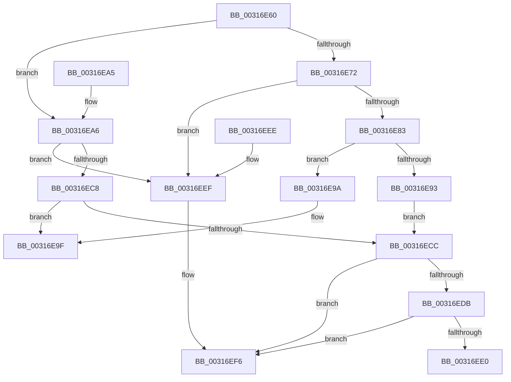

# MiUnlockAndDereferenceVad

- RVA: `0x00316E60`–`0x00316F13` (길이 `179` bytes)
- VA: `0x0000000140316E60`
- 실행 섹션: `.text`
- PDB 이름 있음: `예`; PDB Function 태그: `아니요`
- unwind 정보 RVA: `0x0006D490`
- 디코드: `52`개 명령, `179/179` bytes 표시
- 미해석 바이트: `0` (있으면 어셈블리에 `.byte`로 보존)

> 이 문서는 커널 이미지의 기계어와 PDB 기호를 분석해 생성했습니다. 4번과 5번은 함수 원형과 자료형을 바이너리 사용 방식에서 추정한 C 해석이며 원본 소스 복구 결과는 아닙니다.

## 1. Dependencies

- 직접 호출 지점: **6**; 고유 호출 대상: **4**
- 직접 호출자로 확인된 함수: **49**
- RIP 상대 이미지 참조: **0**

### Outgoing calls
- `0x00316E69` → [Feature_2429262139__private_IsEnabledNoReportingNoInline](../66/Feature_2429262139__private_IsEnabledNoReportingNoInline_function_0066E0A8.md) (function, `0x0066E0A8`)
- `0x00316E93` → [MiUnlockVad](../2A/MiUnlockVad_function_002A59C8.md) (function, `0x002A59C8`)
- `0x00316E9A` → [MiUnlockVad](../2A/MiUnlockVad_function_002A59C8.md) (function, `0x002A59C8`)
- `0x00316EB2` → [MiUnlockVad](../2A/MiUnlockVad_function_002A59C8.md) (function, `0x002A59C8`)
- `0x00316EE3` → [ExFreeHeapPool](../35/ExFreeHeapPool_function_0035FAE0.md) (function, `0x0035FAE0`)
- `0x00316F0D` → [KeBugCheckEx](../4F/KeBugCheckEx_function_004FD660.md) (function, `0x004FD660`)

### Direct callers
- [MiProbeAndLockPages](../23/MiProbeAndLockPages_function_0023B4F0.md) at `0x0023B7B7`
- [MmProbeAndLockPages](../23/MmProbeAndLockPages_function_0023B990.md) at `0x0023BAFC`
- [MiProbeAndLockPrepare](../23/MiProbeAndLockPrepare_function_0023BB40.md) at `0x0023BDED`
- [MiObtainReferencedSecureVad](../29/MiObtainReferencedSecureVad_function_00295688.md) at `0x00295782`
- [MiObtainReferencedSecureVad](../29/MiObtainReferencedSecureVad_function_00295688.md) at `0x002957E9`
- [NtGetWriteWatch](../2A/NtGetWriteWatch_function_002A7CE0.md) at `0x002A817D`
- [MiReturnLockedVadOrNextVa](MiReturnLockedVadOrNextVa_function_00316980.md) at `0x00316CEE`
- [MiDeprioritizeVad](../42/MiDeprioritizeVad_function_0042AAB4.md) at `0x0042AB8B`
- [MiFinishVadDeletion](../43/MiFinishVadDeletion_function_00430ED0.md) at `0x0043101D`
- [MmUpdateUserShadowStackValue](../49/MmUpdateUserShadowStackValue_function_004935D8.md) at `0x004937B7`
- [MiCheckLockUnlockByVa](../67/MiCheckLockUnlockByVa_function_00673D7C.md) at `0x00673DCF`
- [sub_006D799A](../6D/Unknown_function_006D799A.md) at `0x006D799D`
- [sub_006E13DC](../6E/Unknown_function_006E13DC.md) at `0x006E13E7`
- [sub_006E13DC](../6E/Unknown_function_006E13DC.md) at `0x006E140B`
- [MmSetGraphicsPtes](../../page/7F/MmSetGraphicsPtes_function_007FC8B0.md) at `0x007FCAB6`
- [MmAdjustSecuredVirtualMemorySize](../../page/7F/MmAdjustSecuredVirtualMemorySize_function_007FE7E8.md) at `0x007FE88A`
- [MiApplyImageHotPatchRequest](../../page/80/MiApplyImageHotPatchRequest_function_008025AC.md) at `0x00802A4A`
- [MiApplyImageHotPatchRequest](../../page/80/MiApplyImageHotPatchRequest_function_008025AC.md) at `0x00802A74`
- [MiCreatePatchSectionRequest](../../page/80/MiCreatePatchSectionRequest_function_008031E0.md) at `0x008032FC`
- [MiGetVadForHotPatchInProgress](../../page/80/MiGetVadForHotPatchInProgress_function_008039C4.md) at `0x00803A81`
- [MmCommitHotPatchTable](../../page/80/MmCommitHotPatchTable_function_00807278.md) at `0x00807340`
- [MmPrepareImagePagesForHotPatch](../../page/80/MmPrepareImagePagesForHotPatch_function_008074E8.md) at `0x008075DA`
- [MiCreateEnclave](../../page/80/MiCreateEnclave_function_008083E4.md) at `0x008084D4`
- [MiInitializeEnclave](../../page/80/MiInitializeEnclave_function_008089D8.md) at `0x00808ABC`
- [NtTerminateEnclave](../../page/80/NtTerminateEnclave_function_00809320.md) at `0x008093AF`
- [MiScrubProcessLargePage](../../page/80/MiScrubProcessLargePage_function_0080EE70.md) at `0x0080EF79`
- [MiLockVadRange](../../page/87/MiLockVadRange_function_0087F670.md) at `0x0087F8EC`
- [MiFreeToSubAllocatedRegion](../../page/87/MiFreeToSubAllocatedRegion_function_0087FB7C.md) at `0x0087FCC9`
- [MiFreeVirtualMemory](../../page/88/MiFreeVirtualMemory_function_00880268.md) at `0x0088040A`
- [MiFreeVirtualMemory](../../page/88/MiFreeVirtualMemory_function_00880268.md) at `0x00880518`
- [MmProtectVirtualMemory](../../page/88/MmProtectVirtualMemory_function_00881050.md) at `0x0088136A`
- [MmProtectVirtualMemory](../../page/88/MmProtectVirtualMemory_function_00881050.md) at `0x008813DB`
- [MmProtectVirtualMemory](../../page/88/MmProtectVirtualMemory_function_00881050.md) at `0x0088178C`
- [MmProtectVirtualMemory](../../page/88/MmProtectVirtualMemory_function_00881050.md) at `0x00881852`
- [MmProtectVirtualMemory](../../page/88/MmProtectVirtualMemory_function_00881050.md) at `0x00881961`
- [MiAllocateVirtualMemory](../../page/88/MiAllocateVirtualMemory_function_00883B40.md) at `0x00883DF4`
- [MiAllocateVirtualMemory](../../page/88/MiAllocateVirtualMemory_function_00883B40.md) at `0x00883F08`
- [MiAllocateVirtualMemory](../../page/88/MiAllocateVirtualMemory_function_00883B40.md) at `0x00883F40`
- [MiAllocateVirtualMemory](../../page/88/MiAllocateVirtualMemory_function_00883B40.md) at `0x008840C1`
- [MiReserveUserMemory](../../page/88/MiReserveUserMemory_function_00884498.md) at `0x008849E6`
- [sub_0088535F](../../page/88/Unknown_function_0088535F.md) at `0x008855FA`
- [MiCleanVad](../../page/88/MiCleanVad_function_00889224.md) at `0x0088926C`
- [MmUnsecureVirtualMemory](../../page/88/MmUnsecureVirtualMemory_function_0088A2A0.md) at `0x0088A2EC`
- [MiUnmapViewOfSection](../../page/88/MiUnmapViewOfSection_function_0088A4C4.md) at `0x0088A7AA`
- [MmSecureVirtualMemoryAgainstWrites](../../page/89/MmSecureVirtualMemoryAgainstWrites_function_00890164.md) at `0x008902FA`
- [MiCommitInitialVadMetadataBits](../../page/8D/MiCommitInitialVadMetadataBits_function_008D09CC.md) at `0x008D0A85`
- [MiMapLockedPagesInUserSpace](../../page/97/MiMapLockedPagesInUserSpace_function_0097FE04.md) at `0x0098017C`
- [MiAllocateFromSubAllocatedRegion](../../page/98/MiAllocateFromSubAllocatedRegion_function_00981C24.md) at `0x00981DDB`
- [MiAllocateFromSubAllocatedRegion](../../page/98/MiAllocateFromSubAllocatedRegion_function_00981C24.md) at `0x00981E77`
- [MiProcessVaRangesInfoClass](../../page/9F/MiProcessVaRangesInfoClass_function_009F4E50.md) at `0x009F4F3C`
- [MiCfgMarkValidEntries](../../page/9F/MiCfgMarkValidEntries_function_009F4FE8.md) at `0x009F51AB`
- [MmSecureVirtualMemoryEx](../../page/9F/MmSecureVirtualMemoryEx_function_009F5620.md) at `0x009F5734`
- [MmSecureVirtualMemoryEx](../../page/9F/MmSecureVirtualMemoryEx_function_009F5620.md) at `0x009F5779`
- [MmRotatePhysicalView](../../page/A3/MmRotatePhysicalView_function_00A37FE0.md) at `0x00A38101`
- [MmRotatePhysicalView](../../page/A3/MmRotatePhysicalView_function_00A37FE0.md) at `0x00A38144`
- [MmRotatePhysicalView](../../page/A3/MmRotatePhysicalView_function_00A37FE0.md) at `0x00A3818D`
- [MiQuerySingleLoadedPatch](../../page/A4/MiQuerySingleLoadedPatch_function_00A41EB0.md) at `0x00A41F52`
- [MiQuerySingleLoadedPatch](../../page/A4/MiQuerySingleLoadedPatch_function_00A41EB0.md) at `0x00A4202E`
- [NtResetWriteWatch](../../page/A4/NtResetWriteWatch_function_00A48F60.md) at `0x00A4906F`
- [MmSelectVsmEnclaveByAddress](../../page/A6/MmSelectVsmEnclaveByAddress_function_00A600B4.md) at `0x00A60130`
- [MmStoreAllocateVirtualMemory](../../page/A6/MmStoreAllocateVirtualMemory_function_00A68238.md) at `0x00A683AF`
- [MmStoreAllocateVirtualMemory](../../page/A6/MmStoreAllocateVirtualMemory_function_00A68238.md) at `0x00A68410`
- [MiUnmapLockedPagesInUserSpace](../../page/A7/MiUnmapLockedPagesInUserSpace_function_00A78E54.md) at `0x00A78FD9`
- [MiLoadSectionIntoVsmEnclave](../../page/AB/MiLoadSectionIntoVsmEnclave_function_00AB1D4C.md) at `0x00AB1DC8`
- [NtLoadEnclaveData](../../page/AF/NtLoadEnclaveData_function_00AF8DF0.md) at `0x00AF92A4`
- [MiDeleteAllHardwareEnclaves](../../pagelk/B7/MiDeleteAllHardwareEnclaves_function_00B74CAC.md) at `0x00B74E05`

### Static image references
- 디코드된 RIP-relative 메모리 참조가 없습니다.

## 2. Other-region calls and transfers

- 다른 실행 섹션으로 향하는 call: **0**
- 별도 외부 분기/꼬리 이동을 확인하지 못했습니다.

## 3. Assembly (complete function range)

```asm
00316E60  40 53                           push rbx
00316E62  48 83 EC 30                     sub rsp, 0x30
00316E66  48 8B D9                        mov rbx, rcx
00316E69  E8 3A 72 35 00                  call 0x14066e0a8
00316E6E  85 C0                           test eax, eax
00316E70  75 34                           jne 0x140316ea6
00316E72  B8 FF FF FF FF                  mov eax, 0xffffffff
00316E77  F0 0F C1 43 24                  lock xadd dword ptr [rbx + 0x24], eax
00316E7C  FF C8                           dec eax
00316E7E  83 F8 FF                        cmp eax, -1
00316E81  74 6C                           je 0x140316eef
00316E83  65 48 8B 0C 25 88 01 00 00      mov rcx, qword ptr gs:[0x188]
00316E8C  48 8B D3                        mov rdx, rbx
00316E8F  85 C0                           test eax, eax
00316E91  75 07                           jne 0x140316e9a
00316E93  E8 30 EB F8 FF                  call 0x1402a59c8
00316E98  EB 32                           jmp 0x140316ecc
00316E9A  E8 29 EB F8 FF                  call 0x1402a59c8
00316E9F  48 83 C4 30                     add rsp, 0x30
00316EA3  5B                              pop rbx
00316EA4  C3                              ret
00316EA5  CC                              int3
00316EA6  65 48 8B 0C 25 88 01 00 00      mov rcx, qword ptr gs:[0x188]
00316EAF  48 8B D3                        mov rdx, rbx
00316EB2  E8 11 EB F8 FF                  call 0x1402a59c8
00316EB7  B8 FF FF FF FF                  mov eax, 0xffffffff
00316EBC  F0 0F C1 43 24                  lock xadd dword ptr [rbx + 0x24], eax
00316EC1  FF C8                           dec eax
00316EC3  83 F8 FF                        cmp eax, -1
00316EC6  74 27                           je 0x140316eef
00316EC8  85 C0                           test eax, eax
00316ECA  75 D3                           jne 0x140316e9f
00316ECC  48 B8 00 00 00 00 00 80 FF FF   movabs rax, 0xffff800000000000
00316ED6  48 3B D8                        cmp rbx, rax
00316ED9  72 1B                           jb 0x140316ef6
00316EDB  F6 C3 0F                        test bl, 0xf
00316EDE  75 16                           jne 0x140316ef6
00316EE0  48 8B CB                        mov rcx, rbx
00316EE3  E8 F8 8B 04 00                  call 0x14035fae0
00316EE8  48 83 C4 30                     add rsp, 0x30
00316EEC  5B                              pop rbx
00316EED  C3                              ret
00316EEE  CC                              int3
00316EEF  B9 0E 00 00 00                  mov ecx, 0xe
00316EF4  CD 29                           int 0x29
00316EF6  BA 99 00 00 00                  mov edx, 0x99
00316EFB  48 C7 44 24 20 00 00 00 00      mov qword ptr [rsp + 0x20], 0
00316F04  45 33 C9                        xor r9d, r9d
00316F07  4C 8B C3                        mov r8, rbx
00316F0A  8D 4A 29                        lea ecx, [rdx + 0x29]
00316F0D  E8 4E 67 1E 00                  call 0x1404fd660
00316F12  CC                              int3
```

## 4. C-style interpretation (structured pseudocode)

```c
__int64 __fastcall MiUnlockAndDereferenceVad(__int64 a1, __int64 a2, __int64 a3, int a4)
{
    __int64 result;
    __int64 v_rsp;
    unsigned __int64 v_stack_p58;

    v_rsp = (v_rsp) - (48);
    result = Feature_2429262139__private_IsEnabledNoReportingNoInline(a1, a2, a3, a4);
    if ((unsigned int)(result) != 0) goto loc_00316EA6;
    result = (unsigned int)(((unsigned int)(0xFFFFFFFFULL)) - 1);
    if (((unsigned int)(result)) == -1) goto loc_00316EEF;
    if ((unsigned int)(result) != 0) goto loc_00316E9A;
    result = MiUnlockVad(*(unsigned __int64 *)(gs_base + (0 + 392)), a1, a3, a4);
    goto loc_00316ECC;
loc_00316E9A:
    result = MiUnlockVad(*(unsigned __int64 *)(gs_base + (0 + 392)), a1, a3, a4);
loc_00316E9F:
    v_rsp = (v_rsp) + (48);
    return result;
loc_00316EA6:
    result = MiUnlockVad(*(unsigned __int64 *)(gs_base + (0 + 392)), a1, a3, a4);
    result = (unsigned int)(((unsigned int)(0xFFFFFFFFULL)) - 1);
    if (((unsigned int)(result)) == -1) goto loc_00316EEF;
    if ((unsigned int)(result) != 0) goto loc_00316E9F;
loc_00316ECC:
    if (a1 < result) goto loc_00316EF6;
    if ((((unsigned __int8)(a1)) & (15)) != 0) goto loc_00316EF6;
    result = ExFreeHeapPool(a1, a1, a3, a4);
    v_rsp = (v_rsp) + (48);
    return result;
loc_00316EEF:
loc_00316EF6:
    v_stack_p58 = 0;
    a4 = 0;
    result = KeBugCheckEx(153 + 41, 153, a1, a4);
    return result;
}
```

## 5. (Beta) C Style

```c
int64_t MiUnlockAndDereferenceVad(void *Arg1, int64_t Arg2, int64_t Arg3, int32_t Arg4)
{
    uint8_t *arg1 = (uint8_t *)Arg1;

    int64_t result;
    int64_t local_rsp;
    uint64_t v_stack_p58;

    local_rsp = (local_rsp) - (48);
    result = Feature_2429262139__private_IsEnabledNoReportingNoInline(Arg1, Arg2, Arg3, Arg4);
    if ((uint32_t)(result) != 0) goto loc_00316EA6;
    result = (uint32_t)(((uint32_t)(0xFFFFFFFFULL)) - 1);
    if (((uint32_t)(result)) == -1) goto loc_00316EEF;
    if ((uint32_t)(result) != 0) goto loc_00316E9A;
    result = MiUnlockVad(*(uint64_t *)(gs_base + (0 + 0x188)), Arg1, Arg3, Arg4);
    goto loc_00316ECC;
loc_00316E9A:
    result = MiUnlockVad(*(uint64_t *)(gs_base + (0 + 0x188)), Arg1, Arg3, Arg4);
loc_00316E9F:
    local_rsp = (local_rsp) + (48);
    return result;
loc_00316EA6:
    result = MiUnlockVad(*(uint64_t *)(gs_base + (0 + 0x188)), Arg1, Arg3, Arg4);
    result = (uint32_t)(((uint32_t)(0xFFFFFFFFULL)) - 1);
    if (((uint32_t)(result)) == -1) goto loc_00316EEF;
    if ((uint32_t)(result) != 0) goto loc_00316E9F;
loc_00316ECC:
    if (Arg1 < result) goto loc_00316EF6;
    if ((((uint8_t)(Arg1)) & (15)) != 0) goto loc_00316EF6;
    result = ExFreeHeapPool(Arg1, Arg1, Arg3, Arg4);
    local_rsp = (local_rsp) + (48);
    return result;
loc_00316EEF:
loc_00316EF6:
    v_stack_p58 = 0;
    Arg4 = 0;
    result = KeBugCheckEx(153 + 41, 153, Arg1, Arg4);
    return result;
}
```

### 관측된 메모리 오프셋

구조체 형식이 확인되지 않은 접근은 인자 기준의 오프셋으로만 기록했습니다.

| 기준 인자 | 오프셋 표현 | 폭 (bit) | 접근 |
|---|---:|---:|---|
| `Arg1` | `+ 0x24` | `32` | `R/W` |

## 6. Execution-region graph

[열기: 2D/3D 그래프와 함수 탐색 컨트롤 패널](../../../control-panel.html?section=text&rva=0x00316E60&view=graph)

- 2D 그래프는 위에서 아래로 흐르고, 3D 그래프는 빈 공간을 드래그해 회전합니다. Shift+드래그는 이동, 휠은 확대·축소, 함수 노드 선택은 대상 보고서 이동입니다.

### Static fallback


