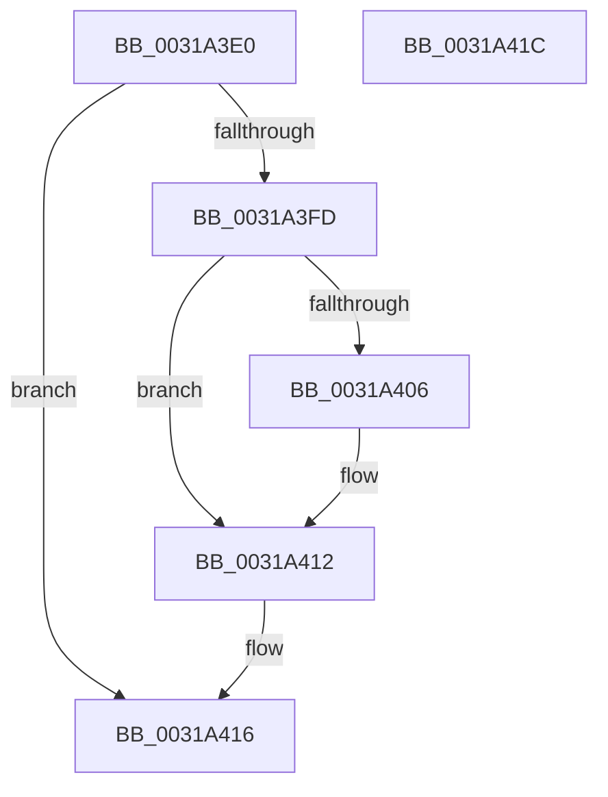

# MiUnlockPage

- RVA: `0x0031A3E0`–`0x0031A41D` (길이 `61` bytes)
- VA: `0x000000014031A3E0`
- 실행 섹션: `.text`
- PDB 이름 있음: `예`; PDB Function 태그: `아니요`
- unwind 정보 RVA: `0x0005CF00`
- 디코드: `17`개 명령, `61/61` bytes 표시
- 미해석 바이트: `0` (있으면 어셈블리에 `.byte`로 보존)

> 이 문서는 커널 이미지의 기계어와 PDB 기호를 분석해 생성했습니다. 4번과 5번은 함수 원형과 자료형을 바이너리 사용 방식에서 추정한 C 해석이며 원본 소스 복구 결과는 아닙니다.

## 1. Dependencies

- 직접 호출 지점: **1**; 고유 호출 대상: **1**
- 직접 호출자로 확인된 함수: **140**
- RIP 상대 이미지 참조: **1**

### Outgoing calls
- `0x0031A40D` → [KiLowerIrqlProcessIrqlFlags](../4F/KiLowerIrqlProcessIrqlFlags_function_004F5698.md) (function, `0x004F5698`)

### Direct callers
- [MiStoreModifiedWriteComplete](../20/MiStoreModifiedWriteComplete_function_002045E8.md) at `0x0020467B`
- [MiCopySinglePage](../22/MiCopySinglePage_function_00228FA4.md) at `0x00229110`
- [MiCopySinglePage](../22/MiCopySinglePage_function_00228FA4.md) at `0x00229175`
- [MiMapArbitraryPage](../22/MiMapArbitraryPage_function_0022A44C.md) at `0x0022A4EE`
- [sub_00285744](../28/Unknown_function_00285744.md) at `0x0028575F`
- [MiGetPerfectColorHeadPage](../28/MiGetPerfectColorHeadPage_function_00289CA8.md) at `0x00289E4D`
- [MiGetPerfectColorHeadPage](../28/MiGetPerfectColorHeadPage_function_00289CA8.md) at `0x0028A0DA`
- [MiTradeTransitionPage](../28/MiTradeTransitionPage_function_0028B9AC.md) at `0x0028BD07`
- [MiTradeTransitionPage](../28/MiTradeTransitionPage_function_0028B9AC.md) at `0x0028BD71`
- [MiFindContiguousPagesEx](../28/MiFindContiguousPagesEx_function_0028BDE0.md) at `0x0028C7E8`
- [MiFindContiguousPagesEx](../28/MiFindContiguousPagesEx_function_0028BDE0.md) at `0x0028C9BC`
- [MiTradePage](../28/MiTradePage_function_0028D160.md) at `0x0028D62C`
- [MiTradePage](../28/MiTradePage_function_0028D160.md) at `0x0028D6A1`
- [MiTradePage](../28/MiTradePage_function_0028D160.md) at `0x0028D7D0`
- [sub_0028E3BA](../28/Unknown_function_0028E3BA.md) at `0x0028E48F`
- [sub_0028E4EC](../28/Unknown_function_0028E4EC.md) at `0x0028E6E9`
- [sub_0028E4EC](../28/Unknown_function_0028E4EC.md) at `0x0028E6FE`
- [MiTrimSharedPage](../29/MiTrimSharedPage_function_00297D14.md) at `0x00297E0E`
- [MiTrimSharedPage](../29/MiTrimSharedPage_function_00297D14.md) at `0x00297F41`
- [MiTrimSharedPage](../29/MiTrimSharedPage_function_00297D14.md) at `0x00297F5C`
- [MiChangePageAttributeBatch](../2A/MiChangePageAttributeBatch_function_002A06E0.md) at `0x002A09ED`
- [MiFreeLargePages](../2A/MiFreeLargePages_function_002A99D0.md) at `0x002A9CC7`
- [MiFreePhysicalPageChain](../2A/MiFreePhysicalPageChain_function_002A9F1C.md) at `0x002AA17B`
- [MiGetSystemPage](../2A/MiGetSystemPage_function_002AB7E8.md) at `0x002AB895`
- [MiGetPageForHeader](../2A/MiGetPageForHeader_function_002AC120.md) at `0x002AC2A9`
- [sub_002B1D4E](../2B/Unknown_function_002B1D4E.md) at `0x002B1EF0`
- [MiLockStealUserVm](../2B/MiLockStealUserVm_function_002B3EDC.md) at `0x002B42CB`
- [MiLockStealUserVm](../2B/MiLockStealUserVm_function_002B3EDC.md) at `0x002B434C`
- [MiStoreWriteModifiedPages](../2B/MiStoreWriteModifiedPages_function_002B46C4.md) at `0x002B5054`
- [MiLockProtoPoolPage](../2B/MiLockProtoPoolPage_function_002B8B80.md) at `0x002B91C1`
- [MmAllocateNonChargedSecurePages](../2C/MmAllocateNonChargedSecurePages_function_002C886C.md) at `0x002C8AA4`
- [MiEmptyDecayClusterTimers](../2D/MiEmptyDecayClusterTimers_function_002DAB50.md) at `0x002DADDA`
- [MiCheckProtoPtePageState](MiCheckProtoPtePageState_function_003183E0.md) at `0x00318671`
- [MiCheckProtoPtePageState](MiCheckProtoPtePageState_function_003183E0.md) at `0x00318707`
- [MiFillSystemPtes](MiFillSystemPtes_function_00319850.md) at `0x00319C05`
- [MiPfnsWorthTrying](MiPfnsWorthTrying_function_0031B0C0.md) at `0x0031B3CE`
- [MmSetPfnListInfo](MmSetPfnListInfo_function_0031D61C.md) at `0x0031D7DF`
- [MmSetPfnListInfo](MmSetPfnListInfo_function_0031D61C.md) at `0x0031D819`
- [MmSetPfnListInfo](MmSetPfnListInfo_function_0031D61C.md) at `0x0031D915`
- [sub_0031EF0D](Unknown_function_0031EF0D.md) at `0x0031EF15`
- [sub_0031F9CC](Unknown_function_0031F9CC.md) at `0x0031FAA5`
- [MiLockProtoPoolPageForce](../32/MiLockProtoPoolPageForce_function_00320E10.md) at `0x003211F8`
- [MiUpdatePfnForPrefetchByPte](../32/MiUpdatePfnForPrefetchByPte_function_00321210.md) at `0x003213D2`
- [MiUpdatePfnForPrefetchByPte](../32/MiUpdatePfnForPrefetchByPte_function_00321210.md) at `0x003214E4`
- [MiUpdatePfnForPrefetchByPte](../32/MiUpdatePfnForPrefetchByPte_function_00321210.md) at `0x0032151F`
- [MiComputeCombineHash](../32/MiComputeCombineHash_function_003227C0.md) at `0x003228E0`
- [MiComputeCombineHash](../32/MiComputeCombineHash_function_003227C0.md) at `0x00322945`
- [MiInitializePfn](../33/MiInitializePfn_function_00331E60.md) at `0x00332575`
- [MiChangePageAttribute](../33/MiChangePageAttribute_function_00332ECC.md) at `0x00333244`
- [MiAddKernelStackToPrcbCache](../33/MiAddKernelStackToPrcbCache_function_00338710.md) at `0x00338C32`
- [MmCopyToCachedPage](../34/MmCopyToCachedPage_function_00347B44.md) at `0x0034808E`
- [MiConvertSmallPageRangeToLarge](../34/MiConvertSmallPageRangeToLarge_function_003484DC.md) at `0x003485D1`
- [MiWalkEntireImage](../36/MiWalkEntireImage_function_00365D70.md) at `0x00366487`
- [MiWalkEntireImage](../36/MiWalkEntireImage_function_00365D70.md) at `0x003667E7`
- [MiInitializeEnclavePfn](../36/MiInitializeEnclavePfn_function_003682A8.md) at `0x003683CE`
- [MiDeleteEnclavePage](../36/MiDeleteEnclavePage_function_00368CCC.md) at `0x00368DFC`
- [MiWaitForCollidedFaultComplete](../36/MiWaitForCollidedFaultComplete_function_00369EDC.md) at `0x0036A078`
- [MiInPageSingleKernelStack](../36/MiInPageSingleKernelStack_function_0036A3E8.md) at `0x0036A6A2`
- [MiInPageSingleKernelStack](../36/MiInPageSingleKernelStack_function_0036A3E8.md) at `0x0036A7B8`
- [sub_00371F2D](../37/Unknown_function_00371F2D.md) at `0x00371F5B`
- [MiZeroAndReleasePages](../37/MiZeroAndReleasePages_function_003748D0.md) at `0x00374AE0`
- [MiFreeMdlPageRun](../37/MiFreeMdlPageRun_function_00375A4C.md) at `0x00375CA2`
- [MiGetPageFromSlabAllocator](../37/MiGetPageFromSlabAllocator_function_00377294.md) at `0x00377438`
- [MiReadyLargePageToFree](../37/MiReadyLargePageToFree_function_00377A68.md) at `0x00377B09`
- [MiReadyLargePageToFree](../37/MiReadyLargePageToFree_function_00377A68.md) at `0x00377B5A`
- [MiFinishLargePageFree](../37/MiFinishLargePageFree_function_00377B94.md) at `0x00377CC5`
- [MiProcessLargeCoalesceBitmapCandidates](../37/MiProcessLargeCoalesceBitmapCandidates_function_0037A3F0.md) at `0x0037A528`
- [MiWaitForInPageComplete](../38/MiWaitForInPageComplete_function_00380AB8.md) at `0x00381033`
- [MiWritePageFileHash](../38/MiWritePageFileHash_function_00381DC8.md) at `0x00382107`
- [MiMarkPfnVerified](../38/MiMarkPfnVerified_function_003833C4.md) at `0x0038344E`
- [MiSwapNumaStandbyPage](../38/MiSwapNumaStandbyPage_function_00385144.md) at `0x0038557D`
- [MiSwapNumaStandbyPage](../38/MiSwapNumaStandbyPage_function_00385144.md) at `0x003855C3`
- [MiRepurposeStandbySlabPage](../38/MiRepurposeStandbySlabPage_function_00385780.md) at `0x00385973`
- [MiAssignInitialPageAttribute](../3B/MiAssignInitialPageAttribute_function_003B472C.md) at `0x003B4782`
- [MiGetLargePageDemoteAsNeeded](../3B/MiGetLargePageDemoteAsNeeded_function_003B8440.md) at `0x003B86DB`
- [MiPruneStandbyPages](../3B/MiPruneStandbyPages_function_003BC0E4.md) at `0x003BC38A`
- [MiUnmapMdlCommon](../3E/MiUnmapMdlCommon_function_003E7DF0.md) at `0x003E83C7`
- [MiFreeSecureKernelPage](../3E/MiFreeSecureKernelPage_function_003E9394.md) at `0x003E9477`
- [MiFreeSecureKernelPage](../3E/MiFreeSecureKernelPage_function_003E9394.md) at `0x003E94B7`
- [MiFreeContiguousPages](../3F/MiFreeContiguousPages_function_003F7178.md) at `0x003F729D`
- [MiFreePagesFromMdl](../3F/MiFreePagesFromMdl_function_003F8300.md) at `0x003F8532`
- [MiGatherMappedPages](../40/MiGatherMappedPages_function_00404E80.md) at `0x00404FCB`
- [MiGatherMappedPages](../40/MiGatherMappedPages_function_00404E80.md) at `0x00405318`
- [MiGatherMappedPages](../40/MiGatherMappedPages_function_00404E80.md) at `0x00405332`
- [MiAddToReservationCluster](../40/MiAddToReservationCluster_function_00405474.md) at `0x0040557C`
- [MiAddToReservationCluster](../40/MiAddToReservationCluster_function_00405474.md) at `0x004055D3`
- [MiAddToReservationCluster](../40/MiAddToReservationCluster_function_00405474.md) at `0x004056EC`
- [MiGetPageForWriteCluster](../40/MiGetPageForWriteCluster_function_00405704.md) at `0x00405856`
- [MiGetPageForWriteCluster](../40/MiGetPageForWriteCluster_function_00405704.md) at `0x00405874`
- [MiLockTransitionLeafPageEx](../40/MiLockTransitionLeafPageEx_function_00405884.md) at `0x00405AE4`
- [MiFillNoReservationCluster](../40/MiFillNoReservationCluster_function_00405B40.md) at `0x00405CCE`
- [MiFillNoReservationCluster](../40/MiFillNoReservationCluster_function_00405B40.md) at `0x00405D11`
- [MiWriteComplete](../40/MiWriteComplete_function_004069B0.md) at `0x00406B66`
- [sub_00407035](../40/Unknown_function_00407035.md) at `0x004070F4`
- [MiBuildReservationCluster](../40/MiBuildReservationCluster_function_004071A0.md) at `0x0040735B`
- [MiBuildReservationCluster](../40/MiBuildReservationCluster_function_004071A0.md) at `0x0040766A`
- [MiBuildReservationCluster](../40/MiBuildReservationCluster_function_004071A0.md) at `0x00407770`
- [MiBuildReservationCluster](../40/MiBuildReservationCluster_function_004071A0.md) at `0x0040782D`
- [MiBuildReservationCluster](../40/MiBuildReservationCluster_function_004071A0.md) at `0x0040791A`
- [MiBuildReservationCluster](../40/MiBuildReservationCluster_function_004071A0.md) at `0x00407945`
- [MiLargeFreePageToMdl](../42/MiLargeFreePageToMdl_function_00420880.md) at `0x004208D6`
- [MiMakeOutswappedPageResident](../43/MiMakeOutswappedPageResident_function_00431AD0.md) at `0x00431C11`
- [MiMakeOutswappedPageResident](../43/MiMakeOutswappedPageResident_function_00431AD0.md) at `0x00431F17`
- [MiSetPageZeroInProgress](../43/MiSetPageZeroInProgress_function_0043B980.md) at `0x0043BB4B`
- [MiSetPageZeroInProgress](../43/MiSetPageZeroInProgress_function_0043B980.md) at `0x0043BB5E`
- [MiSetPageZeroInProgress](../43/MiSetPageZeroInProgress_function_0043B980.md) at `0x0043BBC6`
- [MiDecayPfnFullyInitialized](../44/MiDecayPfnFullyInitialized_function_00447748.md) at `0x0044794D`
- [MiSetPfnOwnedAndActive](../46/MiSetPfnOwnedAndActive_function_004652AC.md) at `0x0046543D`
- [MiCapturePfnVm](../46/MiCapturePfnVm_function_00465570.md) at `0x004656AF`
- [MiCapturePfnVm](../46/MiCapturePfnVm_function_00465570.md) at `0x0046574E`
- [MiGetPfnPageSizeIndexUnsynchronized](../46/MiGetPfnPageSizeIndexUnsynchronized_function_0046C008.md) at `0x0046C0E4`
- [MiMakePageBad](../48/MiMakePageBad_function_00486F04.md) at `0x00486F86`
- [MiMapPageFileHash](../49/MiMapPageFileHash_function_004921E0.md) at `0x004924E7`
- [MiMapPageFileHash](../49/MiMapPageFileHash_function_004921E0.md) at `0x004926B0`
- [MiUnlockPagedAddress](../49/MiUnlockPagedAddress_function_00492FC4.md) at `0x0049302A`
- [MiSetPageTablePfnBuddy](../4A/MiSetPageTablePfnBuddy_function_004A3394.md) at `0x004A3472`
- [MiFinishLastForkPageTable](../4B/MiFinishLastForkPageTable_function_004B2AD4.md) at `0x004B2B9A`
- [MiFinishLastForkPageTable](../4B/MiFinishLastForkPageTable_function_004B2AD4.md) at `0x004B2C5A`
- [MiMarkPfnTradable](../4B/MiMarkPfnTradable_function_004BDE84.md) at `0x004BDEA1`
- [MiMapSystemCachePage](../4D/MiMapSystemCachePage_function_004D3588.md) at `0x004D3609`
- [MiMapSystemCachePage](../4D/MiMapSystemCachePage_function_004D3588.md) at `0x004D363C`
- [MiMapSystemCachePage](../4D/MiMapSystemCachePage_function_004D3588.md) at `0x004D3654`
- [MiPreInitializeSystemImagePage](../4D/MiPreInitializeSystemImagePage_function_004D621C.md) at `0x004D62A0`
- [MiSplitDirectMapPage](../4D/MiSplitDirectMapPage_function_004DAAA0.md) at `0x004DAD59`
- [MiReturnEnclavePage](../4D/MiReturnEnclavePage_function_004DEEF8.md) at `0x004DEF50`
- [MiFreeModifiedReservations](../4F/MiFreeModifiedReservations_function_004FA318.md) at `0x004FA3D5`
- [MiReadPagefilePage](../66/MiReadPagefilePage_function_0066F78C.md) at `0x0066F9E2`
- [MiFreeLargeInitializationCodePages](../67/MiFreeLargeInitializationCodePages_function_00670080.md) at `0x0067012F`
- [MiEnableNewPfns](../67/MiEnableNewPfns_function_00671DD0.md) at `0x00671EED`
- [MiEnableNewPfns](../67/MiEnableNewPfns_function_00671DD0.md) at `0x00671FBE`
- [MiHotRemoveHugeRange](../67/MiHotRemoveHugeRange_function_00675DD0.md) at `0x006760C2`
- [MiLogMdlRangeEvent](../67/MiLogMdlRangeEvent_function_006775E4.md) at `0x00677686`
- [MiUpdateLargePageSectionPfns](../67/MiUpdateLargePageSectionPfns_function_00678F8C.md) at `0x0067916D`
- [MiReferencePagePartition](../67/MiReferencePagePartition_function_00679304.md) at `0x00679395`
- [MiRemoveBadPages](../67/MiRemoveBadPages_function_00679F6C.md) at `0x0067A055`
- [MiRemoveBadPages](../67/MiRemoveBadPages_function_00679F6C.md) at `0x0067A082`
- [MiUnlinkBadPages](../67/MiUnlinkBadPages_function_0067A6FC.md) at `0x0067A858`
- [MiUpdateBadPfnIdentity](../67/MiUpdateBadPfnIdentity_function_0067A890.md) at `0x0067A984`
- [MmGetPageBadStatus](../67/MmGetPageBadStatus_function_0067A9B0.md) at `0x0067AA2B`
- [MmMarkPhysicalMemoryAsBad](../67/MmMarkPhysicalMemoryAsBad_function_0067AA50.md) at `0x0067AB84`
- [MmMarkPhysicalMemoryAsBad](../67/MmMarkPhysicalMemoryAsBad_function_0067AA50.md) at `0x0067ABAB`
- [MmMarkPhysicalMemoryAsBad](../67/MmMarkPhysicalMemoryAsBad_function_0067AA50.md) at `0x0067AC68`
- [MmMarkPhysicalMemoryAsBad](../67/MmMarkPhysicalMemoryAsBad_function_0067AA50.md) at `0x0067ACD4`
- [MmMarkPhysicalMemoryAsBad](../67/MmMarkPhysicalMemoryAsBad_function_0067AA50.md) at `0x0067AD31`
- [MmMarkPhysicalMemoryAsBad](../67/MmMarkPhysicalMemoryAsBad_function_0067AA50.md) at `0x0067ADD9`
- [MmMarkPhysicalMemoryAsBad](../67/MmMarkPhysicalMemoryAsBad_function_0067AA50.md) at `0x0067AEB9`
- [MmMarkPhysicalMemoryAsBad](../67/MmMarkPhysicalMemoryAsBad_function_0067AA50.md) at `0x0067AEFF`
- [MiLocateSharedPageViews](../67/MiLocateSharedPageViews_function_0067F1E4.md) at `0x0067F2D0`
- [MiLocateSharedPageViews](../67/MiLocateSharedPageViews_function_0067F1E4.md) at `0x0067F382`
- [MiLocateSharedPageViews](../67/MiLocateSharedPageViews_function_0067F1E4.md) at `0x0067F3B7`
- [MiLocateSharedPageViews](../67/MiLocateSharedPageViews_function_0067F1E4.md) at `0x0067F3C5`
- [MiLocateSharedPageViews](../67/MiLocateSharedPageViews_function_0067F1E4.md) at `0x0067F445`
- [MiReturnPfnList](../67/MiReturnPfnList_function_0067FBEC.md) at `0x0067FC73`
- [MiChangePagingFileMaximum](../67/MiChangePagingFileMaximum_function_0067FEFC.md) at `0x00680273`
- [MiDecrementProtoShareCounts](../68/MiDecrementProtoShareCounts_function_00680844.md) at `0x00680889`
- [MiMarkFileOnlyPfnBad](../68/MiMarkFileOnlyPfnBad_function_006815C4.md) at `0x00681715`
- [MiMarkFileOnlyPfnBad](../68/MiMarkFileOnlyPfnBad_function_006815C4.md) at `0x00681752`
- [MiPurgeBadFileOnlyPages](../68/MiPurgeBadFileOnlyPages_function_00681ADC.md) at `0x00681BBC`
- [MiPurgeBadFileOnlyPages](../68/MiPurgeBadFileOnlyPages_function_00681ADC.md) at `0x00681C6F`
- [MiAddExpansionNonPagedPool](../68/MiAddExpansionNonPagedPool_function_00682B4C.md) at `0x00682C7A`
- [MmDbgMarkPfnModifiedWorker](../68/MmDbgMarkPfnModifiedWorker_function_00686298.md) at `0x00686310`
- [MiChangeAwePageAttributes](../68/MiChangeAwePageAttributes_function_00687FB4.md) at `0x0068801B`
- [MiChangeAwePageAttributes](../68/MiChangeAwePageAttributes_function_00687FB4.md) at `0x006880C6`
- [MiFreeContiguousLargePageRun](../68/MiFreeContiguousLargePageRun_function_00688A34.md) at `0x00688B6F`
- [MiReadyLargeAwePageForFree](../68/MiReadyLargeAwePageForFree_function_00689258.md) at `0x006892A7`
- [MiResolveAwePageConflict](../68/MiResolveAwePageConflict_function_00689758.md) at `0x006897DC`
- [MiResolveAwePageConflict](../68/MiResolveAwePageConflict_function_00689758.md) at `0x00689896`
- [MiWakeWaitersForAweCacheAttributeChange](../68/MiWakeWaitersForAweCacheAttributeChange_function_00689A58.md) at `0x00689ADD`
- [MiNoPagesLastChance](../68/MiNoPagesLastChance_function_0068B22C.md) at `0x0068B66F`
- [MiDefragmentSlabWorker](../68/MiDefragmentSlabWorker_function_0068D730.md) at `0x0068D900`
- [MmAllocateSecureKernelPages](../68/MmAllocateSecureKernelPages_function_0068F394.md) at `0x0068F5FB`
- [MiMoveModifiedPagesToCompressList](../69/MiMoveModifiedPagesToCompressList_function_006925D8.md) at `0x0069266A`
- [MiStoreDiscardPoisonedPage](../69/MiStoreDiscardPoisonedPage_function_00692858.md) at `0x006929AE`
- [MiCoalesceActivePagesIntoFree](../69/MiCoalesceActivePagesIntoFree_function_00693558.md) at `0x006936C0`
- [MiScrubLargePage](../69/MiScrubLargePage_function_006942E8.md) at `0x0069467F`
- [MiScrubLargePage](../69/MiScrubLargePage_function_006942E8.md) at `0x0069475B`
- [MiScrubLargePage](../69/MiScrubLargePage_function_006942E8.md) at `0x006947A5`
- [MiScrubLargePage](../69/MiScrubLargePage_function_006942E8.md) at `0x00694817`
- [MiScrubLargePage](../69/MiScrubLargePage_function_006942E8.md) at `0x0069487D`
- [MiPrepareLargePageSubPageForFree](../69/MiPrepareLargePageSubPageForFree_function_006994F0.md) at `0x0069952E`
- [MiPrepareLargePageSubPageForFree](../69/MiPrepareLargePageSubPageForFree_function_006994F0.md) at `0x0069953C`
- [MiPrepareLargePageSubPageForFree](../69/MiPrepareLargePageSubPageForFree_function_006994F0.md) at `0x0069956B`
- [MiPrepareLargePageSubPageForFree](../69/MiPrepareLargePageSubPageForFree_function_006994F0.md) at `0x00699599`
- [sub_006D6E94](../6D/Unknown_function_006D6E94.md) at `0x006D6EF8`
- [sub_006DA384](../6D/Unknown_function_006DA384.md) at `0x006DA38A`
- [sub_006DA384](../6D/Unknown_function_006DA384.md) at `0x006DA3AC`
- [sub_006DAAE6](../6D/Unknown_function_006DAAE6.md) at `0x006DACF8`
- [sub_006DAAE6](../6D/Unknown_function_006DAAE6.md) at `0x006DAD42`
- [sub_006DB64E](../6D/Unknown_function_006DB64E.md) at `0x006DB69B`
- [sub_006E3DF6](../6E/Unknown_function_006E3DF6.md) at `0x006E3E28`
- [sub_006E7436](../6E/Unknown_function_006E7436.md) at `0x006E74DF`
- [sub_006E7822](../6E/Unknown_function_006E7822.md) at `0x006E78A4`
- [sub_006E798E](../6E/Unknown_function_006E798E.md) at `0x006E79EB`
- [sub_006EC446](../6E/Unknown_function_006EC446.md) at `0x006EC477`
- [sub_006EC446](../6E/Unknown_function_006EC446.md) at `0x006EC552`
- [sub_006EDB06](../6E/Unknown_function_006EDB06.md) at `0x006EDB3F`
- [MiScanPagefileSpace](../../page/80/MiScanPagefileSpace_function_00800440.md) at `0x008005DF`
- [MmIsMdlPageLocked](../../pagevrfy/BB/MmIsMdlPageLocked_function_00BB46E8.md) at `0x00BB476B`
- [MiInitializeSharedUserData](../../init/C5/MiInitializeSharedUserData_function_00C5F098.md) at `0x00C5F245`
- [MiAllocateDummyPage](../../init/C5/MiAllocateDummyPage_function_00C5F6E8.md) at `0x00C5F847`
- [MiFreeBootPageTable](../../init/C5/MiFreeBootPageTable_function_00C5FC10.md) at `0x00C5FCCF`
- [MiInitializeDummyPages](../../init/C6/MiInitializeDummyPages_function_00C605CC.md) at `0x00C606CC`
- [MiInitializePfnsForValidMappings](../../init/C6/MiInitializePfnsForValidMappings_function_00C6267C.md) at `0x00C62787`
- [MxInsertFreePages](../../init/C6/MxInsertFreePages_function_00C63AD0.md) at `0x00C63C83`
- [MmInitializeImageViewExtensionCfg](../../init/C6/MmInitializeImageViewExtensionCfg_function_00C64FC4.md) at `0x00C651C1`
- [MiInitializeBootShadowStackPage](../../init/C6/MiInitializeBootShadowStackPage_function_00C67D8C.md) at `0x00C67E2E`
- [MiTradeBootImagePage](../../init/C6/MiTradeBootImagePage_function_00C6C554.md) at `0x00C6C7A6`

### Static image references
- `0x0031A3FD` → RVA `0x00FC6D20` (`ALMOSTRO`; read)

## 2. Other-region calls and transfers

- 다른 실행 섹션으로 향하는 call: **0**
- 별도 외부 분기/꼬리 이동을 확인하지 못했습니다.

## 3. Assembly (complete function range)

```asm
0031A3E0  40 53                           push rbx
0031A3E2  48 83 EC 20                     sub rsp, 0x20
0031A3E6  0F B6 DA                        movzx ebx, dl
0031A3E9  48 B8 FF FF FF FF FF FF FF 7F   movabs rax, 0x7fffffffffffffff
0031A3F3  F0 48 21 41 18                  lock and qword ptr [rcx + 0x18], rax
0031A3F8  80 FB 02                        cmp bl, 2
0031A3FB  73 19                           jae 0x14031a416
0031A3FD  83 3D 1C C9 CA 00 00            cmp dword ptr [rip + 0xcac91c], 0
0031A404  74 0C                           je 0x14031a412
0031A406  44 0F 20 C1                     mov rcx, cr8
0031A40A  0F B6 D3                        movzx edx, bl
0031A40D  E8 86 B2 1D 00                  call 0x1404f5698
0031A412  44 0F 22 C3                     mov cr8, rbx
0031A416  48 83 C4 20                     add rsp, 0x20
0031A41A  5B                              pop rbx
0031A41B  C3                              ret
0031A41C  CC                              int3
```

## 4. C-style interpretation (structured pseudocode)

```c
__int64 __fastcall MiUnlockPage(__int64 a1, unsigned __int8 a2)
{
    __int64 result;
    __int64 v_rsp;

    v_rsp = (v_rsp) - (32);
    if (a2 >= 2) goto loc_0031A416;
    if ((*(unsigned int *)(v_rip + 13289756)) != 0) {
        a1 = v_cr8;
        a2 = a2;
        result = KiLowerIrqlProcessIrqlFlags(a1, a2, a3, a4);
    }
loc_0031A416:
    v_rsp = (v_rsp) + (32);
    return result;
}
```

## 5. (Beta) C Style

```c
int64_t MiUnlockPage(void *Arg1, uint8_t Arg2)
{
    uint8_t *arg1 = (uint8_t *)Arg1;

    int64_t result;
    int64_t local_rsp;

    local_rsp = (local_rsp) - (32);
    if (Arg2 >= 2) goto loc_0031A416;
    if ((*(uint32_t *)(v_rip + 0xCAC91C)) != 0) {
        Arg1 = v_cr8;
        Arg2 = Arg2;
        result = KiLowerIrqlProcessIrqlFlags(Arg1, Arg2, a3, a4);
    }
loc_0031A416:
    local_rsp = (local_rsp) + (32);
    return result;
}
```

### 관측된 메모리 오프셋

구조체 형식이 확인되지 않은 접근은 인자 기준의 오프셋으로만 기록했습니다.

| 기준 인자 | 오프셋 표현 | 폭 (bit) | 접근 |
|---|---:|---:|---|
| `Arg1` | `+ 0x18` | `64` | `R/W` |

## 6. Execution-region graph

[열기: 2D/3D 그래프와 함수 탐색 컨트롤 패널](../../../control-panel.html?section=text&rva=0x0031A3E0&view=graph)

- 2D 그래프는 위에서 아래로 흐르고, 3D 그래프는 빈 공간을 드래그해 회전합니다. Shift+드래그는 이동, 휠은 확대·축소, 함수 노드 선택은 대상 보고서 이동입니다.

### Static fallback


