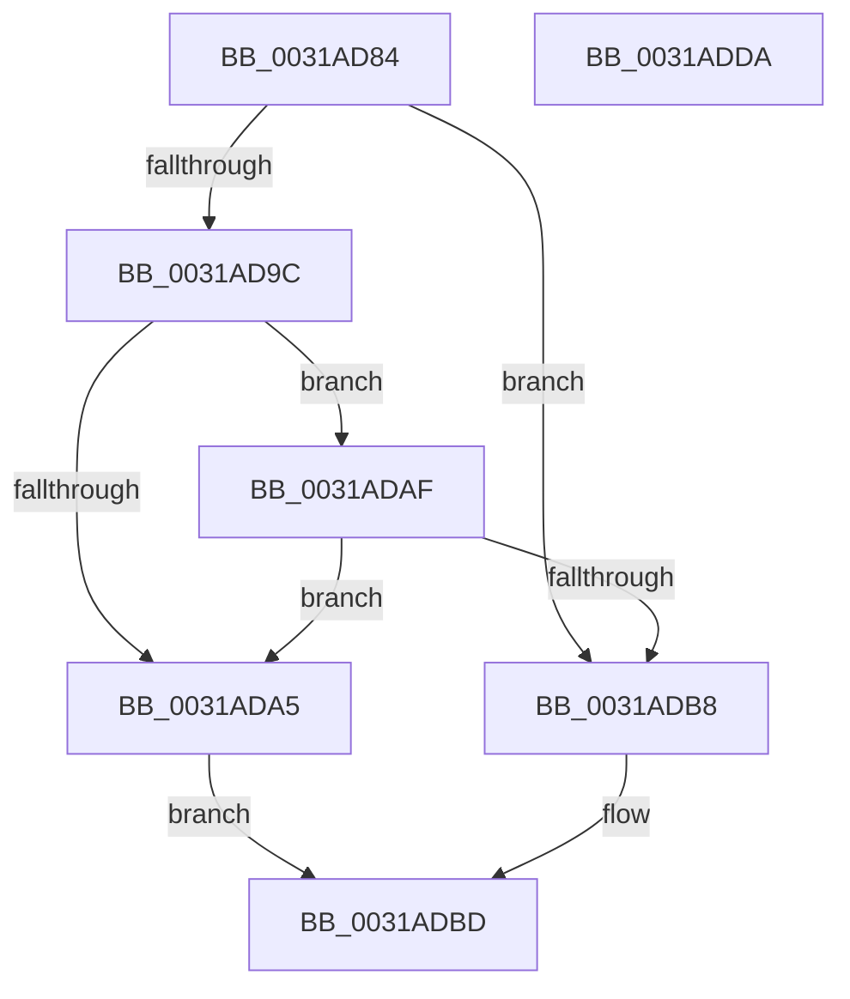

# MiVaToFlushVm

- RVA: `0x0031AD84`–`0x0031ADDB` (길이 `87` bytes)
- VA: `0x000000014031AD84`
- 실행 섹션: `.text`
- PDB 이름 있음: `예`; PDB Function 태그: `아니요`
- unwind 정보 RVA: `0x0005C788`
- 디코드: `22`개 명령, `87/87` bytes 표시
- 미해석 바이트: `0` (있으면 어셈블리에 `.byte`로 보존)

> 이 문서는 커널 이미지의 기계어와 PDB 기호를 분석해 생성했습니다. 4번과 5번은 함수 원형과 자료형을 바이너리 사용 방식에서 추정한 C 해석이며 원본 소스 복구 결과는 아닙니다.

## 1. Dependencies

- 직접 호출 지점: **3**; 고유 호출 대상: **3**
- 직접 호출자로 확인된 함수: **23**
- RIP 상대 이미지 참조: **3**

### Outgoing calls
- `0x0031AD88` → [MiGetLeafVa](../27/MiGetLeafVa_function_0027C0A0.md) (function, `0x0027C0A0`)
- `0x0031ADA8` → [MiGetSystemRegionType](../28/MiGetSystemRegionType_function_0028EC80.md) (function, `0x0028EC80`)
- `0x0031ADBF` → [MiSystemVaTypeToVm](../28/MiSystemVaTypeToVm_function_0028EB50.md) (function, `0x0028EB50`)

### Direct callers
- [sub_00237DE0](../23/Unknown_function_00237DE0.md) at `0x002383D4`
- [MiDecommitInitializePacket](../24/MiDecommitInitializePacket_function_00242F30.md) at `0x00242FE2`
- [MiReleasePtes](../24/MiReleasePtes_function_00247240.md) at `0x002474A2`
- [MiOutPageSingleKernelStack](../2A/MiOutPageSingleKernelStack_function_002A1790.md) at `0x002A18AF`
- [MiAllocateKernelStackPages](../2A/MiAllocateKernelStackPages_function_002A1BEC.md) at `0x002A1E12`
- [MiOutSwapKernelStackPage](../2A/MiOutSwapKernelStackPage_function_002A29BC.md) at `0x002A2A3E`
- [MiUnlockCodePage](../2A/MiUnlockCodePage_function_002A2AB8.md) at `0x002A2AEB`
- [MiDeleteKernelStackPages](../2D/MiDeleteKernelStackPages_function_002D9938.md) at `0x002D9977`
- [MiReservePtes](MiReservePtes_function_00318D20.md) at `0x00318DFA`
- [MiFillSystemPtes](MiFillSystemPtes_function_00319850.md) at `0x0031A13D`
- [MiFlushValidPteFromTb](../37/MiFlushValidPteFromTb_function_00376878.md) at `0x003768A4`
- [sub_00436E60](../43/Unknown_function_00436E60.md) at `0x00436E63`
- [MiSetPageProtection](../67/MiSetPageProtection_function_00674BDC.md) at `0x00674C5B`
- [MiStackTheftFreezeProcessors](../67/MiStackTheftFreezeProcessors_function_0067B274.md) at `0x0067B34E`
- [MiMarkBootGuardPage](../68/MiMarkBootGuardPage_function_0068643C.md) at `0x00686477`
- [MiClearSystemAccessBits](../68/MiClearSystemAccessBits_function_0068A2A0.md) at `0x0068A348`
- [MiDemoteValidLargePageOneLevel](../68/MiDemoteValidLargePageOneLevel_function_0068A3F4.md) at `0x0068A7DC`
- [MiWritePteHighLevel](../68/MiWritePteHighLevel_function_0068AA08.md) at `0x0068AA62`
- [sub_006DB6A6](../6D/Unknown_function_006DB6A6.md) at `0x006DB6BF`
- [MmDeleteShadowMapping](../../page/80/MmDeleteShadowMapping_function_00807D00.md) at `0x00807D80`
- [MmUnmapProtectedKernelPageRange](../../page/AA/MmUnmapProtectedKernelPageRange_function_00AA36DC.md) at `0x00AA3726`
- [MiInitializeBootShadowStackPage](../../init/C6/MiInitializeBootShadowStackPage_function_00C67D8C.md) at `0x00C67E89`
- [MiInitializeBootShadowStackPage](../../init/C6/MiInitializeBootShadowStackPage_function_00C67D8C.md) at `0x00C67F47`
- [MiMarkBootKernelStack](../../init/C6/MiMarkBootKernelStack_function_00C68244.md) at `0x00C68262`

### Static image references
- `0x0031AD9C` → RVA `0x00E2F380` (`.data`; read)
- `0x0031ADAF` → RVA `0x00E2F390` (`.data`; read)
- `0x0031ADC7` → RVA `0x00E38200` (`.data`; read)

## 2. Other-region calls and transfers

- 다른 실행 섹션으로 향하는 call: **0**
- 별도 외부 분기/꼬리 이동을 확인하지 못했습니다.

## 3. Assembly (complete function range)

```asm
0031AD84  48 83 EC 28                     sub rsp, 0x28
0031AD88  E8 13 13 F6 FF                  call 0x14027c0a0
0031AD8D  48 B9 00 00 00 00 00 80 FF FF   movabs rcx, 0xffff800000000000
0031AD97  48 3B C1                        cmp rax, rcx
0031AD9A  72 1C                           jb 0x14031adb8
0031AD9C  48 3B 05 DD 45 B1 00            cmp rax, qword ptr [rip + 0xb145dd]
0031ADA3  73 0A                           jae 0x14031adaf
0031ADA5  48 8B C8                        mov rcx, rax
0031ADA8  E8 D3 3E F7 FF                  call 0x14028ec80
0031ADAD  EB 0E                           jmp 0x14031adbd
0031ADAF  48 3B 05 DA 45 B1 00            cmp rax, qword ptr [rip + 0xb145da]
0031ADB6  77 ED                           ja 0x14031ada5
0031ADB8  B8 01 00 00 00                  mov eax, 1
0031ADBD  8B C8                           mov ecx, eax
0031ADBF  E8 8C 3D F7 FF                  call 0x14028eb50
0031ADC4  48 85 C0                        test rax, rax
0031ADC7  48 8D 0D 32 D4 B1 00            lea rcx, [rip + 0xb1d432]
0031ADCE  48 0F 45 C8                     cmovne rcx, rax
0031ADD2  48 8B C1                        mov rax, rcx
0031ADD5  48 83 C4 28                     add rsp, 0x28
0031ADD9  C3                              ret
0031ADDA  CC                              int3
```

## 4. C-style interpretation (structured pseudocode)

```c
__int64 __fastcall MiVaToFlushVm(void)
{
    __int64 result;
    __int64 v_rsp;

    v_rsp = (v_rsp) - (40);
    result = MiGetLeafVa(a1, a2, a3, a4);
    if (result < a1) goto loc_0031ADB8;
    if (result >= (*(unsigned __int64 *)(v_rip + 11617757))) goto loc_0031ADAF;
loc_0031ADA5:
    result = MiGetSystemRegionType(result, a2, a3, a4);
    goto loc_0031ADBD;
loc_0031ADAF:
    if (result > (*(unsigned __int64 *)(v_rip + 11617754))) goto loc_0031ADA5;
loc_0031ADB8:
loc_0031ADBD:
    result = MiSystemVaTypeToVm(1, a2, a3, a4);
    a1 = v_rip + 11654194;
    if (result != 0) { a1 = result; }
    v_rsp = (v_rsp) + (40);
    return a1;
}
```

## 5. (Beta) C Style

```c
void MiVaToFlushVm(void)
{
    int64_t result;
    int64_t local_rsp;

    local_rsp = (local_rsp) - (40);
    result = MiGetLeafVa(a1, a2, a3, a4);
    if (result < a1) goto loc_0031ADB8;
    if (result >= (*(uint64_t *)(v_rip + 0xB145DD))) goto loc_0031ADAF;
loc_0031ADA5:
    result = MiGetSystemRegionType(result, a2, a3, a4);
    goto loc_0031ADBD;
loc_0031ADAF:
    if (result > (*(uint64_t *)(v_rip + 0xB145DA))) goto loc_0031ADA5;
loc_0031ADB8:
loc_0031ADBD:
    result = MiSystemVaTypeToVm(1, a2, a3, a4);
    a1 = v_rip + 11654194;
    if (result != 0) { a1 = result; }
    local_rsp = (local_rsp) + (40);
    return a1;
}
```

## 6. Execution-region graph

[열기: 2D/3D 그래프와 함수 탐색 컨트롤 패널](../../../control-panel.html?section=text&rva=0x0031AD84&view=graph)

- 2D 그래프는 위에서 아래로 흐르고, 3D 그래프는 빈 공간을 드래그해 회전합니다. Shift+드래그는 이동, 휠은 확대·축소, 함수 노드 선택은 대상 보고서 이동입니다.

### Static fallback


