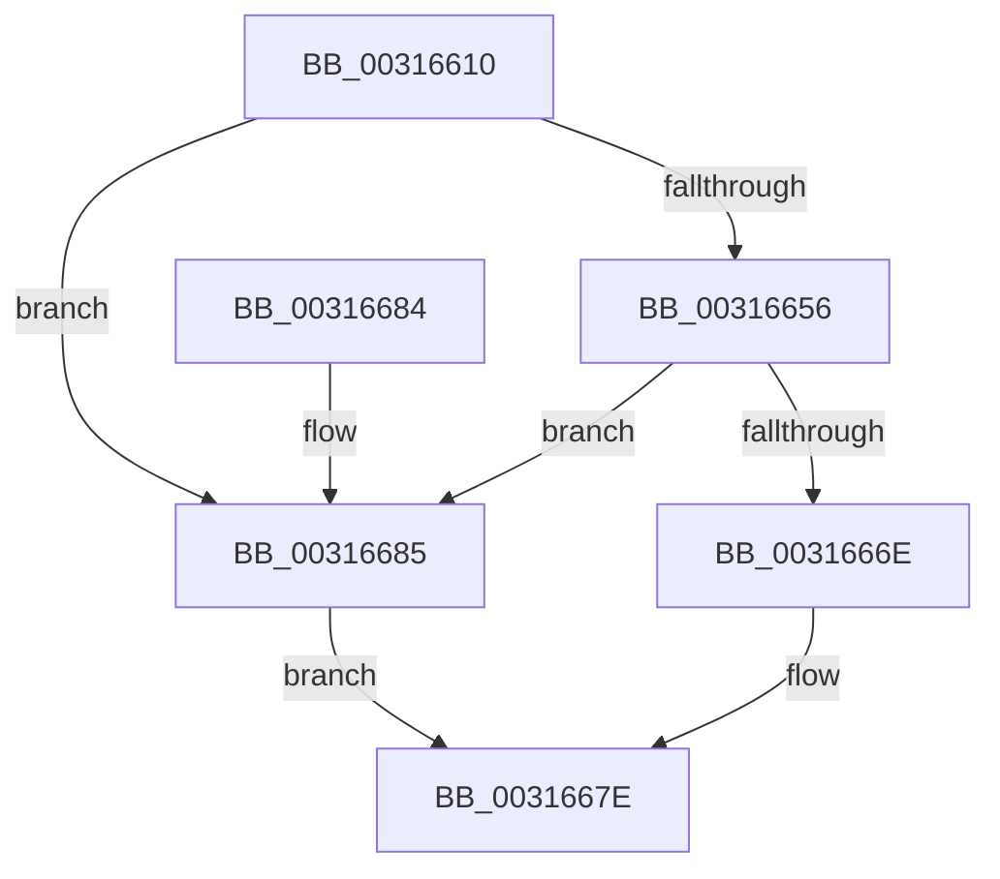

# MiVadSupportsCombine

- RVA: `0x00316610`–`0x00316689` (길이 `121` bytes)
- VA: `0x0000000140316610`
- 실행 섹션: `.text`
- PDB 이름 있음: `예`; PDB Function 태그: `아니요`
- unwind 정보 RVA: `0x00065BAC`
- 디코드: `32`개 명령, `121/121` bytes 표시
- 미해석 바이트: `0` (있으면 어셈블리에 `.byte`로 보존)

> 이 문서는 커널 이미지의 기계어와 PDB 기호를 분석해 생성했습니다. 4번과 5번은 함수 원형과 자료형을 바이너리 사용 방식에서 추정한 C 해석이며 원본 소스 복구 결과는 아닙니다.

## 1. Dependencies

- 직접 호출 지점: **4**; 고유 호출 대상: **4**
- 직접 호출자로 확인된 함수: **1**
- RIP 상대 이미지 참조: **1**

### Outgoing calls
- `0x0031661E` → [MiLockVadTree](../27/MiLockVadTree_function_0027C0F0.md) (function, `0x0027C0F0`)
- `0x00316626` → [MiLocateAddress](MiLocateAddress_function_003168D0.md) (function, `0x003168D0`)
- `0x0031664C` → [ExReleaseSpinLockSharedFromDpcLevel](../24/ExReleaseSpinLockSharedFromDpcLevel_function_0024A590.md) (function, `0x0024A590`)
- `0x00316671` → [MiVadSupportsPrivateCommit](MiVadSupportsPrivateCommit_function_00316FD0.md) (function, `0x00316FD0`)

### Direct callers
- [MiCrcStillIntact](MiCrcStillIntact_function_00317028.md) at `0x003171C4`

### Static image references
- `0x00316659` → RVA `0x00014578` (`.rdata`; read)

## 2. Other-region calls and transfers

- 다른 실행 섹션으로 향하는 call: **0**
- 별도 외부 분기/꼬리 이동을 확인하지 못했습니다.

## 3. Assembly (complete function range)

```asm
00316610  40 53                           push rbx
00316612  48 83 EC 20                     sub rsp, 0x20
00316616  B9 01 00 00 00                  mov ecx, 1
0031661B  48 8B DA                        mov rbx, rdx
0031661E  E8 CD 5A F6 FF                  call 0x14027c0f0
00316623  48 8B CB                        mov rcx, rbx
00316626  E8 A5 02 00 00                  call 0x1403168d0
0031662B  65 48 8B 0C 25 88 01 00 00      mov rcx, qword ptr gs:[0x188]
00316634  48 8B D8                        mov rbx, rax
00316637  48 8B 91 B8 00 00 00            mov rdx, qword ptr [rcx + 0xb8]
0031663E  48 8B 8A 10 04 00 00            mov rcx, qword ptr [rdx + 0x410]
00316645  48 81 C1 EC 03 00 00            add rcx, 0x3ec
0031664C  E8 3F 3F F3 FF                  call 0x14024a590
00316651  48 85 DB                        test rbx, rbx
00316654  74 2F                           je 0x140316685
00316656  8B 4B 30                        mov ecx, dword ptr [rbx + 0x30]
00316659  48 8D 05 18 DF CF FF            lea rax, [rip - 0x3020e8]
00316660  48 C1 E9 13                     shr rcx, 0x13
00316664  83 E1 03                        and ecx, 3
00316667  48 83 3C C8 10                  cmp qword ptr [rax + rcx*8], 0x10
0031666C  74 17                           je 0x140316685
0031666E  48 8B CB                        mov rcx, rbx
00316671  E8 5A 09 00 00                  call 0x140316fd0
00316676  F7 D8                           neg eax
00316678  48 1B C0                        sbb rax, rax
0031667B  48 23 C3                        and rax, rbx
0031667E  48 83 C4 20                     add rsp, 0x20
00316682  5B                              pop rbx
00316683  C3                              ret
00316684  CC                              int3
00316685  33 C0                           xor eax, eax
00316687  EB F5                           jmp 0x14031667e
```

## 4. C-style interpretation (structured pseudocode)

```c
__int64 __fastcall MiVadSupportsCombine(__int64 a1, __int64 a2)
{
    __int64 result;
    __int64 v_rsp;

    v_rsp = (v_rsp) - (32);
    result = MiLockVadTree(1, a2, a3, a4);
    result = MiLocateAddress(a2, a2, a3, a4);
    a1 = (*(unsigned __int64 *)(*(unsigned __int64 *)(*(unsigned __int64 *)(gs_base + (0 + 392)) + 184) + 1040)) + (0x3ECULL);
    result = ExReleaseSpinLockSharedFromDpcLevel(a1, *(unsigned __int64 *)(*(unsigned __int64 *)(gs_base + (0 + 392)) + 184), a3, a4);
    if (result == 0) goto loc_00316685;
    a1 = ((unsigned int)(*(unsigned int *)(result + 48))) >> (19);
    a1 = (unsigned int)((a1) & (3));
    if ((*(unsigned __int64 *)(v_rip - 3154152 + a1 * 8)) == 16) goto loc_00316685;
    result = MiVadSupportsPrivateCommit(result, *(unsigned __int64 *)(*(unsigned __int64 *)(gs_base + (0 + 392)) + 184), a3, a4);
    result = (unsigned int)(-(result));
    result = (result) & (result);
loc_0031667E:
    v_rsp = (v_rsp) + (32);
    return result;
loc_00316685:
    result = 0;
    goto loc_0031667E;
}
```

## 5. (Beta) C Style

```c
int64_t MiVadSupportsCombine(int64_t Arg1, int64_t Arg2)
{
    int64_t result;
    int64_t local_rsp;

    local_rsp = (local_rsp) - (32);
    result = MiLockVadTree(1, Arg2, a3, a4);
    result = MiLocateAddress(Arg2, Arg2, a3, a4);
    Arg1 = (*(uint64_t *)(*(uint64_t *)(*(uint64_t *)(gs_base + (0 + 0x188)) + 0xB8) + 0x410)) + (0x3ECULL);
    result = ExReleaseSpinLockSharedFromDpcLevel(Arg1, *(uint64_t *)(*(uint64_t *)(gs_base + (0 + 0x188)) + 0xB8), a3, a4);
    if (result == 0) goto loc_00316685;
    Arg1 = ((uint32_t)(*(uint32_t *)(result + 0x30))) >> (19);
    Arg1 = (uint32_t)((Arg1) & (3));
    if ((*(uint64_t *)(v_rip - 0x3020E8 + Arg1 * 8)) == 16) goto loc_00316685;
    result = MiVadSupportsPrivateCommit(result, *(uint64_t *)(*(uint64_t *)(gs_base + (0 + 0x188)) + 0xB8), a3, a4);
    result = (uint32_t)(-(result));
    result = (result) & (result);
loc_0031667E:
    local_rsp = (local_rsp) + (32);
    return result;
loc_00316685:
    result = 0;
    goto loc_0031667E;
}
```

## 6. Execution-region graph

[열기: 2D/3D 그래프와 함수 탐색 컨트롤 패널](../../../control-panel.html?section=text&rva=0x00316610&view=graph)

- 2D 그래프는 위에서 아래로 흐르고, 3D 그래프는 빈 공간을 드래그해 회전합니다. Shift+드래그는 이동, 휠은 확대·축소, 함수 노드 선택은 대상 보고서 이동입니다.

### Static fallback


