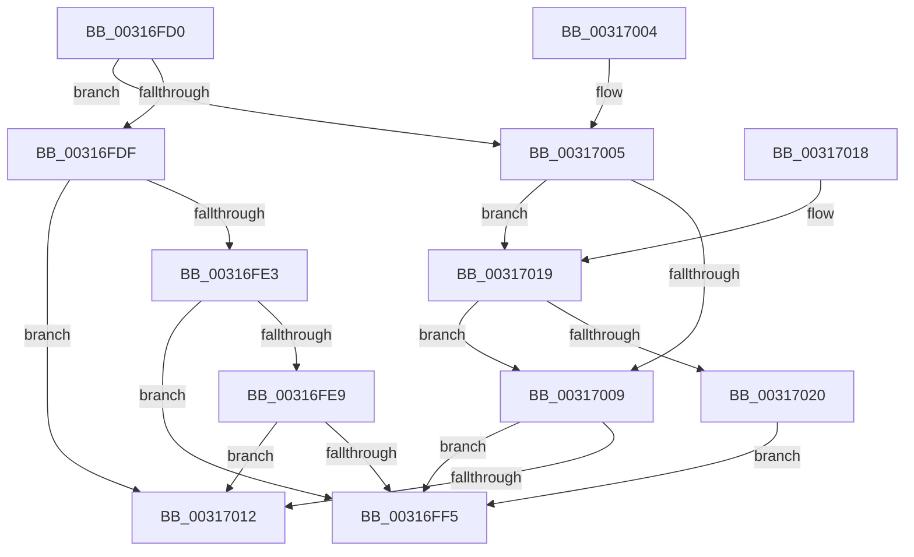

# MiVadSupportsPrivateCommit

- RVA: `0x00316FD0`–`0x00317022` (길이 `82` bytes)
- VA: `0x0000000140316FD0`
- 실행 섹션: `.text`
- PDB 이름 있음: `예`; PDB Function 태그: `아니요`
- unwind 정보 RVA: `0x000DB714`
- 디코드: `32`개 명령, `82/82` bytes 표시
- 미해석 바이트: `0` (있으면 어셈블리에 `.byte`로 보존)

> 이 문서는 커널 이미지의 기계어와 PDB 기호를 분석해 생성했습니다. 4번과 5번은 함수 원형과 자료형을 바이너리 사용 방식에서 추정한 C 해석이며 원본 소스 복구 결과는 아닙니다.

## 1. Dependencies

- 직접 호출 지점: **0**; 고유 호출 대상: **0**
- 직접 호출자로 확인된 함수: **8**
- RIP 상대 이미지 참조: **0**

### Outgoing calls
- 직접 디코드된 call 명령이 없습니다.

### Direct callers
- [MiEmptyWorkingSetPrivatePagesByVa](../2A/MiEmptyWorkingSetPrivatePagesByVa_function_002A6AC0.md) at `0x002A6B57`
- [MmOutSwapWorkingSet](../2A/MmOutSwapWorkingSet_function_002A6BC8.md) at `0x002A6E56`
- [MiSharePages](MiSharePages_function_00315110.md) at `0x0031560B`
- [MiVadSupportsCombine](MiVadSupportsCombine_function_00316610.md) at `0x00316671`
- [MiIsVadEligibleForCommitRelease](../4F/MiIsVadEligibleForCommitRelease_function_004FB6FC.md) at `0x004FB703`
- [MiAllocateVirtualMemory](../../page/88/MiAllocateVirtualMemory_function_00883B40.md) at `0x00883D0B`
- [MmSecureVirtualMemoryAgainstWrites](../../page/89/MmSecureVirtualMemoryAgainstWrites_function_00890164.md) at `0x00890236`
- [MiProcessVaRangesInfoClass](../../page/9F/MiProcessVaRangesInfoClass_function_009F4E50.md) at `0x009F4EEE`

### Static image references
- 디코드된 RIP-relative 메모리 참조가 없습니다.

## 2. Other-region calls and transfers

- 다른 실행 섹션으로 향하는 call: **0**
- 별도 외부 분기/꼬리 이동을 확인하지 못했습니다.

## 3. Assembly (complete function range)

```asm
00316FD0  8B 41 30                        mov eax, dword ptr [rcx + 0x30]
00316FD3  8B D0                           mov edx, eax
00316FD5  81 E2 00 00 20 00               and edx, 0x200000
00316FDB  A8 70                           test al, 0x70
00316FDD  75 26                           jne 0x140317005
00316FDF  85 D2                           test edx, edx
00316FE1  74 2F                           je 0x140317012
00316FE3  0F BA E0 17                     bt eax, 0x17
00316FE7  72 0C                           jb 0x140316ff5
00316FE9  25 00 00 18 00                  and eax, 0x180000
00316FEE  3D 00 00 10 00                  cmp eax, 0x100000
00316FF3  72 1D                           jb 0x140317012
00316FF5  8B 49 30                        mov ecx, dword ptr [rcx + 0x30]
00316FF8  33 C0                           xor eax, eax
00316FFA  80 E1 70                        and cl, 0x70
00316FFD  80 F9 40                        cmp cl, 0x40
00317000  0F 94 C0                        sete al
00317003  C3                              ret
00317004  CC                              int3
00317005  85 D2                           test edx, edx
00317007  74 10                           je 0x140317019
00317009  8B 41 30                        mov eax, dword ptr [rcx + 0x30]
0031700C  24 70                           and al, 0x70
0031700E  3C 20                           cmp al, 0x20
00317010  75 E3                           jne 0x140316ff5
00317012  B8 01 00 00 00                  mov eax, 1
00317017  C3                              ret
00317018  CC                              int3
00317019  8B 41 40                        mov eax, dword ptr [rcx + 0x40]
0031701C  A8 01                           test al, 1
0031701E  74 E9                           je 0x140317009
00317020  EB D3                           jmp 0x140316ff5
```

## 4. C-style interpretation (structured pseudocode)

```c
__int64 __fastcall MiVadSupportsPrivateCommit(__int64 a1)
{
    __int64 result;

    a2 = (unsigned int)(((unsigned int)((unsigned int)((unsigned int)(*(unsigned int *)(a1 + 48))))) & (0x200000ULL));
    if ((((unsigned __int8)((unsigned int)(*(unsigned int *)(a1 + 48)))) & (112)) != 0) goto loc_00317005;
    if ((unsigned int)(a2) == 0) goto loc_00317012;
    if (condition_is_below) goto loc_00316FF5;
    result = (unsigned int)(((unsigned int)(*(unsigned int *)(a1 + 48))) & (0x180000ULL));
    if (((unsigned int)(result)) < 0x100000ULL) goto loc_00317012;
loc_00316FF5:
    result = 0;
    a1 = (unsigned __int8)(((unsigned int)(*(unsigned int *)(a1 + 48))) & (112));
    result = (((unsigned __int8)(a1)) == 64) ? 1 : 0;
    return result;
loc_00317005:
    if ((unsigned int)(a2) == 0) goto loc_00317019;
loc_00317009:
    result = (unsigned __int8)(((unsigned int)(*(unsigned int *)(a1 + 48))) & (112));
    if (((unsigned __int8)(result)) != 32) goto loc_00316FF5;
loc_00317012:
    return 1;
loc_00317019:
    if ((((unsigned __int8)((unsigned int)(*(unsigned int *)(a1 + 64)))) & (1)) == 0) goto loc_00317009;
    goto loc_00316FF5;
}
```

## 5. (Beta) C Style

```c
int64_t MiVadSupportsPrivateCommit(void *Arg1)
{
    uint8_t *arg1 = (uint8_t *)Arg1;

    int64_t result;

    a2 = (uint32_t)(((uint32_t)((uint32_t)((uint32_t)(*(uint32_t *)(arg1 + 0x30))))) & (0x200000ULL));
    if ((((uint8_t)((uint32_t)(*(uint32_t *)(arg1 + 0x30)))) & (112)) != 0) goto loc_00317005;
    if ((uint32_t)(a2) == 0) goto loc_00317012;
    if (condition_is_below) goto loc_00316FF5;
    result = (uint32_t)(((uint32_t)(*(uint32_t *)(arg1 + 0x30))) & (0x180000ULL));
    if (((uint32_t)(result)) < 0x100000ULL) goto loc_00317012;
loc_00316FF5:
    result = 0;
    Arg1 = (uint8_t)(((uint32_t)(*(uint32_t *)(arg1 + 0x30))) & (112));
    result = (((uint8_t)(Arg1)) == 64) ? 1 : 0;
    return result;
loc_00317005:
    if ((uint32_t)(a2) == 0) goto loc_00317019;
loc_00317009:
    result = (uint8_t)(((uint32_t)(*(uint32_t *)(arg1 + 0x30))) & (112));
    if (((uint8_t)(result)) != 32) goto loc_00316FF5;
loc_00317012:
    return 1;
loc_00317019:
    if ((((uint8_t)((uint32_t)(*(uint32_t *)(arg1 + 0x40)))) & (1)) == 0) goto loc_00317009;
    goto loc_00316FF5;
}
```

### 관측된 메모리 오프셋

구조체 형식이 확인되지 않은 접근은 인자 기준의 오프셋으로만 기록했습니다.

| 기준 인자 | 오프셋 표현 | 폭 (bit) | 접근 |
|---|---:|---:|---|
| `Arg1` | `+ 0x30` | `32` | `R` |
| `Arg1` | `+ 0x40` | `32` | `R` |

## 6. Execution-region graph

[열기: 2D/3D 그래프와 함수 탐색 컨트롤 패널](../../../control-panel.html?section=text&rva=0x00316FD0&view=graph)

- 2D 그래프는 위에서 아래로 흐르고, 3D 그래프는 빈 공간을 드래그해 회전합니다. Shift+드래그는 이동, 휠은 확대·축소, 함수 노드 선택은 대상 보고서 이동입니다.

### Static fallback


