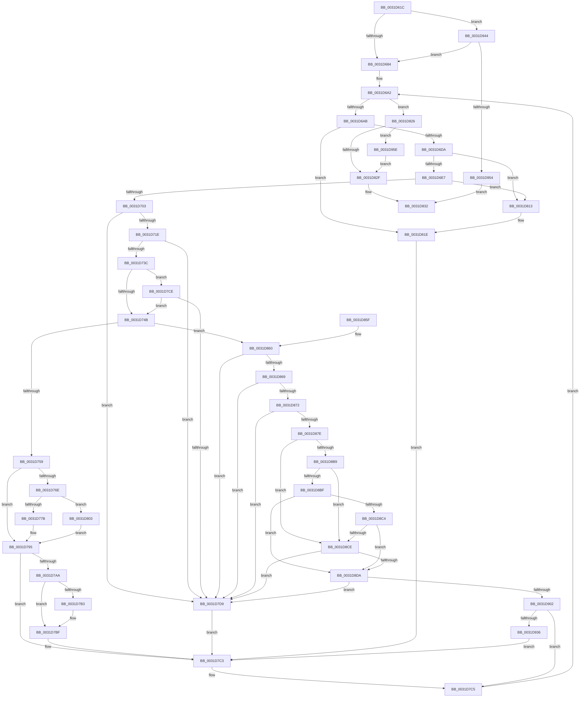

# MmSetPfnListInfo

- RVA: `0x0031D61C`–`0x0031D96C` (길이 `848` bytes)
- VA: `0x000000014031D61C`
- 실행 섹션: `.text`
- PDB 이름 있음: `예`; PDB Function 태그: `아니요`
- unwind 정보 RVA: `0x00075130`
- 디코드: `207`개 명령, `848/848` bytes 표시
- 미해석 바이트: `0` (있으면 어셈블리에 `.byte`로 보존)

> 이 문서는 커널 이미지의 기계어와 PDB 기호를 분석해 생성했습니다. 4번과 5번은 함수 원형과 자료형을 바이너리 사용 방식에서 추정한 C 해석이며 원본 소스 복구 결과는 아닙니다.

## 1. Dependencies

- 직접 호출 지점: **15**; 고유 호출 대상: **12**
- 직접 호출자로 확인된 함수: **1**
- RIP 상대 이미지 참조: **6**

### Outgoing calls
- `0x0031D675` → [memset](../6C/memset_function_006C6C40.md) (function, `0x006C6C40`)
- `0x0031D6C7` → [MiSafeLockPage](../32/MiSafeLockPage_function_00321620.md) (function, `0x00321620`)
- `0x0031D70B` → [MiIdentifyPfn](MiIdentifyPfn_function_0031CAC0.md) (function, `0x0031CAC0`)
- `0x0031D764` → [MiGetPfnPriority](../32/MiGetPfnPriority_function_003226F0.md) (function, `0x003226F0`)
- `0x0031D7BA` → [KiLowerIrqlProcessIrqlFlags](../4F/KiLowerIrqlProcessIrqlFlags_function_004F5698.md) (function, `0x004F5698`)
- `0x0031D7DF` → [MiUnlockPage](MiUnlockPage_function_0031A3E0.md) (function, `0x0031A3E0`)
- `0x0031D809` → [MiRelinkStandbyPage](../2B/MiRelinkStandbyPage_function_002B9D30.md) (function, `0x002B9D30`)
- `0x0031D819` → [MiUnlockPage](MiUnlockPage_function_0031A3E0.md) (function, `0x0031A3E0`)
- `0x0031D839` → [_security_check_cookie](../6A/_security_check_cookie_function_006AC640.md) (function, `0x006AC640`)
- `0x0031D899` → [MiPageToNode](../33/MiPageToNode_function_00338CD0.md) (function, `0x00338CD0`)
- `0x0031D90A` → [MiSetActivePfnHeat](../40/MiSetActivePfnHeat_function_00409E00.md) (function, `0x00409E00`)
- `0x0031D915` → [MiUnlockPage](MiUnlockPage_function_0031A3E0.md) (function, `0x0031A3E0`)
- `0x0031D927` → [MiAddPageToHeatRanges](../44/MiAddPageToHeatRanges_function_00446064.md) (function, `0x00446064`)
- `0x0031D93A` → [MiIssuePageHeatList](../44/MiIssuePageHeatList_function_0044615C.md) (function, `0x0044615C`)
- `0x0031D962` → [MiIssuePageHeatList](../44/MiIssuePageHeatList_function_0044615C.md) (function, `0x0044615C`)

### Direct callers
- [PfpPfnPrioRequest](../../page/90/PfpPfnPrioRequest_function_00902488.md) at `0x0090261E`

### Static image references
- `0x0031D63F` → RVA `0x00E0A740` (`.data`; read)
- `0x0031D684` → RVA `0x00E2ECF8` (`.data`; read)
- `0x0031D6DA` → RVA `0x00E2DCE0` (`.data`; read)
- `0x0031D7AA` → RVA `0x00FC6D20` (`ALMOSTRO`; read)
- `0x0031D882` → RVA `0x00E30088` (`.data`; read)
- `0x0031D8A7` → RVA `0x00FC6AB8` (`ALMOSTRO`; read)

## 2. Other-region calls and transfers

- 다른 실행 섹션으로 향하는 call: **0**
- 별도 외부 분기/꼬리 이동을 확인하지 못했습니다.

## 3. Assembly (complete function range)

```asm
0031D61C  48 8B C4                        mov rax, rsp
0031D61F  48 89 58 08                     mov qword ptr [rax + 8], rbx
0031D623  48 89 70 18                     mov qword ptr [rax + 0x18], rsi
0031D627  48 89 78 20                     mov qword ptr [rax + 0x20], rdi
0031D62B  55                              push rbp
0031D62C  41 54                           push r12
0031D62E  41 55                           push r13
0031D630  41 56                           push r14
0031D632  41 57                           push r15
0031D634  48 8D 68 A1                     lea rbp, [rax - 0x5f]
0031D638  48 81 EC E0 00 00 00            sub rsp, 0xe0
0031D63F  48 8B 05 FA D0 AE 00            mov rax, qword ptr [rip + 0xaed0fa]
0031D646  48 33 C4                        xor rax, rsp
0031D649  48 89 45 27                     mov qword ptr [rbp + 0x27], rax
0031D64D  41 8B F8                        mov edi, r8d
0031D650  44 89 44 24 24                  mov dword ptr [rsp + 0x24], r8d
0031D655  48 8B F2                        mov rsi, rdx
0031D658  48 8B D9                        mov rbx, rcx
0031D65B  0F 57 C0                        xorps xmm0, xmm0
0031D65E  48 8D 4D A7                     lea rcx, [rbp - 0x59]
0031D662  33 C0                           xor eax, eax
0031D664  33 D2                           xor edx, edx
0031D666  41 B8 80 00 00 00               mov r8d, 0x80
0031D66C  48 89 45 8F                     mov qword ptr [rbp - 0x71], rax
0031D670  0F 11 44 24 28                  movups xmmword ptr [rsp + 0x28], xmm0
0031D675  E8 C6 95 3A 00                  call 0x1406c6c40
0031D67A  33 C9                           xor ecx, ecx
0031D67C  85 FF                           test edi, edi
0031D67E  0F 85 C0 02 00 00               jne 0x14031d944
0031D684  48 8B 05 6D 16 B1 00            mov rax, qword ptr [rip + 0xb1166d]
0031D68B  44 8B E1                        mov r12d, ecx
0031D68E  48 89 45 9F                     mov qword ptr [rbp - 0x61], rax
0031D692  48 8D 04 5B                     lea rax, [rbx + rbx*2]
0031D696  4C 8D 2C C6                     lea r13, [rsi + rax*8]
0031D69A  48 C7 45 97 82 00 00 00         mov qword ptr [rbp - 0x69], 0x82
0031D6A2  49 3B F5                        cmp rsi, r13
0031D6A5  0F 83 7B 01 00 00               jae 0x14031d826
0031D6AB  4C 8B 7E 08                     mov r15, qword ptr [rsi + 8]
0031D6AF  4B 8D 1C 7F                     lea rbx, [r15 + r15*2]
0031D6B3  48 03 DB                        add rbx, rbx
0031D6B6  48 B8 00 00 00 00 00 DE FF FF   movabs rax, 0xffffde0000000000
0031D6C0  49 8B CF                        mov rcx, r15
0031D6C3  48 8D 3C D8                     lea rdi, [rax + rbx*8]
0031D6C7  E8 54 3F 00 00                  call 0x140321620
0031D6CC  44 0F B6 F0                     movzx r14d, al
0031D6D0  41 80 FE 11                     cmp r14b, 0x11
0031D6D4  0F 84 44 01 00 00               je 0x14031d81e
0031D6DA  4C 3B 3D FF 05 B1 00            cmp r15, qword ptr [rip + 0xb105ff]
0031D6E1  0F 87 2C 01 00 00               ja 0x14031d813
0031D6E7  48 B8 28 00 00 00 00 DE FF FF   movabs rax, 0xffffde0000000028
0031D6F1  48 8B 04 D8                     mov rax, qword ptr [rax + rbx*8]
0031D6F5  48 C1 E8 36                     shr rax, 0x36
0031D6F9  0F BA E0 00                     bt eax, 0
0031D6FD  0F 83 10 01 00 00               jae 0x14031d813
0031D703  48 8D 54 24 28                  lea rdx, [rsp + 0x28]
0031D708  49 8B CF                        mov rcx, r15
0031D70B  E8 B0 F3 FF FF                  call 0x14031cac0
0031D710  48 8B 46 10                     mov rax, qword ptr [rsi + 0x10]
0031D714  48 39 45 8F                     cmp qword ptr [rbp - 0x71], rax
0031D718  0F 85 BB 00 00 00               jne 0x14031d7d9
0031D71E  4C 8B 16                        mov r10, qword ptr [rsi]
0031D721  48 B9 00 FE FF FF FF FF FF 01   movabs rcx, 0x1fffffffffffe00
0031D72B  49 8B C2                        mov rax, r10
0031D72E  48 33 44 24 28                  xor rax, qword ptr [rsp + 0x28]
0031D733  48 85 C1                        test rcx, rax
0031D736  0F 85 9D 00 00 00               jne 0x14031d7d9
0031D73C  8A 4F 22                        mov cl, byte ptr [rdi + 0x22]
0031D73F  80 E1 07                        and cl, 7
0031D742  80 F9 06                        cmp cl, 6
0031D745  0F 85 83 00 00 00               jne 0x14031d7ce
0031D74B  45 33 DB                        xor r11d, r11d
0031D74E  44 39 5C 24 24                  cmp dword ptr [rsp + 0x24], r11d
0031D753  0F 85 07 01 00 00               jne 0x14031d860
0031D759  49 C1 EA 39                     shr r10, 0x39
0031D75D  48 8B CF                        mov rcx, rdi
0031D760  41 83 E2 07                     and r10d, 7
0031D764  E8 87 4F 00 00                  call 0x1403226f0
0031D769  44 3B D0                        cmp r10d, eax
0031D76C  74 27                           je 0x14031d795
0031D76E  8A 47 22                        mov al, byte ptr [rdi + 0x22]
0031D771  24 07                           and al, 7
0031D773  3C 02                           cmp al, 2
0031D775  0F 84 88 00 00 00               je 0x14031d803
0031D77B  8B 47 20                        mov eax, dword ptr [rdi + 0x20]
0031D77E  89 44 24 20                     mov dword ptr [rsp + 0x20], eax
0031D782  C1 E8 18                        shr eax, 0x18
0031D785  24 F8                           and al, 0xf8
0031D787  41 0A C2                        or al, r10b
0031D78A  88 44 24 23                     mov byte ptr [rsp + 0x23], al
0031D78E  8B 44 24 20                     mov eax, dword ptr [rsp + 0x20]
0031D792  89 47 20                        mov dword ptr [rdi + 0x20], eax
0031D795  48 B8 FF FF FF FF FF FF FF 7F   movabs rax, 0x7fffffffffffffff
0031D79F  F0 48 21 47 18                  lock and qword ptr [rdi + 0x18], rax
0031D7A4  41 80 FE 02                     cmp r14b, 2
0031D7A8  73 19                           jae 0x14031d7c3
0031D7AA  44 39 1D 6F 95 CA 00            cmp dword ptr [rip + 0xca956f], r11d
0031D7B1  74 0C                           je 0x14031d7bf
0031D7B3  44 0F 20 C1                     mov rcx, cr8
0031D7B7  41 8A D6                        mov dl, r14b
0031D7BA  E8 D9 7E 1D 00                  call 0x1404f5698
0031D7BF  45 0F 22 C6                     mov cr8, r14
0031D7C3  33 C9                           xor ecx, ecx
0031D7C5  48 83 C6 18                     add rsi, 0x18
0031D7C9  E9 D4 FE FF FF                  jmp 0x14031d6a2
0031D7CE  8D 41 FE                        lea eax, [rcx - 2]
0031D7D1  3C 02                           cmp al, 2
0031D7D3  0F 86 72 FF FF FF               jbe 0x14031d74b
0031D7D9  41 8A D6                        mov dl, r14b
0031D7DC  48 8B CF                        mov rcx, rdi
0031D7DF  E8 FC CB FF FF                  call 0x14031a3e0
0031D7E4  0F 10 44 24 28                  movups xmm0, xmmword ptr [rsp + 0x28]
0031D7E9  48 83 4D 8F 02                  or qword ptr [rbp - 0x71], 2
0031D7EE  41 BC 24 00 00 C0               mov r12d, 0xc0000024
0031D7F4  F2 0F 10 4D 8F                  movsd xmm1, qword ptr [rbp - 0x71]
0031D7F9  0F 11 06                        movups xmmword ptr [rsi], xmm0
0031D7FC  F2 0F 11 4E 10                  movsd qword ptr [rsi + 0x10], xmm1
0031D801  EB C0                           jmp 0x14031d7c3
0031D803  41 8B D2                        mov edx, r10d
0031D806  48 8B CF                        mov rcx, rdi
0031D809  E8 22 C5 F9 FF                  call 0x1402b9d30
0031D80E  45 33 DB                        xor r11d, r11d
0031D811  EB 82                           jmp 0x14031d795
0031D813  41 8A D6                        mov dl, r14b
0031D816  48 8B CF                        mov rcx, rdi
0031D819  E8 C2 CB FF FF                  call 0x14031a3e0
0031D81E  41 BC F0 00 00 C0               mov r12d, 0xc00000f0
0031D824  EB 9D                           jmp 0x14031d7c3
0031D826  39 4D 9B                        cmp dword ptr [rbp - 0x65], ecx
0031D829  0F 85 2F 01 00 00               jne 0x14031d95e
0031D82F  41 8B C4                        mov eax, r12d
0031D832  48 8B 4D 27                     mov rcx, qword ptr [rbp + 0x27]
0031D836  48 33 CC                        xor rcx, rsp
0031D839  E8 02 EE 38 00                  call 0x1406ac640
0031D83E  4C 8D 9C 24 E0 00 00 00         lea r11, [rsp + 0xe0]
0031D846  49 8B 5B 30                     mov rbx, qword ptr [r11 + 0x30]
0031D84A  49 8B 73 40                     mov rsi, qword ptr [r11 + 0x40]
0031D84E  49 8B 7B 48                     mov rdi, qword ptr [r11 + 0x48]
0031D852  49 8B E3                        mov rsp, r11
0031D855  41 5F                           pop r15
0031D857  41 5E                           pop r14
0031D859  41 5D                           pop r13
0031D85B  41 5C                           pop r12
0031D85D  5D                              pop rbp
0031D85E  C3                              ret
0031D85F  CC                              int3
0031D860  45 84 D2                        test r10b, r10b
0031D863  0F 89 70 FF FF FF               jns 0x14031d7d9
0031D869  80 F9 02                        cmp cl, 2
0031D86C  0F 85 67 FF FF FF               jne 0x14031d7d9
0031D872  8B 47 20                        mov eax, dword ptr [rdi + 0x20]
0031D875  66 85 C0                        test ax, ax
0031D878  0F 85 5B FF FF FF               jne 0x14031d7d9
0031D87E  48 8B 47 28                     mov rax, qword ptr [rdi + 0x28]
0031D882  48 8B 0D FF 27 B1 00            mov rcx, qword ptr [rip + 0xb127ff]
0031D889  48 C1 E8 2B                     shr rax, 0x2b
0031D88D  25 FF 03 00 00                  and eax, 0x3ff
0031D892  48 8B 1C C1                     mov rbx, qword ptr [rcx + rax*8]
0031D896  49 8B CF                        mov rcx, r15
0031D899  E8 32 B4 01 00                  call 0x140338cd0
0031D89E  8B C8                           mov ecx, eax
0031D8A0  48 69 C1 80 DF 00 00            imul rax, rcx, 0xdf80
0031D8A7  8B 0D 0B 92 CA 00               mov ecx, dword ptr [rip + 0xca920b]
0031D8AD  48 03 43 10                     add rax, qword ptr [rbx + 0x10]
0031D8B1  F7 C1 00 00 40 08               test ecx, 0x8400000
0031D8B7  74 15                           je 0x14031d8ce
0031D8B9  0F BA E1 1B                     bt ecx, 0x1b
0031D8BD  72 0F                           jb 0x14031d8ce
0031D8BF  48 85 C0                        test rax, rax
0031D8C2  74 16                           je 0x14031d8da
0031D8C4  8B 80 50 3B 00 00               mov eax, dword ptr [rax + 0x3b50]
0031D8CA  A8 02                           test al, 2
0031D8CC  74 0C                           je 0x14031d8da
0031D8CE  48 0F BA 67 28 35               bt qword ptr [rdi + 0x28], 0x35
0031D8D4  0F 83 FF FE FF FF               jae 0x14031d7d9
0031D8DA  48 8B 47 10                     mov rax, qword ptr [rdi + 0x10]
0031D8DE  4C 8B C8                        mov r9, rax
0031D8E1  4C 8B C0                        mov r8, rax
0031D8E4  49 C1 E8 0B                     shr r8, 0xb
0031D8E8  41 81 E1 00 04 00 00            and r9d, 0x400
0031D8EF  48 C1 E8 03                     shr rax, 3
0031D8F3  4D 85 C9                        test r9, r9
0031D8F6  41 0F 45 C0                     cmovne eax, r8d
0031D8FA  A8 01                           test al, 1
0031D8FC  0F 85 D7 FE FF FF               jne 0x14031d7d9
0031D902  BA 01 00 00 00                  mov edx, 1
0031D907  48 8B CF                        mov rcx, rdi
0031D90A  E8 F1 C4 0E 00                  call 0x140409e00
0031D90F  41 8A D6                        mov dl, r14b
0031D912  48 8B CF                        mov rcx, rdi
0031D915  E8 C6 CA FF FF                  call 0x14031a3e0
0031D91A  41 B8 03 00 00 00               mov r8d, 3
0031D920  48 8D 4D 97                     lea rcx, [rbp - 0x69]
0031D924  49 8B D7                        mov rdx, r15
0031D927  E8 38 87 12 00                  call 0x140446064
0031D92C  33 C9                           xor ecx, ecx
0031D92E  85 C0                           test eax, eax
0031D930  0F 84 8F FE FF FF               je 0x14031d7c5
0031D936  48 8D 4D 97                     lea rcx, [rbp - 0x69]
0031D93A  E8 1D 88 12 00                  call 0x14044615c
0031D93F  E9 7F FE FF FF                  jmp 0x14031d7c3
0031D944  F7 05 6A 91 CA 00 00 00 40 08   test dword ptr [rip + 0xca916a], 0x8400000
0031D94E  0F 85 30 FD FF FF               jne 0x14031d684
0031D954  B8 BB 00 00 C0                  mov eax, 0xc00000bb
0031D959  E9 D4 FE FF FF                  jmp 0x14031d832
0031D95E  48 8D 4D 97                     lea rcx, [rbp - 0x69]
0031D962  E8 F5 87 12 00                  call 0x14044615c
0031D967  E9 C3 FE FF FF                  jmp 0x14031d82f
```

## 4. C-style interpretation (structured pseudocode)

```c
__int64 __fastcall MmSetPfnListInfo(__int64 a1, __int64 a2, int a3)
{
    __int64 result;
    __int64 v_r10;
    __int64 v_r11;
    __int64 v_rbx;
    __int64 v_rsi;
    __int64 v_rsp;
    unsigned __int64 v_stack_m28;
    unsigned __int64 v_stack_mE0;
    unsigned int v_stack_mE4;
    unsigned __int8 v_stack_mE5;
    unsigned int v_stack_mE8;

    *(unsigned __int64 *)(v_rsp + 8) = v_rbx;
    *(unsigned __int64 *)(v_rsp + 24) = v_rsi;
    *(unsigned __int64 *)(v_rsp + 32) = v_rdi;
    v_rsp = (v_rsp) - (224);
    result = (*(unsigned __int64 *)(v_rip + 11456762)) ^ (v_rsp);
    *(unsigned __int64 *)(v_rsp - 95 + 39) = result;
    v_stack_mE4 = a3;
    result = 0;
    a2 = 0;
    *(unsigned __int64 *)(v_rsp - 95 - 113) = 0;
    v_stack_mE0 = v_xmm0;
    result = memset(v_rsp - 95 - 89, a2, 128, a4);
    a1 = 0;
    if ((unsigned int)((unsigned int)(a3)) != 0) goto loc_0031D944;
loc_0031D684:
    *(unsigned __int64 *)(v_rsp - 95 - 97) = *(unsigned __int64 *)(v_rip + 11605613);
    *(unsigned __int64 *)(v_rsp - 95 - 105) = 130;
loc_0031D6A2:
    if (0 >= (a2 + a1 + a1 * 2 * 8)) goto loc_0031D826;
    v_rbx = (*(unsigned __int64 *)(a2 + 8) + *(unsigned __int64 *)(a2 + 8) * 2) + (*(unsigned __int64 *)(a2 + 8) + *(unsigned __int64 *)(a2 + 8) * 2);
    result = MiSafeLockPage(*(unsigned __int64 *)(a2 + 8), a2, 128, a4);
    if (((unsigned __int8)((unsigned __int8)(result))) == 17) goto loc_0031D81E;
    if ((*(unsigned __int64 *)(a2 + 8)) > (*(unsigned __int64 *)(v_rip + 11601407))) goto loc_0031D813;
    result = (*(unsigned __int64 *)(result + v_rbx * 8)) >> (54);
    if (condition_is_above_or_equal) goto loc_0031D813;
    result = MiIdentifyPfn(*(unsigned __int64 *)(a2 + 8), v_stack_mE0, 128, a4);
    if ((*(unsigned __int64 *)(v_rsp - 95 - 113)) != (*(unsigned __int64 *)(a2 + 16))) goto loc_0031D7D9;
    result = (*(unsigned __int64 *)(a2)) ^ (v_stack_mE0);
    if (((*(unsigned __int64 *)(a2 + 8)) & (result)) != 0) goto loc_0031D7D9;
    a1 = (unsigned __int8)((*(unsigned __int8 *)(a1 + a1 * 2 + v_rbx * 8 + 34)) & (7));
    if (((unsigned __int8)(a1)) != 6) goto loc_0031D7CE;
loc_0031D74B:
    v_r11 = 0;
    if (v_stack_mE4 != 0) goto loc_0031D860;
    v_r10 = (*(unsigned __int64 *)(a2)) >> (57);
    v_r10 = (unsigned int)((v_r10) & (7));
    result = MiGetPfnPriority(a1 + a1 * 2 + v_rbx * 8, v_stack_mE0, 128, a4);
    if (((unsigned int)(v_r10)) == ((unsigned int)(result))) goto loc_0031D795;
    result = (unsigned __int8)((*(unsigned __int8 *)(a1 + a1 * 2 + v_rbx * 8 + 34)) & (7));
    if (((unsigned __int8)(result)) == 2) goto loc_0031D803;
    v_stack_mE8 = (unsigned int)((unsigned int)(*(unsigned int *)(a1 + a1 * 2 + v_rbx * 8 + 32)));
    result = (unsigned int)(((unsigned int)(*(unsigned int *)(a1 + a1 * 2 + v_rbx * 8 + 32))) >> (24));
    result = (unsigned __int8)((result) & (248));
    result = (unsigned __int8)((result) | ((unsigned __int8)(v_r10)));
    v_stack_mE5 = (unsigned __int8)(result);
    *(unsigned int *)(a1 + a1 * 2 + v_rbx * 8 + 32) = (unsigned int)((unsigned int)(v_stack_mE8));
loc_0031D795:
    if (((unsigned __int8)((unsigned __int8)(result))) >= 2) goto loc_0031D7C3;
    result = (unsigned int)(v_stack_mE8);
    if ((*(unsigned int *)(v_rip + 13276527)) != 0) {
        a1 = v_cr8;
        a2 = (unsigned __int8)((unsigned __int8)(result));
        result = KiLowerIrqlProcessIrqlFlags(a1, a2, 128, a4);
    }
loc_0031D7C3:
    a1 = 0;
loc_0031D7C5:
    v_rsi = (a2) + (24);
    goto loc_0031D6A2;
loc_0031D7CE:
    if (((unsigned __int8)(a1 - 2)) <= 2) goto loc_0031D74B;
loc_0031D7D9:
    result = MiUnlockPage(a1 + a1 * 2 + v_rbx * 8, (unsigned __int8)((unsigned __int8)(result)), 128, a4);
    *(unsigned __int64 *)(v_rsi) = v_xmm0;
    *(unsigned __int64 *)(v_rsi + 16) = v_xmm1;
    goto loc_0031D7C3;
loc_0031D803:
    result = MiRelinkStandbyPage(a1 + a1 * 2 + v_rbx * 8, (unsigned int)((unsigned int)(v_r10)), 128, a4);
    v_r11 = 0;
    goto loc_0031D795;
loc_0031D813:
    result = MiUnlockPage(a1 + a1 * 2 + v_rbx * 8, (unsigned __int8)((unsigned __int8)(result)), 128, a4);
loc_0031D81E:
    goto loc_0031D7C3;
loc_0031D826:
    if ((*(unsigned int *)(v_rsp - 95 - 101)) != ((unsigned int)(a1 + a1 * 2 + v_rbx * 8))) goto loc_0031D95E;
loc_0031D82F:
loc_0031D832:
    a1 = (*(unsigned __int64 *)(v_rsp - 95 + 39)) ^ (v_rsp);
    result = _security_check_cookie(a1, (unsigned __int8)((unsigned __int8)(result)), 128, a4);
    return result;
loc_0031D860:
    if (!sign_flag) goto loc_0031D7D9;
    if (((unsigned __int8)(a1)) != 2) goto loc_0031D7D9;
    if ((unsigned __int16)((unsigned int)(*(unsigned int *)(*(unsigned __int64 *)(v_stack_m28 + 72) + 32))) != 0) goto loc_0031D7D9;
    result = (*(unsigned __int64 *)(*(unsigned __int64 *)(v_stack_m28 + 72) + 40)) >> (43);
    result = (unsigned int)((result) & (0x3FFULL));
    result = MiPageToNode(*(unsigned __int64 *)(a2 + 8), (unsigned __int8)((unsigned __int8)(result)), 128, a4);
    result = (result) * ((unsigned int)((unsigned int)(result)));
    result = (result) + (*(unsigned __int64 *)(*(unsigned __int64 *)(*(unsigned __int64 *)(v_rip + 11610111) + result * 8) + 16));
    if ((((unsigned int)((unsigned int)(*(unsigned int *)(v_rip + 13275659)))) & (0x8400000ULL)) == 0) goto loc_0031D8CE;
    if (condition_is_below) goto loc_0031D8CE;
    if (result == 0) goto loc_0031D8DA;
    if ((((unsigned __int8)((unsigned int)(*(unsigned int *)(result + 15184)))) & (2)) == 0) goto loc_0031D8DA;
loc_0031D8CE:
    if (condition_is_above_or_equal) goto loc_0031D7D9;
loc_0031D8DA:
    a3 = (*(unsigned __int64 *)(*(unsigned __int64 *)(v_stack_m28 + 72) + 16)) >> (11);
    a4 = (unsigned int)((*(unsigned __int64 *)(*(unsigned __int64 *)(v_stack_m28 + 72) + 16)) & (0x400ULL));
    result = (*(unsigned __int64 *)(*(unsigned __int64 *)(v_stack_m28 + 72) + 16)) >> (3);
    if (a4 != 0) { result = a3; }
    if ((((unsigned __int8)(result)) & (1)) != 0) goto loc_0031D7D9;
    result = MiSetActivePfnHeat(*(unsigned __int64 *)(v_stack_m28 + 72), 1, a3, a4);
    result = MiUnlockPage(*(unsigned __int64 *)(v_stack_m28 + 72), (unsigned __int8)((unsigned __int8)(result)), a3, a4);
    result = MiAddPageToHeatRanges(v_rsp - 95 - 105, *(unsigned __int64 *)(a2 + 8), 3, a4);
    a1 = 0;
    if ((unsigned int)(result) == 0) goto loc_0031D7C5;
    result = MiIssuePageHeatList(v_rsp - 95 - 105, *(unsigned __int64 *)(a2 + 8), 3, a4);
    goto loc_0031D7C3;
loc_0031D944:
    if (((*(unsigned int *)(v_rip + 13275498)) & (0x8400000ULL)) != 0) goto loc_0031D684;
    goto loc_0031D832;
loc_0031D95E:
    result = MiIssuePageHeatList(v_rsp - 95 - 105, *(unsigned __int64 *)(a2 + 8), 3, a4);
    goto loc_0031D82F;
}
```

## 5. (Beta) C Style

```c
int64_t MmSetPfnListInfo(void *Arg1, void *Arg2, int32_t Arg3)
{
    uint8_t *arg1 = (uint8_t *)Arg1;
    uint8_t *arg2 = (uint8_t *)Arg2;

    int64_t result;
    int64_t local_r10;
    int64_t local_r11;
    int64_t local_rbx;
    int64_t local_rsi;
    int64_t local_rsp;
    uint64_t v_stack_m28;
    uint64_t v_stack_mE0;
    uint32_t v_stack_mE4;
    uint8_t v_stack_mE5;
    uint32_t v_stack_mE8;

    *(uint64_t *)(local_rsp + 0x8) = local_rbx;
    *(uint64_t *)(local_rsp + 0x18) = local_rsi;
    *(uint64_t *)(local_rsp + 0x20) = local_rdi;
    local_rsp = (local_rsp) - (224);
    result = (*(uint64_t *)(v_rip + 0xAED0FA)) ^ (local_rsp);
    *(uint64_t *)(local_rsp - 0x5F + 0x27) = result;
    v_stack_mE4 = Arg3;
    result = 0;
    Arg2 = 0;
    *(uint64_t *)(local_rsp - 0x5F - 0x71) = 0;
    v_stack_mE0 = v_xmm0;
    result = memset(local_rsp - 95 - 89, Arg2, 128, a4);
    Arg1 = 0;
    if ((uint32_t)((uint32_t)(Arg3)) != 0) goto loc_0031D944;
loc_0031D684:
    *(uint64_t *)(local_rsp - 0x5F - 0x61) = *(uint64_t *)(v_rip + 0xB1166D);
    *(uint64_t *)(local_rsp - 0x5F - 0x69) = 130;
loc_0031D6A2:
    if (0 >= (Arg2 + Arg1 + Arg1 * 2 * 8)) goto loc_0031D826;
    local_rbx = (*(uint64_t *)(arg2 + 0x8) + *(uint64_t *)(arg2 + 0x8) * 2) + (*(uint64_t *)(arg2 + 0x8) + *(uint64_t *)(arg2 + 0x8) * 2);
    result = MiSafeLockPage(*(uint64_t *)(arg2 + 0x8), Arg2, 128, a4);
    if (((uint8_t)((uint8_t)(result))) == 17) goto loc_0031D81E;
    if ((*(uint64_t *)(arg2 + 0x8)) > (*(uint64_t *)(v_rip + 0xB105FF))) goto loc_0031D813;
    result = (*(uint64_t *)(result + local_rbx * 8)) >> (54);
    if (condition_is_above_or_equal) goto loc_0031D813;
    result = MiIdentifyPfn(*(uint64_t *)(arg2 + 0x8), v_stack_mE0, 128, a4);
    if ((*(uint64_t *)(local_rsp - 0x5F - 0x71)) != (*(uint64_t *)(arg2 + 0x10))) goto loc_0031D7D9;
    result = (*(uint64_t *)(arg2)) ^ (v_stack_mE0);
    if (((*(uint64_t *)(arg2 + 0x8)) & (result)) != 0) goto loc_0031D7D9;
    Arg1 = (uint8_t)((*(uint8_t *)(arg1 + arg1 * 2 + local_rbx * 8 + 0x22)) & (7));
    if (((uint8_t)(Arg1)) != 6) goto loc_0031D7CE;
loc_0031D74B:
    local_r11 = 0;
    if (v_stack_mE4 != 0) goto loc_0031D860;
    local_r10 = (*(uint64_t *)(arg2)) >> (57);
    local_r10 = (uint32_t)((local_r10) & (7));
    result = MiGetPfnPriority(Arg1 + Arg1 * 2 + local_rbx * 8, v_stack_mE0, 128, a4);
    if (((uint32_t)(local_r10)) == ((uint32_t)(result))) goto loc_0031D795;
    result = (uint8_t)((*(uint8_t *)(arg1 + arg1 * 2 + local_rbx * 8 + 0x22)) & (7));
    if (((uint8_t)(result)) == 2) goto loc_0031D803;
    v_stack_mE8 = (uint32_t)((uint32_t)(*(uint32_t *)(arg1 + arg1 * 2 + local_rbx * 8 + 0x20)));
    result = (uint32_t)(((uint32_t)(*(uint32_t *)(arg1 + arg1 * 2 + local_rbx * 8 + 0x20))) >> (24));
    result = (uint8_t)((result) & (248));
    result = (uint8_t)((result) | ((uint8_t)(local_r10)));
    v_stack_mE5 = (uint8_t)(result);
    *(uint32_t *)(arg1 + arg1 * 2 + local_rbx * 8 + 0x20) = (uint32_t)((uint32_t)(v_stack_mE8));
loc_0031D795:
    if (((uint8_t)((uint8_t)(result))) >= 2) goto loc_0031D7C3;
    result = (uint32_t)(v_stack_mE8);
    if ((*(uint32_t *)(v_rip + 0xCA956F)) != 0) {
        Arg1 = v_cr8;
        Arg2 = (uint8_t)((uint8_t)(result));
        result = KiLowerIrqlProcessIrqlFlags(Arg1, Arg2, 128, a4);
    }
loc_0031D7C3:
    Arg1 = 0;
loc_0031D7C5:
    local_rsi = (Arg2) + (24);
    goto loc_0031D6A2;
loc_0031D7CE:
    if (((uint8_t)(Arg1 - 2)) <= 2) goto loc_0031D74B;
loc_0031D7D9:
    result = MiUnlockPage(Arg1 + Arg1 * 2 + local_rbx * 8, (uint8_t)((uint8_t)(result)), 128, a4);
    *(uint64_t *)(local_rsi) = v_xmm0;
    *(uint64_t *)(local_rsi + 0x10) = v_xmm1;
    goto loc_0031D7C3;
loc_0031D803:
    result = MiRelinkStandbyPage(Arg1 + Arg1 * 2 + local_rbx * 8, (uint32_t)((uint32_t)(local_r10)), 128, a4);
    local_r11 = 0;
    goto loc_0031D795;
loc_0031D813:
    result = MiUnlockPage(Arg1 + Arg1 * 2 + local_rbx * 8, (uint8_t)((uint8_t)(result)), 128, a4);
loc_0031D81E:
    goto loc_0031D7C3;
loc_0031D826:
    if ((*(uint32_t *)(local_rsp - 0x5F - 0x65)) != ((uint32_t)(Arg1 + Arg1 * 2 + local_rbx * 8))) goto loc_0031D95E;
loc_0031D82F:
loc_0031D832:
    Arg1 = (*(uint64_t *)(local_rsp - 0x5F + 0x27)) ^ (local_rsp);
    result = _security_check_cookie(Arg1, (uint8_t)((uint8_t)(result)), 128, a4);
    return result;
loc_0031D860:
    if (!sign_flag) goto loc_0031D7D9;
    if (((uint8_t)(Arg1)) != 2) goto loc_0031D7D9;
    if ((uint16_t)((uint32_t)(*(uint32_t *)(*(uint64_t *)(v_stack_m28 + 0x48) + 0x20))) != 0) goto loc_0031D7D9;
    result = (*(uint64_t *)(*(uint64_t *)(v_stack_m28 + 0x48) + 0x28)) >> (43);
    result = (uint32_t)((result) & (0x3FFULL));
    result = MiPageToNode(*(uint64_t *)(arg2 + 0x8), (uint8_t)((uint8_t)(result)), 128, a4);
    result = (result) * ((uint32_t)((uint32_t)(result)));
    result = (result) + (*(uint64_t *)(*(uint64_t *)(*(uint64_t *)(v_rip + 0xB127FF) + result * 8) + 0x10));
    if ((((uint32_t)((uint32_t)(*(uint32_t *)(v_rip + 0xCA920B)))) & (0x8400000ULL)) == 0) goto loc_0031D8CE;
    if (condition_is_below) goto loc_0031D8CE;
    if (result == 0) goto loc_0031D8DA;
    if ((((uint8_t)((uint32_t)(*(uint32_t *)(result + 0x3B50)))) & (2)) == 0) goto loc_0031D8DA;
loc_0031D8CE:
    if (condition_is_above_or_equal) goto loc_0031D7D9;
loc_0031D8DA:
    Arg3 = (*(uint64_t *)(*(uint64_t *)(v_stack_m28 + 0x48) + 0x10)) >> (11);
    a4 = (uint32_t)((*(uint64_t *)(*(uint64_t *)(v_stack_m28 + 0x48) + 0x10)) & (0x400ULL));
    result = (*(uint64_t *)(*(uint64_t *)(v_stack_m28 + 0x48) + 0x10)) >> (3);
    if (a4 != 0) { result = Arg3; }
    if ((((uint8_t)(result)) & (1)) != 0) goto loc_0031D7D9;
    result = MiSetActivePfnHeat(*(uint64_t *)(v_stack_m28 + 0x48), 1, Arg3, a4);
    result = MiUnlockPage(*(uint64_t *)(v_stack_m28 + 0x48), (uint8_t)((uint8_t)(result)), Arg3, a4);
    result = MiAddPageToHeatRanges(local_rsp - 95 - 105, *(uint64_t *)(arg2 + 0x8), 3, a4);
    Arg1 = 0;
    if ((uint32_t)(result) == 0) goto loc_0031D7C5;
    result = MiIssuePageHeatList(local_rsp - 95 - 105, *(uint64_t *)(arg2 + 0x8), 3, a4);
    goto loc_0031D7C3;
loc_0031D944:
    if (((*(uint32_t *)(v_rip + 0xCA916A)) & (0x8400000ULL)) != 0) goto loc_0031D684;
    goto loc_0031D832;
loc_0031D95E:
    result = MiIssuePageHeatList(local_rsp - 95 - 105, *(uint64_t *)(arg2 + 0x8), 3, a4);
    goto loc_0031D82F;
}
```

### 관측된 메모리 오프셋

구조체 형식이 확인되지 않은 접근은 인자 기준의 오프셋으로만 기록했습니다.

| 기준 인자 | 오프셋 표현 | 폭 (bit) | 접근 |
|---|---:|---:|---|
| `Arg1` | `+ 0x0 + rbx*2` | `64` | `R` |
| `Arg2` | `+ 0x0 + rax*8` | `64` | `R` |

## 6. Execution-region graph

[열기: 2D/3D 그래프와 함수 탐색 컨트롤 패널](../../../control-panel.html?section=text&rva=0x0031D61C&view=graph)

- 2D 그래프는 위에서 아래로 흐르고, 3D 그래프는 빈 공간을 드래그해 회전합니다. Shift+드래그는 이동, 휠은 확대·축소, 함수 노드 선택은 대상 보고서 이동입니다.

### Static fallback


