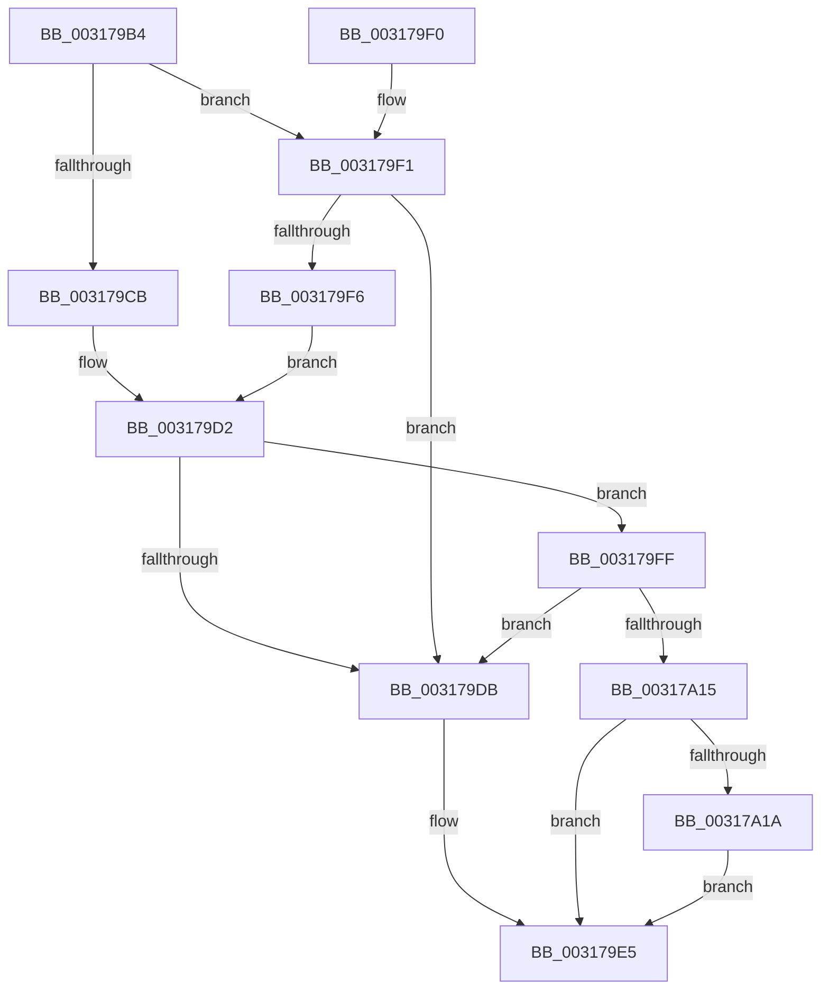

# SMKM_STORE_MGR&lt;SM_TRAITS&gt;::SmWorkItemFreeResource

- RVA: `0x003179B4`–`0x00317A2E` (길이 `122` bytes)
- VA: `0x00000001403179B4`
- 실행 섹션: `.text`
- PDB 이름 있음: `예`; PDB Function 태그: `아니요`
- unwind 정보 RVA: `0x00074B1C`
- 디코드: `39`개 명령, `122/122` bytes 표시
- 미해석 바이트: `0` (있으면 어셈블리에 `.byte`로 보존)

> 이 문서는 커널 이미지의 기계어와 PDB 기호를 분석해 생성했습니다. 4번과 5번은 함수 원형과 자료형을 바이너리 사용 방식에서 추정한 C 해석이며 원본 소스 복구 결과는 아닙니다.

## 1. Dependencies

- 직접 호출 지점: **3**; 고유 호출 대상: **3**
- 직접 호출자로 확인된 함수: **4**
- RIP 상대 이미지 참조: **0**

### Outgoing calls
- `0x003179E0` → [ExFreePoolWithTag](../../poolcode/B8/ExFreePoolWithTag_function_00B82870.md) (function, `0x00B82870`)
- `0x00317A0A` → [SmpFpReleaseResource](../4F/SmpFpReleaseResource_function_004FAC90.md) (function, `0x004FAC90`)
- `0x00317A27` → [KeSetEvent](../33/KeSetEvent_function_0033F310.md) (function, `0x0033F310`)

### Direct callers
- [SMKM_STORE_MGR&lt;SM_TRAITS&gt;::SmpPageEvict](../24/SMKM_STORE_MGR_SM_TRAITS_SmpPageEvict_function_0024A5F4.md) at `0x0024A790`
- [sub_00317476](Unknown_function_00317476.md) at `0x00317567`
- [sub_00317671](Unknown_function_00317671.md) at `0x003176BA`
- [SMKM_STORE_MGR&lt;SM_TRAITS&gt;::SmPageRead](../34/SMKM_STORE_MGR_SM_TRAITS_SmPageRead_function_0034C1D0.md) at `0x0034C448`

### Static image references
- 디코드된 RIP-relative 메모리 참조가 없습니다.

## 2. Other-region calls and transfers

- 다른 실행 섹션으로 향하는 call: **1**
  - `0x003179E0` → [ExFreePoolWithTag](../../poolcode/B8/ExFreePoolWithTag_function_00B82870.md) (`.text` → `POOLCODE`)
- 별도 외부 분기/꼬리 이동을 확인하지 못했습니다.

## 3. Assembly (complete function range)

```asm
003179B4  48 89 5C 24 08                  mov qword ptr [rsp + 8], rbx
003179B9  57                              push rdi
003179BA  48 83 EC 20                     sub rsp, 0x20
003179BE  8B 02                           mov eax, dword ptr [rdx]
003179C0  48 8B FA                        mov rdi, rdx
003179C3  83 E0 07                        and eax, 7
003179C6  83 E8 01                        sub eax, 1
003179C9  75 26                           jne 0x1403179f1
003179CB  48 8D 99 30 06 00 00            lea rbx, [rcx + 0x630]
003179D2  48 8B 43 70                     mov rax, qword ptr [rbx + 0x70]
003179D6  49 3B C0                        cmp rax, r8
003179D9  74 24                           je 0x1403179ff
003179DB  33 D2                           xor edx, edx
003179DD  48 8B CF                        mov rcx, rdi
003179E0  E8 8B AE 86 00                  call 0x140b82870
003179E5  48 8B 5C 24 30                  mov rbx, qword ptr [rsp + 0x30]
003179EA  48 83 C4 20                     add rsp, 0x20
003179EE  5F                              pop rdi
003179EF  C3                              ret
003179F0  CC                              int3
003179F1  83 F8 01                        cmp eax, 1
003179F4  75 E5                           jne 0x1403179db
003179F6  48 8D 99 A8 06 00 00            lea rbx, [rcx + 0x6a8]
003179FD  EB D3                           jmp 0x1403179d2
003179FF  4C 8B C7                        mov r8, rdi
00317A02  BA 01 00 00 00                  mov edx, 1
00317A07  48 8B CB                        mov rcx, rbx
00317A0A  E8 81 32 1E 00                  call 0x1404fac90
00317A0F  33 C9                           xor ecx, ecx
00317A11  85 C0                           test eax, eax
00317A13  74 C6                           je 0x1403179db
00317A15  38 4B 5E                        cmp byte ptr [rbx + 0x5e], cl
00317A18  75 CB                           jne 0x1403179e5
00317A1A  48 87 4B 70                     xchg qword ptr [rbx + 0x70], rcx
00317A1E  48 8D 4B 08                     lea rcx, [rbx + 8]
00317A22  45 33 C0                        xor r8d, r8d
00317A25  33 D2                           xor edx, edx
00317A27  E8 E4 78 02 00                  call 0x14033f310
00317A2C  EB B7                           jmp 0x1403179e5
```

## 4. C-style interpretation (structured pseudocode)

```c
__int64 __fastcall SMKM_STORE_MGR_SM_TRAITS___SmWorkItemFreeResource(__int64 a1, __int64 a2, __int64 a3)
{
    __int64 result;
    __int64 v_rsp;
    unsigned __int64 v_stack_p8;

    v_stack_p8 = v_rbx;
    v_rsp = (v_rsp) - (32);
    result = (unsigned int)(((unsigned int)(*(unsigned int *)(a2))) & (7));
    result = (unsigned int)((result) - (1));
    if (condition_is_not_equal) goto loc_003179F1;
loc_003179D2:
    if ((*(unsigned __int64 *)(a1 + 1584 + 112)) == a3) goto loc_003179FF;
loc_003179DB:
    a2 = 0;
    result = ExFreePoolWithTag(0, a2, a3, a4);
loc_003179E5:
    v_rsp = (v_rsp) + (32);
    return result;
loc_003179F1:
    if (((unsigned int)(result)) != 1) goto loc_003179DB;
    goto loc_003179D2;
loc_003179FF:
    result = SmpFpReleaseResource(0 + 1704, 1, 0, a4);
    a1 = 0;
    if ((unsigned int)(result) == 0) goto loc_003179DB;
    if ((*(unsigned __int8 *)(0 + 1704 + 94)) != 0) goto loc_003179E5;
    a3 = 0;
    a2 = 0;
    result = KeSetEvent(0 + 1704 + 8, a2, a3, a4);
    goto loc_003179E5;
}
```

## 5. (Beta) C Style

```c
int64_t SMKM_STORE_MGR_SM_TRAITS___SmWorkItemFreeResource(void *Arg1, void *Arg2, int64_t Arg3)
{
    uint8_t *arg1 = (uint8_t *)Arg1;
    uint8_t *arg2 = (uint8_t *)Arg2;

    int64_t result;
    int64_t local_rsp;
    uint64_t v_stack_p8;

    v_stack_p8 = local_rbx;
    local_rsp = (local_rsp) - (32);
    result = (uint32_t)(((uint32_t)(*(uint32_t *)(arg2))) & (7));
    result = (uint32_t)((result) - (1));
    if (condition_is_not_equal) goto loc_003179F1;
loc_003179D2:
    if ((*(uint64_t *)(arg1 + 0x630 + 0x70)) == Arg3) goto loc_003179FF;
loc_003179DB:
    Arg2 = 0;
    result = ExFreePoolWithTag(0, Arg2, Arg3, a4);
loc_003179E5:
    local_rsp = (local_rsp) + (32);
    return result;
loc_003179F1:
    if (((uint32_t)(result)) != 1) goto loc_003179DB;
    goto loc_003179D2;
loc_003179FF:
    result = SmpFpReleaseResource(0 + 1704, 1, 0, a4);
    Arg1 = 0;
    if ((uint32_t)(result) == 0) goto loc_003179DB;
    if ((*(uint8_t *)(0 + 0x6A8 + 0x5E)) != 0) goto loc_003179E5;
    Arg3 = 0;
    Arg2 = 0;
    result = KeSetEvent(0 + 1704 + 8, Arg2, Arg3, a4);
    goto loc_003179E5;
}
```

### 관측된 메모리 오프셋

구조체 형식이 확인되지 않은 접근은 인자 기준의 오프셋으로만 기록했습니다.

| 기준 인자 | 오프셋 표현 | 폭 (bit) | 접근 |
|---|---:|---:|---|
| `Arg1` | `+ 0x8` | `64` | `R` |
| `Arg1` | `+ 0x5E` | `8` | `R` |
| `Arg1` | `+ 0x70` | `64` | `R` |
| `Arg1` | `+ 0x70` | `64` | `R/W` |
| `Arg1` | `+ 0x630` | `64` | `R` |
| `Arg1` | `+ 0x6A8` | `64` | `R` |
| `Arg2` | `+ 0x0` | `32` | `R` |

## 6. Execution-region graph

[열기: 2D/3D 그래프와 함수 탐색 컨트롤 패널](../../../control-panel.html?section=text&rva=0x003179B4&view=graph)

- 2D 그래프는 위에서 아래로 흐르고, 3D 그래프는 빈 공간을 드래그해 회전합니다. Shift+드래그는 이동, 휠은 확대·축소, 함수 노드 선택은 대상 보고서 이동입니다.

### Static fallback


