# SMKM_STORE&lt;SM_TRAITS&gt;::SmStWorkItemQueue

- RVA: `0x00317A34`–`0x00317D02` (길이 `718` bytes)
- VA: `0x0000000140317A34`
- 실행 섹션: `.text`
- PDB 이름 있음: `예`; PDB Function 태그: `아니요`
- unwind 정보 RVA: `0x00074B2C`
- 디코드: `181`개 명령, `718/718` bytes 표시
- 미해석 바이트: `0` (있으면 어셈블리에 `.byte`로 보존)

> 이 문서는 커널 이미지의 기계어와 PDB 기호를 분석해 생성했습니다. 4번과 5번은 함수 원형과 자료형을 바이너리 사용 방식에서 추정한 C 해석이며 원본 소스 복구 결과는 아닙니다.

## 1. Dependencies

- 직접 호출 지점: **12**; 고유 호출 대상: **7**
- 직접 호출자로 확인된 함수: **4**
- RIP 상대 이미지 참조: **2**

### Outgoing calls
- `0x00317AA6` → [KeAcquireSpinLockRaiseToDpc](../20/KeAcquireSpinLockRaiseToDpc_function_00208470.md) (function, `0x00208470`)
- `0x00317AF5` → [KxReleaseSpinLock](../20/KxReleaseSpinLock_function_00206670.md) (function, `0x00206670`)
- `0x00317B3B` → [KeQueryPriorityThread](../38/KeQueryPriorityThread_function_0038F4F0.md) (function, `0x0038F4F0`)
- `0x00317B56` → [KeSetEvent](../33/KeSetEvent_function_0033F310.md) (function, `0x0033F310`)
- `0x00317B72` → [KiLowerIrqlProcessIrqlFlags](../4F/KiLowerIrqlProcessIrqlFlags_function_004F5698.md) (function, `0x004F5698`)
- `0x00317BCC` → [KeSetActualBasePriorityThread](../3C/KeSetActualBasePriorityThread_function_003C4370.md) (function, `0x003C4370`)
- `0x00317BE3` → [SMKM_STORE<SM_TRAITS>::SmStDirectRead](../3A/SMKM_STORE_SM_TRAITS_SmStDirectRead_function_003AA820.md) (function, `0x003AA820`)
- `0x00317BF6` → [KeAcquireSpinLockRaiseToDpc](../20/KeAcquireSpinLockRaiseToDpc_function_00208470.md) (function, `0x00208470`)
- `0x00317C3A` → [KxReleaseSpinLock](../20/KxReleaseSpinLock_function_00206670.md) (function, `0x00206670`)
- `0x00317C55` → [KeSetEvent](../33/KeSetEvent_function_0033F310.md) (function, `0x0033F310`)
- `0x00317C6A` → [KiLowerIrqlProcessIrqlFlags](../4F/KiLowerIrqlProcessIrqlFlags_function_004F5698.md) (function, `0x004F5698`)
- `0x00317CF9` → [KeQueryPriorityThread](../38/KeQueryPriorityThread_function_0038F4F0.md) (function, `0x0038F4F0`)

### Direct callers
- [SmWorkItemQueue](SmWorkItemQueue_function_0031799C.md) at `0x003179A0`
- [ST_STORE&lt;SM_TRAITS&gt;::StDmLazyWorkItemQueue](../3C/ST_STORE_SM_TRAITS_StDmLazyWorkItemQueue_function_003C2080.md) at `0x003C20C6`
- [SMKM_STORE_MGR&lt;SM_TRAITS&gt;::SmPerformStoreMaintenance](../49/SMKM_STORE_MGR_SM_TRAITS_SmPerformStoreMaintenance_function_00496FD8.md) at `0x00497092`
- [SMKM_STORE_MGR&lt;SM_TRAITS&gt;::SmStoreRequestEx](../4A/SMKM_STORE_MGR_SM_TRAITS_SmStoreRequestEx_function_004A21D8.md) at `0x004A2201`

### Static image references
- `0x00317B62` → RVA `0x00FC6D20` (`ALMOSTRO`; read)
- `0x00317BAD` → RVA `0x00038018` (`.rdata`; read)

## 2. Other-region calls and transfers

- 다른 실행 섹션으로 향하는 call: **0**
- 별도 외부 분기/꼬리 이동을 확인하지 못했습니다.

## 3. Assembly (complete function range)

```asm
00317A34  48 89 5C 24 08                  mov qword ptr [rsp + 8], rbx
00317A39  48 89 6C 24 10                  mov qword ptr [rsp + 0x10], rbp
00317A3E  48 89 74 24 18                  mov qword ptr [rsp + 0x18], rsi
00317A43  57                              push rdi
00317A44  41 54                           push r12
00317A46  41 55                           push r13
00317A48  41 56                           push r14
00317A4A  41 57                           push r15
00317A4C  48 83 EC 20                     sub rsp, 0x20
00317A50  44 8B 3A                        mov r15d, dword ptr [rdx]
00317A53  41 8B E8                        mov ebp, r8d
00317A56  41 83 E7 07                     and r15d, 7
00317A5A  48 8B DA                        mov rbx, rdx
00317A5D  48 8B F1                        mov rsi, rcx
00317A60  41 83 FF 02                     cmp r15d, 2
00317A64  0F 84 6C 01 00 00               je 0x140317bd6
00317A6A  F6 81 95 1A 00 00 01            test byte ptr [rcx + 0x1a95], 1
00317A71  0F 85 04 01 00 00               jne 0x140317b7b
00317A77  40 F6 C5 04                     test bpl, 4
00317A7B  75 07                           jne 0x140317a84
00317A7D  F0 FF 81 A8 1D 00 00            lock inc dword ptr [rcx + 0x1da8]
00317A84  40 F6 C5 01                     test bpl, 1
00317A88  0F 84 0B 01 00 00               je 0x140317b99
00317A8E  B8 F0 1A 00 00                  mov eax, 0x1af0
00317A93  BF 04 1B 00 00                  mov edi, 0x1b04
00317A98  4C 8D A9 C8 1A 00 00            lea r13, [rcx + 0x1ac8]
00317A9F  4C 8D 34 08                     lea r14, [rax + rcx]
00317AA3  49 8B CD                        mov rcx, r13
00317AA6  E8 C5 09 EF FF                  call 0x140208470
00317AAB  49 8B 56 08                     mov rdx, qword ptr [r14 + 8]
00317AAF  44 0F B6 E0                     movzx r12d, al
00317AB3  40 F6 C5 02                     test bpl, 2
00317AB7  0F 85 BB 01 00 00               jne 0x140317c78
00317ABD  48 8B 12                        mov rdx, qword ptr [rdx]
00317AC0  8B 03                           mov eax, dword ptr [rbx]
00317AC2  48 83 E2 F8                     and rdx, 0xfffffffffffffff8
00317AC6  83 E0 07                        and eax, 7
00317AC9  48 83 C2 08                     add rdx, 8
00317ACD  48 0B D0                        or rdx, rax
00317AD0  48 89 13                        mov qword ptr [rbx], rdx
00317AD3  49 8B 56 08                     mov rdx, qword ptr [r14 + 8]
00317AD7  8B 02                           mov eax, dword ptr [rdx]
00317AD9  83 E0 07                        and eax, 7
00317ADC  48 0B C3                        or rax, rbx
00317ADF  48 89 02                        mov qword ptr [rdx], rax
00317AE2  49 89 5E 08                     mov qword ptr [r14 + 8], rbx
00317AE6  8B 04 37                        mov eax, dword ptr [rdi + rsi]
00317AE9  49 8B CD                        mov rcx, r13
00317AEC  FF C0                           inc eax
00317AEE  89 04 37                        mov dword ptr [rdi + rsi], eax
00317AF1  44 8B 34 37                     mov r14d, dword ptr [rdi + rsi]
00317AF5  E8 76 EB EE FF                  call 0x140206670
00317AFA  65 48 8B 14 25 88 01 00 00      mov rdx, qword ptr gs:[0x188]
00317B03  40 F6 C5 04                     test bpl, 4
00317B07  75 59                           jne 0x140317b62
00317B09  0F B6 86 96 1A 00 00            movzx eax, byte ptr [rsi + 0x1a96]
00317B10  8B BE 98 1D 00 00               mov edi, dword ptr [rsi + 0x1d98]
00317B16  3C 04                           cmp al, 4
00317B18  0F 85 8F 00 00 00               jne 0x140317bad
00317B1E  40 F6 C5 01                     test bpl, 1
00317B22  0F 85 B4 01 00 00               jne 0x140317cdc
00317B28  41 83 FF 02                     cmp r15d, 2
00317B2C  0F 84 B1 01 00 00               je 0x140317ce3
00317B32  8B DF                           mov ebx, edi
00317B34  48 8B 8E 58 1B 00 00            mov rcx, qword ptr [rsi + 0x1b58]
00317B3B  E8 B0 79 07 00                  call 0x14038f4f0
00317B40  3B D8                           cmp ebx, eax
00317B42  7F 7F                           jg 0x140317bc3
00317B44  41 83 FE 01                     cmp r14d, 1
00317B48  75 11                           jne 0x140317b5b
00317B4A  48 8D 8E 10 1B 00 00            lea rcx, [rsi + 0x1b10]
00317B51  45 33 C0                        xor r8d, r8d
00317B54  33 D2                           xor edx, edx
00317B56  E8 B5 77 02 00                  call 0x14033f310
00317B5B  F0 FF 8E A8 1D 00 00            lock dec dword ptr [rsi + 0x1da8]
00317B62  83 3D B7 F1 CA 00 00            cmp dword ptr [rip + 0xcaf1b7], 0
00317B69  74 0C                           je 0x140317b77
00317B6B  44 0F 20 C1                     mov rcx, cr8
00317B6F  41 8A D4                        mov dl, r12b
00317B72  E8 21 DB 1D 00                  call 0x1404f5698
00317B77  45 0F 22 C4                     mov cr8, r12
00317B7B  48 8B 5C 24 50                  mov rbx, qword ptr [rsp + 0x50]
00317B80  48 8B 6C 24 58                  mov rbp, qword ptr [rsp + 0x58]
00317B85  48 8B 74 24 60                  mov rsi, qword ptr [rsp + 0x60]
00317B8A  48 83 C4 20                     add rsp, 0x20
00317B8E  41 5F                           pop r15
00317B90  41 5E                           pop r14
00317B92  41 5D                           pop r13
00317B94  41 5C                           pop r12
00317B96  5F                              pop rdi
00317B97  C3                              ret
00317B98  CC                              int3
00317B99  41 83 FF 02                     cmp r15d, 2
00317B9D  0F 84 1F 01 00 00               je 0x140317cc2
00317BA3  B8 E0 1A 00 00                  mov eax, 0x1ae0
00317BA8  E9 E6 FE FF FF                  jmp 0x140317a93
00317BAD  48 8D 0D 64 04 D2 FF            lea rcx, [rip - 0x2dfb9c]
00317BB4  8B 0C 81                        mov ecx, dword ptr [rcx + rax*4]
00317BB7  3B CF                           cmp ecx, edi
00317BB9  0F 4C CF                        cmovl ecx, edi
00317BBC  8B F9                           mov edi, ecx
00317BBE  E9 5B FF FF FF                  jmp 0x140317b1e
00317BC3  48 8B 8E 58 1B 00 00            mov rcx, qword ptr [rsi + 0x1b58]
00317BCA  8B D3                           mov edx, ebx
00317BCC  E8 9F C7 0A 00                  call 0x1403c4370
00317BD1  E9 6E FF FF FF                  jmp 0x140317b44
00317BD6  F6 81 95 1A 00 00 04            test byte ptr [rcx + 0x1a95], 4
00317BDD  0F 84 87 FE FF FF               je 0x140317a6a
00317BE3  E8 38 2C 09 00                  call 0x1403aa820
00317BE8  85 C0                           test eax, eax
00317BEA  75 8F                           jne 0x140317b7b
00317BEC  48 8D BE E0 1C 00 00            lea rdi, [rsi + 0x1ce0]
00317BF3  48 8B CF                        mov rcx, rdi
00317BF6  E8 75 08 EF FF                  call 0x140208470
00317BFB  8B 13                           mov edx, dword ptr [rbx]
00317BFD  48 8B 8E D8 1C 00 00            mov rcx, qword ptr [rsi + 0x1cd8]
00317C04  83 E2 07                        and edx, 7
00317C07  0F B6 E8                        movzx ebp, al
00317C0A  4C 8B 01                        mov r8, qword ptr [rcx]
00317C0D  48 8B CF                        mov rcx, rdi
00317C10  49 83 E0 F8                     and r8, 0xfffffffffffffff8
00317C14  49 83 C0 08                     add r8, 8
00317C18  4C 0B C2                        or r8, rdx
00317C1B  4C 89 03                        mov qword ptr [rbx], r8
00317C1E  48 8B 96 D8 1C 00 00            mov rdx, qword ptr [rsi + 0x1cd8]
00317C25  8B 02                           mov eax, dword ptr [rdx]
00317C27  83 E0 07                        and eax, 7
00317C2A  48 0B C3                        or rax, rbx
00317C2D  48 89 02                        mov qword ptr [rdx], rax
00317C30  48 89 9E D8 1C 00 00            mov qword ptr [rsi + 0x1cd8], rbx
00317C37  48 8B 1B                        mov rbx, qword ptr [rbx]
00317C3A  E8 31 EA EE FF                  call 0x140206670
00317C3F  48 83 E3 F8                     and rbx, 0xfffffffffffffff8
00317C43  48 83 FB 08                     cmp rbx, 8
00317C47  75 11                           jne 0x140317c5a
00317C49  48 8D 8E B8 1C 00 00            lea rcx, [rsi + 0x1cb8]
00317C50  45 33 C0                        xor r8d, r8d
00317C53  33 D2                           xor edx, edx
00317C55  E8 B6 76 02 00                  call 0x14033f310
00317C5A  83 3D BF F0 CA 00 00            cmp dword ptr [rip + 0xcaf0bf], 0
00317C61  74 0C                           je 0x140317c6f
00317C63  44 0F 20 C1                     mov rcx, cr8
00317C67  40 8A D5                        mov dl, bpl
00317C6A  E8 29 DA 1D 00                  call 0x1404f5698
00317C6F  44 0F 22 C5                     mov cr8, rbp
00317C73  E9 03 FF FF FF                  jmp 0x140317b7b
00317C78  8B 0B                           mov ecx, dword ptr [rbx]
00317C7A  4C 8B 02                        mov r8, qword ptr [rdx]
00317C7D  83 E1 07                        and ecx, 7
00317C80  49 0B 0E                        or rcx, qword ptr [r14]
00317C83  48 89 0B                        mov qword ptr [rbx], rcx
00317C86  49 8B 56 08                     mov rdx, qword ptr [r14 + 8]
00317C8A  49 C1 E8 03                     shr r8, 3
00317C8E  49 89 1E                        mov qword ptr [r14], rbx
00317C91  49 3B D6                        cmp rdx, r14
00317C94  75 07                           jne 0x140317c9d
00317C96  49 89 5E 08                     mov qword ptr [r14 + 8], rbx
00317C9A  48 8B D3                        mov rdx, rbx
00317C9D  8B 02                           mov eax, dword ptr [rdx]
00317C9F  4A 8D 0C C5 08 00 00 00         lea rcx, [r8*8 + 8]
00317CA7  83 E0 07                        and eax, 7
00317CAA  48 0B C8                        or rcx, rax
00317CAD  48 89 0A                        mov qword ptr [rdx], rcx
00317CB0  E9 31 FE FF FF                  jmp 0x140317ae6
00317CB5  3B DF                           cmp ebx, edi
00317CB7  0F 8E 75 FE FF FF               jle 0x140317b32
00317CBD  E9 72 FE FF FF                  jmp 0x140317b34
00317CC2  F7 42 08 00 00 00 01            test dword ptr [rdx + 8], 0x1000000
00317CC9  0F 85 D4 FE FF FF               jne 0x140317ba3
00317CCF  BF 00 1B 00 00                  mov edi, 0x1b00
00317CD4  8D 47 D0                        lea eax, [rdi - 0x30]
00317CD7  E9 BC FD FF FF                  jmp 0x140317a98
00317CDC  BB 0C 00 00 00                  mov ebx, 0xc
00317CE1  EB D2                           jmp 0x140317cb5
00317CE3  65 8B 04 25 3C 3A 00 00         mov eax, dword ptr gs:[0x3a3c]
00317CEB  A9 01 00 01 00                  test eax, 0x10001
00317CF0  0F 85 3C FE FF FF               jne 0x140317b32
00317CF6  48 8B CA                        mov rcx, rdx
00317CF9  E8 F2 77 07 00                  call 0x14038f4f0
00317CFE  8B D8                           mov ebx, eax
00317D00  EB B3                           jmp 0x140317cb5
```

## 4. C-style interpretation (structured pseudocode)

```c
__int64 __fastcall SMKM_STORE_SM_TRAITS___SmStWorkItemQueue(__int64 a1, __int64 a2, int a3)
{
    __int64 result;
    __int64 v_r15;
    __int64 v_rbx;
    __int64 v_rsp;
    unsigned __int64 v_stack_p10;
    unsigned __int64 v_stack_p18;
    unsigned __int64 v_stack_p8;

    v_stack_p8 = v_rbx;
    v_stack_p10 = v_rbp;
    v_stack_p18 = v_rsi;
    v_rsp = (v_rsp) - (32);
    v_r15 = (unsigned int)(((unsigned int)(*(unsigned int *)(a2))) & (7));
    if (((unsigned int)(v_r15)) == 2) goto loc_00317BD6;
loc_00317A6A:
    if (((*(unsigned __int8 *)(a1 + 6805)) & (1)) != 0) goto loc_00317B7B;
    if ((((unsigned __int8)((unsigned int)(a3))) & (4)) == 0) {
    }
    if ((((unsigned __int8)((unsigned int)(a3))) & (1)) == 0) goto loc_00317B99;
loc_00317A93:
loc_00317A98:
    result = KeAcquireSpinLockRaiseToDpc(a1 + 6856, a2, a3, a4);
    if ((((unsigned __int8)((unsigned int)(a3))) & (2)) != 0) goto loc_00317C78;
    a2 = (*(unsigned __int64 *)(*(unsigned __int64 *)((unsigned int)(0x1AF0ULL) + a1 * 1 + 8))) & (-8);
    result = (unsigned int)(((unsigned int)(*(unsigned int *)(a2))) & (7));
    a2 = (a2) + (8);
    a2 = (a2) | (result);
    *(unsigned __int64 *)(a2) = a2;
    result = (unsigned int)(((unsigned int)(*(unsigned int *)(*(unsigned __int64 *)((unsigned int)(0x1AF0ULL) + a1 * 1 + 8)))) & (7));
    result = (result) | (a2);
    *(unsigned __int64 *)(*(unsigned __int64 *)((unsigned int)(0x1AF0ULL) + a1 * 1 + 8)) = result;
    *(unsigned __int64 *)((unsigned int)(0x1AF0ULL) + a1 * 1 + 8) = a2;
loc_00317AE6:
    result = (unsigned int)(((unsigned int)(*(unsigned int *)((unsigned int)(0x1B04ULL) + a1 * 1))) + 1);
    *(unsigned int *)((unsigned int)(0x1B04ULL) + a1 * 1) = (unsigned int)(result);
    result = KxReleaseSpinLock(a1 + 6856, *(unsigned __int64 *)((unsigned int)(0x1AF0ULL) + a1 * 1 + 8), a3, a4);
    if ((((unsigned __int8)((unsigned int)(a3))) & (4)) != 0) goto loc_00317B62;
    if (((unsigned __int8)(*(unsigned __int8 *)(a1 + 6806))) != 4) goto loc_00317BAD;
loc_00317B1E:
    if ((((unsigned __int8)((unsigned int)(a3))) & (1)) != 0) goto loc_00317CDC;
    if (((unsigned int)(v_r15)) == 2) goto loc_00317CE3;
loc_00317B32:
loc_00317B34:
    result = KeQueryPriorityThread(*(unsigned __int64 *)(a1 + 7000), *(unsigned __int64 *)(gs_base + (0 + 392)), a3, a4);
    if (((unsigned int)((unsigned int)((unsigned int)((unsigned int)(*(unsigned int *)(a1 + 7576)))))) > ((unsigned int)(result))) goto loc_00317BC3;
loc_00317B44:
    if (((unsigned int)((unsigned int)(*(unsigned int *)((unsigned int)(0x1B04ULL) + a1 * 1)))) == 1) {
        a1 = a1 + 6928;
        a3 = 0;
        a2 = 0;
        result = KeSetEvent(a1, a2, a3, a4);
    }
loc_00317B62:
    if ((*(unsigned int *)(v_rip + 13300151)) != 0) {
        a1 = v_cr8;
        a2 = (unsigned __int8)((unsigned __int8)(result));
        result = KiLowerIrqlProcessIrqlFlags(a1, a2, a3, a4);
    }
loc_00317B7B:
    v_rsp = (v_rsp) + (32);
    return result;
loc_00317B99:
    if (((unsigned int)(v_r15)) == 2) goto loc_00317CC2;
loc_00317BA3:
    goto loc_00317A93;
loc_00317BAD:
    a1 = (unsigned int)(*(unsigned int *)(v_rip - 3013532 + (unsigned int)(0x1AE0ULL) * 4));
    if (((unsigned int)((unsigned int)(*(unsigned int *)(v_rip - 3013532 + (unsigned int)(0x1AE0ULL) * 4)))) < ((unsigned int)((unsigned int)(*(unsigned int *)(a1 + 7576))))) { a1 = (unsigned int)((unsigned int)(*(unsigned int *)(a1 + 7576))); }
    goto loc_00317B1E;
loc_00317BC3:
    result = KeSetActualBasePriorityThread(*(unsigned __int64 *)(v_stack_p18 + 7000), (unsigned int)((unsigned int)(v_stack_p8)), a3, a4);
    goto loc_00317B44;
loc_00317BD6:
    if (((*(unsigned __int8 *)(*(unsigned __int64 *)(v_stack_p18 + 7000) + 6805)) & (4)) == 0) goto loc_00317A6A;
    result = SMKM_STORE_SM_TRAITS___SmStDirectRead(*(unsigned __int64 *)(v_stack_p18 + 7000), (unsigned int)((unsigned int)(v_stack_p8)), a3, a4);
    if ((unsigned int)(result) != 0) goto loc_00317B7B;
    result = KeAcquireSpinLockRaiseToDpc(v_stack_p18 + 7392, (unsigned int)((unsigned int)(v_stack_p8)), a3, a4);
    a2 = (unsigned int)(((unsigned int)(*(unsigned int *)(v_stack_p8))) & (7));
    a3 = (*(unsigned __int64 *)(*(unsigned __int64 *)(v_stack_p18 + 7384))) & (-8);
    a3 = (a3) + (8);
    a3 = (a3) | (a2);
    *(unsigned __int64 *)(v_stack_p8) = a3;
    result = (unsigned int)(((unsigned int)(*(unsigned int *)(*(unsigned __int64 *)(v_stack_p18 + 7384)))) & (7));
    result = (result) | (v_stack_p8);
    *(unsigned __int64 *)(*(unsigned __int64 *)(v_stack_p18 + 7384)) = result;
    *(unsigned __int64 *)(v_stack_p18 + 7384) = v_stack_p8;
    result = KxReleaseSpinLock(v_stack_p18 + 7392, *(unsigned __int64 *)(v_stack_p18 + 7384), a3, a4);
    v_rbx = (*(unsigned __int64 *)(v_stack_p8)) & (-8);
    if (v_rbx == 8) {
        a1 = v_stack_p18 + 7352;
        a3 = 0;
        a2 = 0;
        result = KeSetEvent(a1, a2, a3, a4);
    }
    if ((*(unsigned int *)(v_rip + 13299903)) != 0) {
        a1 = (unsigned __int8)(result);
        a2 = (unsigned __int8)((unsigned __int8)(result));
        result = KiLowerIrqlProcessIrqlFlags(a1, a2, a3, a4);
    }
    goto loc_00317B7B;
loc_00317C78:
    a1 = (unsigned int)(((unsigned int)(*(unsigned int *)(v_rbx))) & (7));
    a1 = (a1) | (*(unsigned __int64 *)((unsigned int)(*(unsigned int *)((unsigned int)(0x1B04ULL) + a1 * 1))));
    *(unsigned __int64 *)(v_rbx) = a1;
    a3 = (*(unsigned __int64 *)(a2)) >> (3);
    *(unsigned __int64 *)((unsigned int)(*(unsigned int *)((unsigned int)(0x1B04ULL) + a1 * 1))) = v_rbx;
    if ((*(unsigned __int64 *)((unsigned int)(*(unsigned int *)((unsigned int)(0x1B04ULL) + a1 * 1)) + 8)) == ((unsigned int)(*(unsigned int *)((unsigned int)(0x1B04ULL) + a1 * 1)))) {
        *(unsigned __int64 *)((unsigned int)(*(unsigned int *)((unsigned int)(0x1B04ULL) + a1 * 1)) + 8) = v_rbx;
        a2 = v_rbx;
    }
    result = (unsigned int)(((unsigned int)(*(unsigned int *)(a2))) & (7));
    a1 = (a3 * 8 + 8) | (result);
    *(unsigned __int64 *)(a2) = a1;
    goto loc_00317AE6;
loc_00317CB5:
    if (((unsigned int)(v_rbx)) <= ((unsigned int)(v_stack_p18 + 7392))) goto loc_00317B32;
    goto loc_00317B34;
loc_00317CC2:
    if (((*(unsigned int *)(a2 + 8)) & (0x1000000ULL)) != 0) goto loc_00317BA3;
    goto loc_00317A98;
loc_00317CDC:
    goto loc_00317CB5;
loc_00317CE3:
    if ((((unsigned int)((unsigned int)(*(unsigned int *)(gs_base + (0 + 14908))))) & (0x10001ULL)) != 0) goto loc_00317B32;
    result = KeQueryPriorityThread(a2, a2, a3, a4);
    goto loc_00317CB5;
}
```

## 5. (Beta) C Style

```c
int64_t SMKM_STORE_SM_TRAITS___SmStWorkItemQueue(void *Arg1, void *Arg2, int32_t Arg3)
{
    uint8_t *arg1 = (uint8_t *)Arg1;
    uint8_t *arg2 = (uint8_t *)Arg2;

    int64_t result;
    int64_t local_r15;
    int64_t local_rbx;
    int64_t local_rsp;
    uint64_t v_stack_p10;
    uint64_t v_stack_p18;
    uint64_t v_stack_p8;

    v_stack_p8 = local_rbx;
    v_stack_p10 = local_rbp;
    v_stack_p18 = local_rsi;
    local_rsp = (local_rsp) - (32);
    local_r15 = (uint32_t)(((uint32_t)(*(uint32_t *)(arg2))) & (7));
    if (((uint32_t)(local_r15)) == 2) goto loc_00317BD6;
loc_00317A6A:
    if (((*(uint8_t *)(arg1 + 0x1A95)) & (1)) != 0) goto loc_00317B7B;
    if ((((uint8_t)((uint32_t)(Arg3))) & (4)) == 0) {
    }
    if ((((uint8_t)((uint32_t)(Arg3))) & (1)) == 0) goto loc_00317B99;
loc_00317A93:
loc_00317A98:
    result = KeAcquireSpinLockRaiseToDpc(Arg1 + 6856, Arg2, Arg3, a4);
    if ((((uint8_t)((uint32_t)(Arg3))) & (2)) != 0) goto loc_00317C78;
    Arg2 = (*(uint64_t *)(*(uint64_t *)((uint32_t)(0x1AF0ULL) + arg1 * 1 + 0x8))) & (-8);
    result = (uint32_t)(((uint32_t)(*(uint32_t *)(arg2))) & (7));
    Arg2 = (Arg2) + (8);
    Arg2 = (Arg2) | (result);
    *(void **)(arg2) = Arg2;
    result = (uint32_t)(((uint32_t)(*(uint32_t *)(*(uint64_t *)((uint32_t)(0x1AF0ULL) + arg1 * 1 + 0x8)))) & (7));
    result = (result) | (Arg2);
    *(uint64_t *)(*(uint64_t *)((uint32_t)(0x1AF0ULL) + arg1 * 1 + 0x8)) = result;
    *(void **)((uint32_t)(0x1AF0ULL) + arg1 * 1 + 0x8) = Arg2;
loc_00317AE6:
    result = (uint32_t)(((uint32_t)(*(uint32_t *)((uint32_t)(0x1B04ULL) + arg1 * 1))) + 1);
    *(uint32_t *)((uint32_t)(0x1B04ULL) + arg1 * 1) = (uint32_t)(result);
    result = KxReleaseSpinLock(Arg1 + 6856, *(uint64_t *)((uint32_t)(0x1AF0ULL) + arg1 * 1 + 0x8), Arg3, a4);
    if ((((uint8_t)((uint32_t)(Arg3))) & (4)) != 0) goto loc_00317B62;
    if (((uint8_t)(*(uint8_t *)(arg1 + 0x1A96))) != 4) goto loc_00317BAD;
loc_00317B1E:
    if ((((uint8_t)((uint32_t)(Arg3))) & (1)) != 0) goto loc_00317CDC;
    if (((uint32_t)(local_r15)) == 2) goto loc_00317CE3;
loc_00317B32:
loc_00317B34:
    result = KeQueryPriorityThread(*(uint64_t *)(arg1 + 0x1B58), *(uint64_t *)(gs_base + (0 + 0x188)), Arg3, a4);
    if (((uint32_t)((uint32_t)((uint32_t)((uint32_t)(*(uint32_t *)(arg1 + 0x1D98)))))) > ((uint32_t)(result))) goto loc_00317BC3;
loc_00317B44:
    if (((uint32_t)((uint32_t)(*(uint32_t *)((uint32_t)(0x1B04ULL) + arg1 * 1)))) == 1) {
        Arg1 = Arg1 + 6928;
        Arg3 = 0;
        Arg2 = 0;
        result = KeSetEvent(Arg1, Arg2, Arg3, a4);
    }
loc_00317B62:
    if ((*(uint32_t *)(v_rip + 0xCAF1B7)) != 0) {
        Arg1 = v_cr8;
        Arg2 = (uint8_t)((uint8_t)(result));
        result = KiLowerIrqlProcessIrqlFlags(Arg1, Arg2, Arg3, a4);
    }
loc_00317B7B:
    local_rsp = (local_rsp) + (32);
    return result;
loc_00317B99:
    if (((uint32_t)(local_r15)) == 2) goto loc_00317CC2;
loc_00317BA3:
    goto loc_00317A93;
loc_00317BAD:
    Arg1 = (uint32_t)(*(uint32_t *)(v_rip - 0x2DFB9C + (uint32_t)(0x1AE0ULL) * 4));
    if (((uint32_t)((uint32_t)(*(uint32_t *)(v_rip - 0x2DFB9C + (uint32_t)(0x1AE0ULL) * 4)))) < ((uint32_t)((uint32_t)(*(uint32_t *)(arg1 + 0x1D98))))) { Arg1 = (uint32_t)((uint32_t)(*(uint32_t *)(arg1 + 0x1D98))); }
    goto loc_00317B1E;
loc_00317BC3:
    result = KeSetActualBasePriorityThread(*(uint64_t *)(v_stack_p18 + 0x1B58), (uint32_t)((uint32_t)(v_stack_p8)), Arg3, a4);
    goto loc_00317B44;
loc_00317BD6:
    if (((*(uint8_t *)(*(uint64_t *)(v_stack_p18 + 0x1B58) + 0x1A95)) & (4)) == 0) goto loc_00317A6A;
    result = SMKM_STORE_SM_TRAITS___SmStDirectRead(*(uint64_t *)(v_stack_p18 + 0x1B58), (uint32_t)((uint32_t)(v_stack_p8)), Arg3, a4);
    if ((uint32_t)(result) != 0) goto loc_00317B7B;
    result = KeAcquireSpinLockRaiseToDpc(v_stack_p18 + 7392, (uint32_t)((uint32_t)(v_stack_p8)), Arg3, a4);
    Arg2 = (uint32_t)(((uint32_t)(*(uint32_t *)(v_stack_p8))) & (7));
    Arg3 = (*(uint64_t *)(*(uint64_t *)(v_stack_p18 + 0x1CD8))) & (-8);
    Arg3 = (Arg3) + (8);
    Arg3 = (Arg3) | (Arg2);
    *(uint64_t *)(v_stack_p8) = Arg3;
    result = (uint32_t)(((uint32_t)(*(uint32_t *)(*(uint64_t *)(v_stack_p18 + 0x1CD8)))) & (7));
    result = (result) | (v_stack_p8);
    *(uint64_t *)(*(uint64_t *)(v_stack_p18 + 0x1CD8)) = result;
    *(uint64_t *)(v_stack_p18 + 0x1CD8) = v_stack_p8;
    result = KxReleaseSpinLock(v_stack_p18 + 7392, *(uint64_t *)(v_stack_p18 + 0x1CD8), Arg3, a4);
    local_rbx = (*(uint64_t *)(v_stack_p8)) & (-8);
    if (local_rbx == 8) {
        Arg1 = v_stack_p18 + 7352;
        Arg3 = 0;
        Arg2 = 0;
        result = KeSetEvent(Arg1, Arg2, Arg3, a4);
    }
    if ((*(uint32_t *)(v_rip + 0xCAF0BF)) != 0) {
        Arg1 = (uint8_t)(result);
        Arg2 = (uint8_t)((uint8_t)(result));
        result = KiLowerIrqlProcessIrqlFlags(Arg1, Arg2, Arg3, a4);
    }
    goto loc_00317B7B;
loc_00317C78:
    Arg1 = (uint32_t)(((uint32_t)(*(uint32_t *)(local_rbx))) & (7));
    Arg1 = (Arg1) | (*(uint64_t *)((uint32_t)(*(uint32_t *)((uint32_t)(0x1B04ULL) + arg1 * 1))));
    *(void **)(local_rbx) = Arg1;
    Arg3 = (*(uint64_t *)(arg2)) >> (3);
    *(uint64_t *)((uint32_t)(*(uint32_t *)((uint32_t)(0x1B04ULL) + arg1 * 1))) = local_rbx;
    if ((*(uint64_t *)((uint32_t)(*(uint32_t *)((uint32_t)(0x1B04ULL) + arg1 * 1)) + 0x8)) == ((uint32_t)(*(uint32_t *)((uint32_t)(0x1B04ULL) + arg1 * 1)))) {
        *(uint64_t *)((uint32_t)(*(uint32_t *)((uint32_t)(0x1B04ULL) + arg1 * 1)) + 0x8) = local_rbx;
        Arg2 = local_rbx;
    }
    result = (uint32_t)(((uint32_t)(*(uint32_t *)(arg2))) & (7));
    Arg1 = (Arg3 * 8 + 8) | (result);
    *(void **)(arg2) = Arg1;
    goto loc_00317AE6;
loc_00317CB5:
    if (((uint32_t)(local_rbx)) <= ((uint32_t)(v_stack_p18 + 7392))) goto loc_00317B32;
    goto loc_00317B34;
loc_00317CC2:
    if (((*(uint32_t *)(arg2 + 0x8)) & (0x1000000ULL)) != 0) goto loc_00317BA3;
    goto loc_00317A98;
loc_00317CDC:
    goto loc_00317CB5;
loc_00317CE3:
    if ((((uint32_t)((uint32_t)(*(uint32_t *)(gs_base + (0 + 0x3A3C))))) & (0x10001ULL)) != 0) goto loc_00317B32;
    result = KeQueryPriorityThread(Arg2, Arg2, Arg3, a4);
    goto loc_00317CB5;
}
```

### 관측된 메모리 오프셋

구조체 형식이 확인되지 않은 접근은 인자 기준의 오프셋으로만 기록했습니다.

| 기준 인자 | 오프셋 표현 | 폭 (bit) | 접근 |
|---|---:|---:|---|
| `Arg1` | `+ 0x1A95` | `8` | `R` |
| `Arg1` | `+ 0x1A96` | `8` | `R` |
| `Arg1` | `+ 0x1AC8` | `64` | `R` |
| `Arg1` | `+ 0x1B10` | `64` | `R` |
| `Arg1` | `+ 0x1B58` | `64` | `R` |
| `Arg1` | `+ 0x1CB8` | `64` | `R` |
| `Arg1` | `+ 0x1CD8` | `64` | `R` |
| `Arg1` | `+ 0x1CD8` | `64` | `W` |
| `Arg1` | `+ 0x1CE0` | `64` | `R` |
| `Arg1` | `+ 0x1D98` | `32` | `R` |
| `Arg1` | `+ 0x1DA8` | `32` | `R/W` |
| `Arg2` | `+ 0x0` | `32` | `R` |
| `Arg2` | `+ 0x0` | `64` | `R` |
| `Arg2` | `+ 0x0` | `64` | `W` |
| `Arg2` | `+ 0x8` | `32` | `R` |

## 6. Execution-region graph

[열기: 2D/3D 그래프와 함수 탐색 컨트롤 패널](../../../control-panel.html?section=text&rva=0x00317A34&view=graph)

- 2D 그래프는 위에서 아래로 흐르고, 3D 그래프는 빈 공간을 드래그해 회전합니다. Shift+드래그는 이동, 휠은 확대·축소, 함수 노드 선택은 대상 보고서 이동입니다.

### Static fallback

```mermaid
flowchart TD
  bb_00317A34[BB_00317A34]
  bb_00317A6A[BB_00317A6A]
  bb_00317A77[BB_00317A77]
  bb_00317A7D[BB_00317A7D]
  bb_00317A84[BB_00317A84]
  bb_00317A8E[BB_00317A8E]
  bb_00317A93[BB_00317A93]
  bb_00317A98[BB_00317A98]
  bb_00317ABD[BB_00317ABD]
  bb_00317AE6[BB_00317AE6]
  bb_00317B09[BB_00317B09]
  bb_00317B1E[BB_00317B1E]
  bb_00317B28[BB_00317B28]
  bb_00317B32[BB_00317B32]
  bb_00317B34[BB_00317B34]
  bb_00317B44[BB_00317B44]
  bb_00317B4A[BB_00317B4A]
  bb_00317B5B[BB_00317B5B]
  bb_00317B62[BB_00317B62]
  bb_00317B6B[BB_00317B6B]
  bb_00317B77[BB_00317B77]
  bb_00317B7B[BB_00317B7B]
  bb_00317B98[BB_00317B98]
  bb_00317B99[BB_00317B99]
  bb_00317BA3[BB_00317BA3]
  bb_00317BAD[BB_00317BAD]
  bb_00317BC3[BB_00317BC3]
  bb_00317BD6[BB_00317BD6]
  bb_00317BE3[BB_00317BE3]
  bb_00317BEC[BB_00317BEC]
  bb_00317C49[BB_00317C49]
  bb_00317C5A[BB_00317C5A]
  bb_00317C63[BB_00317C63]
  bb_00317C6F[BB_00317C6F]
  bb_00317C78[BB_00317C78]
  bb_00317C96[BB_00317C96]
  bb_00317C9D[BB_00317C9D]
  bb_00317CB5[BB_00317CB5]
  bb_00317CBD[BB_00317CBD]
  bb_00317CC2[BB_00317CC2]
  bb_00317CCF[BB_00317CCF]
  bb_00317CDC[BB_00317CDC]
  bb_00317CE3[BB_00317CE3]
  bb_00317CF6[BB_00317CF6]
  bb_00317A34 -->|branch| bb_00317BD6
  bb_00317A34 -->|fallthrough| bb_00317A6A
  bb_00317A6A -->|branch| bb_00317B7B
  bb_00317A6A -->|fallthrough| bb_00317A77
  bb_00317A77 -->|branch| bb_00317A84
  bb_00317A77 -->|fallthrough| bb_00317A7D
  bb_00317A7D -->|flow| bb_00317A84
  bb_00317A84 -->|branch| bb_00317B99
  bb_00317A84 -->|fallthrough| bb_00317A8E
  bb_00317A8E -->|flow| bb_00317A93
  bb_00317A93 -->|flow| bb_00317A98
  bb_00317A98 -->|branch| bb_00317C78
  bb_00317A98 -->|fallthrough| bb_00317ABD
  bb_00317ABD -->|flow| bb_00317AE6
  bb_00317AE6 -->|branch| bb_00317B62
  bb_00317AE6 -->|fallthrough| bb_00317B09
  bb_00317B09 -->|branch| bb_00317BAD
  bb_00317B09 -->|fallthrough| bb_00317B1E
  bb_00317B1E -->|branch| bb_00317CDC
  bb_00317B1E -->|fallthrough| bb_00317B28
  bb_00317B28 -->|branch| bb_00317CE3
  bb_00317B28 -->|fallthrough| bb_00317B32
  bb_00317B32 -->|flow| bb_00317B34
  bb_00317B34 -->|branch| bb_00317BC3
  bb_00317B34 -->|fallthrough| bb_00317B44
  bb_00317B44 -->|branch| bb_00317B5B
  bb_00317B44 -->|fallthrough| bb_00317B4A
  bb_00317B4A -->|flow| bb_00317B5B
  bb_00317B5B -->|flow| bb_00317B62
  bb_00317B62 -->|branch| bb_00317B77
  bb_00317B62 -->|fallthrough| bb_00317B6B
  bb_00317B6B -->|flow| bb_00317B77
  bb_00317B77 -->|flow| bb_00317B7B
  bb_00317B98 -->|flow| bb_00317B99
  bb_00317B99 -->|branch| bb_00317CC2
  bb_00317B99 -->|fallthrough| bb_00317BA3
  bb_00317BA3 -->|branch| bb_00317A93
  bb_00317BAD -->|branch| bb_00317B1E
  bb_00317BC3 -->|branch| bb_00317B44
  bb_00317BD6 -->|branch| bb_00317A6A
  bb_00317BD6 -->|fallthrough| bb_00317BE3
  bb_00317BE3 -->|branch| bb_00317B7B
  bb_00317BE3 -->|fallthrough| bb_00317BEC
  bb_00317BEC -->|branch| bb_00317C5A
  bb_00317BEC -->|fallthrough| bb_00317C49
  bb_00317C49 -->|flow| bb_00317C5A
  bb_00317C5A -->|branch| bb_00317C6F
  bb_00317C5A -->|fallthrough| bb_00317C63
  bb_00317C63 -->|flow| bb_00317C6F
  bb_00317C6F -->|branch| bb_00317B7B
  bb_00317C78 -->|branch| bb_00317C9D
  bb_00317C78 -->|fallthrough| bb_00317C96
  bb_00317C96 -->|flow| bb_00317C9D
  bb_00317C9D -->|branch| bb_00317AE6
  bb_00317CB5 -->|branch| bb_00317B32
  bb_00317CB5 -->|fallthrough| bb_00317CBD
  bb_00317CBD -->|branch| bb_00317B34
  bb_00317CC2 -->|branch| bb_00317BA3
  bb_00317CC2 -->|fallthrough| bb_00317CCF
  bb_00317CCF -->|branch| bb_00317A98
  bb_00317CDC -->|branch| bb_00317CB5
  bb_00317CE3 -->|branch| bb_00317B32
  bb_00317CE3 -->|fallthrough| bb_00317CF6
  bb_00317CF6 -->|branch| bb_00317CB5
```


