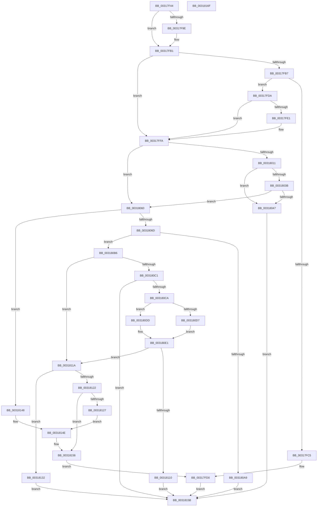

# ST_STORE&lt;SM_TRAITS&gt;::StDmSinglePageCopy

- RVA: `0x00317F44`–`0x00318170` (길이 `556` bytes)
- VA: `0x0000000140317F44`
- 실행 섹션: `.text`
- PDB 이름 있음: `예`; PDB Function 태그: `아니요`
- unwind 정보 RVA: `0x00074B7C`
- 디코드: `141`개 명령, `556/556` bytes 표시
- 미해석 바이트: `0` (있으면 어셈블리에 `.byte`로 보존)

> 이 문서는 커널 이미지의 기계어와 PDB 기호를 분석해 생성했습니다. 4번과 5번은 함수 원형과 자료형을 바이너리 사용 방식에서 추정한 C 해석이며 원본 소스 복구 결과는 아닙니다.

## 1. Dependencies

- 직접 호출 지점: **6**; 고유 호출 대상: **4**
- 직접 호출자로 확인된 함수: **2**
- RIP 상대 이미지 참조: **0**

### Outgoing calls
- `0x00317FCB` → [memcpy](../6C/memcpy_function_006C6840.md) (function, `0x006C6840`)
- `0x00317FEE` → [memcpy](../6C/memcpy_function_006C6840.md) (function, `0x006C6840`)
- `0x0031802A` → [ST_STORE<SM_TRAITS>::StDmpHashBytes](../4F/ST_STORE_SM_TRAITS_StDmpHashBytes_function_004F68D8.md) (function, `0x004F68D8`)
- `0x00318095` → [SmStoreDecompressBuffer](../3A/SmStoreDecompressBuffer_function_003A4B6C.md) (function, `0x003A4B6C`)
- `0x003180F7` → [SmStoreCompletePendingDecompress](../4D/SmStoreCompletePendingDecompress_function_004D7824.md) (function, `0x004D7824`)
- `0x00318151` → [memcpy](../6C/memcpy_function_006C6840.md) (function, `0x006C6840`)

### Direct callers
- [ST_STORE&lt;SM_TRAITS&gt;::StDmSinglePageTransfer](ST_STORE_SM_TRAITS_StDmSinglePageTransfer_function_00317E50.md) at `0x00317ECE`
- [sub_0034CBFD](../34/Unknown_function_0034CBFD.md) at `0x0034CC74`

### Static image references
- 디코드된 RIP-relative 메모리 참조가 없습니다.

## 2. Other-region calls and transfers

- 다른 실행 섹션으로 향하는 call: **0**
- 별도 외부 분기/꼬리 이동을 확인하지 못했습니다.

## 3. Assembly (complete function range)

```asm
00317F44  48 89 54 24 10                  mov qword ptr [rsp + 0x10], rdx
00317F49  48 89 4C 24 08                  mov qword ptr [rsp + 8], rcx
00317F4E  53                              push rbx
00317F4F  56                              push rsi
00317F50  57                              push rdi
00317F51  41 54                           push r12
00317F53  41 55                           push r13
00317F55  41 56                           push r14
00317F57  41 57                           push r15
00317F59  48 83 EC 50                     sub rsp, 0x50
00317F5D  49 8B F9                        mov rdi, r9
00317F60  49 8B F0                        mov rsi, r8
00317F63  4C 8B F1                        mov r14, rcx
00317F66  49 8B D0                        mov rdx, r8
00317F69  44 8B 81 38 03 00 00            mov r8d, dword ptr [rcx + 0x338]
00317F70  49 03 F0                        add rsi, r8
00317F73  4C 8B 89 68 05 00 00            mov r9, qword ptr [rcx + 0x568]
00317F7A  48 8B 9C 24 B0 00 00 00         mov rbx, qword ptr [rsp + 0xb0]
00317F82  45 8B 51 08                     mov r10d, dword ptr [r9 + 8]
00317F86  0F B7 4B 04                     movzx ecx, word ptr [rbx + 4]
00317F8A  FF C9                           dec ecx
00317F8C  41 03 CA                        add ecx, r10d
00317F8F  41 F7 DA                        neg r10d
00317F92  41 23 CA                        and ecx, r10d
00317F95  4C 8B E7                        mov r12, rdi
00317F98  40 F6 C7 01                     test dil, 1
00317F9C  74 13                           je 0x140317fb1
00317F9E  48 83 E7 FE                     and rdi, 0xfffffffffffffffe
00317FA2  48 8B 84 24 B8 00 00 00         mov rax, qword ptr [rsp + 0xb8]
00317FAA  4C 8B A0 98 01 00 00            mov r12, qword ptr [rax + 0x198]
00317FB1  40 F6 C6 03                     test sil, 3
00317FB5  74 43                           je 0x140317ffa
00317FB7  8B C6                           mov eax, esi
00317FB9  48 83 E6 FC                     and rsi, 0xfffffffffffffffc
00317FBD  48 83 E2 FC                     and rdx, 0xfffffffffffffffc
00317FC1  A8 02                           test al, 2
00317FC3  74 15                           je 0x140317fda
00317FC5  44 03 C1                        add r8d, ecx
00317FC8  48 8B CF                        mov rcx, rdi
00317FCB  E8 70 E8 3A 00                  call 0x1406c6840
00317FD0  83 64 24 40 00                  and dword ptr [rsp + 0x40], 0
00317FD5  E9 81 01 00 00                  jmp 0x14031815b
00317FDA  41 83 79 18 00                  cmp dword ptr [r9 + 0x18], 0
00317FDF  74 19                           je 0x140317ffa
00317FE1  44 8B C1                        mov r8d, ecx
00317FE4  48 8B D6                        mov rdx, rsi
00317FE7  49 8B 8E 70 08 00 00            mov rcx, qword ptr [r14 + 0x870]
00317FEE  E8 4D E8 3A 00                  call 0x1406c6840
00317FF3  49 8B B6 70 08 00 00            mov rsi, qword ptr [r14 + 0x870]
00317FFA  44 0F B7 7B 04                  movzx r15d, word ptr [rbx + 4]
00317FFF  83 64 24 40 00                  and dword ptr [rsp + 0x40], 0
00318004  41 F7 86 08 03 00 00 00 00 80 00  test dword ptr [r14 + 0x308], 0x800000
0031800F  74 4F                           je 0x140318060
00318011  83 A4 24 A0 00 00 00 00         and dword ptr [rsp + 0xa0], 0
00318019  4C 8D 8C 24 A0 00 00 00         lea r9, [rsp + 0xa0]
00318021  45 8B C7                        mov r8d, r15d
00318024  48 8B D6                        mov rdx, rsi
00318027  49 8B CE                        mov rcx, r14
0031802A  E8 A9 E8 1D 00                  call 0x1404f68d8
0031802F  89 44 24 40                     mov dword ptr [rsp + 0x40], eax
00318033  8B 44 24 40                     mov eax, dword ptr [rsp + 0x40]
00318037  85 C0                           test eax, eax
00318039  78 0C                           js 0x140318047
0031803B  8B 84 24 A0 00 00 00            mov eax, dword ptr [rsp + 0xa0]
00318042  39 43 10                        cmp dword ptr [rbx + 0x10], eax
00318045  74 19                           je 0x140318060
00318047  C7 44 24 40 E0 04 00 C0         mov dword ptr [rsp + 0x40], 0xc00004e0
0031804F  8B 43 14                        mov eax, dword ptr [rbx + 0x14]
00318052  83 E0 F7                        and eax, 0xfffffff7
00318055  83 C8 04                        or eax, 4
00318058  89 43 14                        mov dword ptr [rbx + 0x14], eax
0031805B  E9 FB 00 00 00                  jmp 0x14031815b
00318060  41 81 FF 00 10 00 00            cmp r15d, 0x1000
00318067  0F 83 DB 00 00 00               jae 0x140318148
0031806D  4C 8D 6B 08                     lea r13, [rbx + 8]
00318071  4C 89 6C 24 30                  mov qword ptr [rsp + 0x30], r13
00318076  48 8B 84 24 98 00 00 00         mov rax, qword ptr [rsp + 0x98]
0031807E  48 89 44 24 28                  mov qword ptr [rsp + 0x28], rax
00318083  44 89 7C 24 20                  mov dword ptr [rsp + 0x20], r15d
00318088  4C 8B CE                        mov r9, rsi
0031808B  49 8B D4                        mov rdx, r12
0031808E  49 8B 8E 20 03 00 00            mov rcx, qword ptr [r14 + 0x320]
00318095  E8 D2 CA 08 00                  call 0x1403a4b6c
0031809A  89 44 24 40                     mov dword ptr [rsp + 0x40], eax
0031809E  8B 44 24 40                     mov eax, dword ptr [rsp + 0x40]
003180A2  3D 94 01 00 C0                  cmp eax, 0xc0000194
003180A7  75 0D                           jne 0x1403180b6
003180A9  C7 44 24 40 10 01 00 C0         mov dword ptr [rsp + 0x40], 0xc0000110
003180B1  E9 A5 00 00 00                  jmp 0x14031815b
003180B6  8B 44 24 40                     mov eax, dword ptr [rsp + 0x40]
003180BA  3D 03 01 00 00                  cmp eax, 0x103
003180BF  75 59                           jne 0x14031811a
003180C1  4C 3B E7                        cmp r12, rdi
003180C4  0F 84 91 00 00 00               je 0x14031815b
003180CA  41 F7 86 08 03 00 00 00 00 20 00  test dword ptr [r14 + 0x308], 0x200000
003180D5  74 06                           je 0x1403180dd
003180D7  41 83 C9 FF                     or r9d, 0xffffffff
003180DB  EB 04                           jmp 0x1403180e1
003180DD  44 8B 4B 10                     mov r9d, dword ptr [rbx + 0x10]
003180E1  44 89 8C 24 A8 00 00 00         mov dword ptr [rsp + 0xa8], r9d
003180E9  45 33 C0                        xor r8d, r8d
003180EC  49 8B 55 00                     mov rdx, qword ptr [r13]
003180F0  49 8B 8E 20 03 00 00            mov rcx, qword ptr [r14 + 0x320]
003180F7  E8 28 F7 1B 00                  call 0x1404d7824
003180FC  89 44 24 40                     mov dword ptr [rsp + 0x40], eax
00318100  49 83 65 00 00                  and qword ptr [r13], 0
00318105  8B 44 24 40                     mov eax, dword ptr [rsp + 0x40]
00318109  3D 40 02 00 C0                  cmp eax, 0xc0000240
0031810E  75 0A                           jne 0x14031811a
00318110  49 C7 45 00 02 00 00 00         mov qword ptr [r13], 2
00318118  EB 41                           jmp 0x14031815b
0031811A  8B 44 24 40                     mov eax, dword ptr [rsp + 0x40]
0031811E  85 C0                           test eax, eax
00318120  78 10                           js 0x140318132
00318122  4C 3B E7                        cmp r12, rdi
00318125  74 2F                           je 0x140318156
00318127  41 B8 00 10 00 00               mov r8d, 0x1000
0031812D  49 8B D4                        mov rdx, r12
00318130  EB 1C                           jmp 0x14031814e
00318132  C7 44 24 40 E0 04 00 C0         mov dword ptr [rsp + 0x40], 0xc00004e0
0031813A  8B 43 14                        mov eax, dword ptr [rbx + 0x14]
0031813D  83 E0 F7                        and eax, 0xfffffff7
00318140  83 C8 04                        or eax, 4
00318143  89 43 14                        mov dword ptr [rbx + 0x14], eax
00318146  EB 13                           jmp 0x14031815b
00318148  4D 8B C7                        mov r8, r15
0031814B  48 8B D6                        mov rdx, rsi
0031814E  48 8B CF                        mov rcx, rdi
00318151  E8 EA E6 3A 00                  call 0x1406c6840
00318156  E9 75 FE FF FF                  jmp 0x140317fd0
0031815B  8B 44 24 40                     mov eax, dword ptr [rsp + 0x40]
0031815F  48 83 C4 50                     add rsp, 0x50
00318163  41 5F                           pop r15
00318165  41 5E                           pop r14
00318167  41 5D                           pop r13
00318169  41 5C                           pop r12
0031816B  5F                              pop rdi
0031816C  5E                              pop rsi
0031816D  5B                              pop rbx
0031816E  C3                              ret
0031816F  CC                              int3
```

## 4. C-style interpretation (structured pseudocode)

```c
__int64 __fastcall ST_STORE_SM_TRAITS___StDmSinglePageCopy(__int64 a1, __int64 a2, __int64 a3, __int64 a4, __int64 a5, __int64 a6)
{
    __int64 result;
    __int64 v_r10;
    __int64 v_r12;
    __int64 v_rdi;
    __int64 v_rsi;
    __int64 v_rsp;
    unsigned int v_stack_m48;
    unsigned __int64 v_stack_m58;
    unsigned __int64 v_stack_m60;
    unsigned int v_stack_m68;
    unsigned __int64 v_stack_p10;
    unsigned int v_stack_p18;
    unsigned int v_stack_p20;
    unsigned __int64 v_stack_p8;

    v_stack_p10 = a2;
    v_stack_p8 = a1;
    v_rsp = (v_rsp) - (80);
    v_rsi = (a3) + ((unsigned int)(*(unsigned int *)(a1 + 824)));
    a1 = (unsigned int)((*(unsigned __int16 *)(a5 + 4)) - 1);
    a1 = (unsigned int)((a1) + ((unsigned int)((unsigned int)(*(unsigned int *)(*(unsigned __int64 *)(a1 + 1384) + 8)))));
    v_r10 = (unsigned int)(-((unsigned int)(*(unsigned int *)(*(unsigned __int64 *)(a1 + 1384) + 8))));
    a1 = (unsigned int)((a1) & ((unsigned int)(v_r10)));
    v_rdi = a4;
    v_r12 = a4;
    if ((((unsigned __int8)(a4)) & (1)) != 0) {
        v_rdi = (a4) & (-2);
        result = a6;
        v_r12 = *(unsigned __int64 *)(result + 408);
    }
    if ((((unsigned __int8)(v_rsi)) & (3)) == 0) goto loc_00317FFA;
    v_rsi = (v_rsi) & (-4);
    a2 = (a3) & (-4);
    if ((((unsigned __int8)((unsigned int)((unsigned int)(v_rsi)))) & (2)) == 0) goto loc_00317FDA;
    a3 = (unsigned int)(((unsigned int)(*(unsigned int *)(a1 + 824))) + ((unsigned int)(a1)));
    result = memcpy(v_rdi, a2, a3, *(unsigned __int64 *)(a1 + 1384));
loc_00317FD0:
    goto loc_0031815B;
loc_00317FDA:
    if ((*(unsigned int *)(*(unsigned __int64 *)(a1 + 1384) + 24)) != 0) {
        a3 = (unsigned int)(v_rdi);
        a2 = v_rsi;
        a1 = *(unsigned __int64 *)(a1 + 2160);
        result = memcpy(a1, a2, a3, *(unsigned __int64 *)(a1 + 1384));
        v_rsi = *(unsigned __int64 *)(a1 + 2160);
    }
    if (((*(unsigned int *)(a1 + 776)) & (0x800000ULL)) == 0) goto loc_00318060;
    result = ST_STORE_SM_TRAITS___StDmpHashBytes(a1, v_rsi, (unsigned int)((unsigned int)(*(unsigned __int16 *)(a5 + 4))), v_stack_p18);
    v_stack_m48 = (unsigned int)(result);
    if (sign_flag) goto loc_00318047;
    if ((*(unsigned int *)(a5 + 16)) == ((unsigned int)((unsigned int)(v_stack_p18)))) goto loc_00318060;
loc_00318047:
    v_stack_m48 = 0xC00004E0ULL;
    result = (unsigned int)(((unsigned int)(*(unsigned int *)(a5 + 20))) & (0xFFFFFFF7ULL));
    result = (unsigned int)((result) | (4));
    *(unsigned int *)(a5 + 20) = (unsigned int)(result);
    goto loc_0031815B;
loc_00318060:
    if (((unsigned int)(*(unsigned __int16 *)(a5 + 4))) >= 0x1000ULL) goto loc_00318148;
    v_stack_m58 = a5 + 8;
    v_stack_m60 = v_stack_p10;
    v_stack_m68 = (unsigned int)(*(unsigned __int16 *)(a5 + 4));
    result = SmStoreDecompressBuffer(*(unsigned __int64 *)(a1 + 800), v_r12, (unsigned int)((unsigned int)(*(unsigned __int16 *)(a5 + 4))), v_rsi);
    v_stack_m48 = (unsigned int)(result);
    if (((unsigned int)((unsigned int)(v_stack_m48))) != 0xC0000194ULL) goto loc_003180B6;
    v_stack_m48 = 0xC0000110ULL;
    goto loc_0031815B;
loc_003180B6:
    if (((unsigned int)((unsigned int)(v_stack_m48))) != 259) goto loc_0031811A;
    if (v_r12 == v_rdi) goto loc_0031815B;
    if (((*(unsigned int *)(a1 + 776)) & (0x200000ULL)) == 0) goto loc_003180DD;
    a4 = (unsigned int)((v_rsi) | (0xFFFFFFFFULL));
    goto loc_003180E1;
loc_003180DD:
loc_003180E1:
    v_stack_p20 = (unsigned int)((unsigned int)(*(unsigned int *)(a5 + 16)));
    a3 = 0;
    result = SmStoreCompletePendingDecompress(*(unsigned __int64 *)(a1 + 800), *(unsigned __int64 *)(a5 + 8), a3, (unsigned int)(*(unsigned int *)(a5 + 16)));
    v_stack_m48 = (unsigned int)(result);
    if (((unsigned int)((unsigned int)(v_stack_m48))) != 0xC0000240ULL) goto loc_0031811A;
    *(unsigned __int64 *)(a5 + 8) = 2;
    goto loc_0031815B;
loc_0031811A:
    if (sign_flag) goto loc_00318132;
    if (v_r12 == v_rdi) goto loc_00318156;
    goto loc_0031814E;
loc_00318132:
    v_stack_m48 = 0xC00004E0ULL;
    result = (unsigned int)(((unsigned int)(*(unsigned int *)(a5 + 20))) & (0xFFFFFFF7ULL));
    result = (unsigned int)((result) | (4));
    *(unsigned int *)(a5 + 20) = (unsigned int)(result);
    goto loc_0031815B;
loc_00318148:
loc_0031814E:
    result = memcpy(v_rdi, v_rsi, *(unsigned __int16 *)(a5 + 4), (unsigned int)(*(unsigned int *)(a5 + 16)));
loc_00318156:
    goto loc_00317FD0;
loc_0031815B:
    v_rsp = (v_rsp) + (80);
    return (unsigned int)(v_stack_m48);
}
```

## 5. (Beta) C Style

```c
int64_t ST_STORE_SM_TRAITS___StDmSinglePageCopy(void *Arg1, int64_t Arg2, int64_t Arg3, int64_t Arg4, void *Arg5, void *Arg6)
{
    uint8_t *arg1 = (uint8_t *)Arg1;
    uint8_t *arg5 = (uint8_t *)Arg5;
    uint8_t *arg6 = (uint8_t *)Arg6;

    int64_t result;
    int64_t local_r10;
    int64_t local_r12;
    int64_t local_rdi;
    int64_t local_rsi;
    int64_t local_rsp;
    uint32_t v_stack_m48;
    uint64_t v_stack_m58;
    uint64_t v_stack_m60;
    uint32_t v_stack_m68;
    uint64_t v_stack_p10;
    uint32_t v_stack_p18;
    uint32_t v_stack_p20;
    uint64_t v_stack_p8;

    v_stack_p10 = Arg2;
    v_stack_p8 = Arg1;
    local_rsp = (local_rsp) - (80);
    local_rsi = (Arg3) + ((uint32_t)(*(uint32_t *)(arg1 + 0x338)));
    Arg1 = (uint32_t)((*(uint16_t *)(arg5 + 0x4)) - 1);
    Arg1 = (uint32_t)((Arg1) + ((uint32_t)((uint32_t)(*(uint32_t *)(*(uint64_t *)(arg1 + 0x568) + 0x8)))));
    local_r10 = (uint32_t)(-((uint32_t)(*(uint32_t *)(*(uint64_t *)(arg1 + 0x568) + 0x8))));
    Arg1 = (uint32_t)((Arg1) & ((uint32_t)(local_r10)));
    local_rdi = Arg4;
    local_r12 = Arg4;
    if ((((uint8_t)(Arg4)) & (1)) != 0) {
        local_rdi = (Arg4) & (-2);
        result = Arg6;
        local_r12 = *(uint64_t *)(result + 0x198);
    }
    if ((((uint8_t)(local_rsi)) & (3)) == 0) goto loc_00317FFA;
    local_rsi = (local_rsi) & (-4);
    Arg2 = (Arg3) & (-4);
    if ((((uint8_t)((uint32_t)((uint32_t)(local_rsi)))) & (2)) == 0) goto loc_00317FDA;
    Arg3 = (uint32_t)(((uint32_t)(*(uint32_t *)(arg1 + 0x338))) + ((uint32_t)(Arg1)));
    result = memcpy(local_rdi, Arg2, Arg3, *(uint64_t *)(arg1 + 0x568));
loc_00317FD0:
    goto loc_0031815B;
loc_00317FDA:
    if ((*(uint32_t *)(*(uint64_t *)(arg1 + 0x568) + 0x18)) != 0) {
        Arg3 = (uint32_t)(local_rdi);
        Arg2 = local_rsi;
        Arg1 = *(uint64_t *)(arg1 + 0x870);
        result = memcpy(Arg1, Arg2, Arg3, *(uint64_t *)(arg1 + 0x568));
        local_rsi = *(uint64_t *)(arg1 + 0x870);
    }
    if (((*(uint32_t *)(arg1 + 0x308)) & (0x800000ULL)) == 0) goto loc_00318060;
    result = ST_STORE_SM_TRAITS___StDmpHashBytes(Arg1, local_rsi, (uint32_t)((uint32_t)(*(uint16_t *)(arg5 + 0x4))), v_stack_p18);
    v_stack_m48 = (uint32_t)(result);
    if (sign_flag) goto loc_00318047;
    if ((*(uint32_t *)(arg5 + 0x10)) == ((uint32_t)((uint32_t)(v_stack_p18)))) goto loc_00318060;
loc_00318047:
    v_stack_m48 = 0xC00004E0ULL;
    result = (uint32_t)(((uint32_t)(*(uint32_t *)(arg5 + 0x14))) & (0xFFFFFFF7ULL));
    result = (uint32_t)((result) | (4));
    *(uint32_t *)(arg5 + 0x14) = (uint32_t)(result);
    goto loc_0031815B;
loc_00318060:
    if (((uint32_t)(*(uint16_t *)(arg5 + 0x4))) >= 0x1000ULL) goto loc_00318148;
    v_stack_m58 = Arg5 + 8;
    v_stack_m60 = v_stack_p10;
    v_stack_m68 = (uint32_t)(*(uint16_t *)(arg5 + 0x4));
    result = SmStoreDecompressBuffer(*(uint64_t *)(arg1 + 0x320), local_r12, (uint32_t)((uint32_t)(*(uint16_t *)(arg5 + 0x4))), local_rsi);
    v_stack_m48 = (uint32_t)(result);
    if (((uint32_t)((uint32_t)(v_stack_m48))) != 0xC0000194ULL) goto loc_003180B6;
    v_stack_m48 = 0xC0000110ULL;
    goto loc_0031815B;
loc_003180B6:
    if (((uint32_t)((uint32_t)(v_stack_m48))) != 259) goto loc_0031811A;
    if (local_r12 == local_rdi) goto loc_0031815B;
    if (((*(uint32_t *)(arg1 + 0x308)) & (0x200000ULL)) == 0) goto loc_003180DD;
    Arg4 = (uint32_t)((local_rsi) | (0xFFFFFFFFULL));
    goto loc_003180E1;
loc_003180DD:
loc_003180E1:
    v_stack_p20 = (uint32_t)((uint32_t)(*(uint32_t *)(arg5 + 0x10)));
    Arg3 = 0;
    result = SmStoreCompletePendingDecompress(*(uint64_t *)(arg1 + 0x320), *(uint64_t *)(arg5 + 0x8), Arg3, (uint32_t)(*(uint32_t *)(arg5 + 0x10)));
    v_stack_m48 = (uint32_t)(result);
    if (((uint32_t)((uint32_t)(v_stack_m48))) != 0xC0000240ULL) goto loc_0031811A;
    *(uint64_t *)(arg5 + 0x8) = 2;
    goto loc_0031815B;
loc_0031811A:
    if (sign_flag) goto loc_00318132;
    if (local_r12 == local_rdi) goto loc_00318156;
    goto loc_0031814E;
loc_00318132:
    v_stack_m48 = 0xC00004E0ULL;
    result = (uint32_t)(((uint32_t)(*(uint32_t *)(arg5 + 0x14))) & (0xFFFFFFF7ULL));
    result = (uint32_t)((result) | (4));
    *(uint32_t *)(arg5 + 0x14) = (uint32_t)(result);
    goto loc_0031815B;
loc_00318148:
loc_0031814E:
    result = memcpy(local_rdi, local_rsi, *(uint16_t *)(arg5 + 0x4), (uint32_t)(*(uint32_t *)(arg5 + 0x10)));
loc_00318156:
    goto loc_00317FD0;
loc_0031815B:
    local_rsp = (local_rsp) + (80);
    return (uint32_t)(v_stack_m48);
}
```

### 관측된 메모리 오프셋

구조체 형식이 확인되지 않은 접근은 인자 기준의 오프셋으로만 기록했습니다.

| 기준 인자 | 오프셋 표현 | 폭 (bit) | 접근 |
|---|---:|---:|---|
| `Arg1` | `+ 0x308` | `32` | `R` |
| `Arg1` | `+ 0x320` | `64` | `R` |
| `Arg1` | `+ 0x338` | `32` | `R` |
| `Arg1` | `+ 0x568` | `64` | `R` |
| `Arg1` | `+ 0x870` | `64` | `R` |
| `Arg5` | `+ 0x0` | `64` | `R` |
| `Arg5` | `+ 0x0` | `64` | `R/W` |
| `Arg5` | `+ 0x0` | `64` | `W` |
| `Arg5` | `+ 0x4` | `16` | `R` |
| `Arg5` | `+ 0x8` | `64` | `R` |
| `Arg5` | `+ 0x10` | `32` | `R` |
| `Arg5` | `+ 0x14` | `32` | `R` |
| `Arg5` | `+ 0x14` | `32` | `W` |
| `Arg6` | `+ 0x198` | `64` | `R` |

## 6. Execution-region graph

[열기: 2D/3D 그래프와 함수 탐색 컨트롤 패널](../../../control-panel.html?section=text&rva=0x00317F44&view=graph)

- 2D 그래프는 위에서 아래로 흐르고, 3D 그래프는 빈 공간을 드래그해 회전합니다. Shift+드래그는 이동, 휠은 확대·축소, 함수 노드 선택은 대상 보고서 이동입니다.

### Static fallback


