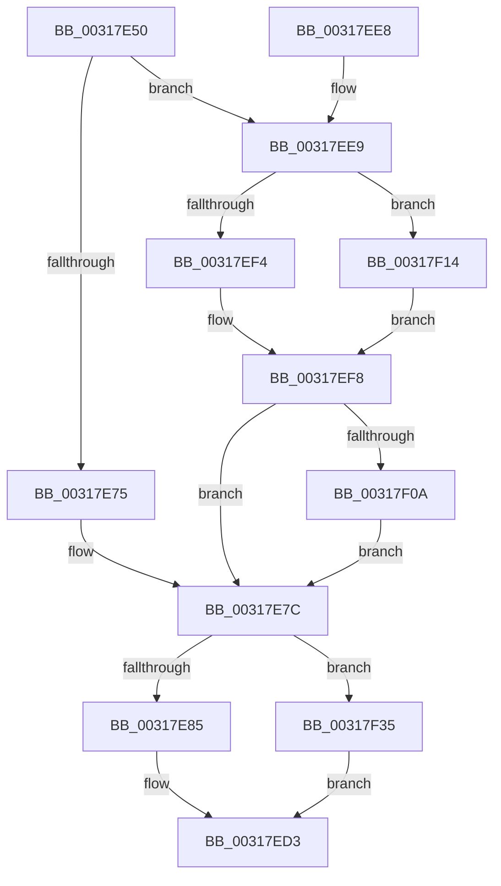

# ST_STORE&lt;SM_TRAITS&gt;::StDmSinglePageTransfer

- RVA: `0x00317E50`–`0x00317F3C` (길이 `236` bytes)
- VA: `0x0000000140317E50`
- 실행 섹션: `.text`
- PDB 이름 있음: `예`; PDB Function 태그: `아니요`
- unwind 정보 RVA: `0x00074B64`
- 디코드: `64`개 명령, `236/236` bytes 표시
- 미해석 바이트: `0` (있으면 어셈블리에 `.byte`로 보존)

> 이 문서는 커널 이미지의 기계어와 PDB 기호를 분석해 생성했습니다. 4번과 5번은 함수 원형과 자료형을 바이너리 사용 방식에서 추정한 C 해석이며 원본 소스 복구 결과는 아닙니다.

## 1. Dependencies

- 직접 호출 지점: **2**; 고유 호출 대상: **2**
- 직접 호출자로 확인된 함수: **2**
- RIP 상대 이미지 참조: **0**

### Outgoing calls
- `0x00317ECE` → [ST_STORE<SM_TRAITS>::StDmSinglePageCopy](ST_STORE_SM_TRAITS_StDmSinglePageCopy_function_00317F44.md) (function, `0x00317F44`)
- `0x00317F2B` → [MmMapLockedPagesSpecifyCache](MmMapLockedPagesSpecifyCache_function_00318800.md) (function, `0x00318800`)

### Direct callers
- [sub_0042067D](../42/Unknown_function_0042067D.md) at `0x00420778`
- [ST_STORE&lt;SM_TRAITS&gt;::StDmDeviceIoTransfer](../4B/ST_STORE_SM_TRAITS_StDmDeviceIoTransfer_function_004BBE44.md) at `0x004BBF04`

### Static image references
- 디코드된 RIP-relative 메모리 참조가 없습니다.

## 2. Other-region calls and transfers

- 다른 실행 섹션으로 향하는 call: **0**
- 별도 외부 분기/꼬리 이동을 확인하지 못했습니다.

## 3. Assembly (complete function range)

```asm
00317E50  48 89 5C 24 08                  mov qword ptr [rsp + 8], rbx
00317E55  48 89 6C 24 10                  mov qword ptr [rsp + 0x10], rbp
00317E5A  48 89 74 24 18                  mov qword ptr [rsp + 0x18], rsi
00317E5F  57                              push rdi
00317E60  48 83 EC 30                     sub rsp, 0x30
00317E64  49 8B D9                        mov rbx, r9
00317E67  49 8B F8                        mov rdi, r8
00317E6A  48 8B F2                        mov rsi, rdx
00317E6D  48 8B E9                        mov rbp, rcx
00317E70  4D 85 C9                        test r9, r9
00317E73  75 74                           jne 0x140317ee9
00317E75  4C 8B 4C 24 60                  mov r9, qword ptr [rsp + 0x60]
00317E7A  33 C0                           xor eax, eax
00317E7C  4D 85 C9                        test r9, r9
00317E7F  0F 84 B0 00 00 00               je 0x140317f35
00317E85  4C 8B 44 24 68                  mov r8, qword ptr [rsp + 0x68]
00317E8A  8B D0                           mov edx, eax
00317E8C  D1 EA                           shr edx, 1
00317E8E  41 8B 48 14                     mov ecx, dword ptr [r8 + 0x14]
00317E92  33 D1                           xor edx, ecx
00317E94  83 E2 02                        and edx, 2
00317E97  33 D1                           xor edx, ecx
00317E99  48 8B CD                        mov rcx, rbp
00317E9C  41 89 50 14                     mov dword ptr [r8 + 0x14], edx
00317EA0  41 0F B7 50 06                  movzx edx, word ptr [r8 + 6]
00317EA5  48 C1 E2 0C                     shl rdx, 0xc
00317EA9  49 03 D1                        add rdx, r9
00317EAC  4C 8B CA                        mov r9, rdx
00317EAF  49 83 C9 01                     or r9, 1
00317EB3  A8 20                           test al, 0x20
00317EB5  48 8B 44 24 70                  mov rax, qword ptr [rsp + 0x70]
00317EBA  48 89 44 24 28                  mov qword ptr [rsp + 0x28], rax
00317EBF  4C 89 44 24 20                  mov qword ptr [rsp + 0x20], r8
00317EC4  4C 0F 44 CA                     cmove r9, rdx
00317EC8  4C 8B C7                        mov r8, rdi
00317ECB  48 8B D6                        mov rdx, rsi
00317ECE  E8 71 00 00 00                  call 0x140317f44
00317ED3  48 8B 5C 24 40                  mov rbx, qword ptr [rsp + 0x40]
00317ED8  48 8B 6C 24 48                  mov rbp, qword ptr [rsp + 0x48]
00317EDD  48 8B 74 24 50                  mov rsi, qword ptr [rsp + 0x50]
00317EE2  48 83 C4 30                     add rsp, 0x30
00317EE6  5F                              pop rdi
00317EE7  C3                              ret
00317EE8  CC                              int3
00317EE9  48 8B 4C 24 60                  mov rcx, qword ptr [rsp + 0x60]
00317EEE  F6 41 0A 05                     test byte ptr [rcx + 0xa], 5
00317EF2  74 20                           je 0x140317f14
00317EF4  4C 8B 49 18                     mov r9, qword ptr [rcx + 0x18]
00317EF8  F7 43 08 00 00 00 08            test dword ptr [rbx + 8], 0x8000000
00317EFF  B8 04 00 00 00                  mov eax, 4
00317F04  0F 84 72 FF FF FF               je 0x140317e7c
00317F0A  B8 24 00 00 00                  mov eax, 0x24
00317F0F  E9 68 FF FF FF                  jmp 0x140317e7c
00317F14  33 C0                           xor eax, eax
00317F16  C7 44 24 28 10 00 00 40         mov dword ptr [rsp + 0x28], 0x40000010
00317F1E  45 33 C9                        xor r9d, r9d
00317F21  89 44 24 20                     mov dword ptr [rsp + 0x20], eax
00317F25  33 D2                           xor edx, edx
00317F27  44 8D 40 01                     lea r8d, [rax + 1]
00317F2B  E8 D0 08 00 00                  call 0x140318800
00317F30  4C 8B C8                        mov r9, rax
00317F33  EB C3                           jmp 0x140317ef8
00317F35  B8 9A 00 00 C0                  mov eax, 0xc000009a
00317F3A  EB 97                           jmp 0x140317ed3
```

## 4. C-style interpretation (structured pseudocode)

```c
__int64 __fastcall ST_STORE_SM_TRAITS___StDmSinglePageTransfer(__int64 a1, __int64 a2, __int64 a3, __int64 a4, __int64 a5, __int64 a6, __int64 a7)
{
    __int64 result;
    __int64 v_rsp;
    unsigned __int64 v_stack_m10;
    unsigned __int64 v_stack_m18;
    unsigned __int64 v_stack_p10;
    unsigned __int64 v_stack_p18;
    unsigned int v_stack_p20;
    unsigned int v_stack_p28;
    unsigned __int64 v_stack_p8;

    v_stack_p8 = v_rbx;
    v_stack_p10 = v_rbp;
    v_stack_p18 = v_rsi;
    v_rsp = (v_rsp) - (48);
    if (a4 != 0) goto loc_00317EE9;
    result = 0;
loc_00317E7C:
    if (a5 == 0) goto loc_00317F35;
    a2 = (unsigned int)((0) >> (1));
    a2 = (unsigned int)((a2) ^ ((unsigned int)((unsigned int)(*(unsigned int *)(a6 + 20)))));
    a2 = (unsigned int)((a2) & (2));
    a2 = (unsigned int)((a2) ^ ((unsigned int)((unsigned int)(*(unsigned int *)(a6 + 20)))));
    *(unsigned int *)(a6 + 20) = (unsigned int)(a2);
    a2 = (*(unsigned __int16 *)(a6 + 6)) << (12);
    a2 = (a2) + (a5);
    a4 = (a2) | (1);
    v_stack_m10 = a7;
    v_stack_m18 = a6;
    if (((0) & (32)) == 0) { a4 = a2; }
    result = ST_STORE_SM_TRAITS___StDmSinglePageCopy(a1, a2, a3, a4);
loc_00317ED3:
    v_rsp = (v_rsp) + (48);
    return result;
loc_00317EE9:
    if (((*(unsigned __int8 *)(a5 + 10)) & (5)) == 0) goto loc_00317F14;
loc_00317EF8:
    if (((*(unsigned int *)(v_stack_p8 + 8)) & (0x8000000ULL)) == 0) goto loc_00317E7C;
    goto loc_00317E7C;
loc_00317F14:
    result = 0;
    v_stack_p28 = 0x40000010ULL;
    a4 = 0;
    v_stack_p20 = 0;
    a2 = 0;
    result = MmMapLockedPagesSpecifyCache(a5, a2, result + 1, a4);
    goto loc_00317EF8;
loc_00317F35:
    goto loc_00317ED3;
}
```

## 5. (Beta) C Style

```c
int64_t ST_STORE_SM_TRAITS___StDmSinglePageTransfer(int64_t Arg1, int64_t Arg2, int64_t Arg3, void *Arg4, void *Arg5, void *Arg6, int64_t Arg7)
{
    uint8_t *arg4 = (uint8_t *)Arg4;
    uint8_t *arg5 = (uint8_t *)Arg5;
    uint8_t *arg6 = (uint8_t *)Arg6;

    int64_t result;
    int64_t local_rsp;
    uint64_t v_stack_m10;
    uint64_t v_stack_m18;
    uint64_t v_stack_p10;
    uint64_t v_stack_p18;
    uint32_t v_stack_p20;
    uint32_t v_stack_p28;
    uint64_t v_stack_p8;

    v_stack_p8 = local_rbx;
    v_stack_p10 = local_rbp;
    v_stack_p18 = local_rsi;
    local_rsp = (local_rsp) - (48);
    if (Arg4 != NULL) goto loc_00317EE9;
    result = 0;
loc_00317E7C:
    if (Arg5 == NULL) goto loc_00317F35;
    Arg2 = (uint32_t)((0) >> (1));
    Arg2 = (uint32_t)((Arg2) ^ ((uint32_t)((uint32_t)(*(uint32_t *)(arg6 + 0x14)))));
    Arg2 = (uint32_t)((Arg2) & (2));
    Arg2 = (uint32_t)((Arg2) ^ ((uint32_t)((uint32_t)(*(uint32_t *)(arg6 + 0x14)))));
    *(uint32_t *)(arg6 + 0x14) = (uint32_t)(Arg2);
    Arg2 = (*(uint16_t *)(arg6 + 0x6)) << (12);
    Arg2 = (Arg2) + (Arg5);
    Arg4 = (Arg2) | (1);
    v_stack_m10 = Arg7;
    v_stack_m18 = Arg6;
    if (((0) & (32)) == 0) { Arg4 = Arg2; }
    result = ST_STORE_SM_TRAITS___StDmSinglePageCopy(Arg1, Arg2, Arg3, Arg4);
loc_00317ED3:
    local_rsp = (local_rsp) + (48);
    return result;
loc_00317EE9:
    if (((*(uint8_t *)(arg5 + 0xA)) & (5)) == 0) goto loc_00317F14;
loc_00317EF8:
    if (((*(uint32_t *)(v_stack_p8 + 0x8)) & (0x8000000ULL)) == 0) goto loc_00317E7C;
    goto loc_00317E7C;
loc_00317F14:
    result = 0;
    v_stack_p28 = 0x40000010ULL;
    Arg4 = 0;
    v_stack_p20 = 0;
    Arg2 = 0;
    result = MmMapLockedPagesSpecifyCache(Arg5, Arg2, result + 1, Arg4);
    goto loc_00317EF8;
loc_00317F35:
    goto loc_00317ED3;
}
```

### 관측된 메모리 오프셋

구조체 형식이 확인되지 않은 접근은 인자 기준의 오프셋으로만 기록했습니다.

| 기준 인자 | 오프셋 표현 | 폭 (bit) | 접근 |
|---|---:|---:|---|
| `Arg4` | `+ 0x8` | `32` | `R` |
| `Arg5` | `+ 0xA` | `8` | `R` |
| `Arg5` | `+ 0x18` | `64` | `R` |
| `Arg6` | `+ 0x6` | `16` | `R` |
| `Arg6` | `+ 0x14` | `32` | `R` |
| `Arg6` | `+ 0x14` | `32` | `W` |

## 6. Execution-region graph

[열기: 2D/3D 그래프와 함수 탐색 컨트롤 패널](../../../control-panel.html?section=text&rva=0x00317E50&view=graph)

- 2D 그래프는 위에서 아래로 흐르고, 3D 그래프는 빈 공간을 드래그해 회전합니다. Shift+드래그는 이동, 휠은 확대·축소, 함수 노드 선택은 대상 보고서 이동입니다.

### Static fallback


