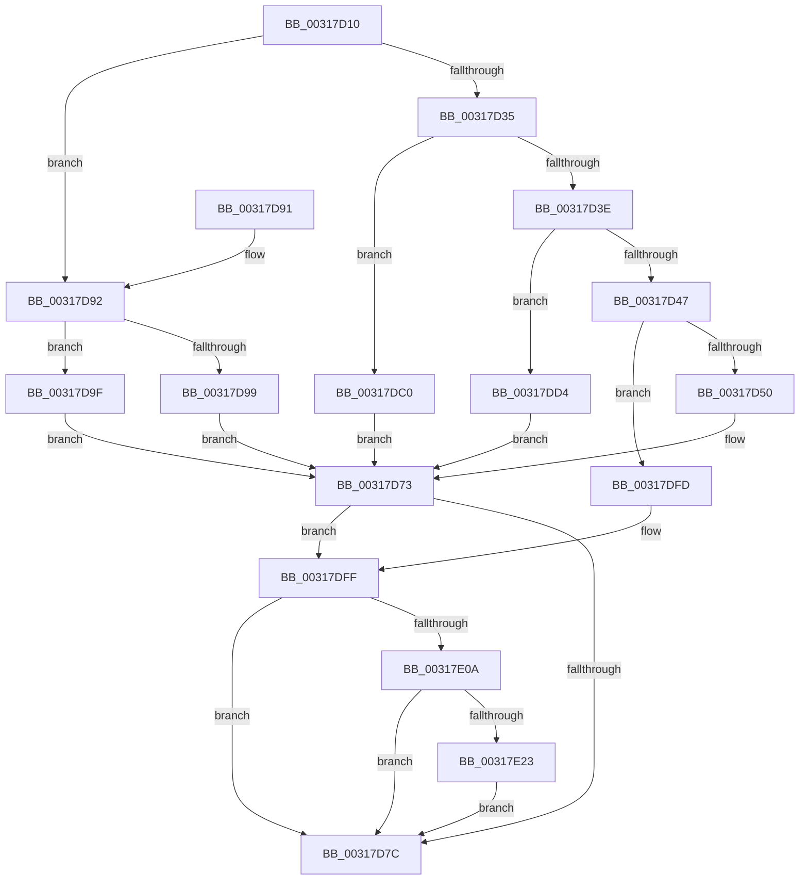

# SmFpAllocate

- RVA: `0x00317D10`–`0x00317E41` (길이 `305` bytes)
- VA: `0x0000000140317D10`
- 실행 섹션: `.text`
- PDB 이름 있음: `예`; PDB Function 태그: `아니요`
- unwind 정보 RVA: `0x00074B4C`
- 디코드: `77`개 명령, `305/305` bytes 표시
- 미해석 바이트: `0` (있으면 어셈블리에 `.byte`로 보존)

> 이 문서는 커널 이미지의 기계어와 PDB 기호를 분석해 생성했습니다. 4번과 5번은 함수 원형과 자료형을 바이너리 사용 방식에서 추정한 C 해석이며 원본 소스 복구 결과는 아닙니다.

## 1. Dependencies

- 직접 호출 지점: **6**; 고유 호출 대상: **6**
- 직접 호출자로 확인된 함수: **7**
- RIP 상대 이미지 참조: **0**

### Outgoing calls
- `0x00317D6E` → [ExAllocatePool2](../../poolcode/B8/ExAllocatePool2_function_00B820F0.md) (function, `0x00B820F0`)
- `0x00317DB9` → [MmMapLockedPagesSpecifyCache](MmMapLockedPagesSpecifyCache_function_00318800.md) (function, `0x00318800`)
- `0x00317DCD` → [SmKmAllocateMdlForLock](../47/SmKmAllocateMdlForLock_function_00470E68.md) (function, `0x00470E68`)
- `0x00317DEA` → [MmChargeResources](../28/MmChargeResources_function_002880E0.md) (function, `0x002880E0`)
- `0x00317E12` → [SmpFpWaitForResource](../61/SmpFpWaitForResource_function_006102A4.md) (function, `0x006102A4`)
- `0x00317E34` → [MmMapLockedPagesWithReservedMapping](../3E/MmMapLockedPagesWithReservedMapping_function_003E8910.md) (function, `0x003E8910`)

### Direct callers
- [SMKM_STORE&lt;SM_TRAITS&gt;::SmStReadThread](../20/SMKM_STORE_SM_TRAITS_SmStReadThread_function_00203230.md) at `0x0020338E`
- [SMKM_STORE_MGR&lt;SM_TRAITS&gt;::SmpPageEvict](../24/SMKM_STORE_MGR_SM_TRAITS_SmpPageEvict_function_0024A5F4.md) at `0x0024A6C2`
- [SMKM_STORE_MGR&lt;SM_TRAITS&gt;::SmpPageEvict](../24/SMKM_STORE_MGR_SM_TRAITS_SmpPageEvict_function_0024A5F4.md) at `0x0024A6F2`
- [sub_003176F1](Unknown_function_003176F1.md) at `0x0031773A`
- [SMKM_STORE_MGR&lt;SM_TRAITS&gt;::SmPageRead](../34/SMKM_STORE_MGR_SM_TRAITS_SmPageRead_function_0034C1D0.md) at `0x0034C38B`
- [SmKmStoreHelperCommandProcess](../3C/SmKmStoreHelperCommandProcess_function_003C3AA4.md) at `0x003C3B1D`
- [SmKmStoreHelperCommandProcess](../3C/SmKmStoreHelperCommandProcess_function_003C3AA4.md) at `0x003C3BD2`
- [SMKM_STORE&lt;SM_TRAITS&gt;::SmStMapPhysicalRegion](../60/SMKM_STORE_SM_TRAITS_SmStMapPhysicalRegion_function_0060CB6C.md) at `0x0060CBC0`
- [sub_006E8004](../6E/Unknown_function_006E8004.md) at `0x006E8046`

### Static image references
- 디코드된 RIP-relative 메모리 참조가 없습니다.

## 2. Other-region calls and transfers

- 다른 실행 섹션으로 향하는 call: **1**
  - `0x00317D6E` → [ExAllocatePool2](../../poolcode/B8/ExAllocatePool2_function_00B820F0.md) (`.text` → `POOLCODE`)
- 별도 외부 분기/꼬리 이동을 확인하지 못했습니다.

## 3. Assembly (complete function range)

```asm
00317D10  48 89 5C 24 08                  mov qword ptr [rsp + 8], rbx
00317D15  48 89 6C 24 18                  mov qword ptr [rsp + 0x18], rbp
00317D1A  48 89 74 24 20                  mov qword ptr [rsp + 0x20], rsi
00317D1F  57                              push rdi
00317D20  48 83 EC 30                     sub rsp, 0x30
00317D24  48 63 DA                        movsxd rbx, edx
00317D27  49 8B F9                        mov rdi, r9
00317D2A  49 8B E8                        mov rbp, r8
00317D2D  48 8B F1                        mov rsi, rcx
00317D30  83 FB 05                        cmp ebx, 5
00317D33  7D 5D                           jge 0x140317d92
00317D35  83 FB 02                        cmp ebx, 2
00317D38  0F 84 82 00 00 00               je 0x140317dc0
00317D3E  83 FB 03                        cmp ebx, 3
00317D41  0F 84 8D 00 00 00               je 0x140317dd4
00317D47  83 FB 04                        cmp ebx, 4
00317D4A  0F 84 AD 00 00 00               je 0x140317dfd
00317D50  0F B7 54 59 60                  movzx edx, word ptr [rcx + rbx*2 + 0x60]
00317D55  8D 43 30                        lea eax, [rbx + 0x30]
00317D58  C7 44 24 48 73 6D 52 30         mov dword ptr [rsp + 0x48], 0x30526d73
00317D60  B9 40 00 00 00                  mov ecx, 0x40
00317D65  88 44 24 4B                     mov byte ptr [rsp + 0x4b], al
00317D69  44 8B 44 24 48                  mov r8d, dword ptr [rsp + 0x48]
00317D6E  E8 7D A3 86 00                  call 0x140b820f0
00317D73  48 85 C0                        test rax, rax
00317D76  0F 84 83 00 00 00               je 0x140317dff
00317D7C  48 8B 5C 24 40                  mov rbx, qword ptr [rsp + 0x40]
00317D81  48 8B 6C 24 50                  mov rbp, qword ptr [rsp + 0x50]
00317D86  48 8B 74 24 58                  mov rsi, qword ptr [rsp + 0x58]
00317D8B  48 83 C4 30                     add rsp, 0x30
00317D8F  5F                              pop rdi
00317D90  C3                              ret
00317D91  CC                              int3
00317D92  41 F6 41 0A 05                  test byte ptr [r9 + 0xa], 5
00317D97  74 06                           je 0x140317d9f
00317D99  49 8B 41 18                     mov rax, qword ptr [r9 + 0x18]
00317D9D  EB D4                           jmp 0x140317d73
00317D9F  33 C0                           xor eax, eax
00317DA1  C7 44 24 28 10 00 00 40         mov dword ptr [rsp + 0x28], 0x40000010
00317DA9  45 33 C9                        xor r9d, r9d
00317DAC  89 44 24 20                     mov dword ptr [rsp + 0x20], eax
00317DB0  33 D2                           xor edx, edx
00317DB2  48 8B CF                        mov rcx, rdi
00317DB5  44 8D 40 01                     lea r8d, [rax + 1]
00317DB9  E8 42 0A 00 00                  call 0x140318800
00317DBE  EB B3                           jmp 0x140317d73
00317DC0  0F B7 54 59 60                  movzx edx, word ptr [rcx + rbx*2 + 0x60]
00317DC5  48 8B 49 20                     mov rcx, qword ptr [rcx + 0x20]
00317DC9  48 C1 E2 0C                     shl rdx, 0xc
00317DCD  E8 96 90 15 00                  call 0x140470e68
00317DD2  EB 9F                           jmp 0x140317d73
00317DD4  0F B7 54 59 60                  movzx edx, word ptr [rcx + rbx*2 + 0x60]
00317DD9  41 B8 01 00 00 00               mov r8d, 1
00317DDF  48 8B 49 20                     mov rcx, qword ptr [rcx + 0x20]
00317DE3  48 8B 89 30 08 00 00            mov rcx, qword ptr [rcx + 0x830]
00317DEA  E8 F1 02 F7 FF                  call 0x1402880e0
00317DEF  F7 D8                           neg eax
00317DF1  48 1B C0                        sbb rax, rax
00317DF4  48 83 E0 F8                     and rax, 0xfffffffffffffff8
00317DF8  E9 76 FF FF FF                  jmp 0x140317d73
00317DFD  33 C0                           xor eax, eax
00317DFF  83 7C 24 60 00                  cmp dword ptr [rsp + 0x60], 0
00317E04  0F 84 72 FF FF FF               je 0x140317d7c
00317E0A  4C 8B C5                        mov r8, rbp
00317E0D  8B D3                           mov edx, ebx
00317E0F  48 8B CE                        mov rcx, rsi
00317E12  E8 8D 84 2F 00                  call 0x1406102a4
00317E17  48 8B F0                        mov rsi, rax
00317E1A  83 FB 05                        cmp ebx, 5
00317E1D  0F 8C 59 FF FF FF               jl 0x140317d7c
00317E23  41 B9 01 00 00 00               mov r9d, 1
00317E29  4C 8B C7                        mov r8, rdi
00317E2C  BA 73 6D 52 6D                  mov edx, 0x6d526d73
00317E31  48 8B C8                        mov rcx, rax
00317E34  E8 D7 0A 0D 00                  call 0x1403e8910
00317E39  48 8B C6                        mov rax, rsi
00317E3C  E9 3B FF FF FF                  jmp 0x140317d7c
```

## 4. C-style interpretation (structured pseudocode)

```c
__int64 __fastcall SmFpAllocate(__int64 a1, int a2, __int64 a3, __int64 a4, unsigned int a5)
{
    __int64 result;
    __int64 v_rsp;
    unsigned int v_stack_p10;
    unsigned __int8 v_stack_p13;
    unsigned __int64 v_stack_p18;
    unsigned __int64 v_stack_p20;
    unsigned int v_stack_p28;
    unsigned __int64 v_stack_p8;

    v_stack_p8 = v_rbx;
    v_stack_p18 = v_rbp;
    v_stack_p20 = v_rsi;
    v_rsp = (v_rsp) - (48);
    if (((unsigned int)((int)(a2))) >= 5) goto loc_00317D92;
    if (((unsigned int)((int)(a2))) == 2) goto loc_00317DC0;
    if (((unsigned int)((int)(a2))) == 3) goto loc_00317DD4;
    if (((unsigned int)((int)(a2))) == 4) goto loc_00317DFD;
    v_stack_p10 = 0x30526D73ULL;
    v_stack_p13 = (unsigned __int8)((int)(a2) + 48);
    result = ExAllocatePool2(64, *(unsigned __int16 *)(a1 + (int)(a2) * 2 + 96), (unsigned int)(v_stack_p10), a4);
loc_00317D73:
    if (result == 0) goto loc_00317DFF;
loc_00317D7C:
    v_rsp = (v_rsp) + (48);
    return result;
loc_00317D92:
    if (((*(unsigned __int8 *)(a4 + 10)) & (5)) == 0) goto loc_00317D9F;
    goto loc_00317D73;
loc_00317D9F:
    result = 0;
    v_stack_p28 = 0x40000010ULL;
    a4 = 0;
    v_stack_p20 = 0;
    a2 = 0;
    result = MmMapLockedPagesSpecifyCache(0, a2, result + 1, a4);
    goto loc_00317D73;
loc_00317DC0:
    a2 = (*(unsigned __int16 *)(0 + v_stack_p8 * 2 + 96)) << (12);
    result = SmKmAllocateMdlForLock(*(unsigned __int64 *)(0 + 32), a2, result + 1, a4);
    goto loc_00317D73;
loc_00317DD4:
    result = MmChargeResources(*(unsigned __int64 *)(*(unsigned __int64 *)(*(unsigned __int64 *)(0 + 32) + 32) + 2096), *(unsigned __int16 *)(*(unsigned __int64 *)(0 + 32) + v_stack_p8 * 2 + 96), 1, a4);
    result = (unsigned int)(-(result));
    result = (result) & (-8);
    goto loc_00317D73;
loc_00317DFD:
    result = 0;
loc_00317DFF:
    if (a5 == 0) goto loc_00317D7C;
    result = SmpFpWaitForResource(v_stack_p20, (unsigned int)((unsigned int)(v_stack_p8)), v_stack_p18, a4);
    if (((unsigned int)(v_stack_p8)) < 5) goto loc_00317D7C;
    result = MmMapLockedPagesWithReservedMapping(result, (unsigned int)(0x6D526D73ULL), 0, 1);
    goto loc_00317D7C;
}
```

## 5. (Beta) C Style

```c
int64_t SmFpAllocate(void *Arg1, int32_t Arg2, int64_t Arg3, void *Arg4, uint32_t Arg5)
{
    uint8_t *arg1 = (uint8_t *)Arg1;
    uint8_t *arg4 = (uint8_t *)Arg4;

    int64_t result;
    int64_t local_rsp;
    uint32_t v_stack_p10;
    uint8_t v_stack_p13;
    uint64_t v_stack_p18;
    uint64_t v_stack_p20;
    uint32_t v_stack_p28;
    uint64_t v_stack_p8;

    v_stack_p8 = local_rbx;
    v_stack_p18 = local_rbp;
    v_stack_p20 = local_rsi;
    local_rsp = (local_rsp) - (48);
    if (((uint32_t)((int32_t)(Arg2))) >= 5) goto loc_00317D92;
    if (((uint32_t)((int32_t)(Arg2))) == 2) goto loc_00317DC0;
    if (((uint32_t)((int32_t)(Arg2))) == 3) goto loc_00317DD4;
    if (((uint32_t)((int32_t)(Arg2))) == 4) goto loc_00317DFD;
    v_stack_p10 = 0x30526D73ULL;
    v_stack_p13 = (uint8_t)((int32_t)(Arg2) + 48);
    result = ExAllocatePool2(64, *(uint16_t *)(arg1 + (int32_t)(Arg2) * 2 + 0x60), (uint32_t)(v_stack_p10), Arg4);
loc_00317D73:
    if (result == 0) goto loc_00317DFF;
loc_00317D7C:
    local_rsp = (local_rsp) + (48);
    return result;
loc_00317D92:
    if (((*(uint8_t *)(arg4 + 0xA)) & (5)) == 0) goto loc_00317D9F;
    goto loc_00317D73;
loc_00317D9F:
    result = 0;
    v_stack_p28 = 0x40000010ULL;
    Arg4 = 0;
    v_stack_p20 = 0;
    Arg2 = 0;
    result = MmMapLockedPagesSpecifyCache(0, Arg2, result + 1, Arg4);
    goto loc_00317D73;
loc_00317DC0:
    Arg2 = (*(uint16_t *)(0 + v_stack_p8 * 2 + 0x60)) << (12);
    result = SmKmAllocateMdlForLock(*(uint64_t *)(0 + 0x20), Arg2, result + 1, Arg4);
    goto loc_00317D73;
loc_00317DD4:
    result = MmChargeResources(*(uint64_t *)(*(uint64_t *)(*(uint64_t *)(0 + 0x20) + 0x20) + 0x830), *(uint16_t *)(*(uint64_t *)(0 + 0x20) + v_stack_p8 * 2 + 0x60), 1, Arg4);
    result = (uint32_t)(-(result));
    result = (result) & (-8);
    goto loc_00317D73;
loc_00317DFD:
    result = 0;
loc_00317DFF:
    if (Arg5 == 0) goto loc_00317D7C;
    result = SmpFpWaitForResource(v_stack_p20, (uint32_t)((uint32_t)(v_stack_p8)), v_stack_p18, Arg4);
    if (((uint32_t)(v_stack_p8)) < 5) goto loc_00317D7C;
    result = MmMapLockedPagesWithReservedMapping(result, (uint32_t)(0x6D526D73ULL), 0, 1);
    goto loc_00317D7C;
}
```

### 관측된 메모리 오프셋

구조체 형식이 확인되지 않은 접근은 인자 기준의 오프셋으로만 기록했습니다.

| 기준 인자 | 오프셋 표현 | 폭 (bit) | 접근 |
|---|---:|---:|---|
| `Arg1` | `+ 0x20` | `64` | `R` |
| `Arg1` | `+ 0x60 + rbx*2` | `16` | `R` |
| `Arg4` | `+ 0xA` | `8` | `R` |
| `Arg4` | `+ 0x18` | `64` | `R` |

## 6. Execution-region graph

[열기: 2D/3D 그래프와 함수 탐색 컨트롤 패널](../../../control-panel.html?section=text&rva=0x00317D10&view=graph)

- 2D 그래프는 위에서 아래로 흐르고, 3D 그래프는 빈 공간을 드래그해 회전합니다. Shift+드래그는 이동, 휠은 확대·축소, 함수 노드 선택은 대상 보고서 이동입니다.

### Static fallback


