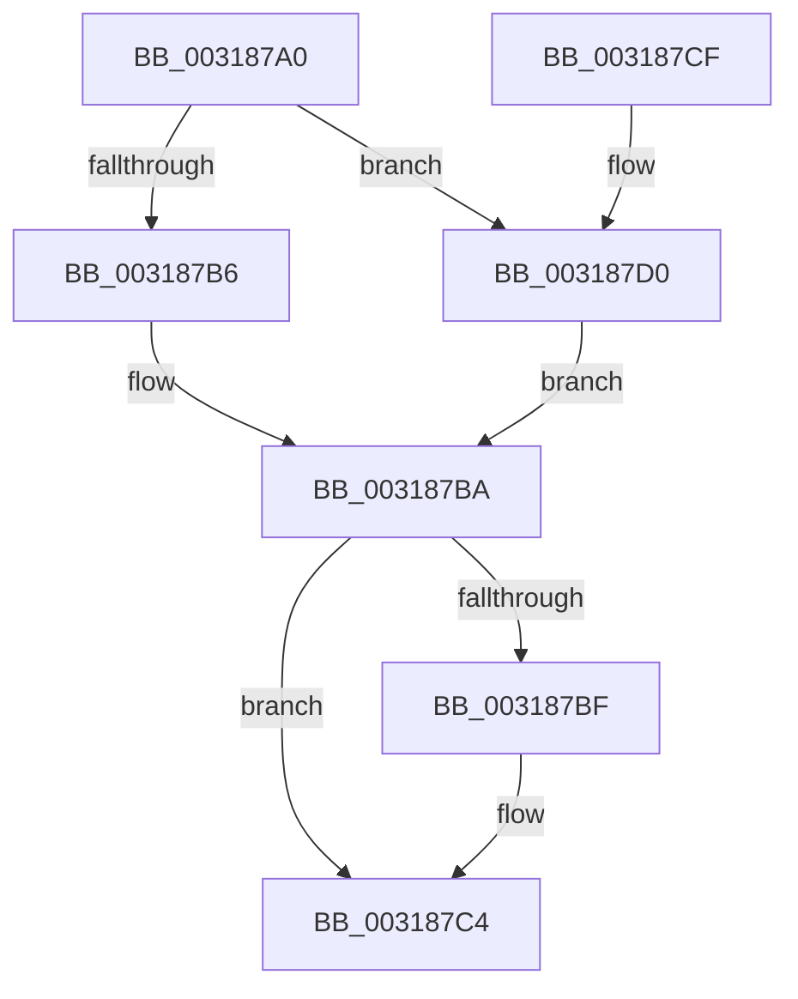

# SmMapPage

- RVA: `0x003187A0`–`0x003187F0` (길이 `80` bytes)
- VA: `0x00000001403187A0`
- 실행 섹션: `.text`
- PDB 이름 있음: `예`; PDB Function 태그: `아니요`
- unwind 정보 RVA: `0x00074C1C`
- 디코드: `24`개 명령, `80/80` bytes 표시
- 미해석 바이트: `0` (있으면 어셈블리에 `.byte`로 보존)

> 이 문서는 커널 이미지의 기계어와 PDB 기호를 분석해 생성했습니다. 4번과 5번은 함수 원형과 자료형을 바이너리 사용 방식에서 추정한 C 해석이며 원본 소스 복구 결과는 아닙니다.

## 1. Dependencies

- 직접 호출 지점: **1**; 고유 호출 대상: **1**
- 직접 호출자로 확인된 함수: **2**
- RIP 상대 이미지 참조: **0**

### Outgoing calls
- `0x003187E9` → [MmMapLockedPagesSpecifyCache](MmMapLockedPagesSpecifyCache_function_00318800.md) (function, `0x00318800`)

### Direct callers
- [sub_0034CBFD](../34/Unknown_function_0034CBFD.md) at `0x0034CC35`
- [ST_STORE&lt;SM_TRAITS&gt;::StGetStats](../4F/ST_STORE_SM_TRAITS_StGetStats_function_004FA058.md) at `0x004FA07F`

### Static image references
- 디코드된 RIP-relative 메모리 참조가 없습니다.

## 2. Other-region calls and transfers

- 다른 실행 섹션으로 향하는 call: **0**
- 별도 외부 분기/꼬리 이동을 확인하지 못했습니다.

## 3. Assembly (complete function range)

```asm
003187A0  48 89 5C 24 08                  mov qword ptr [rsp + 8], rbx
003187A5  57                              push rdi
003187A6  48 83 EC 30                     sub rsp, 0x30
003187AA  F6 41 0A 05                     test byte ptr [rcx + 0xa], 5
003187AE  48 8B FA                        mov rdi, rdx
003187B1  48 8B D9                        mov rbx, rcx
003187B4  74 1A                           je 0x1403187d0
003187B6  48 8B 41 18                     mov rax, qword ptr [rcx + 0x18]
003187BA  48 85 C0                        test rax, rax
003187BD  74 05                           je 0x1403187c4
003187BF  8B 4B 28                        mov ecx, dword ptr [rbx + 0x28]
003187C2  89 0F                           mov dword ptr [rdi], ecx
003187C4  48 8B 5C 24 40                  mov rbx, qword ptr [rsp + 0x40]
003187C9  48 83 C4 30                     add rsp, 0x30
003187CD  5F                              pop rdi
003187CE  C3                              ret
003187CF  CC                              int3
003187D0  45 33 C9                        xor r9d, r9d
003187D3  C7 44 24 28 10 00 00 40         mov dword ptr [rsp + 0x28], 0x40000010
003187DB  33 D2                           xor edx, edx
003187DD  C7 44 24 20 00 00 00 00         mov dword ptr [rsp + 0x20], 0
003187E5  45 8D 41 01                     lea r8d, [r9 + 1]
003187E9  E8 12 00 00 00                  call 0x140318800
003187EE  EB CA                           jmp 0x1403187ba
```

## 4. C-style interpretation (structured pseudocode)

```c
__int64 __fastcall SmMapPage(__int64 a1, __int64 a2, __int64 a3, int a4)
{
    __int64 result;
    __int64 v_rsp;
    unsigned int v_stack_p20;
    unsigned int v_stack_p28;
    unsigned __int64 v_stack_p8;

    v_stack_p8 = v_rbx;
    v_rsp = (v_rsp) - (48);
    if (((*(unsigned __int8 *)(a1 + 10)) & (5)) == 0) goto loc_003187D0;
loc_003187BA:
    if (*(unsigned __int64 *)(a1 + 24) != 0) {
        a1 = *(unsigned int *)(a1 + 40);
        *(unsigned int *)(a2) = (unsigned int)(a1);
    }
    v_rsp = (v_rsp) + (48);
    return *(unsigned __int64 *)(a1 + 24);
loc_003187D0:
    a4 = 0;
    v_stack_p28 = 0x40000010ULL;
    a2 = 0;
    v_stack_p20 = 0;
    result = MmMapLockedPagesSpecifyCache(a1, a2, a4 + 1, a4);
    goto loc_003187BA;
}
```

## 5. (Beta) C Style

```c
int64_t SmMapPage(void *Arg1, void *Arg2, int64_t Arg3, int32_t Arg4)
{
    uint8_t *arg1 = (uint8_t *)Arg1;
    uint8_t *arg2 = (uint8_t *)Arg2;

    int64_t result;
    int64_t local_rsp;
    uint32_t v_stack_p20;
    uint32_t v_stack_p28;
    uint64_t v_stack_p8;

    v_stack_p8 = local_rbx;
    local_rsp = (local_rsp) - (48);
    if (((*(uint8_t *)(arg1 + 0xA)) & (5)) == 0) goto loc_003187D0;
loc_003187BA:
    if (*(uint64_t *)(arg1 + 0x18) != 0) {
        Arg1 = *(uint32_t *)(arg1 + 0x28);
        *(uint32_t *)(arg2) = (uint32_t)(Arg1);
    }
    local_rsp = (local_rsp) + (48);
    return *(uint64_t *)(arg1 + 0x18);
loc_003187D0:
    Arg4 = 0;
    v_stack_p28 = 0x40000010ULL;
    Arg2 = 0;
    v_stack_p20 = 0;
    result = MmMapLockedPagesSpecifyCache(Arg1, Arg2, Arg4 + 1, Arg4);
    goto loc_003187BA;
}
```

### 관측된 메모리 오프셋

구조체 형식이 확인되지 않은 접근은 인자 기준의 오프셋으로만 기록했습니다.

| 기준 인자 | 오프셋 표현 | 폭 (bit) | 접근 |
|---|---:|---:|---|
| `Arg1` | `+ 0xA` | `8` | `R` |
| `Arg1` | `+ 0x18` | `64` | `R` |
| `Arg1` | `+ 0x28` | `32` | `R` |
| `Arg2` | `+ 0x0` | `32` | `W` |

## 6. Execution-region graph

[열기: 2D/3D 그래프와 함수 탐색 컨트롤 패널](../../../control-panel.html?section=text&rva=0x003187A0&view=graph)

- 2D 그래프는 위에서 아래로 흐르고, 3D 그래프는 빈 공간을 드래그해 회전합니다. Shift+드래그는 이동, 휠은 확대·축소, 함수 노드 선택은 대상 보고서 이동입니다.

### Static fallback


