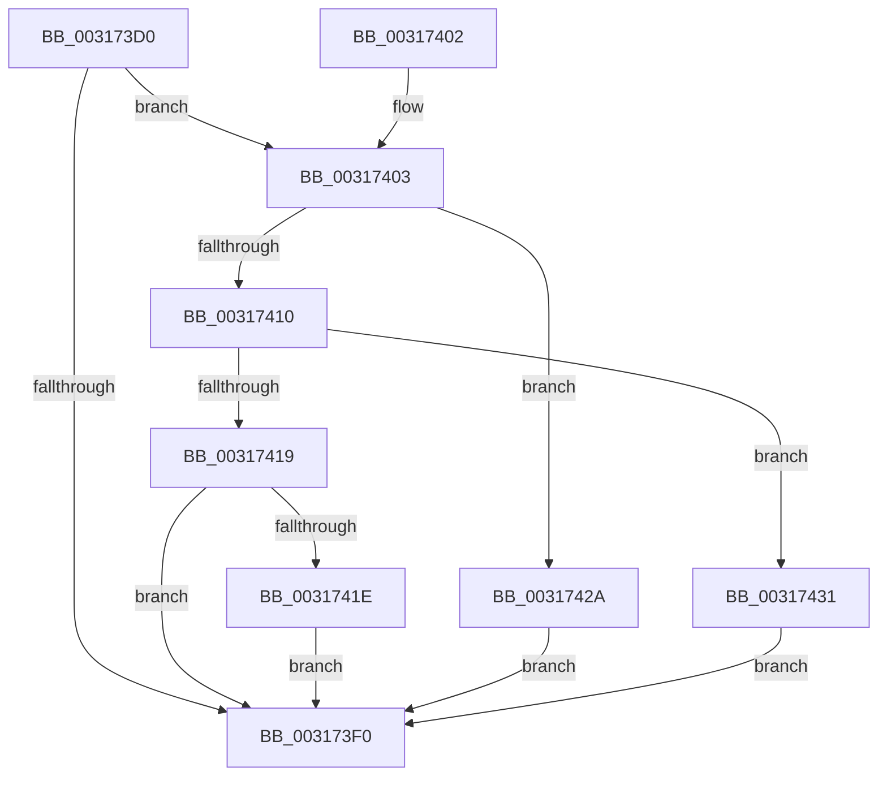

# SmpStoreMgrCallback

- RVA: `0x003173D0`–`0x00317438` (길이 `104` bytes)
- VA: `0x00000001403173D0`
- 실행 섹션: `.text`
- PDB 이름 있음: `예`; PDB Function 태그: `아니요`
- unwind 정보 RVA: `0x00070298`
- 디코드: `32`개 명령, `104/104` bytes 표시
- 미해석 바이트: `0` (있으면 어셈블리에 `.byte`로 보존)

> 이 문서는 커널 이미지의 기계어와 PDB 기호를 분석해 생성했습니다. 4번과 5번은 함수 원형과 자료형을 바이너리 사용 방식에서 추정한 C 해석이며 원본 소스 복구 결과는 아닙니다.

## 1. Dependencies

- 직접 호출 지점: **2**; 고유 호출 대상: **2**
- 직접 호출자로 확인된 함수: **1**
- RIP 상대 이미지 참조: **0**

### Outgoing calls
- `0x00317410` → [ExAcquireRundownProtection](../21/ExAcquireRundownProtection_function_00216620.md) (function, `0x00216620`)
- `0x0031742A` → [ExReleaseRundownProtection](../34/ExReleaseRundownProtection_function_00349E80.md) (function, `0x00349E80`)

### Direct callers
- [sub_003176F1](Unknown_function_003176F1.md) at `0x003177A8`

### Static image references
- 디코드된 RIP-relative 메모리 참조가 없습니다.

## 2. Other-region calls and transfers

- 다른 실행 섹션으로 향하는 call: **0**
- 별도 외부 분기/꼬리 이동을 확인하지 못했습니다.

## 3. Assembly (complete function range)

```asm
003173D0  48 89 5C 24 08                  mov qword ptr [rsp + 8], rbx
003173D5  48 89 74 24 10                  mov qword ptr [rsp + 0x10], rsi
003173DA  57                              push rdi
003173DB  48 83 EC 20                     sub rsp, 0x20
003173DF  41 8D 40 F8                     lea eax, [r8 - 8]
003173E3  33 DB                           xor ebx, ebx
003173E5  48 8B FA                        mov rdi, rdx
003173E8  48 8B F1                        mov rsi, rcx
003173EB  83 F8 01                        cmp eax, 1
003173EE  76 13                           jbe 0x140317403
003173F0  48 8B 74 24 38                  mov rsi, qword ptr [rsp + 0x38]
003173F5  8B C3                           mov eax, ebx
003173F7  48 8B 5C 24 30                  mov rbx, qword ptr [rsp + 0x30]
003173FC  48 83 C4 20                     add rsp, 0x20
00317400  5F                              pop rdi
00317401  C3                              ret
00317402  CC                              int3
00317403  48 81 C1 40 08 00 00            add rcx, 0x840
0031740A  41 83 F8 08                     cmp r8d, 8
0031740E  75 1A                           jne 0x14031742a
00317410  E8 0B F2 EF FF                  call 0x140216620
00317415  84 C0                           test al, al
00317417  74 18                           je 0x140317431
00317419  48 85 FF                        test rdi, rdi
0031741C  74 D2                           je 0x1403173f0
0031741E  48 8B 86 30 08 00 00            mov rax, qword ptr [rsi + 0x830]
00317425  48 89 07                        mov qword ptr [rdi], rax
00317428  EB C6                           jmp 0x1403173f0
0031742A  E8 51 2A 03 00                  call 0x140349e80
0031742F  EB BF                           jmp 0x1403173f0
00317431  BB A0 04 00 C0                  mov ebx, 0xc00004a0
00317436  EB B8                           jmp 0x1403173f0
```

## 4. C-style interpretation (structured pseudocode)

```c
__int64 __fastcall SmpStoreMgrCallback(__int64 a1, __int64 a2, __int64 a3)
{
    __int64 result;
    __int64 v_rbx;
    __int64 v_rsp;
    unsigned __int64 v_stack_p10;
    unsigned __int64 v_stack_p8;

    v_stack_p8 = v_rbx;
    v_stack_p10 = v_rsi;
    v_rsp = (v_rsp) - (32);
    v_rbx = 0;
    if (((unsigned int)(a3 - 8)) <= 1) goto loc_00317403;
loc_003173F0:
    v_rsp = (v_rsp) + (32);
    return 0;
loc_00317403:
    a1 = (a1) + (0x840ULL);
    if (((unsigned int)(a3)) != 8) goto loc_0031742A;
    result = ExAcquireRundownProtection(a1, a2, a3, a4);
    if ((unsigned __int8)(result) == 0) goto loc_00317431;
    if (a2 == 0) goto loc_003173F0;
    *(unsigned __int64 *)(a2) = *(unsigned __int64 *)(v_stack_p10 + 2096);
    goto loc_003173F0;
loc_0031742A:
    result = ExReleaseRundownProtection(a1, a2, a3, a4);
    goto loc_003173F0;
loc_00317431:
    goto loc_003173F0;
}
```

## 5. (Beta) C Style

```c
int64_t SmpStoreMgrCallback(void *Arg1, int64_t Arg2, void *Arg3)
{
    uint8_t *arg1 = (uint8_t *)Arg1;
    uint8_t *arg3 = (uint8_t *)Arg3;

    int64_t result;
    int64_t local_rbx;
    int64_t local_rsp;
    uint64_t v_stack_p10;
    uint64_t v_stack_p8;

    v_stack_p8 = local_rbx;
    v_stack_p10 = local_rsi;
    local_rsp = (local_rsp) - (32);
    local_rbx = 0;
    if (((uint32_t)(Arg3 - 8)) <= 1) goto loc_00317403;
loc_003173F0:
    local_rsp = (local_rsp) + (32);
    return 0;
loc_00317403:
    Arg1 = (Arg1) + (0x840ULL);
    if (((uint32_t)(Arg3)) != 8) goto loc_0031742A;
    result = ExAcquireRundownProtection(Arg1, Arg2, Arg3, a4);
    if ((uint8_t)(result) == 0) goto loc_00317431;
    if (Arg2 == 0) goto loc_003173F0;
    *(uint64_t *)(Arg2) = *(uint64_t *)(v_stack_p10 + 0x830);
    goto loc_003173F0;
loc_0031742A:
    result = ExReleaseRundownProtection(Arg1, Arg2, Arg3, a4);
    goto loc_003173F0;
loc_00317431:
    goto loc_003173F0;
}
```

### 관측된 메모리 오프셋

구조체 형식이 확인되지 않은 접근은 인자 기준의 오프셋으로만 기록했습니다.

| 기준 인자 | 오프셋 표현 | 폭 (bit) | 접근 |
|---|---:|---:|---|
| `Arg1` | `+ 0x830` | `64` | `R` |
| `Arg3` | `- 0x8` | `32` | `R` |

## 6. Execution-region graph

[열기: 2D/3D 그래프와 함수 탐색 컨트롤 패널](../../../control-panel.html?section=text&rva=0x003173D0&view=graph)

- 2D 그래프는 위에서 아래로 흐르고, 3D 그래프는 빈 공간을 드래그해 회전합니다. Shift+드래그는 이동, 휠은 확대·축소, 함수 노드 선택은 대상 보고서 이동입니다.

### Static fallback


