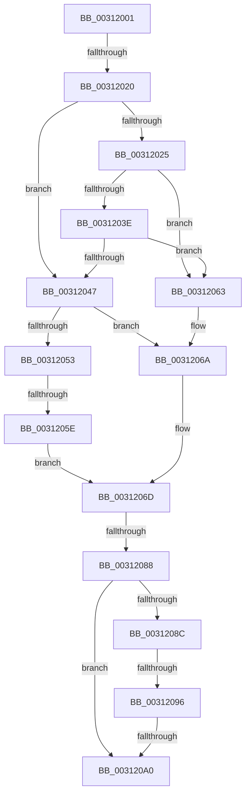

# sub_00312001

- RVA: `0x00312001`–`0x003120A5` (길이 `164` bytes)
- VA: `0x0000000140312001`
- 실행 섹션: `.text`
- PDB 이름 있음: `아니요`; PDB Function 태그: `아니요`
- unwind 정보 RVA: `0x00074204`
- 디코드: `40`개 명령, `164/164` bytes 표시
- 미해석 바이트: `0` (있으면 어셈블리에 `.byte`로 보존)

> 이 문서는 커널 이미지의 기계어와 PDB 기호를 분석해 생성했습니다. 4번과 5번은 함수 원형과 자료형을 바이너리 사용 방식에서 추정한 C 해석이며 원본 소스 복구 결과는 아닙니다.

## 1. Dependencies

- 직접 호출 지점: **0**; 고유 호출 대상: **0**
- 직접 호출자로 확인된 함수: **0**
- RIP 상대 이미지 참조: **1**

### Outgoing calls
- 직접 디코드된 call 명령이 없습니다.

### Direct callers
- 이 함수 시작 RVA로 연결되는 직접 call은 확인되지 않았습니다. 간접 호출은 완전히 역산할 수 없습니다.

### Static image references
- `0x00312047` → RVA `0x00E2DCD0` (`.data`; read)

## 2. Other-region calls and transfers

- 다른 실행 섹션으로 향하는 call: **0**
- call이 아닌 외부 분기/꼬리 이동: **5**
  - `0x0031201A` → [sub_00312A3C](Unknown_function_00312A3C.md) (`tail-transfer`)
  - `0x00312058` → [sub_003127B7](Unknown_function_003127B7.md) (`tail-transfer`)
  - `0x00312082` → [sub_003121C2](Unknown_function_003121C2.md) (`tail-transfer`)
  - `0x00312090` → [sub_003126A2](Unknown_function_003126A2.md) (`tail-transfer`)
  - `0x0031209A` → [sub_003126A2](Unknown_function_003126A2.md) (`tail-transfer`)

## 3. Assembly (complete function range)

```asm
00312001  4D 89 63 20                     mov qword ptr [r11 + 0x20], r12
00312005  4D 89 73 E0                     mov qword ptr [r11 - 0x20], r14
00312009  4D 89 7B D8                     mov qword ptr [r11 - 0x28], r15
0031200D  45 33 FF                        xor r15d, r15d
00312010  45 8D 67 01                     lea r12d, [r15 + 1]
00312014  45 8D 77 02                     lea r14d, [r15 + 2]
00312018  84 D2                           test dl, dl
0031201A  0F 85 1C 0A 00 00               jne 0x140312a3c
00312020  44 39 26                        cmp dword ptr [rsi], r12d
00312023  75 22                           jne 0x140312047
00312025  65 48 8B 04 25 88 01 00 00      mov rax, qword ptr gs:[0x188]
0031202E  48 8B 88 B8 00 00 00            mov rcx, qword ptr [rax + 0xb8]
00312035  4C 39 B9 70 06 00 00            cmp qword ptr [rcx + 0x670], r15
0031203C  75 25                           jne 0x140312063
0031203E  4C 39 B9 70 01 00 00            cmp qword ptr [rcx + 0x170], r15
00312045  75 1C                           jne 0x140312063
00312047  4C 8B 05 82 BC B1 00            mov r8, qword ptr [rip + 0xb1bc82]
0031204E  44 39 26                        cmp dword ptr [rsi], r12d
00312051  74 17                           je 0x14031206a
00312053  8B 43 10                        mov eax, dword ptr [rbx + 0x10]
00312056  A8 04                           test al, 4
00312058  0F 84 59 07 00 00               je 0x1403127b7
0031205E  45 8B CE                        mov r9d, r14d
00312061  EB 0A                           jmp 0x14031206d
00312063  49 C7 C0 FF FF FF FF            mov r8, 0xffffffffffffffff
0031206A  45 8B CF                        mov r9d, r15d
0031206D  B8 10 00 00 00                  mov eax, 0x10
00312072  44 89 4C 24 44                  mov dword ptr [rsp + 0x44], r9d
00312077  48 8B CB                        mov rcx, rbx
0031207A  48 8D 3C 18                     lea rdi, [rax + rbx]
0031207E  44 38 7B 19                     cmp byte ptr [rbx + 0x19], r15b
00312082  0F 85 3A 01 00 00               jne 0x1403121c2
00312088  84 D2                           test dl, dl
0031208A  75 14                           jne 0x1403120a0
0031208C  4C 39 43 20                     cmp qword ptr [rbx + 0x20], r8
00312090  0F 83 0C 06 00 00               jae 0x1403126a2
00312096  44 38 7B 1A                     cmp byte ptr [rbx + 0x1a], r15b
0031209A  0F 85 02 06 00 00               jne 0x1403126a2
003120A0  8B 4B 14                        mov ecx, dword ptr [rbx + 0x14]
003120A3  F6 DA                           neg dl
```

## 4. C-style interpretation (structured pseudocode)

```c
__int64 __fastcall sub_00312001(__int64 a1, unsigned __int8 a2)
{
    __int64 v_r15;
    unsigned int v_stack_p44;

    *(unsigned __int64 *)(v_r11 + 32) = v_r12;
    *(unsigned __int64 *)(v_r11 - 32) = v_r14;
    *(unsigned __int64 *)(v_r11 - 40) = v_r15;
    v_r15 = 0;
    if ((*(unsigned int *)(v_rsi)) != ((unsigned int)(v_r15 + 1))) goto loc_00312047;
    if ((*(unsigned __int64 *)(*(unsigned __int64 *)(*(unsigned __int64 *)(gs_base + (0 + 392)) + 184) + 1648)) != 0) goto loc_00312063;
    if ((*(unsigned __int64 *)(*(unsigned __int64 *)(*(unsigned __int64 *)(gs_base + (0 + 392)) + 184) + 368)) != 0) goto loc_00312063;
loc_00312047:
    if ((*(unsigned int *)(v_rsi)) == ((unsigned int)(v_r15 + 1))) goto loc_0031206A;
    goto loc_0031206D;
loc_00312063:
loc_0031206A:
loc_0031206D:
    v_stack_p44 = 0;
    if (a2 != 0) goto loc_003120A0;
loc_003120A0:
    a2 = (unsigned __int8)(-(a2));
    return 16;
}
```

## 5. (Beta) C Style

```c
int64_t sub_00312001(int64_t Arg1, uint8_t Arg2)
{
    int64_t local_r15;
    uint32_t v_stack_p44;

    *(uint64_t *)(local_r11 + 0x20) = local_r12;
    *(uint64_t *)(local_r11 - 0x20) = local_r14;
    *(uint64_t *)(local_r11 - 0x28) = local_r15;
    local_r15 = 0;
    if ((*(uint32_t *)(local_rsi)) != ((uint32_t)(local_r15 + 1))) goto loc_00312047;
    if ((*(uint64_t *)(*(uint64_t *)(*(uint64_t *)(gs_base + (0 + 0x188)) + 0xB8) + 0x670)) != 0) goto loc_00312063;
    if ((*(uint64_t *)(*(uint64_t *)(*(uint64_t *)(gs_base + (0 + 0x188)) + 0xB8) + 0x170)) != 0) goto loc_00312063;
loc_00312047:
    if ((*(uint32_t *)(local_rsi)) == ((uint32_t)(local_r15 + 1))) goto loc_0031206A;
    goto loc_0031206D;
loc_00312063:
loc_0031206A:
loc_0031206D:
    v_stack_p44 = 0;
    if (Arg2 != 0) goto loc_003120A0;
loc_003120A0:
    Arg2 = (uint8_t)(-(Arg2));
    return 16;
}
```

## 6. Execution-region graph

[열기: 2D/3D 그래프와 함수 탐색 컨트롤 패널](../../../control-panel.html?section=text&rva=0x00312001&view=graph)

- 2D 그래프는 위에서 아래로 흐르고, 3D 그래프는 빈 공간을 드래그해 회전합니다. Shift+드래그는 이동, 휠은 확대·축소, 함수 노드 선택은 대상 보고서 이동입니다.

### Static fallback


