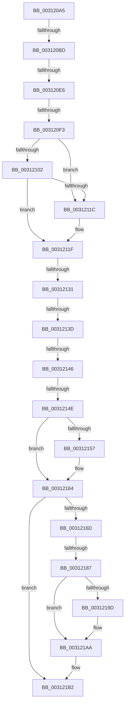

# sub_003120A5

- RVA: `0x003120A5`–`0x003121C2` (길이 `285` bytes)
- VA: `0x00000001403120A5`
- 실행 섹션: `.text`
- PDB 이름 있음: `아니요`; PDB Function 태그: `아니요`
- unwind 정보 RVA: `0x00074220`
- 디코드: `65`개 명령, `285/285` bytes 표시
- 미해석 바이트: `0` (있으면 어셈블리에 `.byte`로 보존)

> 이 문서는 커널 이미지의 기계어와 PDB 기호를 분석해 생성했습니다. 4번과 5번은 함수 원형과 자료형을 바이너리 사용 방식에서 추정한 C 해석이며 원본 소스 복구 결과는 아닙니다.

## 1. Dependencies

- 직접 호출 지점: **3**; 고유 호출 대상: **3**
- 직접 호출자로 확인된 함수: **0**
- RIP 상대 이미지 참조: **4**

### Outgoing calls
- `0x0031215F` → [VmFlushTb](VmFlushTb_function_00312BD0.md) (function, `0x00312BD0`)
- `0x0031218F` → [ExFlushTb](ExFlushTb_function_00312B34.md) (function, `0x00312B34`)
- `0x003121A5` → [KiLowerIrqlProcessIrqlFlags](../4F/KiLowerIrqlProcessIrqlFlags_function_004F5698.md) (function, `0x004F5698`)

### Direct callers
- 이 함수 시작 RVA로 연결되는 직접 call은 확인되지 않았습니다. 간접 호출은 완전히 역산할 수 없습니다.

### Static image references
- `0x0031211F` → RVA `0x00FC6AB8` (`ALMOSTRO`; read)
- `0x0031214E` → RVA `0x00FC5004` (`ALMOSTRO`; read)
- `0x00312164` → RVA `0x00E685D4` (`.data`; read)
- `0x0031217A` → RVA `0x00FC6D20` (`ALMOSTRO`; read)

## 2. Other-region calls and transfers

- 다른 실행 섹션으로 향하는 call: **0**
- call이 아닌 외부 분기/꼬리 이동: **8**
  - `0x003120B7` → [sub_00312223 + 0x3E8](Unknown_function_00312223.md) (`tail-transfer`)
  - `0x003120E0` → [sub_00312223](Unknown_function_00312223.md) (`tail-transfer`)
  - `0x003120ED` → [sub_00312A48 + 0x34](Unknown_function_00312A48.md) (`tail-transfer`)
  - `0x0031212B` → [sub_003126C5 + 0xBF](Unknown_function_003126C5.md) (`tail-transfer`)
  - `0x00312137` → [sub_00312223 + 0x402](Unknown_function_00312223.md) (`tail-transfer`)
  - `0x00312140` → [sub_00312223 + 0x402](Unknown_function_00312223.md) (`tail-transfer`)
  - `0x00312148` → [sub_003127BF + 0x25C](Unknown_function_003127BF.md) (`tail-transfer`)
  - `0x00312181` → [sub_003126C5 + 0xAE](Unknown_function_003126C5.md) (`tail-transfer`)

## 3. Assembly (complete function range)

```asm
003120A5  4C 89 AC 24 F0 01 00 00         mov qword ptr [rsp + 0x1f0], r13
003120AD  1B C0                           sbb eax, eax
003120AF  25 00 00 00 80                  and eax, 0x80000000
003120B4  41 84 CC                        test r12b, cl
003120B7  0F 84 4E 05 00 00               je 0x14031260b
003120BD  41 0B C4                        or eax, r12d
003120C0  44 8B 3E                        mov r15d, dword ptr [rsi]
003120C3  48 8D 7B 10                     lea rdi, [rbx + 0x10]
003120C7  8B D0                           mov edx, eax
003120C9  4C 8D 6B 28                     lea r13, [rbx + 0x28]
003120CD  83 CA 08                        or edx, 8
003120D0  0F BA E1 08                     bt ecx, 8
003120D4  0F 43 D0                        cmovae edx, eax
003120D7  8B 07                           mov eax, dword ptr [rdi]
003120D9  89 54 24 58                     mov dword ptr [rsp + 0x58], edx
003120DD  41 84 C4                        test r12b, al
003120E0  0F 84 3D 01 00 00               je 0x140312223
003120E6  49 8B 4D 00                     mov rcx, qword ptr [r13]
003120EA  45 3B FC                        cmp r15d, r12d
003120ED  0F 85 89 09 00 00               jne 0x140312a7c
003120F3  48 B8 FF FF FE FF FF 7F 00 00   movabs rax, 0x7ffffffeffff
003120FD  48 3B C8                        cmp rcx, rax
00312100  77 1A                           ja 0x14031211c
00312102  65 48 8B 04 25 88 01 00 00      mov rax, qword ptr gs:[0x188]
0031210B  48 8B 88 B8 00 00 00            mov rcx, qword ptr [rax + 0xb8]
00312112  48 83 B9 70 01 00 00 00         cmp qword ptr [rcx + 0x170], 0
0031211A  75 03                           jne 0x14031211f
0031211C  45 33 E4                        xor r12d, r12d
0031211F  44 8B 35 92 49 CB 00            mov r14d, dword ptr [rip + 0xcb4992]
00312126  41 0F BA E6 17                  bt r14d, 0x17
0031212B  0F 82 53 06 00 00               jb 0x140312784
00312131  45 32 F6                        xor r14b, r14b
00312134  45 85 E4                        test r12d, r12d
00312137  0F 85 E8 04 00 00               jne 0x140312625
0031213D  45 84 F6                        test r14b, r14b
00312140  0F 85 DF 04 00 00               jne 0x140312625
00312146  85 ED                           test ebp, ebp
00312148  0F 85 CD 08 00 00               jne 0x140312a1b
0031214E  80 3D AF 2E CB 00 00            cmp byte ptr [rip + 0xcb2eaf], 0
00312155  74 0D                           je 0x140312164
00312157  45 8B C7                        mov r8d, r15d
0031215A  49 8B D5                        mov rdx, r13
0031215D  8B CD                           mov ecx, ebp
0031215F  E8 6C 0A 00 00                  call 0x140312bd0
00312164  83 3D 69 64 B5 00 00            cmp dword ptr [rip + 0xb56469], 0
0031216B  74 45                           je 0x1403121b2
0031216D  45 0F 20 C6                     mov r14, cr8
00312171  B8 0F 00 00 00                  mov eax, 0xf
00312176  44 0F 22 C0                     mov cr8, rax
0031217A  83 3D 9F 4B CB 00 00            cmp dword ptr [rip + 0xcb4b9f], 0
00312181  0F 85 EC 05 00 00               jne 0x140312773
00312187  45 8B C7                        mov r8d, r15d
0031218A  49 8B D5                        mov rdx, r13
0031218D  8B CD                           mov ecx, ebp
0031218F  E8 A0 09 00 00                  call 0x140312b34
00312194  83 3D 85 4B CB 00 00            cmp dword ptr [rip + 0xcb4b85], 0
0031219B  74 0D                           je 0x1403121aa
0031219D  41 0F B6 D6                     movzx edx, r14b
003121A1  44 0F 20 C1                     mov rcx, cr8
003121A5  E8 EE 34 1E 00                  call 0x1404f5698
003121AA  41 0F B6 C6                     movzx eax, r14b
003121AE  44 0F 22 C0                     mov cr8, rax
003121B2  44 8B 4C 24 44                  mov r9d, dword ptr [rsp + 0x44]
003121B7  45 33 FF                        xor r15d, r15d
003121BA  4C 8B AC 24 F0 01 00 00         mov r13, qword ptr [rsp + 0x1f0]
```

## 4. C-style interpretation (structured pseudocode)

```c
__int64 __fastcall sub_003120A5(int a1, __int64 a2, __int64 a3, __int64 a4, __int64 a5, __int64 a6, __int64 a7, __int64 a8, __int64 a9, __int64 a10, __int64 a11, __int64 a12, __int64 a13, __int64 a14, __int64 a15, __int64 a16, __int64 a17, __int64 a18, __int64 a19, __int64 a20, __int64 a21, __int64 a22, __int64 a23, __int64 a24, __int64 a25, __int64 a26, __int64 a27, __int64 a28, __int64 a29, __int64 a30, __int64 a31, __int64 a32, __int64 a33, __int64 a34, __int64 a35, __int64 a36, __int64 a37, __int64 a38, __int64 a39, __int64 a40, __int64 a41, __int64 a42, __int64 a43, __int64 a44, __int64 a45, __int64 a46, __int64 a47, __int64 a48, __int64 a49, __int64 a50, __int64 a51, __int64 a52, __int64 a53, __int64 a54, __int64 a55, __int64 a56, __int64 a57, __int64 a58, __int64 a59, __int64 a60, __int64 a61, __int64 a62)
{
    __int64 result;
    __int64 v_r12;
    __int64 v_r14;
    __int64 v_r15;
    unsigned __int64 v_stack_p1F0;
    unsigned int v_stack_p44;
    unsigned int v_stack_p58;

    v_stack_p1F0 = v_r13;
    result = (unsigned int)((result) & (0x80000000ULL));
    result = (unsigned int)((result) | ((unsigned int)(v_r12)));
    a2 = (unsigned int)(((unsigned int)((unsigned int)(result))) | (8));
    if (condition_is_above_or_equal) { a2 = (unsigned int)(result); }
    v_stack_p58 = (unsigned int)(a2);
    if ((*(unsigned __int64 *)(v_rbx + 40)) > ((unsigned int)(*(unsigned int *)(v_rbx + 16)))) goto loc_0031211C;
    if ((*(unsigned __int64 *)(*(unsigned __int64 *)(*(unsigned __int64 *)(gs_base + (0 + 392)) + 184) + 368)) == 0) {
        v_r12 = 0;
    }
    v_r14 = 0;
    result = *(unsigned __int64 *)(gs_base + (0 + 392));
    if ((*(unsigned __int8 *)(v_rip + 13315759)) != 0) {
        a3 = (unsigned int)((unsigned int)(*(unsigned int *)(v_rsi)));
        a2 = v_rbx + 40;
        a1 = (unsigned int)(v_rbp);
        result = VmFlushTb(a1, a2, a3, a4);
    }
    if ((*(unsigned int *)(v_rip + 11887721)) == 0) goto loc_003121B2;
    result = ExFlushTb((unsigned int)((unsigned int)(v_rbp)), v_rbx + 40, (unsigned int)((unsigned int)((unsigned int)(*(unsigned int *)(v_rsi)))), a4);
    if ((*(unsigned int *)(v_rip + 13323141)) != 0) {
        a2 = (unsigned __int8)(v_cr8);
        a1 = 15;
        result = KiLowerIrqlProcessIrqlFlags(a1, a2, (unsigned int)((unsigned int)((unsigned int)(*(unsigned int *)(v_rsi)))), a4);
    }
loc_003121B2:
    v_r15 = 0;
    return (unsigned __int8)(v_cr8);
}
```

## 5. (Beta) C Style

```c
int64_t sub_003120A5(int32_t Arg1, int64_t Arg2, int64_t Arg3, int64_t Arg4, uint64_t Arg5, uint64_t Arg6, uint64_t Arg7, uint64_t Arg8, uint64_t Arg9, uint64_t Arg10, uint64_t Arg11, uint64_t Arg12, uint64_t Arg13, uint64_t Arg14, uint64_t Arg15, uint64_t Arg16, uint64_t Arg17, uint64_t Arg18, uint64_t Arg19, uint64_t Arg20, uint64_t Arg21, uint64_t Arg22, uint64_t Arg23, uint64_t Arg24, uint64_t Arg25, uint64_t Arg26, uint64_t Arg27, uint64_t Arg28, uint64_t Arg29, uint64_t Arg30, uint64_t Arg31, uint64_t Arg32, uint64_t Arg33, uint64_t Arg34, uint64_t Arg35, uint64_t Arg36, uint64_t Arg37, uint64_t Arg38, uint64_t Arg39, uint64_t Arg40, uint64_t Arg41, uint64_t Arg42, uint64_t Arg43, uint64_t Arg44, uint64_t Arg45, uint64_t Arg46, uint64_t Arg47, uint64_t Arg48, uint64_t Arg49, uint64_t Arg50, uint64_t Arg51, uint64_t Arg52, uint64_t Arg53, uint64_t Arg54, uint64_t Arg55, uint64_t Arg56, uint64_t Arg57, uint64_t Arg58, uint64_t Arg59, uint64_t Arg60, uint64_t Arg61, int64_t Arg62)
{
    int64_t result;
    int64_t local_r12;
    int64_t local_r14;
    int64_t local_r15;
    uint64_t v_stack_p1F0;
    uint32_t v_stack_p44;
    uint32_t v_stack_p58;

    v_stack_p1F0 = local_r13;
    result = (uint32_t)((result) & (0x80000000ULL));
    result = (uint32_t)((result) | ((uint32_t)(local_r12)));
    Arg2 = (uint32_t)(((uint32_t)((uint32_t)(result))) | (8));
    if (condition_is_above_or_equal) { Arg2 = (uint32_t)(result); }
    v_stack_p58 = (uint32_t)(Arg2);
    if ((*(uint64_t *)(local_rbx + 0x28)) > ((uint32_t)(*(uint32_t *)(local_rbx + 0x10)))) goto loc_0031211C;
    if ((*(uint64_t *)(*(uint64_t *)(*(uint64_t *)(gs_base + (0 + 0x188)) + 0xB8) + 0x170)) == 0) {
        local_r12 = 0;
    }
    local_r14 = 0;
    result = *(uint64_t *)(gs_base + (0 + 0x188));
    if ((*(uint8_t *)(v_rip + 0xCB2EAF)) != 0) {
        Arg3 = (uint32_t)((uint32_t)(*(uint32_t *)(local_rsi)));
        Arg2 = local_rbx + 40;
        Arg1 = (uint32_t)(local_rbp);
        result = VmFlushTb(Arg1, Arg2, Arg3, Arg4);
    }
    if ((*(uint32_t *)(v_rip + 0xB56469)) == 0) goto loc_003121B2;
    result = ExFlushTb((uint32_t)((uint32_t)(local_rbp)), local_rbx + 40, (uint32_t)((uint32_t)((uint32_t)(*(uint32_t *)(local_rsi)))), Arg4);
    if ((*(uint32_t *)(v_rip + 0xCB4B85)) != 0) {
        Arg2 = (uint8_t)(v_cr8);
        Arg1 = 15;
        result = KiLowerIrqlProcessIrqlFlags(Arg1, Arg2, (uint32_t)((uint32_t)((uint32_t)(*(uint32_t *)(local_rsi)))), Arg4);
    }
loc_003121B2:
    local_r15 = 0;
    return (uint8_t)(v_cr8);
}
```

## 6. Execution-region graph

[열기: 2D/3D 그래프와 함수 탐색 컨트롤 패널](../../../control-panel.html?section=text&rva=0x003120A5&view=graph)

- 2D 그래프는 위에서 아래로 흐르고, 3D 그래프는 빈 공간을 드래그해 회전합니다. Shift+드래그는 이동, 휠은 확대·축소, 함수 노드 선택은 대상 보고서 이동입니다.

### Static fallback


