# sub_00312223

- RVA: `0x00312223`–`0x003126A2` (길이 `1,151` bytes)
- VA: `0x0000000140312223`
- 실행 섹션: `.text`
- PDB 이름 있음: `아니요`; PDB Function 태그: `아니요`
- unwind 정보 RVA: `0x0007426C`
- 디코드: `242`개 명령, `1,151/1,151` bytes 표시
- 미해석 바이트: `0` (있으면 어셈블리에 `.byte`로 보존)

> 이 문서는 커널 이미지의 기계어와 PDB 기호를 분석해 생성했습니다. 4번과 5번은 함수 원형과 자료형을 바이너리 사용 방식에서 추정한 C 해석이며 원본 소스 복구 결과는 아닙니다.

## 1. Dependencies

- 직접 호출 지점: **5**; 고유 호출 대상: **4**
- 직접 호출자로 확인된 함수: **0**
- RIP 상대 이미지 참조: **6**

### Outgoing calls
- `0x0031244E` → [KiLowerIrqlProcessIrqlFlags](../4F/KiLowerIrqlProcessIrqlFlags_function_004F5698.md) (function, `0x004F5698`)
- `0x00312550` → [memset](../6C/memset_function_006C6C40.md) (function, `0x006C6C40`)
- `0x00312635` → [memset](../6C/memset_function_006C6C40.md) (function, `0x006C6C40`)
- `0x00312667` → [KiPrepareFlushCurrentAffinity](KiPrepareFlushCurrentAffinity_function_00313424.md) (function, `0x00313424`)
- `0x00312690` → [HvlFlushRangeListTb](HvlFlushRangeListTb_function_00312C10.md) (function, `0x00312C10`)

### Direct callers
- 이 함수 시작 RVA로 연결되는 직접 call은 확인되지 않았습니다. 간접 호출은 완전히 역산할 수 없습니다.

### Static image references
- `0x00312223` → RVA `0x00FC6AB8` (`ALMOSTRO`; read)
- `0x00312244` → RVA `0x00FC6A87` (`ALMOSTRO`; read)
- `0x00312256` → RVA `0x00FC6A80` (`ALMOSTRO`; read)
- `0x00312280` → RVA `0x00FC6D20` (`ALMOSTRO`; read)
- `0x003125A4` → RVA `0x00F231B0` (`.data`; read)
- `0x0031263A` → RVA `0x01201840` (`CFGRO`; read)

## 2. Other-region calls and transfers

- 다른 실행 섹션으로 향하는 call: **0**
- call이 아닌 외부 분기/꼬리 이동: **26**
  - `0x0031223E` → [sub_00312A48 + 0x26](Unknown_function_00312A48.md) (`tail-transfer`)
  - `0x00312250` → [sub_00312A48 + 0xA2](Unknown_function_00312A48.md) (`tail-transfer`)
  - `0x00312268` → [sub_003127BF + 0x133](Unknown_function_003127BF.md) (`tail-transfer`)
  - `0x00312287` → [sub_003126C5 + 0xDC](Unknown_function_003126C5.md) (`tail-transfer`)
  - `0x003122CA` → [sub_003126C5 + 0x24](Unknown_function_003126C5.md) (`tail-transfer`)
  - `0x003122D7` → [sub_003126C5 + 0x24](Unknown_function_003126C5.md) (`tail-transfer`)
  - `0x00312346` → [sub_00312A48](Unknown_function_00312A48.md) (`tail-transfer`)
  - `0x003123D5` → [sub_00312A48 + 0xF](Unknown_function_00312A48.md) (`tail-transfer`)
  - `0x00312479` → [sub_00312A48 + 0x68](Unknown_function_00312A48.md) (`tail-transfer`)
  - `0x003124A6` → [sub_003127BF + 0x15D](Unknown_function_003127BF.md) (`tail-transfer`)
  - `0x003124B5` → [sub_003127BF + 0x163](Unknown_function_003127BF.md) (`tail-transfer`)
  - `0x003124C2` → [sub_003127BF + 0x76](Unknown_function_003127BF.md) (`tail-transfer`)
  - `0x003124F5` → [sub_003126C5 + 0xCB](Unknown_function_003126C5.md) (`tail-transfer`)
  - `0x00312511` → [sub_003127BF + 0x11](Unknown_function_003127BF.md) (`tail-transfer`)
  - `0x00312585` → [sub_003126C5 + 0x59](Unknown_function_003126C5.md) (`tail-transfer`)
  - `0x003125C5` → [sub_003126C5](Unknown_function_003126C5.md) (`tail-transfer`)
  - `0x003125D3` → [sub_003127BF](Unknown_function_003127BF.md) (`tail-transfer`)
  - `0x003125F2` → [sub_003127BF + 0x1F5](Unknown_function_003127BF.md) (`tail-transfer`)
  - `0x00312600` → [sub_003127BF + 0x1F5](Unknown_function_003127BF.md) (`tail-transfer`)
  - `0x0031260E` → [sub_003126C5 + 0x1C](Unknown_function_003126C5.md) (`tail-transfer`)
  - `0x00312617` → [sub_003120A5 + 0x1B](Unknown_function_003120A5.md) (`tail-transfer`)
  - `0x00312620` → [sub_003120A5 + 0x1B](Unknown_function_003120A5.md) (`tail-transfer`)
  - `0x00312641` → [sub_003126C5 + 0x7B](Unknown_function_003126C5.md) (`tail-transfer`)
  - `0x0031264B` → [sub_003127BF + 0x141](Unknown_function_003127BF.md) (`tail-transfer`)
  - `0x00312697` → [sub_003120A5 + 0xA9](Unknown_function_003120A5.md) (`tail-transfer`)
  - `0x0031269D` → [sub_003120A5 + 0xA1](Unknown_function_003120A5.md) (`tail-transfer`)

## 3. Assembly (complete function range)

```asm
00312223  8B 05 8F 48 CB 00               mov eax, dword ptr [rip + 0xcb488f]
00312229  B9 0C 00 00 00                  mov ecx, 0xc
0031222E  C6 44 24 41 00                  mov byte ptr [rsp + 0x41], 0
00312233  A8 04                           test al, 4
00312235  0F 84 2F 02 00 00               je 0x14031246a
0031223B  41 84 C6                        test r14b, al
0031223E  0F 85 2A 08 00 00               jne 0x140312a6e
00312244  0F B6 05 3C 48 CB 00            movzx eax, byte ptr [rip + 0xcb483c]
0031224B  24 03                           and al, 3
0031224D  41 3A C4                        cmp al, r12b
00312250  0F 84 94 08 00 00               je 0x140312aea
00312256  8B 05 24 48 CB 00               mov eax, dword ptr [rip + 0xcb4824]
0031225C  41 3B C4                        cmp eax, r12d
0031225F  0F 84 05 02 00 00               je 0x14031246a
00312265  45 85 C9                        test r9d, r9d
00312268  0F 85 84 06 00 00               jne 0x1403128f2
0031226E  F0 44 09 0C 24                  lock or dword ptr [rsp], r9d
00312273  45 0F 20 C2                     mov r10, cr8
00312277  4C 89 54 24 68                  mov qword ptr [rsp + 0x68], r10
0031227C  44 0F 22 C1                     mov cr8, rcx
00312280  44 39 0D 99 4A CB 00            cmp dword ptr [rip + 0xcb4a99], r9d
00312287  0F 85 14 05 00 00               jne 0x1403127a1
0031228D  65 48 8B 14 25 20 00 00 00      mov rdx, qword ptr gs:[0x20]
00312296  48 8B 42 08                     mov rax, qword ptr [rdx + 8]
0031229A  48 8B 88 B8 00 00 00            mov rcx, qword ptr [rax + 0xb8]
003122A1  33 C0                           xor eax, eax
003122A3  4C 8B 81 80 00 00 00            mov r8, qword ptr [rcx + 0x80]
003122AA  0F B7 C8                        movzx ecx, ax
003122AD  66 41 3B 08                     cmp cx, word ptr [r8]
003122B1  73 2F                           jae 0x1403122e2
003122B3  0F B7 C1                        movzx eax, cx
003122B6  4D 8B 4C C0 08                  mov r9, qword ptr [r8 + rax*8 + 8]
003122BB  4D 85 C9                        test r9, r9
003122BE  74 1D                           je 0x1403122dd
003122C0  0F B6 82 D0 00 00 00            movzx eax, byte ptr [rdx + 0xd0]
003122C7  66 3B C8                        cmp cx, ax
003122CA  0F 85 19 04 00 00               jne 0x1403126e9
003122D0  4C 3B 8A C8 00 00 00            cmp r9, qword ptr [rdx + 0xc8]
003122D7  0F 85 0C 04 00 00               jne 0x1403126e9
003122DD  66 FF C1                        inc cx
003122E0  EB CB                           jmp 0x1403122ad
003122E2  C6 44 24 40 00                  mov byte ptr [rsp + 0x40], 0
003122E7  85 ED                           test ebp, ebp
003122E9  0F 84 4D 01 00 00               je 0x14031243c
003122EF  41 8B CF                        mov ecx, r15d
003122F2  48 89 6C 24 60                  mov qword ptr [rsp + 0x60], rbp
003122F7  41 8B DC                        mov ebx, r12d
003122FA  49 8B C5                        mov rax, r13
003122FD  D3 C3                           rol ebx, cl
003122FF  83 E3 06                        and ebx, 6
00312302  48 89 84 24 90 00 00 00         mov qword ptr [rsp + 0x90], rax
0031230A  89 5C 24 50                     mov dword ptr [rsp + 0x50], ebx
0031230E  45 33 F6                        xor r14d, r14d
00312311  48 8B 10                        mov rdx, qword ptr [rax]
00312314  48 89 54 24 48                  mov qword ptr [rsp + 0x48], rdx
00312319  85 DB                           test ebx, ebx
0031231B  74 4C                           je 0x140312369
0031231D  80 3D 63 47 CB 00 00            cmp byte ptr [rip + 0xcb4763], 0
00312324  74 43                           je 0x140312369
00312326  65 48 8B 04 25 88 01 00 00      mov rax, qword ptr gs:[0x188]
0031232F  48 8B 88 B8 00 00 00            mov rcx, qword ptr [rax + 0xb8]
00312336  80 B9 60 01 00 00 00            cmp byte ptr [rcx + 0x160], 0
0031233D  75 2A                           jne 0x140312369
0031233F  F6 05 41 47 CB 00 02            test byte ptr [rip + 0xcb4741], 2
00312346  0F 84 FC 06 00 00               je 0x140312a48
0031234C  4C 89 A4 24 98 00 00 00         mov qword ptr [rsp + 0x98], r12
00312354  48 89 94 24 A0 00 00 00         mov qword ptr [rsp + 0xa0], rdx
0031235C  41 8B C6                        mov eax, r14d
0031235F  66 0F 38 82 84 24 98 00 00 00   invpcid rax, xmmword ptr [rsp + 0x98]
00312369  0F 01 3A                        invlpg byte ptr [rdx]
0031236C  4C 8B C2                        mov r8, rdx
0031236F  48 8B CA                        mov rcx, rdx
00312372  48 C1 E9 0A                     shr rcx, 0xa
00312376  41 BD 00 10 00 00               mov r13d, 0x1000
0031237C  80 E1 03                        and cl, 3
0031237F  0F B6 C1                        movzx eax, cl
00312382  C0 E0 03                        shl al, 3
00312385  02 C8                           add cl, al
00312387  49 D3 E5                        shl r13, cl
0031238A  41 81 E0 FF 03 00 00            and r8d, 0x3ff
00312391  4C 89 84 24 88 00 00 00         mov qword ptr [rsp + 0x88], r8
00312399  74 73                           je 0x14031240e
0031239B  33 DB                           xor ebx, ebx
0031239D  49 03 D5                        add rdx, r13
003123A0  41 8D 47 FF                     lea eax, [r15 - 1]
003123A4  38 1D DD 46 CB 00               cmp byte ptr [rip + 0xcb46dd], bl
003123AA  48 89 54 24 48                  mov qword ptr [rsp + 0x48], rdx
003123AF  74 46                           je 0x1403123f7
003123B1  41 3B C4                        cmp eax, r12d
003123B4  77 41                           ja 0x1403123f7
003123B6  65 48 8B 04 25 88 01 00 00      mov rax, qword ptr gs:[0x188]
003123BF  48 8B 88 B8 00 00 00            mov rcx, qword ptr [rax + 0xb8]
003123C6  38 99 60 01 00 00               cmp byte ptr [rcx + 0x160], bl
003123CC  75 29                           jne 0x1403123f7
003123CE  F6 05 B2 46 CB 00 02            test byte ptr [rip + 0xcb46b2], 2
003123D5  0F 84 7C 06 00 00               je 0x140312a57
003123DB  4C 89 A4 24 A8 00 00 00         mov qword ptr [rsp + 0xa8], r12
003123E3  48 89 94 24 B0 00 00 00         mov qword ptr [rsp + 0xb0], rdx
003123EB  8B C3                           mov eax, ebx
003123ED  66 0F 38 82 84 24 A8 00 00 00   invpcid rax, xmmword ptr [rsp + 0xa8]
003123F7  0F 01 3A                        invlpg byte ptr [rdx]
003123FA  4D 2B C4                        sub r8, r12
003123FD  4C 89 84 24 88 00 00 00         mov qword ptr [rsp + 0x88], r8
00312405  75 96                           jne 0x14031239d
00312407  8B 5C 24 50                     mov ebx, dword ptr [rsp + 0x50]
0031240B  45 33 F6                        xor r14d, r14d
0031240E  48 8B 84 24 90 00 00 00         mov rax, qword ptr [rsp + 0x90]
00312416  48 83 C0 08                     add rax, 8
0031241A  4C 29 64 24 60                  sub qword ptr [rsp + 0x60], r12
0031241F  48 89 84 24 90 00 00 00         mov qword ptr [rsp + 0x90], rax
00312427  0F 85 E4 FE FF FF               jne 0x140312311
0031242D  48 8B 5C 24 70                  mov rbx, qword ptr [rsp + 0x70]
00312432  41 BE 02 00 00 00               mov r14d, 2
00312438  4C 8D 6B 28                     lea r13, [rbx + 0x28]
0031243C  83 3D DD 48 CB 00 00            cmp dword ptr [rip + 0xcb48dd], 0
00312443  74 0E                           je 0x140312453
00312445  44 0F 20 C1                     mov rcx, cr8
00312449  0F B6 54 24 68                  movzx edx, byte ptr [rsp + 0x68]
0031244E  E8 45 32 1E 00                  call 0x1404f5698
00312453  0F B6 44 24 68                  movzx eax, byte ptr [rsp + 0x68]
00312458  44 0F 22 C0                     mov cr8, rax
0031245C  8B 54 24 58                     mov edx, dword ptr [rsp + 0x58]
00312460  45 32 C0                        xor r8b, r8b
00312463  44 88 64 24 41                  mov byte ptr [rsp + 0x41], r12b
00312468  EB 08                           jmp 0x140312472
0031246A  45 32 C0                        xor r8b, r8b
0031246D  44 88 44 24 40                  mov byte ptr [rsp + 0x40], r8b
00312472  49 8B 4D 00                     mov rcx, qword ptr [r13]
00312476  45 3B FC                        cmp r15d, r12d
00312479  0F 85 31 06 00 00               jne 0x140312ab0
0031247F  48 B8 FF FF FE FF FF 7F 00 00   movabs rax, 0x7ffffffeffff
00312489  48 3B C8                        cmp rcx, rax
0031248C  77 1E                           ja 0x1403124ac
0031248E  65 48 8B 04 25 88 01 00 00      mov rax, qword ptr gs:[0x188]
00312497  48 8B 88 B8 00 00 00            mov rcx, qword ptr [rax + 0xb8]
0031249E  48 83 B9 70 01 00 00 00         cmp qword ptr [rcx + 0x170], 0
003124A6  0F 85 70 04 00 00               jne 0x14031291c
003124AC  45 33 C9                        xor r9d, r9d
003124AF  45 8B F1                        mov r14d, r9d
003124B2  45 84 C0                        test r8b, r8b
003124B5  0F 85 67 04 00 00               jne 0x140312922
003124BB  0F B6 4C 24 41                  movzx ecx, byte ptr [rsp + 0x41]
003124C0  84 C9                           test cl, cl
003124C2  0F 85 6D 03 00 00               jne 0x140312835
003124C8  4C 89 6C 24 78                  mov qword ptr [rsp + 0x78], r13
003124CD  89 AC 24 80 00 00 00            mov dword ptr [rsp + 0x80], ebp
003124D4  44 89 BC 24 84 00 00 00         mov dword ptr [rsp + 0x84], r15d
003124DC  45 0F 20 C6                     mov r14, cr8
003124E0  4C 89 74 24 48                  mov qword ptr [rsp + 0x48], r14
003124E5  B8 0C 00 00 00                  mov eax, 0xc
003124EA  44 0F 22 C0                     mov cr8, rax
003124EE  83 3D 2B 48 CB 00 00            cmp dword ptr [rip + 0xcb482b], 0
003124F5  0F 85 95 02 00 00               jne 0x140312790
003124FB  65 48 8B 0C 25 20 00 00 00      mov rcx, qword ptr gs:[0x20]
00312504  44 8B 44 24 44                  mov r8d, dword ptr [rsp + 0x44]
00312509  48 89 4C 24 60                  mov qword ptr [rsp + 0x60], rcx
0031250E  45 85 C0                        test r8d, r8d
00312511  0F 85 B9 02 00 00               jne 0x1403127d0
00312517  F0 44 09 04 24                  lock or dword ptr [rsp], r8d
0031251C  48 8B 41 08                     mov rax, qword ptr [rcx + 8]
00312520  4C 8D B1 B8 2D 00 00            lea r14, [rcx + 0x2db8]
00312527  4D 8D 66 08                     lea r12, [r14 + 8]
0031252B  33 D2                           xor edx, edx
0031252D  41 B8 00 01 00 00               mov r8d, 0x100
00312533  48 8B 88 B8 00 00 00            mov rcx, qword ptr [rax + 0xb8]
0031253A  48 8B 81 80 00 00 00            mov rax, qword ptr [rcx + 0x80]
00312541  49 8B CC                        mov rcx, r12
00312544  48 89 44 24 70                  mov qword ptr [rsp + 0x70], rax
00312549  49 C7 06 01 00 20 00            mov qword ptr [r14], 0x200001
00312550  E8 EB 46 3B 00                  call 0x1406c6c40
00312555  41 0F B7 4E 02                  movzx ecx, word ptr [r14 + 2]
0031255A  4C 8B 44 24 70                  mov r8, qword ptr [rsp + 0x70]
0031255F  0F B7 D1                        movzx edx, cx
00312562  41 0F B7 00                     movzx eax, word ptr [r8]
00312566  66 3B C1                        cmp ax, cx
00312569  66 41 89 4E 02                  mov word ptr [r14 + 2], cx
0031256E  66 0F 46 D0                     cmovbe dx, ax
00312572  45 33 C9                        xor r9d, r9d
00312575  66 41 89 16                     mov word ptr [r14], dx
00312579  41 0F B7 C9                     movzx ecx, r9w
0031257D  45 89 4E 04                     mov dword ptr [r14 + 4], r9d
00312581  66 44 3B CA                     cmp r9w, dx
00312585  0F 82 93 01 00 00               jb 0x14031271e
0031258B  66 41 3B 4E 02                  cmp cx, word ptr [r14 + 2]
00312590  73 12                           jae 0x1403125a4
00312592  0F B7 C1                        movzx eax, cx
00312595  66 FF C1                        inc cx
00312598  4D 89 4C C6 08                  mov qword ptr [r14 + rax*8 + 8], r9
0031259D  66 41 3B 4E 02                  cmp cx, word ptr [r14 + 2]
003125A2  72 EE                           jb 0x140312592
003125A4  48 8B 05 05 0C C1 00            mov rax, qword ptr [rip + 0xc10c05]
003125AB  4C 8B 64 24 60                  mov r12, qword ptr [rsp + 0x60]
003125B0  41 8B 4C 24 24                  mov ecx, dword ptr [r12 + 0x24]
003125B5  44 8B 04 88                     mov r8d, dword ptr [rax + rcx*4]
003125B9  41 8B C8                        mov ecx, r8d
003125BC  41 0F B7 06                     movzx eax, word ptr [r14]
003125C0  C1 E9 06                        shr ecx, 6
003125C3  3B C1                           cmp eax, ecx
003125C5  0F 87 FA 00 00 00               ja 0x1403126c5
003125CB  41 0F B7 C9                     movzx ecx, r9w
003125CF  66 41 3B 0E                     cmp cx, word ptr [r14]
003125D3  0F 83 E6 01 00 00               jae 0x1403127bf
003125D9  0F B7 C1                        movzx eax, cx
003125DC  49 8B 54 C6 08                  mov rdx, qword ptr [r14 + rax*8 + 8]
003125E1  48 85 D2                        test rdx, rdx
003125E4  74 20                           je 0x140312606
003125E6  41 0F B6 84 24 D0 00 00 00      movzx eax, byte ptr [r12 + 0xd0]
003125EF  66 3B C8                        cmp cx, ax
003125F2  0F 85 BC 03 00 00               jne 0x1403129b4
003125F8  49 3B 94 24 C8 00 00 00         cmp rdx, qword ptr [r12 + 0xc8]
00312600  0F 85 AE 03 00 00               jne 0x1403129b4
00312606  66 FF C1                        inc cx
00312609  EB C4                           jmp 0x1403125cf
0031260B  41 84 CE                        test r14b, cl
0031260E  0F 85 CD 00 00 00               jne 0x1403126e1
00312614  F6 C1 04                        test cl, 4
00312617  0F 84 A3 FA FF FF               je 0x1403120c0
0031261D  83 C8 04                        or eax, 4
00312620  E9 9B FA FF FF                  jmp 0x1403120c0
00312625  33 D2                           xor edx, edx
00312627  48 8D 8C 24 C0 00 00 00         lea rcx, [rsp + 0xc0]
0031262F  41 B8 08 01 00 00               mov r8d, 0x108
00312635  E8 06 46 3B 00                  call 0x1406c6c40
0031263A  80 3D FF F1 EE 00 00            cmp byte ptr [rip + 0xeef1ff], 0
00312641  0F 84 F9 00 00 00               je 0x140312740
00312647  41 83 FF 03                     cmp r15d, 3
0031264B  0F 85 AF 02 00 00               jne 0x140312900
00312651  48 C7 44 24 50 00 00 00 00      mov qword ptr [rsp + 0x50], 0
0031265A  C6 44 24 40 01                  mov byte ptr [rsp + 0x40], 1
0031265F  48 8D 8C 24 C0 00 00 00         lea rcx, [rsp + 0xc0]
00312667  E8 B8 0D 00 00                  call 0x140313424
0031266C  44 0F B6 44 24 40               movzx r8d, byte ptr [rsp + 0x40]
00312672  48 8D 94 24 C0 00 00 00         lea rdx, [rsp + 0xc0]
0031267A  48 8B 4C 24 50                  mov rcx, qword ptr [rsp + 0x50]
0031267F  45 8B CC                        mov r9d, r12d
00312682  4C 89 6C 24 30                  mov qword ptr [rsp + 0x30], r13
00312687  89 6C 24 28                     mov dword ptr [rsp + 0x28], ebp
0031268B  44 88 74 24 20                  mov byte ptr [rsp + 0x20], r14b
00312690  E8 7B 05 00 00                  call 0x140312c10
00312695  84 C0                           test al, al
00312697  0F 85 B1 FA FF FF               jne 0x14031214e
0031269D  E9 A4 FA FF FF                  jmp 0x140312146
```

## 4. C-style interpretation (structured pseudocode)

```c
__int64 __fastcall sub_00312223(__int64 a1, __int64 a2, __int64 a3, int a4, __int64 a5, __int64 a6, __int64 a7, __int64 a8, __int64 a9, unsigned int a10, unsigned int a11, __int64 a12, unsigned __int8 a13, __int64 a14, __int64 a15, __int64 a16, __int64 a17, __int64 a18, __int64 a19, __int64 a20, __int64 a21)
{
    __int64 result;
    __int64 v_r13;
    __int64 v_r14;
    __int64 v_rbx;
    unsigned int v_stack_p0;
    unsigned __int8 v_stack_p20;
    unsigned int v_stack_p28;
    unsigned __int64 v_stack_p30;
    unsigned __int8 v_stack_p40;
    unsigned __int8 v_stack_p41;
    unsigned int v_stack_p44;
    unsigned __int64 v_stack_p48;
    unsigned int v_stack_p50;
    unsigned __int64 v_stack_p60;
    unsigned __int64 v_stack_p68;
    unsigned __int64 v_stack_p70;
    unsigned __int64 v_stack_p78;
    unsigned int v_stack_p80;
    unsigned int v_stack_p84;
    unsigned __int64 v_stack_p88;
    unsigned __int64 v_stack_p90;
    unsigned __int64 v_stack_p98;
    unsigned __int64 v_stack_pA0;
    unsigned __int64 v_stack_pA8;
    unsigned __int64 v_stack_pB0;
    unsigned __int64 v_stack_pC0;

    v_stack_p41 = 0;
    if ((((unsigned __int8)((unsigned int)(*(unsigned int *)(v_rip + 13322383)))) & (4)) == 0) goto loc_0031246A;
    result = (unsigned __int8)((*(unsigned __int8 *)(v_rip + 13322300)) & (3));
    if (((unsigned int)((unsigned int)(*(unsigned int *)(v_rip + 13322276)))) == ((unsigned int)(v_r12))) goto loc_0031246A;
    v_stack_p68 = v_cr8;
    result = 0;
loc_003122AD:
    if (0 >= (*(unsigned __int16 *)(*(unsigned __int64 *)(*(unsigned __int64 *)(*(unsigned __int64 *)(*(unsigned __int64 *)(gs_base + (0 + 32)) + 8) + 184) + 128)))) goto loc_003122E2;
    if (*(unsigned __int64 *)(*(unsigned __int64 *)(*(unsigned __int64 *)(*(unsigned __int64 *)(*(unsigned __int64 *)(gs_base + (0 + 32)) + 8) + 184) + 128) + 0 * 8 + 8) == 0) goto loc_003122DD;
loc_003122DD:
    a1 = (unsigned __int16)((0) + 1);
    goto loc_003122AD;
loc_003122E2:
    v_stack_p40 = 0;
    if ((unsigned int)(v_rbp) == 0) goto loc_0031243C;
    v_stack_p60 = v_rbp;
    v_rbx = (unsigned int)(((unsigned int)((unsigned int)(v_r12))) & (6));
    v_stack_p90 = v_r13;
    v_stack_p50 = (unsigned int)(v_rbx);
    v_r14 = 0;
loc_00312311:
    v_stack_p48 = *(unsigned __int64 *)(v_r13);
    if ((unsigned int)(v_rbx) == 0) goto loc_00312369;
    if ((*(unsigned __int8 *)(v_rip + 13322083)) == 0) goto loc_00312369;
    if ((*(unsigned __int8 *)(*(unsigned __int64 *)(*(unsigned __int64 *)(gs_base + (0 + 392)) + 184) + 352)) != 0) goto loc_00312369;
    v_stack_p98 = v_r12;
    v_stack_pA0 = *(unsigned __int64 *)(v_r13);
loc_00312369:
    a1 = (*(unsigned __int64 *)(v_r13)) >> (10);
    a1 = (unsigned __int8)((a1) & (3));
    result = (unsigned __int8)(((unsigned __int8)(a1)) << (3));
    a1 = (unsigned __int8)((a1) + ((unsigned __int8)(result)));
    v_r13 = ((unsigned int)(0x1000ULL)) << ((unsigned __int8)(a1));
    a3 = (unsigned int)((*(unsigned __int64 *)(v_r13)) & (0x3FFULL));
    v_stack_p88 = a3;
    if (condition_is_equal) goto loc_0031240E;
    v_rbx = 0;
loc_0031239D:
    a2 = (*(unsigned __int64 *)(v_r13)) + (v_r13);
    v_stack_p48 = a2;
    if ((*(unsigned __int8 *)(v_rip + 13321949)) == 0) goto loc_003123F7;
    if (((unsigned int)(v_r15 - 1)) > ((unsigned int)(v_r12))) goto loc_003123F7;
    if ((*(unsigned __int8 *)(*(unsigned __int64 *)(*(unsigned __int64 *)(gs_base + (0 + 392)) + 184) + 352)) != 0) goto loc_003123F7;
    v_stack_pA8 = v_r12;
    v_stack_pB0 = a2;
loc_003123F7:
    a3 = (a3) - (v_r12);
    v_stack_p88 = a3;
    if (condition_is_not_equal) goto loc_0031239D;
    v_r14 = 0;
loc_0031240E:
    result = (a18) + (8);
    v_stack_p90 = result;
    if (condition_is_not_equal) goto loc_00312311;
loc_0031243C:
    if ((*(unsigned int *)(v_rip + 13322461)) != 0) {
        a1 = 12;
        a2 = a13;
        result = KiLowerIrqlProcessIrqlFlags(a1, a2, a3, *(unsigned __int64 *)(*(unsigned __int64 *)(*(unsigned __int64 *)(*(unsigned __int64 *)(*(unsigned __int64 *)(gs_base + (0 + 32)) + 8) + 184) + 128) + 0 * 8 + 8));
    }
    a3 = 0;
    v_stack_p41 = (unsigned __int8)(v_r12);
    goto loc_00312472;
loc_0031246A:
    a3 = 0;
    v_stack_p40 = 0;
loc_00312472:
    if ((*(unsigned __int64 *)(a14 + 40)) > a13) goto loc_003124AC;
loc_003124AC:
    a4 = 0;
    v_stack_p78 = a14 + 40;
    v_stack_p80 = (unsigned int)(v_rbp);
    v_stack_p84 = (unsigned int)(v_r15);
    v_stack_p48 = a13;
    v_stack_p60 = *(unsigned __int64 *)(gs_base + (0 + 32));
    a2 = 0;
    v_stack_p70 = *(unsigned __int64 *)(*(unsigned __int64 *)(*(unsigned __int64 *)(*(unsigned __int64 *)(gs_base + (0 + 32)) + 8) + 184) + 128);
    *(unsigned __int64 *)(*(unsigned __int64 *)(gs_base + (0 + 32)) + 11704) = 0x200001ULL;
    result = memset(*(unsigned __int64 *)(gs_base + (0 + 32)) + 11704 + 8, a2, 256, a4);
    *(unsigned __int16 *)(*(unsigned __int64 *)(gs_base + (0 + 32)) + 11704 + 2) = (unsigned __int16)(*(unsigned __int16 *)(*(unsigned __int64 *)(gs_base + (0 + 32)) + 11704 + 2));
    a2 = (unsigned __int16)(*(unsigned __int16 *)(*(unsigned __int64 *)(gs_base + (0 + 32)) + 11704 + 2));
    if (((unsigned __int16)(*(unsigned __int16 *)(a14))) <= ((unsigned __int16)(*(unsigned __int16 *)(*(unsigned __int64 *)(gs_base + (0 + 32)) + 11704 + 2)))) { a2 = (unsigned __int16)(*(unsigned __int16 *)(a14)); }
    a4 = 0;
    *(unsigned __int16 *)(*(unsigned __int64 *)(gs_base + (0 + 32)) + 11704) = (unsigned __int16)(a2);
    *(unsigned int *)(*(unsigned __int64 *)(gs_base + (0 + 32)) + 11704 + 4) = 0;
    if (0 >= (*(unsigned __int16 *)(*(unsigned __int64 *)(gs_base + (0 + 32)) + 11704 + 2))) goto loc_003125A4;
loc_00312592:
    a1 = (unsigned __int16)((0) + 1);
    *(unsigned __int64 *)(*(unsigned __int64 *)(gs_base + (0 + 32)) + 11704 + 0 * 8 + 8) = 0;
    if (((unsigned __int16)(a1)) < (*(unsigned __int16 *)(*(unsigned __int64 *)(gs_base + (0 + 32)) + 11704 + 2))) goto loc_00312592;
loc_003125A4:
    a1 = (unsigned int)(((unsigned int)((unsigned int)((unsigned int)(*(unsigned int *)(*(unsigned __int64 *)(v_rip + 12651525) + (unsigned int)(*(unsigned int *)(a12 + 36)) * 4))))) >> (6));
loc_003125CF:
    if (*(unsigned __int64 *)(*(unsigned __int64 *)(gs_base + (0 + 32)) + 11704 + 0 * 8 + 8) == 0) goto loc_00312606;
loc_00312606:
    a1 = (unsigned __int16)((0) + 1);
    goto loc_003125CF;
}
```

## 5. (Beta) C Style

```c
int64_t sub_00312223(int64_t Arg1, int64_t Arg2, int64_t Arg3, int32_t Arg4, uint64_t Arg5, uint64_t Arg6, uint64_t Arg7, uint64_t Arg8, uint64_t Arg9, uint32_t Arg10, uint32_t Arg11, void *Arg12, uint8_t Arg13, void *Arg14, uint64_t Arg15, uint64_t Arg16, uint64_t Arg17, int64_t Arg18, int64_t Arg19, uint64_t Arg20, int64_t Arg21)
{
    uint8_t *arg12 = (uint8_t *)Arg12;
    uint8_t *arg14 = (uint8_t *)Arg14;

    int64_t result;
    int64_t local_r13;
    int64_t local_r14;
    int64_t local_rbx;
    uint32_t v_stack_p0;
    uint8_t v_stack_p20;
    uint32_t v_stack_p28;
    uint64_t v_stack_p30;
    uint8_t v_stack_p40;
    uint8_t v_stack_p41;
    uint32_t v_stack_p44;
    uint64_t v_stack_p48;
    uint32_t v_stack_p50;
    uint64_t v_stack_p60;
    uint64_t v_stack_p68;
    uint64_t v_stack_p70;
    uint64_t v_stack_p78;
    uint32_t v_stack_p80;
    uint32_t v_stack_p84;
    uint64_t v_stack_p88;
    uint64_t v_stack_p90;
    uint64_t v_stack_p98;
    uint64_t v_stack_pA0;
    uint64_t v_stack_pA8;
    uint64_t v_stack_pB0;
    uint64_t v_stack_pC0;

    v_stack_p41 = 0;
    if ((((uint8_t)((uint32_t)(*(uint32_t *)(v_rip + 0xCB488F)))) & (4)) == 0) goto loc_0031246A;
    result = (uint8_t)((*(uint8_t *)(v_rip + 0xCB483C)) & (3));
    if (((uint32_t)((uint32_t)(*(uint32_t *)(v_rip + 0xCB4824)))) == ((uint32_t)(local_r12))) goto loc_0031246A;
    v_stack_p68 = v_cr8;
    result = 0;
loc_003122AD:
    if (0 >= (*(uint16_t *)(*(uint64_t *)(*(uint64_t *)(*(uint64_t *)(*(uint64_t *)(gs_base + (0 + 0x20)) + 0x8) + 0xB8) + 0x80)))) goto loc_003122E2;
    if (*(uint64_t *)(*(uint64_t *)(*(uint64_t *)(*(uint64_t *)(*(uint64_t *)(gs_base + (0 + 0x20)) + 0x8) + 0xB8) + 0x80) + 0x0 * 8 + 0x8) == 0) goto loc_003122DD;
loc_003122DD:
    Arg1 = (uint16_t)((0) + 1);
    goto loc_003122AD;
loc_003122E2:
    v_stack_p40 = 0;
    if ((uint32_t)(local_rbp) == 0) goto loc_0031243C;
    v_stack_p60 = local_rbp;
    local_rbx = (uint32_t)(((uint32_t)((uint32_t)(local_r12))) & (6));
    v_stack_p90 = local_r13;
    v_stack_p50 = (uint32_t)(local_rbx);
    local_r14 = 0;
loc_00312311:
    v_stack_p48 = *(uint64_t *)(local_r13);
    if ((uint32_t)(local_rbx) == 0) goto loc_00312369;
    if ((*(uint8_t *)(v_rip + 0xCB4763)) == 0) goto loc_00312369;
    if ((*(uint8_t *)(*(uint64_t *)(*(uint64_t *)(gs_base + (0 + 0x188)) + 0xB8) + 0x160)) != 0) goto loc_00312369;
    v_stack_p98 = local_r12;
    v_stack_pA0 = *(uint64_t *)(local_r13);
loc_00312369:
    Arg1 = (*(uint64_t *)(local_r13)) >> (10);
    Arg1 = (uint8_t)((Arg1) & (3));
    result = (uint8_t)(((uint8_t)(Arg1)) << (3));
    Arg1 = (uint8_t)((Arg1) + ((uint8_t)(result)));
    local_r13 = ((uint32_t)(0x1000ULL)) << ((uint8_t)(Arg1));
    Arg3 = (uint32_t)((*(uint64_t *)(local_r13)) & (0x3FFULL));
    v_stack_p88 = Arg3;
    if (condition_is_equal) goto loc_0031240E;
    local_rbx = 0;
loc_0031239D:
    Arg2 = (*(uint64_t *)(local_r13)) + (local_r13);
    v_stack_p48 = Arg2;
    if ((*(uint8_t *)(v_rip + 0xCB46DD)) == 0) goto loc_003123F7;
    if (((uint32_t)(local_r15 - 1)) > ((uint32_t)(local_r12))) goto loc_003123F7;
    if ((*(uint8_t *)(*(uint64_t *)(*(uint64_t *)(gs_base + (0 + 0x188)) + 0xB8) + 0x160)) != 0) goto loc_003123F7;
    v_stack_pA8 = local_r12;
    v_stack_pB0 = Arg2;
loc_003123F7:
    Arg3 = (Arg3) - (local_r12);
    v_stack_p88 = Arg3;
    if (condition_is_not_equal) goto loc_0031239D;
    local_r14 = 0;
loc_0031240E:
    result = (Arg18) + (8);
    v_stack_p90 = result;
    if (condition_is_not_equal) goto loc_00312311;
loc_0031243C:
    if ((*(uint32_t *)(v_rip + 0xCB48DD)) != 0) {
        Arg1 = 12;
        Arg2 = Arg13;
        result = KiLowerIrqlProcessIrqlFlags(Arg1, Arg2, Arg3, *(uint64_t *)(*(uint64_t *)(*(uint64_t *)(*(uint64_t *)(*(uint64_t *)(gs_base + (0 + 0x20)) + 0x8) + 0xB8) + 0x80) + 0x0 * 8 + 0x8));
    }
    Arg3 = 0;
    v_stack_p41 = (uint8_t)(local_r12);
    goto loc_00312472;
loc_0031246A:
    Arg3 = 0;
    v_stack_p40 = 0;
loc_00312472:
    if ((*(uint64_t *)(arg14 + 0x28)) > Arg13) goto loc_003124AC;
loc_003124AC:
    Arg4 = 0;
    v_stack_p78 = Arg14 + 40;
    v_stack_p80 = (uint32_t)(local_rbp);
    v_stack_p84 = (uint32_t)(local_r15);
    v_stack_p48 = Arg13;
    v_stack_p60 = *(uint64_t *)(gs_base + (0 + 0x20));
    Arg2 = 0;
    v_stack_p70 = *(uint64_t *)(*(uint64_t *)(*(uint64_t *)(*(uint64_t *)(gs_base + (0 + 0x20)) + 0x8) + 0xB8) + 0x80);
    *(uint64_t *)(*(uint64_t *)(gs_base + (0 + 0x20)) + 0x2DB8) = 0x200001ULL;
    result = memset(*(uint64_t *)(gs_base + (0 + 0x20)) + 11704 + 8, Arg2, 256, Arg4);
    *(uint16_t *)(*(uint64_t *)(gs_base + (0 + 0x20)) + 0x2DB8 + 0x2) = (uint16_t)(*(uint16_t *)(*(uint64_t *)(gs_base + (0 + 0x20)) + 0x2DB8 + 0x2));
    Arg2 = (uint16_t)(*(uint16_t *)(*(uint64_t *)(gs_base + (0 + 0x20)) + 0x2DB8 + 0x2));
    if (((uint16_t)(*(uint16_t *)(arg14))) <= ((uint16_t)(*(uint16_t *)(*(uint64_t *)(gs_base + (0 + 0x20)) + 0x2DB8 + 0x2)))) { Arg2 = (uint16_t)(*(uint16_t *)(arg14)); }
    Arg4 = 0;
    *(uint16_t *)(*(uint64_t *)(gs_base + (0 + 0x20)) + 0x2DB8) = (uint16_t)(Arg2);
    *(uint32_t *)(*(uint64_t *)(gs_base + (0 + 0x20)) + 0x2DB8 + 0x4) = 0;
    if (0 >= (*(uint16_t *)(*(uint64_t *)(gs_base + (0 + 0x20)) + 0x2DB8 + 0x2))) goto loc_003125A4;
loc_00312592:
    Arg1 = (uint16_t)((0) + 1);
    *(uint64_t *)(*(uint64_t *)(gs_base + (0 + 0x20)) + 0x2DB8 + 0x0 * 8 + 0x8) = 0;
    if (((uint16_t)(Arg1)) < (*(uint16_t *)(*(uint64_t *)(gs_base + (0 + 0x20)) + 0x2DB8 + 0x2))) goto loc_00312592;
loc_003125A4:
    Arg1 = (uint32_t)(((uint32_t)((uint32_t)((uint32_t)(*(uint32_t *)(*(uint64_t *)(v_rip + 0xC10C05) + (uint32_t)(*(uint32_t *)(arg12 + 0x24)) * 4))))) >> (6));
loc_003125CF:
    if (*(uint64_t *)(*(uint64_t *)(gs_base + (0 + 0x20)) + 0x2DB8 + 0x0 * 8 + 0x8) == 0) goto loc_00312606;
loc_00312606:
    Arg1 = (uint16_t)((0) + 1);
    goto loc_003125CF;
}
```

### 관측된 메모리 오프셋

구조체 형식이 확인되지 않은 접근은 인자 기준의 오프셋으로만 기록했습니다.

| 기준 인자 | 오프셋 표현 | 폭 (bit) | 접근 |
|---|---:|---:|---|
| `Arg12` | `+ 0x24` | `32` | `R` |
| `Arg12` | `+ 0xC8` | `64` | `R` |
| `Arg12` | `+ 0xD0` | `8` | `R` |
| `Arg14` | `+ 0x0` | `16` | `R` |
| `Arg14` | `+ 0x28` | `64` | `R` |

## 6. Execution-region graph

[열기: 2D/3D 그래프와 함수 탐색 컨트롤 패널](../../../control-panel.html?section=text&rva=0x00312223&view=graph)

- 2D 그래프는 위에서 아래로 흐르고, 3D 그래프는 빈 공간을 드래그해 회전합니다. Shift+드래그는 이동, 휠은 확대·축소, 함수 노드 선택은 대상 보고서 이동입니다.

### Static fallback

```mermaid
flowchart TD
  bb_00312223[BB_00312223]
  bb_0031223B[BB_0031223B]
  bb_00312244[BB_00312244]
  bb_00312256[BB_00312256]
  bb_00312265[BB_00312265]
  bb_0031226E[BB_0031226E]
  bb_0031228D[BB_0031228D]
  bb_003122AD[BB_003122AD]
  bb_003122B3[BB_003122B3]
  bb_003122C0[BB_003122C0]
  bb_003122D0[BB_003122D0]
  bb_003122DD[BB_003122DD]
  bb_003122E2[BB_003122E2]
  bb_003122EF[BB_003122EF]
  bb_00312311[BB_00312311]
  bb_0031231D[BB_0031231D]
  bb_00312326[BB_00312326]
  bb_0031233F[BB_0031233F]
  bb_0031234C[BB_0031234C]
  bb_00312369[BB_00312369]
  bb_0031239B[BB_0031239B]
  bb_0031239D[BB_0031239D]
  bb_003123B1[BB_003123B1]
  bb_003123B6[BB_003123B6]
  bb_003123CE[BB_003123CE]
  bb_003123DB[BB_003123DB]
  bb_003123F7[BB_003123F7]
  bb_00312407[BB_00312407]
  bb_0031240E[BB_0031240E]
  bb_0031242D[BB_0031242D]
  bb_0031243C[BB_0031243C]
  bb_00312445[BB_00312445]
  bb_00312453[BB_00312453]
  bb_0031246A[BB_0031246A]
  bb_00312472[BB_00312472]
  bb_0031247F[BB_0031247F]
  bb_0031248E[BB_0031248E]
  bb_003124AC[BB_003124AC]
  bb_003124BB[BB_003124BB]
  bb_003124C8[BB_003124C8]
  bb_003124FB[BB_003124FB]
  bb_00312517[BB_00312517]
  bb_0031258B[BB_0031258B]
  bb_00312592[BB_00312592]
  bb_003125A4[BB_003125A4]
  bb_003125CB[BB_003125CB]
  bb_003125CF[BB_003125CF]
  bb_003125D9[BB_003125D9]
  bb_003125E6[BB_003125E6]
  bb_003125F8[BB_003125F8]
  bb_00312606[BB_00312606]
  bb_0031260B[BB_0031260B]
  bb_00312614[BB_00312614]
  bb_0031261D[BB_0031261D]
  bb_00312625[BB_00312625]
  bb_00312647[BB_00312647]
  bb_00312651[BB_00312651]
  bb_0031269D[BB_0031269D]
  bb_00312223 -->|branch| bb_0031246A
  bb_00312223 -->|fallthrough| bb_0031223B
  bb_0031223B -->|fallthrough| bb_00312244
  bb_00312244 -->|fallthrough| bb_00312256
  bb_00312256 -->|branch| bb_0031246A
  bb_00312256 -->|fallthrough| bb_00312265
  bb_00312265 -->|fallthrough| bb_0031226E
  bb_0031226E -->|fallthrough| bb_0031228D
  bb_0031228D -->|flow| bb_003122AD
  bb_003122AD -->|branch| bb_003122E2
  bb_003122AD -->|fallthrough| bb_003122B3
  bb_003122B3 -->|branch| bb_003122DD
  bb_003122B3 -->|fallthrough| bb_003122C0
  bb_003122C0 -->|fallthrough| bb_003122D0
  bb_003122D0 -->|fallthrough| bb_003122DD
  bb_003122DD -->|branch| bb_003122AD
  bb_003122E2 -->|branch| bb_0031243C
  bb_003122E2 -->|fallthrough| bb_003122EF
  bb_003122EF -->|flow| bb_00312311
  bb_00312311 -->|branch| bb_00312369
  bb_00312311 -->|fallthrough| bb_0031231D
  bb_0031231D -->|branch| bb_00312369
  bb_0031231D -->|fallthrough| bb_00312326
  bb_00312326 -->|branch| bb_00312369
  bb_00312326 -->|fallthrough| bb_0031233F
  bb_0031233F -->|fallthrough| bb_0031234C
  bb_0031234C -->|flow| bb_00312369
  bb_00312369 -->|branch| bb_0031240E
  bb_00312369 -->|fallthrough| bb_0031239B
  bb_0031239B -->|flow| bb_0031239D
  bb_0031239D -->|branch| bb_003123F7
  bb_0031239D -->|fallthrough| bb_003123B1
  bb_003123B1 -->|branch| bb_003123F7
  bb_003123B1 -->|fallthrough| bb_003123B6
  bb_003123B6 -->|branch| bb_003123F7
  bb_003123B6 -->|fallthrough| bb_003123CE
  bb_003123CE -->|fallthrough| bb_003123DB
  bb_003123DB -->|flow| bb_003123F7
  bb_003123F7 -->|branch| bb_0031239D
  bb_003123F7 -->|fallthrough| bb_00312407
  bb_00312407 -->|flow| bb_0031240E
  bb_0031240E -->|branch| bb_00312311
  bb_0031240E -->|fallthrough| bb_0031242D
  bb_0031242D -->|flow| bb_0031243C
  bb_0031243C -->|branch| bb_00312453
  bb_0031243C -->|fallthrough| bb_00312445
  bb_00312445 -->|flow| bb_00312453
  bb_00312453 -->|branch| bb_00312472
  bb_0031246A -->|flow| bb_00312472
  bb_00312472 -->|fallthrough| bb_0031247F
  bb_0031247F -->|branch| bb_003124AC
  bb_0031247F -->|fallthrough| bb_0031248E
  bb_0031248E -->|fallthrough| bb_003124AC
  bb_003124AC -->|fallthrough| bb_003124BB
  bb_003124BB -->|fallthrough| bb_003124C8
  bb_003124C8 -->|fallthrough| bb_003124FB
  bb_003124FB -->|fallthrough| bb_00312517
  bb_00312517 -->|fallthrough| bb_0031258B
  bb_0031258B -->|branch| bb_003125A4
  bb_0031258B -->|fallthrough| bb_00312592
  bb_00312592 -->|branch| bb_00312592
  bb_00312592 -->|fallthrough| bb_003125A4
  bb_003125A4 -->|fallthrough| bb_003125CB
  bb_003125CB -->|flow| bb_003125CF
  bb_003125CF -->|fallthrough| bb_003125D9
  bb_003125D9 -->|branch| bb_00312606
  bb_003125D9 -->|fallthrough| bb_003125E6
  bb_003125E6 -->|fallthrough| bb_003125F8
  bb_003125F8 -->|fallthrough| bb_00312606
  bb_00312606 -->|branch| bb_003125CF
  bb_0031260B -->|fallthrough| bb_00312614
  bb_00312614 -->|fallthrough| bb_0031261D
  bb_00312625 -->|fallthrough| bb_00312647
  bb_00312647 -->|fallthrough| bb_00312651
  bb_00312651 -->|fallthrough| bb_0031269D
```


