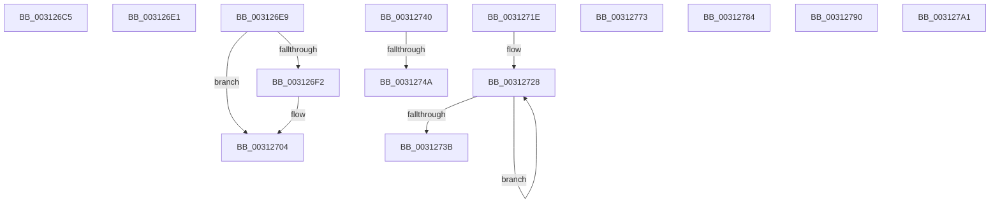

# sub_003126C5

- RVA: `0x003126C5`–`0x003127B7` (길이 `242` bytes)
- VA: `0x00000001403126C5`
- 실행 섹션: `.text`
- PDB 이름 있음: `아니요`; PDB Function 태그: `아니요`
- unwind 정보 RVA: `0x000742D4`
- 디코드: `55`개 명령, `242/242` bytes 표시
- 미해석 바이트: `0` (있으면 어셈블리에 `.byte`로 보존)

> 이 문서는 커널 이미지의 기계어와 PDB 기호를 분석해 생성했습니다. 4번과 5번은 함수 원형과 자료형을 바이너리 사용 방식에서 추정한 C 해석이며 원본 소스 복구 결과는 아닙니다.

## 1. Dependencies

- 직접 호출 지점: **4**; 고유 호출 대상: **2**
- 직접 호출자로 확인된 함수: **0**
- RIP 상대 이미지 참조: **1**

### Outgoing calls
- `0x003126FA` → [KiLowerIrqlProcessIrqlFlags](../4F/KiLowerIrqlProcessIrqlFlags_function_004F5698.md) (function, `0x004F5698`)
- `0x0031277A` → [KiRaiseIrqlProcessIrqlFlags](../4F/KiRaiseIrqlProcessIrqlFlags_function_004F56FC.md) (function, `0x004F56FC`)
- `0x00312797` → [KiRaiseIrqlProcessIrqlFlags](../4F/KiRaiseIrqlProcessIrqlFlags_function_004F56FC.md) (function, `0x004F56FC`)
- `0x003127A8` → [KiRaiseIrqlProcessIrqlFlags](../4F/KiRaiseIrqlProcessIrqlFlags_function_004F56FC.md) (function, `0x004F56FC`)

### Direct callers
- 이 함수 시작 RVA로 연결되는 직접 call은 확인되지 않았습니다. 간접 호출은 완전히 역산할 수 없습니다.

### Static image references
- `0x003126E9` → RVA `0x00FC6D20` (`ALMOSTRO`; read)

## 2. Other-region calls and transfers

- 다른 실행 섹션으로 향하는 call: **0**
- call이 아닌 외부 분기/꼬리 이동: **10**
  - `0x003126DC` → [sub_00312223 + 0x3A8](Unknown_function_00312223.md) (`tail-transfer`)
  - `0x003126E4` → [sub_003120A5 + 0x1B](Unknown_function_003120A5.md) (`tail-transfer`)
  - `0x00312719` → [sub_00312223 + 0x24F](Unknown_function_00312223.md) (`tail-transfer`)
  - `0x0031273B` → [sub_00312223 + 0x368](Unknown_function_00312223.md) (`tail-transfer`)
  - `0x00312744` → [sub_00312223 + 0x42E](Unknown_function_00312223.md) (`tail-transfer`)
  - `0x0031276E` → [sub_00312223 + 0x43C](Unknown_function_00312223.md) (`tail-transfer`)
  - `0x0031277F` → [sub_003120A5 + 0xE2](Unknown_function_003120A5.md) (`tail-transfer`)
  - `0x0031278B` → [sub_003120A5 + 0x8F](Unknown_function_003120A5.md) (`tail-transfer`)
  - `0x0031279C` → [sub_00312223 + 0x2D8](Unknown_function_00312223.md) (`tail-transfer`)
  - `0x003127B2` → [sub_00312223 + 0x6A](Unknown_function_00312223.md) (`tail-transfer`)

## 3. Assembly (complete function range)

```asm
003126C5  49 8B 44 CE 08                  mov rax, qword ptr [r14 + rcx*8 + 8]
003126CA  49 8D 14 CE                     lea rdx, [r14 + rcx*8]
003126CE  41 8B C8                        mov ecx, r8d
003126D1  83 E1 3F                        and ecx, 0x3f
003126D4  48 0F B3 C8                     btr rax, rcx
003126D8  48 89 42 08                     mov qword ptr [rdx + 8], rax
003126DC  E9 EA FE FF FF                  jmp 0x1403125cb
003126E1  41 0B C6                        or eax, r14d
003126E4  E9 D7 F9 FF FF                  jmp 0x1403120c0
003126E9  83 3D 30 46 CB 00 00            cmp dword ptr [rip + 0xcb4630], 0
003126F0  74 12                           je 0x140312704
003126F2  44 0F 20 C1                     mov rcx, cr8
003126F6  41 0F B6 D2                     movzx edx, r10b
003126FA  E8 99 2F 1E 00                  call 0x1404f5698
003126FF  4C 8B 54 24 68                  mov r10, qword ptr [rsp + 0x68]
00312704  41 0F B6 C2                     movzx eax, r10b
00312708  44 0F 22 C0                     mov cr8, rax
0031270C  8B 54 24 58                     mov edx, dword ptr [rsp + 0x58]
00312710  45 0F B6 C4                     movzx r8d, r12b
00312714  44 88 64 24 40                  mov byte ptr [rsp + 0x40], r12b
00312719  E9 54 FD FF FF                  jmp 0x140312472
0031271E  4D 2B C6                        sub r8, r14
00312721  44 0F B7 CA                     movzx r9d, dx
00312725  0F B7 CA                        movzx ecx, dx
00312728  4B 8B 04 20                     mov rax, qword ptr [r8 + r12]
0031272C  49 89 04 24                     mov qword ptr [r12], rax
00312730  4D 8D 64 24 08                  lea r12, [r12 + 8]
00312735  49 83 E9 01                     sub r9, 1
00312739  75 ED                           jne 0x140312728
0031273B  E9 4B FE FF FF                  jmp 0x14031258b
00312740  41 83 FF 01                     cmp r15d, 1
00312744  0F 85 07 FF FF FF               jne 0x140312651
0031274A  65 48 8B 04 25 88 01 00 00      mov rax, qword ptr gs:[0x188]
00312753  C6 44 24 40 00                  mov byte ptr [rsp + 0x40], 0
00312758  48 8B 88 B8 00 00 00            mov rcx, qword ptr [rax + 0xb8]
0031275F  48 8B 41 28                     mov rax, qword ptr [rcx + 0x28]
00312763  48 25 00 F0 FF FF               and rax, 0xfffffffffffff000
00312769  48 89 44 24 50                  mov qword ptr [rsp + 0x50], rax
0031276E  E9 EC FE FF FF                  jmp 0x14031265f
00312773  0F B6 D0                        movzx edx, al
00312776  41 0F B6 CE                     movzx ecx, r14b
0031277A  E8 7D 2F 1E 00                  call 0x1404f56fc
0031277F  E9 03 FA FF FF                  jmp 0x140312187
00312784  41 D0 EE                        shr r14b, 1
00312787  41 80 E6 01                     and r14b, 1
0031278B  E9 A4 F9 FF FF                  jmp 0x140312134
00312790  0F B6 D0                        movzx edx, al
00312793  41 0F B6 CE                     movzx ecx, r14b
00312797  E8 60 2F 1E 00                  call 0x1404f56fc
0031279C  E9 5A FD FF FF                  jmp 0x1403124fb
003127A1  0F B6 D1                        movzx edx, cl
003127A4  41 0F B6 CA                     movzx ecx, r10b
003127A8  E8 4F 2F 1E 00                  call 0x1404f56fc
003127AD  4C 8B 54 24 68                  mov r10, qword ptr [rsp + 0x68]
003127B2  E9 D6 FA FF FF                  jmp 0x14031228d
```

## 4. C-style interpretation (structured pseudocode)

```c
__int64 __fastcall sub_003126C5(__int64 a1, __int64 a2, int a3)
{
    unsigned __int8 v_stack_p40;
    unsigned __int64 v_stack_p50;
    unsigned int v_stack_p58;
    unsigned __int64 v_stack_p68;

    a1 = (unsigned int)(((unsigned int)(a3)) & (63));
    *(unsigned __int64 *)(v_r14 + a1 * 8 + 8) = *(unsigned __int64 *)(v_r14 + a1 * 8 + 8);
}
```

## 5. (Beta) C Style

```c
int64_t sub_003126C5(int64_t Arg1, int64_t Arg2, int32_t Arg3)
{
    uint8_t v_stack_p40;
    uint64_t v_stack_p50;
    uint32_t v_stack_p58;
    uint64_t v_stack_p68;

    Arg1 = (uint32_t)(((uint32_t)(Arg3)) & (63));
    *(uint64_t *)(local_r14 + Arg1 * 8 + 0x8) = *(uint64_t *)(local_r14 + Arg1 * 8 + 0x8);
}
```

## 6. Execution-region graph

[열기: 2D/3D 그래프와 함수 탐색 컨트롤 패널](../../../control-panel.html?section=text&rva=0x003126C5&view=graph)

- 2D 그래프는 위에서 아래로 흐르고, 3D 그래프는 빈 공간을 드래그해 회전합니다. Shift+드래그는 이동, 휠은 확대·축소, 함수 노드 선택은 대상 보고서 이동입니다.

### Static fallback


