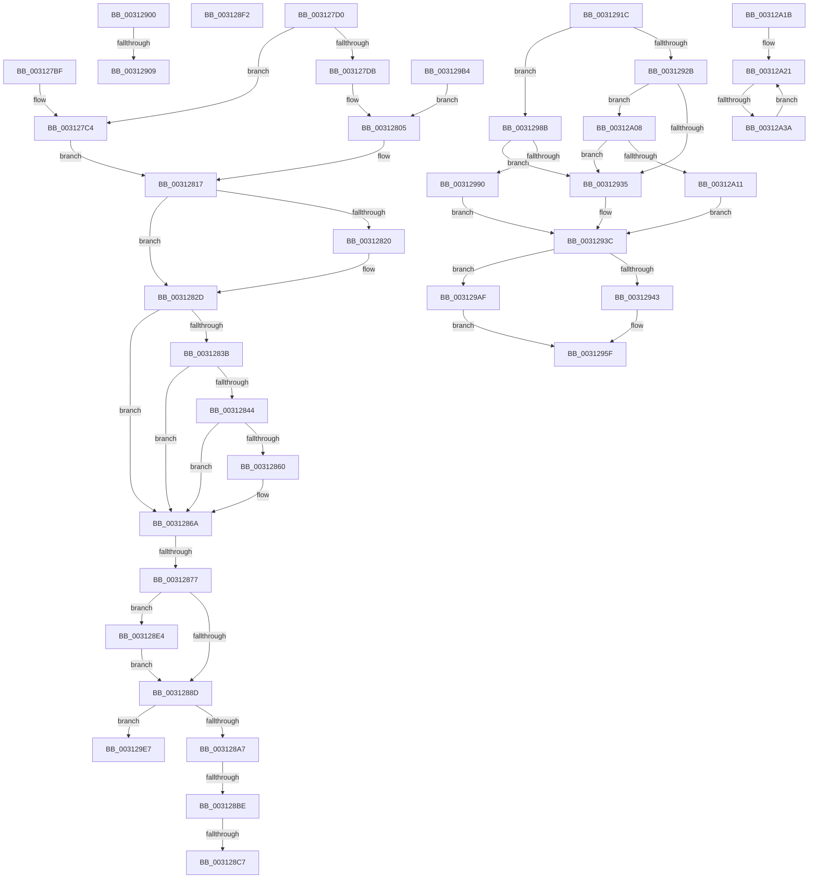

# sub_003127BF

- RVA: `0x003127BF`–`0x00312A3C` (길이 `637` bytes)
- VA: `0x00000001403127BF`
- 실행 섹션: `.text`
- PDB 이름 있음: `아니요`; PDB Function 태그: `아니요`
- unwind 정보 RVA: `0x00074320`
- 디코드: `144`개 명령, `637/637` bytes 표시
- 미해석 바이트: `0` (있으면 어셈블리에 `.byte`로 보존)

> 이 문서는 커널 이미지의 기계어와 PDB 기호를 분석해 생성했습니다. 4번과 5번은 함수 원형과 자료형을 바이너리 사용 방식에서 추정한 C 해석이며 원본 소스 복구 결과는 아닙니다.

## 1. Dependencies

- 직접 호출 지점: **12**; 고유 호출 대상: **9**
- 직접 호출자로 확인된 함수: **0**
- RIP 상대 이미지 참조: **7**

### Outgoing calls
- `0x003127C9` → [KiFlushRangeWorker](KiFlushRangeWorker_function_00311A70.md) (function, `0x00311A70`)
- `0x003127FB` → [KiIpiSendRequest](KiIpiSendRequest_function_003113C0.md) (function, `0x003113C0`)
- `0x0031280A` → [KiFlushRangeWorker](KiFlushRangeWorker_function_00311A70.md) (function, `0x00311A70`)
- `0x00312812` → [KiIpiWaitForRequestBarrier](KiIpiWaitForRequestBarrier_function_003133C0.md) (function, `0x003133C0`)
- `0x00312828` → [KiLowerIrqlProcessIrqlFlags](../4F/KiLowerIrqlProcessIrqlFlags_function_004F5698.md) (function, `0x004F5698`)
- `0x00312865` → [VmpFlushTb](VmpFlushTb_function_00311BD0.md) (function, `0x00311BD0`)
- `0x003128DA` → [guard_dispatch_icall](../6B/guard_dispatch_icall_function_006BAAD0.md) (function, `0x006BAAD0`)
- `0x003128EB` → [KiRaiseIrqlProcessIrqlFlags](../4F/KiRaiseIrqlProcessIrqlFlags_function_004F56FC.md) (function, `0x004F56FC`)
- `0x0031297A` → [HvlFlushRangeListTb](HvlFlushRangeListTb_function_00312C10.md) (function, `0x00312C10`)
- `0x003129D8` → [KiIpiSendRequest](KiIpiSendRequest_function_003113C0.md) (function, `0x003113C0`)
- `0x003129FE` → [guard_dispatch_icall](../6B/guard_dispatch_icall_function_006BAAD0.md) (function, `0x006BAAD0`)
- `0x00312A27` → [KiFlushRangeTb](../40/KiFlushRangeTb_function_00401D40.md) (function, `0x00401D40`)

### Direct callers
- 이 함수 시작 RVA로 연결되는 직접 call은 확인되지 않았습니다. 간접 호출은 완전히 역산할 수 없습니다.

### Static image references
- `0x003127D0` → RVA `0x00FC6A80` (`ALMOSTRO`; read)
- `0x00312817` → RVA `0x00FC6D20` (`ALMOSTRO`; read)
- `0x0031283B` → RVA `0x00FC5004` (`ALMOSTRO`; read)
- `0x0031286A` → RVA `0x00E685D4` (`.data`; read)
- `0x003128C7` → RVA `0x00E06D28` (`.data`; read)
- `0x00312922` → RVA `0x01201840` (`CFGRO`; read)
- `0x003129F1` → RVA `0x00EFA8E0` (`.data`; read)

## 2. Other-region calls and transfers

- 다른 실행 섹션으로 향하는 call: **0**
- call이 아닌 외부 분기/꼬리 이동: **10**
  - `0x00312871` → [sub_003120A5 + 0x10D](Unknown_function_003120A5.md) (`tail-transfer`)
  - `0x003128B8` → [sub_00312A48 + 0xB0](Unknown_function_00312A48.md) (`tail-transfer`)
  - `0x003128C1` → [sub_003120A5 + 0xEF](Unknown_function_003120A5.md) (`tail-transfer`)
  - `0x003128DF` → [sub_003120A5 + 0xEF](Unknown_function_003120A5.md) (`tail-transfer`)
  - `0x003128FB` → [sub_00312223 + 0x24F](Unknown_function_00312223.md) (`tail-transfer`)
  - `0x00312903` → [sub_00312223 + 0x42E](Unknown_function_00312223.md) (`tail-transfer`)
  - `0x00312917` → [sub_00312223 + 0x43C](Unknown_function_00312223.md) (`tail-transfer`)
  - `0x00312986` → [sub_00312223 + 0x29D](Unknown_function_00312223.md) (`tail-transfer`)
  - `0x00312A03` → [sub_003120A5 + 0xEF](Unknown_function_003120A5.md) (`tail-transfer`)
  - `0x00312A34` → [sub_003120A5 + 0xA9](Unknown_function_003120A5.md) (`tail-transfer`)

## 3. Assembly (complete function range)

```asm
003127BF  4C 8B 74 24 48                  mov r14, qword ptr [rsp + 0x48]
003127C4  48 8D 4C 24 78                  lea rcx, [rsp + 0x78]
003127C9  E8 A2 F2 FF FF                  call 0x140311a70
003127CE  EB 47                           jmp 0x140312817
003127D0  8B 05 AA 42 CB 00               mov eax, dword ptr [rip + 0xcb42aa]
003127D6  41 3B C4                        cmp eax, r12d
003127D9  76 E9                           jbe 0x1403127c4
003127DB  45 3B C4                        cmp r8d, r12d
003127DE  4C 8D 4C 24 78                  lea r9, [rsp + 0x78]
003127E3  BA 04 00 00 00                  mov edx, 4
003127E8  B8 04 00 00 80                  mov eax, 0x80000004
003127ED  0F 45 C2                        cmovne eax, edx
003127F0  45 33 C0                        xor r8d, r8d
003127F3  41 8B D4                        mov edx, r12d
003127F6  48 89 44 24 20                  mov qword ptr [rsp + 0x20], rax
003127FB  E8 C0 EB FF FF                  call 0x1403113c0
00312800  4C 8B 64 24 60                  mov r12, qword ptr [rsp + 0x60]
00312805  48 8D 4C 24 78                  lea rcx, [rsp + 0x78]
0031280A  E8 61 F2 FF FF                  call 0x140311a70
0031280F  49 8B CC                        mov rcx, r12
00312812  E8 A9 0B 00 00                  call 0x1403133c0
00312817  83 3D 02 45 CB 00 00            cmp dword ptr [rip + 0xcb4502], 0
0031281E  74 0D                           je 0x14031282d
00312820  44 0F 20 C1                     mov rcx, cr8
00312824  41 0F B6 D6                     movzx edx, r14b
00312828  E8 6B 2E 1E 00                  call 0x1404f5698
0031282D  41 0F B6 C6                     movzx eax, r14b
00312831  44 0F 22 C0                     mov cr8, rax
00312835  41 83 FF 01                     cmp r15d, 1
00312839  75 2F                           jne 0x14031286a
0031283B  80 3D C2 27 CB 00 00            cmp byte ptr [rip + 0xcb27c2], 0
00312842  74 26                           je 0x14031286a
00312844  65 48 8B 04 25 88 01 00 00      mov rax, qword ptr gs:[0x188]
0031284D  48 8B 88 B8 00 00 00            mov rcx, qword ptr [rax + 0xb8]
00312854  48 8B 89 70 06 00 00            mov rcx, qword ptr [rcx + 0x670]
0031285B  48 85 C9                        test rcx, rcx
0031285E  74 0A                           je 0x14031286a
00312860  4D 8B C5                        mov r8, r13
00312863  8B D5                           mov edx, ebp
00312865  E8 66 F3 FF FF                  call 0x140311bd0
0031286A  83 3D 63 5D B5 00 00            cmp dword ptr [rip + 0xb55d63], 0
00312871  0F 84 3B F9 FF FF               je 0x1403121b2
00312877  45 0F 20 C6                     mov r14, cr8
0031287B  B8 0F 00 00 00                  mov eax, 0xf
00312880  44 0F 22 C0                     mov cr8, rax
00312884  83 3D 95 44 CB 00 00            cmp dword ptr [rip + 0xcb4495], 0
0031288B  75 57                           jne 0x1403128e4
0031288D  65 48 8B 04 25 88 01 00 00      mov rax, qword ptr gs:[0x188]
00312896  48 8B 88 B8 00 00 00            mov rcx, qword ptr [rax + 0xb8]
0031289D  41 83 FF 01                     cmp r15d, 1
003128A1  0F 85 40 01 00 00               jne 0x1403129e7
003128A7  4C 8B 89 08 06 00 00            mov r9, qword ptr [rcx + 0x608]
003128AE  4C 8B B9 E8 07 00 00            mov r15, qword ptr [rcx + 0x7e8]
003128B5  4D 85 C9                        test r9, r9
003128B8  0F 85 3A 02 00 00               jne 0x140312af8
003128BE  4D 85 FF                        test r15, r15
003128C1  0F 84 CD F8 FF FF               je 0x140312194
003128C7  48 8B 05 5A 44 AF 00            mov rax, qword ptr [rip + 0xaf445a]
003128CE  49 8B CF                        mov rcx, r15
003128D1  4D 8B C5                        mov r8, r13
003128D4  8B D5                           mov edx, ebp
003128D6  48 8B 40 48                     mov rax, qword ptr [rax + 0x48]
003128DA  E8 F1 81 3A 00                  call 0x1406baad0
003128DF  E9 B0 F8 FF FF                  jmp 0x140312194
003128E4  0F B6 D0                        movzx edx, al
003128E7  41 0F B6 CE                     movzx ecx, r14b
003128EB  E8 0C 2E 1E 00                  call 0x1404f56fc
003128F0  EB 9B                           jmp 0x14031288d
003128F2  45 0F B6 C4                     movzx r8d, r12b
003128F6  44 88 64 24 40                  mov byte ptr [rsp + 0x40], r12b
003128FB  E9 72 FB FF FF                  jmp 0x140312472
00312900  45 85 FF                        test r15d, r15d
00312903  0F 85 48 FD FF FF               jne 0x140312651
00312909  48 C7 44 24 50 00 00 00 00      mov qword ptr [rsp + 0x50], 0
00312912  44 88 7C 24 40                  mov byte ptr [rsp + 0x40], r15b
00312917  E9 43 FD FF FF                  jmp 0x14031265f
0031291C  45 8B F4                        mov r14d, r12d
0031291F  45 33 C9                        xor r9d, r9d
00312922  80 3D 17 EF EE 00 00            cmp byte ptr [rip + 0xeeef17], 0
00312929  74 60                           je 0x14031298b
0031292B  41 83 FF 03                     cmp r15d, 3
0031292F  0F 85 D3 00 00 00               jne 0x140312a08
00312935  4D 8B D1                        mov r10, r9
00312938  41 0F B6 D4                     movzx edx, r12b
0031293C  83 7C 24 44 00                  cmp dword ptr [rsp + 0x44], 0
00312941  75 6C                           jne 0x1403129af
00312943  F0 83 0C 24 00                  lock or dword ptr [rsp], 0
00312948  65 48 8B 04 25 88 01 00 00      mov rax, qword ptr gs:[0x188]
00312951  48 8B 88 B8 00 00 00            mov rcx, qword ptr [rax + 0xb8]
00312958  48 8B 81 80 00 00 00            mov rax, qword ptr [rcx + 0x80]
0031295F  4C 89 6C 24 30                  mov qword ptr [rsp + 0x30], r13
00312964  45 8B CE                        mov r9d, r14d
00312967  89 6C 24 28                     mov dword ptr [rsp + 0x28], ebp
0031296B  49 8B CA                        mov rcx, r10
0031296E  44 88 44 24 20                  mov byte ptr [rsp + 0x20], r8b
00312973  44 0F B6 C2                     movzx r8d, dl
00312977  48 8B D0                        mov rdx, rax
0031297A  E8 91 02 00 00                  call 0x140312c10
0031297F  0F B6 4C 24 41                  movzx ecx, byte ptr [rsp + 0x41]
00312984  0A C8                           or cl, al
00312986  E9 35 FB FF FF                  jmp 0x1403124c0
0031298B  45 3B FC                        cmp r15d, r12d
0031298E  75 A5                           jne 0x140312935
00312990  65 48 8B 04 25 88 01 00 00      mov rax, qword ptr gs:[0x188]
00312999  48 8B 88 B8 00 00 00            mov rcx, qword ptr [rax + 0xb8]
003129A0  4C 8B 51 28                     mov r10, qword ptr [rcx + 0x28]
003129A4  49 81 E2 00 F0 FF FF            and r10, 0xfffffffffffff000
003129AB  32 D2                           xor dl, dl
003129AD  EB 8D                           jmp 0x14031293c
003129AF  49 8B C1                        mov rax, r9
003129B2  EB AB                           jmp 0x14031295f
003129B4  83 7C 24 44 01                  cmp dword ptr [rsp + 0x44], 1
003129B9  4C 8D 4C 24 78                  lea r9, [rsp + 0x78]
003129BE  BA 04 00 00 00                  mov edx, 4
003129C3  B8 04 00 00 80                  mov eax, 0x80000004
003129C8  0F 45 C2                        cmovne eax, edx
003129CB  4D 8B C6                        mov r8, r14
003129CE  33 D2                           xor edx, edx
003129D0  48 89 44 24 20                  mov qword ptr [rsp + 0x20], rax
003129D5  49 8B CC                        mov rcx, r12
003129D8  E8 E3 E9 FF FF                  call 0x1403113c0
003129DD  4C 8B 74 24 48                  mov r14, qword ptr [rsp + 0x48]
003129E2  E9 1E FE FF FF                  jmp 0x140312805
003129E7  48 8B 05 3A 43 AF 00            mov rax, qword ptr [rip + 0xaf433a]
003129EE  4D 8B C5                        mov r8, r13
003129F1  48 8B 0D E8 7E BE 00            mov rcx, qword ptr [rip + 0xbe7ee8]
003129F8  8B D5                           mov edx, ebp
003129FA  48 8B 40 50                     mov rax, qword ptr [rax + 0x50]
003129FE  E8 CD 80 3A 00                  call 0x1406baad0
00312A03  E9 8C F7 FF FF                  jmp 0x140312194
00312A08  45 85 FF                        test r15d, r15d
00312A0B  0F 85 24 FF FF FF               jne 0x140312935
00312A11  4D 8B D1                        mov r10, r9
00312A14  32 D2                           xor dl, dl
00312A16  E9 21 FF FF FF                  jmp 0x14031293c
00312A1B  4D 8B F5                        mov r14, r13
00312A1E  4C 8B E5                        mov r12, rbp
00312A21  49 8B 0E                        mov rcx, qword ptr [r14]
00312A24  41 8B D7                        mov edx, r15d
00312A27  E8 14 F3 0E 00                  call 0x140401d40
00312A2C  4D 8D 76 08                     lea r14, [r14 + 8]
00312A30  49 83 EC 01                     sub r12, 1
00312A34  0F 84 14 F7 FF FF               je 0x14031214e
00312A3A  EB E5                           jmp 0x140312a21
```

## 4. C-style interpretation (structured pseudocode)

```c
__int64 __fastcall sub_003127BF(__int64 a1, __int64 a2, int a3, __int64 a4, __int64 a5, __int64 a6, __int64 a7, __int64 a8, __int64 a9, __int64 a10, __int64 a11, __int64 a12, __int64 a13, __int64 a14, __int64 a15)
{
    __int64 result;
    unsigned int v_stack_p0;
    unsigned __int64 v_stack_p20;
    unsigned int v_stack_p28;
    unsigned __int64 v_stack_p30;
    unsigned __int8 v_stack_p40;
    unsigned __int8 v_stack_p41;
    unsigned int v_stack_p44;
    unsigned __int64 v_stack_p48;
    unsigned __int64 v_stack_p50;
    unsigned __int64 v_stack_p60;
    unsigned __int64 v_stack_p78;

loc_003127C4:
    result = KiFlushRangeWorker(a15, a2, a3, a4);
    goto loc_00312817;
loc_00312817:
    if ((*(unsigned int *)(v_rip + 13321474)) != 0) {
        a1 = v_cr8;
        a2 = (unsigned __int8)(a9);
        result = KiLowerIrqlProcessIrqlFlags(a1, a2, a3, a4);
    }
    if (((unsigned int)(v_r15)) != 1) goto loc_0031286A;
    if ((*(unsigned __int8 *)(v_rip + 13313986)) == 0) goto loc_0031286A;
    result = *(unsigned __int64 *)(gs_base + (0 + 392));
    if (*(unsigned __int64 *)(*(unsigned __int64 *)(*(unsigned __int64 *)(gs_base + (0 + 392)) + 184) + 1648) != 0) {
        a3 = v_r13;
        a2 = (unsigned int)(v_rbp);
        result = VmpFlushTb(*(unsigned __int64 *)(*(unsigned __int64 *)(*(unsigned __int64 *)(gs_base + (0 + 392)) + 184) + 1648), a2, a3, a4);
    }
    if ((*(unsigned int *)(v_rip + 13321365)) != 0) goto loc_003128E4;
loc_0031288D:
    if (((unsigned int)(v_r15)) != 1) goto loc_003129E7;
    result = guard_dispatch_icall(*(unsigned __int64 *)(*(unsigned __int64 *)(*(unsigned __int64 *)(gs_base + (0 + 392)) + 184) + 2024), (unsigned int)((unsigned int)(v_rbp)), v_r13, *(unsigned __int64 *)(*(unsigned __int64 *)(*(unsigned __int64 *)(gs_base + (0 + 392)) + 184) + 1544));
loc_003128E4:
    result = KiRaiseIrqlProcessIrqlFlags((unsigned __int8)((unsigned __int8)(a9)), (unsigned __int8)(result), v_r13, *(unsigned __int64 *)(*(unsigned __int64 *)(*(unsigned __int64 *)(gs_base + (0 + 392)) + 184) + 1544));
    goto loc_0031288D;
loc_003129E7:
    result = guard_dispatch_icall(*(unsigned __int64 *)(v_rip + 12484328), (unsigned int)((unsigned int)(v_rbp)), v_r13, *(unsigned __int64 *)(*(unsigned __int64 *)(*(unsigned __int64 *)(gs_base + (0 + 392)) + 184) + 1544));
}
```

## 5. (Beta) C Style

```c
int64_t sub_003127BF(int64_t Arg1, int64_t Arg2, int32_t Arg3, int64_t Arg4, uint64_t Arg5, uint64_t Arg6, uint64_t Arg7, uint64_t Arg8, int64_t Arg9, uint64_t Arg10, uint64_t Arg11, uint64_t Arg12, uint64_t Arg13, uint64_t Arg14, int64_t Arg15)
{
    int64_t result;
    uint32_t v_stack_p0;
    uint64_t v_stack_p20;
    uint32_t v_stack_p28;
    uint64_t v_stack_p30;
    uint8_t v_stack_p40;
    uint8_t v_stack_p41;
    uint32_t v_stack_p44;
    uint64_t v_stack_p48;
    uint64_t v_stack_p50;
    uint64_t v_stack_p60;
    uint64_t v_stack_p78;

loc_003127C4:
    result = KiFlushRangeWorker(Arg15, Arg2, Arg3, Arg4);
    goto loc_00312817;
loc_00312817:
    if ((*(uint32_t *)(v_rip + 0xCB4502)) != 0) {
        Arg1 = v_cr8;
        Arg2 = (uint8_t)(Arg9);
        result = KiLowerIrqlProcessIrqlFlags(Arg1, Arg2, Arg3, Arg4);
    }
    if (((uint32_t)(local_r15)) != 1) goto loc_0031286A;
    if ((*(uint8_t *)(v_rip + 0xCB27C2)) == 0) goto loc_0031286A;
    result = *(uint64_t *)(gs_base + (0 + 0x188));
    if (*(uint64_t *)(*(uint64_t *)(*(uint64_t *)(gs_base + (0 + 0x188)) + 0xB8) + 0x670) != 0) {
        Arg3 = local_r13;
        Arg2 = (uint32_t)(local_rbp);
        result = VmpFlushTb(*(uint64_t *)(*(uint64_t *)(*(uint64_t *)(gs_base + (0 + 0x188)) + 0xB8) + 0x670), Arg2, Arg3, Arg4);
    }
    if ((*(uint32_t *)(v_rip + 0xCB4495)) != 0) goto loc_003128E4;
loc_0031288D:
    if (((uint32_t)(local_r15)) != 1) goto loc_003129E7;
    result = guard_dispatch_icall(*(uint64_t *)(*(uint64_t *)(*(uint64_t *)(gs_base + (0 + 0x188)) + 0xB8) + 0x7E8), (uint32_t)((uint32_t)(local_rbp)), local_r13, *(uint64_t *)(*(uint64_t *)(*(uint64_t *)(gs_base + (0 + 0x188)) + 0xB8) + 0x608));
loc_003128E4:
    result = KiRaiseIrqlProcessIrqlFlags((uint8_t)((uint8_t)(Arg9)), (uint8_t)(result), local_r13, *(uint64_t *)(*(uint64_t *)(*(uint64_t *)(gs_base + (0 + 0x188)) + 0xB8) + 0x608));
    goto loc_0031288D;
loc_003129E7:
    result = guard_dispatch_icall(*(uint64_t *)(v_rip + 0xBE7EE8), (uint32_t)((uint32_t)(local_rbp)), local_r13, *(uint64_t *)(*(uint64_t *)(*(uint64_t *)(gs_base + (0 + 0x188)) + 0xB8) + 0x608));
}
```

## 6. Execution-region graph

[열기: 2D/3D 그래프와 함수 탐색 컨트롤 패널](../../../control-panel.html?section=text&rva=0x003127BF&view=graph)

- 2D 그래프는 위에서 아래로 흐르고, 3D 그래프는 빈 공간을 드래그해 회전합니다. Shift+드래그는 이동, 휠은 확대·축소, 함수 노드 선택은 대상 보고서 이동입니다.

### Static fallback


