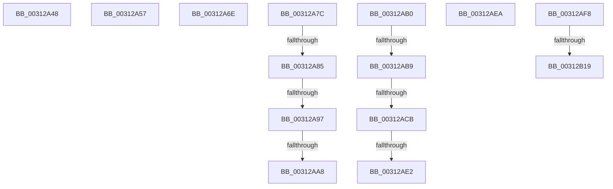

# sub_00312A48

- RVA: `0x00312A48`–`0x00312B1E` (길이 `214` bytes)
- VA: `0x0000000140312A48`
- 실행 섹션: `.text`
- PDB 이름 있음: `아니요`; PDB Function 태그: `아니요`
- unwind 정보 RVA: `0x0007436C`
- 디코드: `45`개 명령, `214/214` bytes 표시
- 미해석 바이트: `0` (있으면 어셈블리에 `.byte`로 보존)

> 이 문서는 커널 이미지의 기계어와 PDB 기호를 분석해 생성했습니다. 4번과 5번은 함수 원형과 자료형을 바이너리 사용 방식에서 추정한 C 해석이며 원본 소스 복구 결과는 아닙니다.

## 1. Dependencies

- 직접 호출 지점: **5**; 고유 호출 대상: **3**
- 직접 호출자로 확인된 함수: **0**
- RIP 상대 이미지 참조: **1**

### Outgoing calls
- `0x00312A48` → [KiSetUserTbFlushPending](../6B/KiSetUserTbFlushPending_function_006B20C0.md) (function, `0x006B20C0`)
- `0x00312A57` → [KiSetUserTbFlushPending](../6B/KiSetUserTbFlushPending_function_006B20C0.md) (function, `0x006B20C0`)
- `0x00312A99` → [VslGetNestedPageProtectionFlags](../2F/VslGetNestedPageProtectionFlags_function_002F2164.md) (function, `0x002F2164`)
- `0x00312ACD` → [VslGetNestedPageProtectionFlags](../2F/VslGetNestedPageProtectionFlags_function_002F2164.md) (function, `0x002F2164`)
- `0x00312B0B` → [guard_dispatch_icall](../6B/guard_dispatch_icall_function_006BAAD0.md) (function, `0x006BAAD0`)

### Direct callers
- 이 함수 시작 RVA로 연결되는 직접 call은 확인되지 않았습니다. 간접 호출은 완전히 역산할 수 없습니다.

### Static image references
- `0x00312AF8` → RVA `0x00E06D28` (`.data`; read)

## 2. Other-region calls and transfers

- 다른 실행 섹션으로 향하는 call: **0**
- call이 아닌 외부 분기/꼬리 이동: **14**
  - `0x00312A52` → [sub_00312223 + 0x146](Unknown_function_00312223.md) (`tail-transfer`)
  - `0x00312A69` → [sub_00312223 + 0x1D4](Unknown_function_00312223.md) (`tail-transfer`)
  - `0x00312A77` → [sub_00312223 + 0x24F](Unknown_function_00312223.md) (`tail-transfer`)
  - `0x00312A7F` → [sub_003120A5 + 0x77](Unknown_function_003120A5.md) (`tail-transfer`)
  - `0x00312A91` → [sub_003120A5 + 0x77](Unknown_function_003120A5.md) (`tail-transfer`)
  - `0x00312AA2` → [sub_003120A5 + 0x77](Unknown_function_003120A5.md) (`tail-transfer`)
  - `0x00312AAB` → [sub_003120A5 + 0x7A](Unknown_function_003120A5.md) (`tail-transfer`)
  - `0x00312AB3` → [sub_00312223 + 0x289](Unknown_function_00312223.md) (`tail-transfer`)
  - `0x00312AC5` → [sub_00312223 + 0x289](Unknown_function_00312223.md) (`tail-transfer`)
  - `0x00312ADC` → [sub_00312223 + 0x289](Unknown_function_00312223.md) (`tail-transfer`)
  - `0x00312AE5` → [sub_003127BF + 0x163](Unknown_function_003127BF.md) (`tail-transfer`)
  - `0x00312AF3` → [sub_00312223 + 0x24F](Unknown_function_00312223.md) (`tail-transfer`)
  - `0x00312B13` → [sub_003120A5 + 0xEF](Unknown_function_003120A5.md) (`tail-transfer`)
  - `0x00312B19` → [sub_003127BF + 0x108](Unknown_function_003127BF.md) (`tail-transfer`)

## 3. Assembly (complete function range)

```asm
00312A48  E8 73 F6 39 00                  call 0x1406b20c0
00312A4D  48 8B 54 24 48                  mov rdx, qword ptr [rsp + 0x48]
00312A52  E9 12 F9 FF FF                  jmp 0x140312369
00312A57  E8 64 F6 39 00                  call 0x1406b20c0
00312A5C  48 8B 54 24 48                  mov rdx, qword ptr [rsp + 0x48]
00312A61  4C 8B 84 24 88 00 00 00         mov r8, qword ptr [rsp + 0x88]
00312A69  E9 89 F9 FF FF                  jmp 0x1403123f7
00312A6E  45 0F B6 C4                     movzx r8d, r12b
00312A72  44 88 64 24 40                  mov byte ptr [rsp + 0x40], r12b
00312A77  E9 F6 F9 FF FF                  jmp 0x140312472
00312A7C  45 85 FF                        test r15d, r15d
00312A7F  0F 85 97 F6 FF FF               jne 0x14031211c
00312A85  81 E2 09 00 00 80               and edx, 0x80000009
00312A8B  81 FA 01 00 00 80               cmp edx, 0x80000001
00312A91  0F 85 85 F6 FF FF               jne 0x14031211c
00312A97  33 C9                           xor ecx, ecx
00312A99  E8 C6 F6 FD FF                  call 0x1402f2164
00312A9E  0F BA E0 0E                     bt eax, 0xe
00312AA2  0F 83 74 F6 FF FF               jae 0x14031211c
00312AA8  45 8B E6                        mov r12d, r14d
00312AAB  E9 6F F6 FF FF                  jmp 0x14031211f
00312AB0  45 85 FF                        test r15d, r15d
00312AB3  0F 85 F3 F9 FF FF               jne 0x1403124ac
00312AB9  81 E2 09 00 00 80               and edx, 0x80000009
00312ABF  81 FA 01 00 00 80               cmp edx, 0x80000001
00312AC5  0F 85 E1 F9 FF FF               jne 0x1403124ac
00312ACB  33 C9                           xor ecx, ecx
00312ACD  E8 92 F6 FD FF                  call 0x1402f2164
00312AD2  44 0F B6 44 24 40               movzx r8d, byte ptr [rsp + 0x40]
00312AD8  0F BA E0 0E                     bt eax, 0xe
00312ADC  0F 83 CA F9 FF FF               jae 0x1403124ac
00312AE2  45 33 C9                        xor r9d, r9d
00312AE5  E9 38 FE FF FF                  jmp 0x140312922
00312AEA  45 0F B6 C4                     movzx r8d, r12b
00312AEE  44 88 64 24 40                  mov byte ptr [rsp + 0x40], r12b
00312AF3  E9 7A F9 FF FF                  jmp 0x140312472
00312AF8  48 8B 05 29 42 AF 00            mov rax, qword ptr [rip + 0xaf4229]
00312AFF  4D 8B C5                        mov r8, r13
00312B02  8B D5                           mov edx, ebp
00312B04  49 8B C9                        mov rcx, r9
00312B07  48 8B 40 48                     mov rax, qword ptr [rax + 0x48]
00312B0B  E8 C0 7F 3A 00                  call 0x1406baad0
00312B10  4D 85 FF                        test r15, r15
00312B13  0F 84 7B F6 FF FF               je 0x140312194
00312B19  E9 A9 FD FF FF                  jmp 0x1403128c7
```

## 4. C-style interpretation (structured pseudocode)

```c
__int64 __fastcall sub_00312A48(int a1, __int64 a2, __int64 a3, int a4, __int64 a5, __int64 a6, __int64 a7, __int64 a8, __int64 a9)
{
    __int64 result;
    unsigned __int8 v_stack_p40;
    unsigned __int64 v_stack_p48;
    unsigned __int64 v_stack_p88;

    result = KiSetUserTbFlushPending(a1, a2, a3, a4);
}
```

## 5. (Beta) C Style

```c
int64_t sub_00312A48(int32_t Arg1, int64_t Arg2, int64_t Arg3, int32_t Arg4, uint64_t Arg5, uint64_t Arg6, uint64_t Arg7, uint64_t Arg8, int64_t Arg9)
{
    int64_t result;
    uint8_t v_stack_p40;
    uint64_t v_stack_p48;
    uint64_t v_stack_p88;

    result = KiSetUserTbFlushPending(Arg1, Arg2, Arg3, Arg4);
}
```

## 6. Execution-region graph

[열기: 2D/3D 그래프와 함수 탐색 컨트롤 패널](../../../control-panel.html?section=text&rva=0x00312A48&view=graph)

- 2D 그래프는 위에서 아래로 흐르고, 3D 그래프는 빈 공간을 드래그해 회전합니다. Shift+드래그는 이동, 휠은 확대·축소, 함수 노드 선택은 대상 보고서 이동입니다.

### Static fallback


