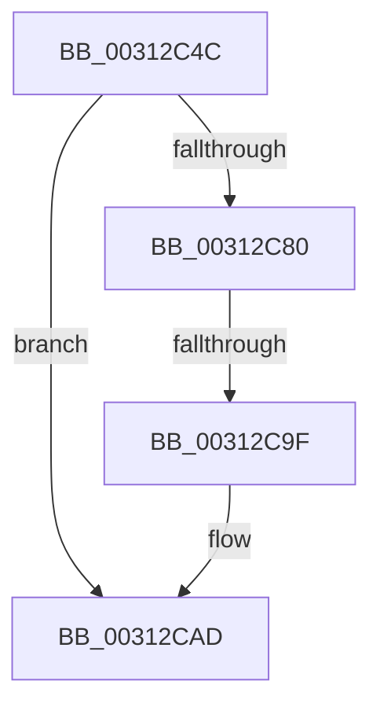

# sub_00312C4C

- RVA: `0x00312C4C`–`0x00312CB7` (길이 `107` bytes)
- VA: `0x0000000140312C4C`
- 실행 섹션: `.text`
- PDB 이름 있음: `아니요`; PDB Function 태그: `아니요`
- unwind 정보 RVA: `0x000743DC`
- 디코드: `24`개 명령, `107/107` bytes 표시
- 미해석 바이트: `0` (있으면 어셈블리에 `.byte`로 보존)

> 이 문서는 커널 이미지의 기계어와 PDB 기호를 분석해 생성했습니다. 4번과 5번은 함수 원형과 자료형을 바이너리 사용 방식에서 추정한 C 해석이며 원본 소스 복구 결과는 아닙니다.

## 1. Dependencies

- 직접 호출 지점: **0**; 고유 호출 대상: **0**
- 직접 호출자로 확인된 함수: **0**
- RIP 상대 이미지 참조: **1**

### Outgoing calls
- 직접 디코드된 call 명령이 없습니다.

### Direct callers
- 이 함수 시작 RVA로 연결되는 직접 call은 확인되지 않았습니다. 간접 호출은 완전히 역산할 수 없습니다.

### Static image references
- `0x00312CAD` → RVA `0x00FC6A90` (`ALMOSTRO`; read)

## 2. Other-region calls and transfers

- 다른 실행 섹션으로 향하는 call: **0**
- call이 아닌 외부 분기/꼬리 이동: **1**
  - `0x00312C99` → [sub_00312E4F](Unknown_function_00312E4F.md) (`tail-transfer`)

## 3. Assembly (complete function range)

```asm
00312C4C  48 89 B4 24 98 01 00 00         mov qword ptr [rsp + 0x198], rsi
00312C54  48 89 BC 24 58 01 00 00         mov qword ptr [rsp + 0x158], rdi
00312C5C  8B FB                           mov edi, ebx
00312C5E  4C 89 A4 24 50 01 00 00         mov qword ptr [rsp + 0x150], r12
00312C66  44 0F B6 A5 A0 00 00 00         movzx r12d, byte ptr [rbp + 0xa0]
00312C6E  48 89 5C 24 78                  mov qword ptr [rsp + 0x78], rbx
00312C73  48 89 5D 80                     mov qword ptr [rbp - 0x80], rbx
00312C77  48 89 5D 88                     mov qword ptr [rbp - 0x78], rbx
00312C7B  45 84 E4                        test r12b, r12b
00312C7E  74 2D                           je 0x140312cad
00312C80  45 84 C0                        test r8b, r8b
00312C83  B8 04 00 00 00                  mov eax, 4
00312C88  0F 45 C3                        cmovne eax, ebx
00312C8B  8B C8                           mov ecx, eax
00312C8D  83 C9 02                        or ecx, 2
00312C90  4D 85 DB                        test r11, r11
00312C93  0F 45 C8                        cmovne ecx, eax
00312C96  48 85 D2                        test rdx, rdx
00312C99  0F 85 B0 01 00 00               jne 0x140312e4f
00312C9F  83 C9 01                        or ecx, 1
00312CA2  8B F9                           mov edi, ecx
00312CA4  48 89 7D 80                     mov qword ptr [rbp - 0x80], rdi
00312CA8  4C 89 5C 24 78                  mov qword ptr [rsp + 0x78], r11
00312CAD  F7 05 D9 3D CB 00 00 20 00 00   test dword ptr [rip + 0xcb3dd9], 0x2000
```

## 4. C-style interpretation (structured pseudocode)

```c
__int64 __fastcall sub_00312C4C(__int64 a1, __int64 a2, unsigned __int8 a3)
{
    __int64 result;
    unsigned __int64 v_stack_p150;
    unsigned __int64 v_stack_p158;
    unsigned __int64 v_stack_p198;
    unsigned __int64 v_stack_p78;

    v_stack_p198 = v_rsi;
    v_stack_p158 = v_rdi;
    v_stack_p150 = v_r12;
    v_stack_p78 = v_rbx;
    *(unsigned __int64 *)(v_rbp - 128) = v_rbx;
    *(unsigned __int64 *)(v_rbp - 120) = v_rbx;
    if ((unsigned __int8)(*(unsigned __int8 *)(v_rbp + 160)) == 0) goto loc_00312CAD;
    result = 4;
    if (a3 != 0) { result = (unsigned int)(v_rbx); }
    a1 = (unsigned int)(((unsigned int)((unsigned int)(result))) | (2));
    if (v_r11 != 0) { a1 = (unsigned int)(result); }
    a1 = (unsigned int)((a1) | (1));
    *(unsigned __int64 *)(v_rbp - 128) = (unsigned int)((unsigned int)(a1));
    v_stack_p78 = v_r11;
loc_00312CAD:
    return result;
}
```

## 5. (Beta) C Style

```c
int64_t sub_00312C4C(int64_t Arg1, int64_t Arg2, uint8_t Arg3)
{
    int64_t result;
    uint64_t v_stack_p150;
    uint64_t v_stack_p158;
    uint64_t v_stack_p198;
    uint64_t v_stack_p78;

    v_stack_p198 = local_rsi;
    v_stack_p158 = local_rdi;
    v_stack_p150 = local_r12;
    v_stack_p78 = local_rbx;
    *(uint64_t *)(local_rbp - 0x80) = local_rbx;
    *(uint64_t *)(local_rbp - 0x78) = local_rbx;
    if ((uint8_t)(*(uint8_t *)(local_rbp + 0xA0)) == 0) goto loc_00312CAD;
    result = 4;
    if (Arg3 != 0) { result = (uint32_t)(local_rbx); }
    Arg1 = (uint32_t)(((uint32_t)((uint32_t)(result))) | (2));
    if (local_r11 != 0) { Arg1 = (uint32_t)(result); }
    Arg1 = (uint32_t)((Arg1) | (1));
    *(uint64_t *)(local_rbp - 0x80) = (uint32_t)((uint32_t)(Arg1));
    v_stack_p78 = local_r11;
loc_00312CAD:
    return result;
}
```

## 6. Execution-region graph

[열기: 2D/3D 그래프와 함수 탐색 컨트롤 패널](../../../control-panel.html?section=text&rva=0x00312C4C&view=graph)

- 2D 그래프는 위에서 아래로 흐르고, 3D 그래프는 빈 공간을 드래그해 회전합니다. Shift+드래그는 이동, 휠은 확대·축소, 함수 노드 선택은 대상 보고서 이동입니다.

### Static fallback


