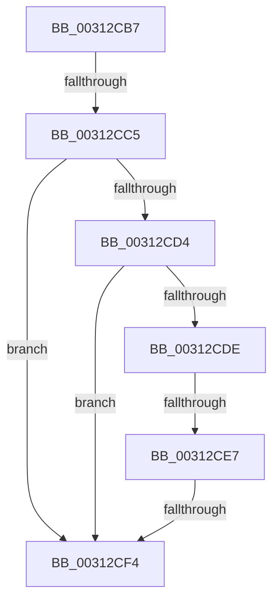

# sub_00312CB7

- RVA: `0x00312CB7`–`0x00312CF6` (길이 `63` bytes)
- VA: `0x0000000140312CB7`
- 실행 섹션: `.text`
- PDB 이름 있음: `아니요`; PDB Function 태그: `아니요`
- unwind 정보 RVA: `0x000743F8`
- 디코드: `15`개 명령, `63/63` bytes 표시
- 미해석 바이트: `0` (있으면 어셈블리에 `.byte`로 보존)

> 이 문서는 커널 이미지의 기계어와 PDB 기호를 분석해 생성했습니다. 4번과 5번은 함수 원형과 자료형을 바이너리 사용 방식에서 추정한 C 해석이며 원본 소스 복구 결과는 아닙니다.

## 1. Dependencies

- 직접 호출 지점: **0**; 고유 호출 대상: **0**
- 직접 호출자로 확인된 함수: **0**
- RIP 상대 이미지 참조: **1**

### Outgoing calls
- 직접 디코드된 call 명령이 없습니다.

### Direct callers
- 이 함수 시작 RVA로 연결되는 직접 call은 확인되지 않았습니다. 간접 호출은 완전히 역산할 수 없습니다.

### Static image references
- `0x00312CD4` → RVA `0x00FC6AB8` (`ALMOSTRO`; read)

## 2. Other-region calls and transfers

- 다른 실행 섹션으로 향하는 call: **0**
- call이 아닌 외부 분기/꼬리 이동: **3**
  - `0x00312CBF` → [sub_00312FE6](Unknown_function_00312FE6.md) (`tail-transfer`)
  - `0x00312CE1` → [sub_00312E68 + 0x9](Unknown_function_00312E68.md) (`tail-transfer`)
  - `0x00312CEE` → [sub_00312E68](Unknown_function_00312E68.md) (`tail-transfer`)

## 3. Assembly (complete function range)

```asm
00312CB7  4C 89 AC 24 48 01 00 00         mov qword ptr [rsp + 0x148], r13
00312CBF  0F 85 21 03 00 00               jne 0x140312fe6
00312CC5  44 8B AD A8 00 00 00            mov r13d, dword ptr [rbp + 0xa8]
00312CCC  41 8B F5                        mov esi, r13d
00312CCF  83 FE 0B                        cmp esi, 0xb
00312CD2  77 20                           ja 0x140312cf4
00312CD4  8B 05 DE 3D CB 00               mov eax, dword ptr [rip + 0xcb3dde]
00312CDA  84 C0                           test al, al
00312CDC  79 16                           jns 0x140312cf4
00312CDE  45 85 D2                        test r10d, r10d
00312CE1  0F 84 8A 01 00 00               je 0x140312e71
00312CE7  41 8D 45 01                     lea eax, [r13 + 1]
00312CEB  83 F8 0C                        cmp eax, 0xc
00312CEE  0F 86 74 01 00 00               jbe 0x140312e68
00312CF4  33 C0                           xor eax, eax
```

## 4. C-style interpretation (structured pseudocode)

```c
__int64 __fastcall sub_00312CB7(void)
{
    __int64 result;
    unsigned __int64 v_stack_p148;

    v_stack_p148 = v_r13;
    if (((unsigned int)((unsigned int)((unsigned int)((unsigned int)(*(unsigned int *)(v_rbp + 168)))))) > 11) goto loc_00312CF4;
    if (!sign_flag) goto loc_00312CF4;
loc_00312CF4:
    result = 0;
    return result;
}
```

## 5. (Beta) C Style

```c
void sub_00312CB7(void)
{
    int64_t result;
    uint64_t v_stack_p148;

    v_stack_p148 = local_r13;
    if (((uint32_t)((uint32_t)((uint32_t)((uint32_t)(*(uint32_t *)(local_rbp + 0xA8)))))) > 11) goto loc_00312CF4;
    if (!sign_flag) goto loc_00312CF4;
loc_00312CF4:
    result = 0;
    return result;
}
```

## 6. Execution-region graph

[열기: 2D/3D 그래프와 함수 탐색 컨트롤 패널](../../../control-panel.html?section=text&rva=0x00312CB7&view=graph)

- 2D 그래프는 위에서 아래로 흐르고, 3D 그래프는 빈 공간을 드래그해 회전합니다. Shift+드래그는 이동, 휠은 확대·축소, 함수 노드 선택은 대상 보고서 이동입니다.

### Static fallback


