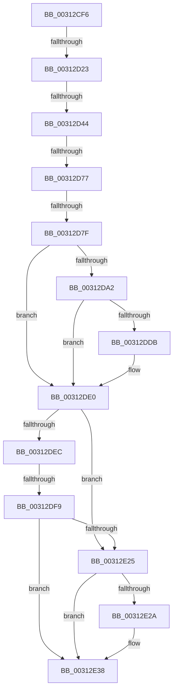

# sub_00312CF6

- RVA: `0x00312CF6`–`0x00312E4F` (길이 `345` bytes)
- VA: `0x0000000140312CF6`
- 실행 섹션: `.text`
- PDB 이름 있음: `아니요`; PDB Function 태그: `아니요`
- unwind 정보 RVA: `0x0007440C`
- 디코드: `76`개 명령, `345/345` bytes 표시
- 미해석 바이트: `0` (있으면 어셈블리에 `.byte`로 보존)

> 이 문서는 커널 이미지의 기계어와 PDB 기호를 분석해 생성했습니다. 4번과 5번은 함수 원형과 자료형을 바이너리 사용 방식에서 추정한 C 해석이며 원본 소스 복구 결과는 아닙니다.

## 1. Dependencies

- 직접 호출 지점: **5**; 고유 호출 대상: **5**
- 직접 호출자로 확인된 함수: **0**
- RIP 상대 이미지 참조: **1**

### Outgoing calls
- `0x00312D33` → [ExpInterlockedPopEntrySList](../6B/ExpInterlockedPopEntrySList_function_006BA570.md) (function, `0x006BA570`)
- `0x00312D98` → [HvlpCopyFlushVaList](HvlpCopyFlushVaList_function_00313CC0.md) (function, `0x00313CC0`)
- `0x00312E17` → [VslSlowFlushSecureRangeList](VslSlowFlushSecureRangeList_function_00314D44.md) (function, `0x00314D44`)
- `0x00312E33` → [HvcallInitiateHypercall](HvcallInitiateHypercall_function_00313630.md) (function, `0x00313630`)
- `0x00312E3D` → [HvlpReleaseHypercallPage](HvlpReleaseHypercallPage_function_00313480.md) (function, `0x00313480`)

### Direct callers
- 이 함수 시작 RVA로 연결되는 직접 call은 확인되지 않았습니다. 간접 호출은 완전히 역산할 수 없습니다.

### Static image references
- `0x00312D10` → RVA `0x00FC6A90` (`ALMOSTRO`; read)

## 2. Other-region calls and transfers

- 다른 실행 섹션으로 향하는 call: **0**
- call이 아닌 외부 분기/꼬리 이동: **6**
  - `0x00312D1D` → [sub_00313017](Unknown_function_00313017.md) (`tail-transfer`)
  - `0x00312D3E` → [sub_006E10B0](../6E/Unknown_function_006E10B0.md) (`tail-transfer`)
  - `0x00312D71` → [sub_00312F97](Unknown_function_00312F97.md) (`tail-transfer`)
  - `0x00312D79` → [sub_00312F97](Unknown_function_00312F97.md) (`tail-transfer`)
  - `0x00312DF3` → [sub_00313017 + 0x9A](Unknown_function_00313017.md) (`tail-transfer`)
  - `0x00312E4A` → [sub_00312E68 + 0xB2](Unknown_function_00312E68.md) (`tail-transfer`)

## 3. Assembly (complete function range)

```asm
00312CF6  4C 89 BC 24 40 01 00 00         mov qword ptr [rsp + 0x140], r15
00312CFE  48 89 44 24 68                  mov qword ptr [rsp + 0x68], rax
00312D03  0F 57 C0                        xorps xmm0, xmm0
00312D06  89 44 24 70                     mov dword ptr [rsp + 0x70], eax
00312D0A  41 B8 02 00 00 00               mov r8d, 2
00312D10  8B 05 7A 3D CB 00               mov eax, dword ptr [rip + 0xcb3d7a]
00312D16  0F 11 44 24 58                  movups xmmword ptr [rsp + 0x58], xmm0
00312D1B  A8 08                           test al, 8
00312D1D  0F 84 F4 02 00 00               je 0x140313017
00312D23  65 48 8B 3C 25 20 00 00 00      mov rdi, qword ptr gs:[0x20]
00312D2C  48 8D 8F C0 8B 00 00            lea rcx, [rdi + 0x8bc0]
00312D33  E8 38 78 3A 00                  call 0x1406ba570
00312D38  4C 8B F8                        mov r15, rax
00312D3B  48 85 C0                        test rax, rax
00312D3E  0F 84 6C E3 3C 00               je 0x1406e10b0
00312D44  48 89 7C 24 60                  mov qword ptr [rsp + 0x60], rdi
00312D49  B8 01 00 00 00                  mov eax, 1
00312D4E  49 8B 7F 10                     mov rdi, qword ptr [r15 + 0x10]
00312D52  48 89 7C 24 70                  mov qword ptr [rsp + 0x70], rdi
00312D57  89 44 24 58                     mov dword ptr [rsp + 0x58], eax
00312D5B  4C 89 7C 24 68                  mov qword ptr [rsp + 0x68], r15
00312D60  44 8B 54 24 50                  mov r10d, dword ptr [rsp + 0x50]
00312D65  41 B8 02 00 00 00               mov r8d, 2
00312D6B  81 FE FD 01 00 00               cmp esi, 0x1fd
00312D71  0F 87 20 02 00 00               ja 0x140312f97
00312D77  A8 02                           test al, 2
00312D79  0F 85 18 02 00 00               jne 0x140312f97
00312D7F  44 8B 05 0A 3D CB 00            mov r8d, dword ptr [rip + 0xcb3d0a]
00312D86  4D 8D 4F 18                     lea r9, [r15 + 0x18]
00312D8A  41 C1 E8 0D                     shr r8d, 0xd
00312D8E  49 8B D6                        mov rdx, r14
00312D91  41 80 E0 01                     and r8b, 1
00312D95  41 8B CD                        mov ecx, r13d
00312D98  E8 23 0F 00 00                  call 0x140313cc0
00312D9D  45 84 E4                        test r12b, r12b
00312DA0  74 3E                           je 0x140312de0
00312DA2  0F 10 44 24 78                  movups xmm0, xmmword ptr [rsp + 0x78]
00312DA7  8B C6                           mov eax, esi
00312DA9  48 C7 44 24 48 03 00 00 00      mov qword ptr [rsp + 0x48], 3
00312DB2  F2 0F 10 4D 88                  movsd xmm1, qword ptr [rbp - 0x78]
00312DB7  25 FF 0F 00 00                  and eax, 0xfff
00312DBC  41 0F 11 07                     movups xmmword ptr [r15], xmm0
00312DC0  89 44 24 4C                     mov dword ptr [rsp + 0x4c], eax
00312DC4  48 8B 5C 24 48                  mov rbx, qword ptr [rsp + 0x48]
00312DC9  F2 41 0F 11 4F 10               movsd qword ptr [r15 + 0x10], xmm1
00312DCF  F7 05 B7 3C CB 00 00 20 00 00   test dword ptr [rip + 0xcb3cb7], 0x2000
00312DD9  75 05                           jne 0x140312de0
00312DDB  49 83 4F 08 08                  or qword ptr [r15 + 8], 8
00312DE0  44 8B 54 24 50                  mov r10d, dword ptr [rsp + 0x50]
00312DE5  32 C0                           xor al, al
00312DE7  45 85 D2                        test r10d, r10d
00312DEA  74 39                           je 0x140312e25
00312DEC  C6 44 24 40 00                  mov byte ptr [rsp + 0x40], 0
00312DF1  84 C0                           test al, al
00312DF3  0F 85 B8 02 00 00               jne 0x1403130b1
00312DF9  48 8D 44 24 40                  lea rax, [rsp + 0x40]
00312DFE  44 8B CE                        mov r9d, esi
00312E01  48 89 44 24 28                  mov qword ptr [rsp + 0x28], rax
00312E06  45 8B C2                        mov r8d, r10d
00312E09  49 8B D7                        mov rdx, r15
00312E0C  C7 44 24 20 18 00 00 00         mov dword ptr [rsp + 0x20], 0x18
00312E14  48 8B CF                        mov rcx, rdi
00312E17  E8 28 1F 00 00                  call 0x140314d44
00312E1C  0F B6 44 24 40                  movzx eax, byte ptr [rsp + 0x40]
00312E21  84 C0                           test al, al
00312E23  75 13                           jne 0x140312e38
00312E25  45 84 E4                        test r12b, r12b
00312E28  74 0E                           je 0x140312e38
00312E2A  45 33 C0                        xor r8d, r8d
00312E2D  48 8B D7                        mov rdx, rdi
00312E30  48 8B CB                        mov rcx, rbx
00312E33  E8 F8 07 00 00                  call 0x140313630
00312E38  48 8D 4C 24 58                  lea rcx, [rsp + 0x58]
00312E3D  E8 3E 06 00 00                  call 0x140313480
00312E42  4C 8B BC 24 40 01 00 00         mov r15, qword ptr [rsp + 0x140]
00312E4A  E9 CB 00 00 00                  jmp 0x140312f1a
```

## 4. C-style interpretation (structured pseudocode)

```c
__int64 __fastcall sub_00312CF6(__int64 a1, __int64 a2, __int64 a3, __int64 a4, __int64 a5, __int64 a6, __int64 a7, unsigned __int8 a8, __int64 a9, unsigned int a10, __int64 a11, __int64 a12, __int64 a13, __int64 a14, __int64 a15, __int64 a16, __int64 a17, __int64 a18, __int64 a19, __int64 a20, __int64 a21, __int64 a22, __int64 a23, __int64 a24, __int64 a25, __int64 a26, __int64 a27, __int64 a28, __int64 a29, __int64 a30, __int64 a31, __int64 a32, __int64 a33, __int64 a34, __int64 a35, __int64 a36, __int64 a37, __int64 a38, __int64 a39, __int64 a40)
{
    __int64 result;
    unsigned __int64 v_stack_p140;
    unsigned int v_stack_p20;
    unsigned __int64 v_stack_p28;
    unsigned __int8 v_stack_p40;
    unsigned __int64 v_stack_p48;
    unsigned int v_stack_p4C;
    unsigned int v_stack_p58;
    unsigned __int64 v_stack_p60;
    unsigned __int64 v_stack_p68;
    unsigned int v_stack_p70;

    v_stack_p140 = v_r15;
    v_stack_p68 = result;
    v_stack_p70 = (unsigned int)(result);
    a11 = v_xmm0;
    result = ExpInterlockedPopEntrySList(*(unsigned __int64 *)(gs_base + (0 + 32)) + 35776, a2, 2, a4);
    v_stack_p60 = *(unsigned __int64 *)(gs_base + (0 + 32));
    v_stack_p70 = *(unsigned __int64 *)(result + 16);
    v_stack_p58 = 1;
    v_stack_p68 = result;
    a3 = (unsigned int)(((unsigned int)(*(unsigned int *)(v_rip + 13319434))) >> (13));
    a3 = (unsigned __int8)((a3) & (1));
    result = HvlpCopyFlushVaList((unsigned int)((unsigned int)(v_r13)), v_r14, a3, result + 24);
    if ((unsigned __int8)(v_r12) == 0) goto loc_00312DE0;
    v_stack_p48 = 3;
    result = (unsigned int)(((unsigned int)((unsigned int)(v_rsi))) & (0xFFFULL));
    *(unsigned __int64 *)(result) = v_xmm0;
    v_stack_p4C = (unsigned int)(result);
    *(unsigned __int64 *)(result + 16) = v_xmm1;
    if (((*(unsigned int *)(v_rip + 13319351)) & (0x2000ULL)) == 0) {
    }
    result = 0;
    if ((unsigned int)((unsigned int)(a10)) == 0) goto loc_00312E25;
    v_stack_p40 = 0;
    v_stack_p28 = a8;
    v_stack_p20 = 24;
    result = VslSlowFlushSecureRangeList(*(unsigned __int64 *)(result + 16), 0, (unsigned int)((unsigned int)((unsigned int)(a10))), (unsigned int)((unsigned int)(v_rsi)));
    if (a8 != 0) goto loc_00312E38;
loc_00312E25:
    result = a8;
    if ((unsigned __int8)(v_r12) != 0) {
        a3 = 0;
        a2 = *(unsigned __int64 *)(result + 16);
        a1 = a9;
        result = HvcallInitiateHypercall(a1, a2, a3, (unsigned int)((unsigned int)(v_rsi)));
    }
    result = HvlpReleaseHypercallPage(a11, a2, a3, (unsigned int)((unsigned int)(v_rsi)));
}
```

## 5. (Beta) C Style

```c
int64_t sub_00312CF6(int64_t Arg1, int64_t Arg2, int64_t Arg3, int64_t Arg4, uint64_t Arg5, uint64_t Arg6, uint64_t Arg7, uint8_t Arg8, int64_t Arg9, uint32_t Arg10, int64_t Arg11, uint64_t Arg12, uint64_t Arg13, uint64_t Arg14, int64_t Arg15, uint64_t Arg16, uint64_t Arg17, uint64_t Arg18, uint64_t Arg19, uint64_t Arg20, uint64_t Arg21, uint64_t Arg22, uint64_t Arg23, uint64_t Arg24, uint64_t Arg25, uint64_t Arg26, uint64_t Arg27, uint64_t Arg28, uint64_t Arg29, uint64_t Arg30, uint64_t Arg31, uint64_t Arg32, uint64_t Arg33, uint64_t Arg34, uint64_t Arg35, uint64_t Arg36, uint64_t Arg37, uint64_t Arg38, uint64_t Arg39, int64_t Arg40)
{
    int64_t result;
    uint64_t v_stack_p140;
    uint32_t v_stack_p20;
    uint64_t v_stack_p28;
    uint8_t v_stack_p40;
    uint64_t v_stack_p48;
    uint32_t v_stack_p4C;
    uint32_t v_stack_p58;
    uint64_t v_stack_p60;
    uint64_t v_stack_p68;
    uint32_t v_stack_p70;

    v_stack_p140 = local_r15;
    v_stack_p68 = result;
    v_stack_p70 = (uint32_t)(result);
    Arg11 = v_xmm0;
    result = ExpInterlockedPopEntrySList(*(uint64_t *)(gs_base + (0 + 0x20)) + 35776, Arg2, 2, Arg4);
    v_stack_p60 = *(uint64_t *)(gs_base + (0 + 0x20));
    v_stack_p70 = *(uint64_t *)(result + 0x10);
    v_stack_p58 = 1;
    v_stack_p68 = result;
    Arg3 = (uint32_t)(((uint32_t)(*(uint32_t *)(v_rip + 0xCB3D0A))) >> (13));
    Arg3 = (uint8_t)((Arg3) & (1));
    result = HvlpCopyFlushVaList((uint32_t)((uint32_t)(local_r13)), local_r14, Arg3, result + 24);
    if ((uint8_t)(local_r12) == 0) goto loc_00312DE0;
    v_stack_p48 = 3;
    result = (uint32_t)(((uint32_t)((uint32_t)(local_rsi))) & (0xFFFULL));
    *(uint64_t *)(result) = v_xmm0;
    v_stack_p4C = (uint32_t)(result);
    *(uint64_t *)(result + 0x10) = v_xmm1;
    if (((*(uint32_t *)(v_rip + 0xCB3CB7)) & (0x2000ULL)) == 0) {
    }
    result = 0;
    if ((uint32_t)((uint32_t)(Arg10)) == 0) goto loc_00312E25;
    v_stack_p40 = 0;
    v_stack_p28 = Arg8;
    v_stack_p20 = 24;
    result = VslSlowFlushSecureRangeList(*(uint64_t *)(result + 0x10), 0, (uint32_t)((uint32_t)((uint32_t)(Arg10))), (uint32_t)((uint32_t)(local_rsi)));
    if (Arg8 != 0) goto loc_00312E38;
loc_00312E25:
    result = Arg8;
    if ((uint8_t)(local_r12) != 0) {
        Arg3 = 0;
        Arg2 = *(uint64_t *)(result + 0x10);
        Arg1 = Arg9;
        result = HvcallInitiateHypercall(Arg1, Arg2, Arg3, (uint32_t)((uint32_t)(local_rsi)));
    }
    result = HvlpReleaseHypercallPage(Arg11, Arg2, Arg3, (uint32_t)((uint32_t)(local_rsi)));
}
```

## 6. Execution-region graph

[열기: 2D/3D 그래프와 함수 탐색 컨트롤 패널](../../../control-panel.html?section=text&rva=0x00312CF6&view=graph)

- 2D 그래프는 위에서 아래로 흐르고, 3D 그래프는 빈 공간을 드래그해 회전합니다. Shift+드래그는 이동, 휠은 확대·축소, 함수 노드 선택은 대상 보고서 이동입니다.

### Static fallback


