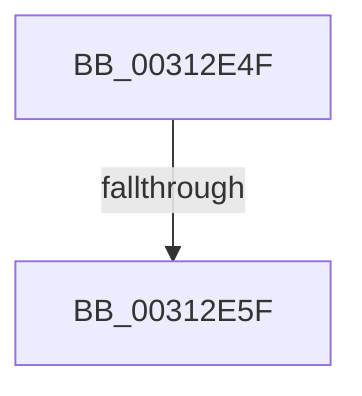

# sub_00312E4F

- RVA: `0x00312E4F`–`0x00312E68` (길이 `25` bytes)
- VA: `0x0000000140312E4F`
- 실행 섹션: `.text`
- PDB 이름 있음: `아니요`; PDB Function 태그: `아니요`
- unwind 정보 RVA: `0x00074420`
- 디코드: `5`개 명령, `25/25` bytes 표시
- 미해석 바이트: `0` (있으면 어셈블리에 `.byte`로 보존)

> 이 문서는 커널 이미지의 기계어와 PDB 기호를 분석해 생성했습니다. 4번과 5번은 함수 원형과 자료형을 바이너리 사용 방식에서 추정한 C 해석이며 원본 소스 복구 결과는 아닙니다.

## 1. Dependencies

- 직접 호출 지점: **0**; 고유 호출 대상: **0**
- 직접 호출자로 확인된 함수: **0**
- RIP 상대 이미지 참조: **1**

### Outgoing calls
- 직접 디코드된 call 명령이 없습니다.

### Direct callers
- 이 함수 시작 RVA로 연결되는 직접 call은 확인되지 않았습니다. 간접 호출은 완전히 역산할 수 없습니다.

### Static image references
- `0x00312E4F` → RVA `0x00FC5007` (`ALMOSTRO`; read)

## 2. Other-region calls and transfers

- 다른 실행 섹션으로 향하는 call: **0**
- call이 아닌 외부 분기/꼬리 이동: **2**
  - `0x00312E59` → [sub_00312FD7](Unknown_function_00312FD7.md) (`tail-transfer`)
  - `0x00312E63` → [sub_00312C4C + 0x56](Unknown_function_00312C4C.md) (`tail-transfer`)

## 3. Assembly (complete function range)

```asm
00312E4F  38 1D B2 21 CB 00               cmp byte ptr [rip + 0xcb21b2], bl
00312E55  4C 8B 42 08                     mov r8, qword ptr [rdx + 8]
00312E59  0F 84 78 01 00 00               je 0x140312fd7
00312E5F  4C 89 45 88                     mov qword ptr [rbp - 0x78], r8
00312E63  E9 3A FE FF FF                  jmp 0x140312ca2
```

## 4. C-style interpretation (structured pseudocode)

```c
void __fastcall sub_00312E4F(__int64 a1, __int64 a2)
{
    *(unsigned __int64 *)(v_rbp - 120) = *(unsigned __int64 *)(a2 + 8);
}
```

## 5. (Beta) C Style

```c
void sub_00312E4F(int64_t Arg1, void *Arg2)
{
    uint8_t *arg2 = (uint8_t *)Arg2;

    *(uint64_t *)(local_rbp - 0x78) = *(uint64_t *)(arg2 + 0x8);
}
```

### 관측된 메모리 오프셋

구조체 형식이 확인되지 않은 접근은 인자 기준의 오프셋으로만 기록했습니다.

| 기준 인자 | 오프셋 표현 | 폭 (bit) | 접근 |
|---|---:|---:|---|
| `Arg2` | `+ 0x8` | `64` | `R` |

## 6. Execution-region graph

[열기: 2D/3D 그래프와 함수 탐색 컨트롤 패널](../../../control-panel.html?section=text&rva=0x00312E4F&view=graph)

- 2D 그래프는 위에서 아래로 흐르고, 3D 그래프는 빈 공간을 드래그해 회전합니다. Shift+드래그는 이동, 휠은 확대·축소, 함수 노드 선택은 대상 보고서 이동입니다.

### Static fallback


