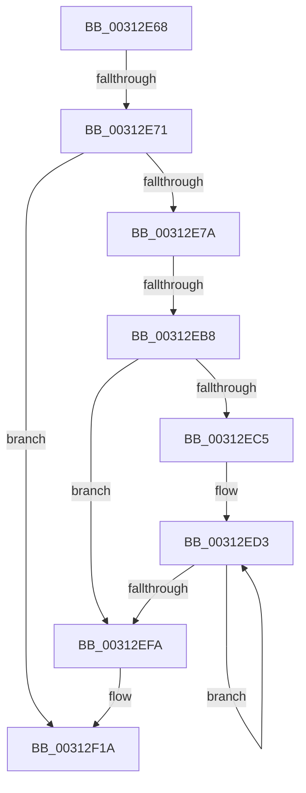

# sub_00312E68

- RVA: `0x00312E68`–`0x00312F3E` (길이 `214` bytes)
- VA: `0x0000000140312E68`
- 실행 섹션: `.text`
- PDB 이름 있음: `아니요`; PDB Function 태그: `아니요`
- unwind 정보 RVA: `0x00074430`
- 디코드: `44`개 명령, `214/214` bytes 표시
- 미해석 바이트: `0` (있으면 어셈블리에 `.byte`로 보존)

> 이 문서는 커널 이미지의 기계어와 PDB 기호를 분석해 생성했습니다. 4번과 5번은 함수 원형과 자료형을 바이너리 사용 방식에서 추정한 C 해석이며 원본 소스 복구 결과는 아닙니다.

## 1. Dependencies

- 직접 호출 지점: **1**; 고유 호출 대상: **1**
- 직접 호출자로 확인된 함수: **0**
- RIP 상대 이미지 참조: **1**

### Outgoing calls
- `0x00312F15` → [HvcallFastExtended](HvcallFastExtended_function_003130E0.md) (function, `0x003130E0`)

### Direct callers
- 이 함수 시작 RVA로 연결되는 직접 call은 확인되지 않았습니다. 간접 호출은 완전히 역산할 수 없습니다.

### Static image references
- `0x00312E92` → RVA `0x00FC6A90` (`ALMOSTRO`; read)

## 2. Other-region calls and transfers

- 다른 실행 섹션으로 향하는 call: **0**
- call이 아닌 외부 분기/꼬리 이동: **2**
  - `0x00312E6B` → [sub_00312FB1](Unknown_function_00312FB1.md) (`tail-transfer`)
  - `0x00312EB2` → [sub_00312FE6 + 0x1D](Unknown_function_00312FE6.md) (`tail-transfer`)

## 3. Assembly (complete function range)

```asm
00312E68  45 85 D2                        test r10d, r10d
00312E6B  0F 85 40 01 00 00               jne 0x140312fb1
00312E71  45 84 E4                        test r12b, r12b
00312E74  0F 84 A0 00 00 00               je 0x140312f1a
00312E7A  0F 10 44 24 78                  movups xmm0, xmmword ptr [rsp + 0x78]
00312E7F  44 8D 14 F5 18 00 00 00         lea r10d, [rsi*8 + 0x18]
00312E87  81 E6 FF 0F 00 00               and esi, 0xfff
00312E8D  F2 0F 10 4D 88                  movsd xmm1, qword ptr [rbp - 0x78]
00312E92  F7 05 F4 3B CB 00 00 20 00 00   test dword ptr [rip + 0xcb3bf4], 0x2000
00312E9C  48 C7 44 24 48 03 00 00 00      mov qword ptr [rsp + 0x48], 3
00312EA5  0F 29 45 90                     movaps xmmword ptr [rbp - 0x70], xmm0
00312EA9  89 74 24 4C                     mov dword ptr [rsp + 0x4c], esi
00312EAD  F2 0F 11 4D A0                  movsd qword ptr [rbp - 0x60], xmm1
00312EB2  0F 85 4B 01 00 00               jne 0x140313003
00312EB8  48 83 CF 08                     or rdi, 8
00312EBC  48 89 7D 98                     mov qword ptr [rbp - 0x68], rdi
00312EC0  45 85 ED                        test r13d, r13d
00312EC3  74 35                           je 0x140312efa
00312EC5  48 8D 4D A8                     lea rcx, [rbp - 0x58]
00312EC9  45 8B C5                        mov r8d, r13d
00312ECC  4C 2B F1                        sub r14, rcx
00312ECF  48 8D 45 A8                     lea rax, [rbp - 0x58]
00312ED3  49 8B 0C 06                     mov rcx, qword ptr [r14 + rax]
00312ED7  48 8D 40 08                     lea rax, [rax + 8]
00312EDB  48 8B D1                        mov rdx, rcx
00312EDE  81 E2 00 0C 00 00               and edx, 0xc00
00312EE4  48 03 D1                        add rdx, rcx
00312EE7  81 E1 00 08 00 00               and ecx, 0x800
00312EED  48 0B D1                        or rdx, rcx
00312EF0  48 89 50 F8                     mov qword ptr [rax - 8], rdx
00312EF4  49 83 E8 01                     sub r8, 1
00312EF8  75 D9                           jne 0x140312ed3
00312EFA  81 4C 24 48 00 00 01 00         or dword ptr [rsp + 0x48], 0x10000
00312F02  48 8D 55 90                     lea rdx, [rbp - 0x70]
00312F06  48 8B 4C 24 48                  mov rcx, qword ptr [rsp + 0x48]
00312F0B  45 33 C9                        xor r9d, r9d
00312F0E  45 8B C2                        mov r8d, r10d
00312F11  89 5C 24 20                     mov dword ptr [rsp + 0x20], ebx
00312F15  E8 C6 01 00 00                  call 0x1403130e0
00312F1A  4C 8B AC 24 48 01 00 00         mov r13, qword ptr [rsp + 0x148]
00312F22  41 0F B6 C4                     movzx eax, r12b
00312F26  4C 8B A4 24 50 01 00 00         mov r12, qword ptr [rsp + 0x150]
00312F2E  48 8B BC 24 58 01 00 00         mov rdi, qword ptr [rsp + 0x158]
00312F36  48 8B B4 24 98 01 00 00         mov rsi, qword ptr [rsp + 0x198]
```

## 4. C-style interpretation (structured pseudocode)

```c
__int64 __fastcall sub_00312E68(__int64 a1, __int64 a2, __int64 a3, int a4, __int64 a5, __int64 a6, __int64 a7, __int64 a8, unsigned int a9, __int64 a10, __int64 a11, __int64 a12, __int64 a13, __int64 a14, __int64 a15, __int64 a16, __int64 a17, __int64 a18, __int64 a19, __int64 a20, __int64 a21, __int64 a22, __int64 a23, __int64 a24, __int64 a25, __int64 a26, __int64 a27, __int64 a28, __int64 a29, __int64 a30, __int64 a31, __int64 a32, __int64 a33, __int64 a34, __int64 a35, __int64 a36, __int64 a37, __int64 a38, __int64 a39, __int64 a40, __int64 a41, __int64 a42, __int64 a43, __int64 a44, __int64 a45, __int64 a46, __int64 a47, __int64 a48, __int64 a49, __int64 a50, __int64 a51)
{
    __int64 result;
    __int64 v_r14;
    __int64 v_rdi;
    __int64 v_rsi;
    unsigned int v_stack_p20;
    unsigned __int64 v_stack_p48;
    unsigned int v_stack_p4C;

    if ((unsigned __int8)(v_r12) == 0) goto loc_00312F1A;
    v_rsi = (unsigned int)((v_rsi) & (0xFFFULL));
    v_stack_p48 = 3;
    *(unsigned __int64 *)(v_rbp - 112) = v_xmm0;
    v_stack_p4C = (unsigned int)(v_rsi);
    *(unsigned __int64 *)(v_rbp - 96) = v_xmm1;
    v_rdi = (v_rdi) | (8);
    *(unsigned __int64 *)(v_rbp - 104) = v_rdi;
    if ((unsigned int)(v_r13) == 0) goto loc_00312EFA;
    v_r14 = (v_r14) - (v_rbp - 88);
loc_00312ED3:
    a2 = (unsigned int)((*(unsigned __int64 *)(v_r14 + v_rbp - 88 * 1)) & (0xC00ULL));
    a2 = (a2) + (*(unsigned __int64 *)(v_r14 + v_rbp - 88 * 1));
    a1 = (unsigned int)((*(unsigned __int64 *)(v_r14 + v_rbp - 88 * 1)) & (0x800ULL));
    a2 = (a2) | (a1);
    *(unsigned __int64 *)(v_rbp - 88 + 8 - 8) = a2;
    a3 = ((unsigned int)((unsigned int)(v_r13))) - (1);
    if (condition_is_not_equal) goto loc_00312ED3;
loc_00312EFA:
    a4 = 0;
    v_stack_p20 = (unsigned int)(v_rbx);
    result = HvcallFastExtended(a9, v_rbp - 112, (unsigned int)((unsigned int)(v_rsi * 8 + 24)), a4);
loc_00312F1A:
    return (unsigned __int8)(v_r12);
}
```

## 5. (Beta) C Style

```c
int64_t sub_00312E68(int64_t Arg1, int64_t Arg2, int64_t Arg3, int32_t Arg4, uint64_t Arg5, uint64_t Arg6, uint64_t Arg7, uint64_t Arg8, uint32_t Arg9, uint64_t Arg10, uint64_t Arg11, uint64_t Arg12, uint64_t Arg13, uint64_t Arg14, int64_t Arg15, uint64_t Arg16, uint64_t Arg17, uint64_t Arg18, uint64_t Arg19, uint64_t Arg20, uint64_t Arg21, uint64_t Arg22, uint64_t Arg23, uint64_t Arg24, uint64_t Arg25, uint64_t Arg26, uint64_t Arg27, uint64_t Arg28, uint64_t Arg29, uint64_t Arg30, uint64_t Arg31, uint64_t Arg32, uint64_t Arg33, uint64_t Arg34, uint64_t Arg35, uint64_t Arg36, uint64_t Arg37, uint64_t Arg38, uint64_t Arg39, uint64_t Arg40, int64_t Arg41, int64_t Arg42, int64_t Arg43, uint64_t Arg44, uint64_t Arg45, uint64_t Arg46, uint64_t Arg47, uint64_t Arg48, uint64_t Arg49, uint64_t Arg50, int64_t Arg51)
{
    int64_t result;
    int64_t local_r14;
    int64_t local_rdi;
    int64_t local_rsi;
    uint32_t v_stack_p20;
    uint64_t v_stack_p48;
    uint32_t v_stack_p4C;

    if ((uint8_t)(local_r12) == 0) goto loc_00312F1A;
    local_rsi = (uint32_t)((local_rsi) & (0xFFFULL));
    v_stack_p48 = 3;
    *(uint64_t *)(local_rbp - 0x70) = v_xmm0;
    v_stack_p4C = (uint32_t)(local_rsi);
    *(uint64_t *)(local_rbp - 0x60) = v_xmm1;
    local_rdi = (local_rdi) | (8);
    *(uint64_t *)(local_rbp - 0x68) = local_rdi;
    if ((uint32_t)(local_r13) == 0) goto loc_00312EFA;
    local_r14 = (local_r14) - (local_rbp - 88);
loc_00312ED3:
    Arg2 = (uint32_t)((*(uint64_t *)(local_r14 + local_rbp - 0x58 * 1)) & (0xC00ULL));
    Arg2 = (Arg2) + (*(uint64_t *)(local_r14 + local_rbp - 0x58 * 1));
    Arg1 = (uint32_t)((*(uint64_t *)(local_r14 + local_rbp - 0x58 * 1)) & (0x800ULL));
    Arg2 = (Arg2) | (Arg1);
    *(uint64_t *)(local_rbp - 0x58 + 0x8 - 0x8) = Arg2;
    Arg3 = ((uint32_t)((uint32_t)(local_r13))) - (1);
    if (condition_is_not_equal) goto loc_00312ED3;
loc_00312EFA:
    Arg4 = 0;
    v_stack_p20 = (uint32_t)(local_rbx);
    result = HvcallFastExtended(Arg9, local_rbp - 112, (uint32_t)((uint32_t)(local_rsi * 8 + 24)), Arg4);
loc_00312F1A:
    return (uint8_t)(local_r12);
}
```

## 6. Execution-region graph

[열기: 2D/3D 그래프와 함수 탐색 컨트롤 패널](../../../control-panel.html?section=text&rva=0x00312E68&view=graph)

- 2D 그래프는 위에서 아래로 흐르고, 3D 그래프는 빈 공간을 드래그해 회전합니다. Shift+드래그는 이동, 휠은 확대·축소, 함수 노드 선택은 대상 보고서 이동입니다.

### Static fallback


