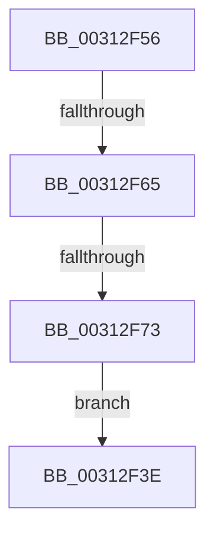

# sub_00312F3E

- RVA: `0x00312F3E`–`0x00312F97` (길이 `89` bytes)
- VA: `0x0000000140312F3E`
- 실행 섹션: `.text`
- PDB 이름 있음: `아니요`; PDB Function 태그: `아니요`
- unwind 정보 RVA: `0x00074444`
- 디코드: `22`개 명령, `89/89` bytes 표시
- 미해석 바이트: `0` (있으면 어셈블리에 `.byte`로 보존)

> 이 문서는 커널 이미지의 기계어와 PDB 기호를 분석해 생성했습니다. 4번과 5번은 함수 원형과 자료형을 바이너리 사용 방식에서 추정한 C 해석이며 원본 소스 복구 결과는 아닙니다.

## 1. Dependencies

- 직접 호출 지점: **2**; 고유 호출 대상: **2**
- 직접 호출자로 확인된 함수: **0**
- RIP 상대 이미지 참조: **2**

### Outgoing calls
- `0x00312F45` → [_security_check_cookie](../6A/_security_check_cookie_function_006AC640.md) (function, `0x006AC640`)
- `0x00312F8D` → [HvlpFlushRangeListTbEx](../30/HvlpFlushRangeListTbEx_function_00306670.md) (function, `0x00306670`)

### Direct callers
- 이 함수 시작 RVA로 연결되는 직접 call은 확인되지 않았습니다. 간접 호출은 완전히 역산할 수 없습니다.

### Static image references
- `0x00312F57` → RVA `0x00FC6A90` (`ALMOSTRO`; read)
- `0x00312F65` → RVA `0x00FC5018` (`ALMOSTRO`; read)

## 2. Other-region calls and transfers

- 다른 실행 섹션으로 향하는 call: **0**
- call이 아닌 외부 분기/꼬리 이동: **2**
  - `0x00312F5F` → [HvlFlushRangeListTb + 0x3A](HvlFlushRangeListTb_function_00312C10.md) (`tail-transfer`)
  - `0x00312F6D` → [HvlFlushRangeListTb + 0x3A](HvlFlushRangeListTb_function_00312C10.md) (`tail-transfer`)

## 3. Assembly (complete function range)

```asm
00312F3E  48 8B 4D 30                     mov rcx, qword ptr [rbp + 0x30]
00312F42  48 33 CC                        xor rcx, rsp
00312F45  E8 F6 96 39 00                  call 0x1406ac640
00312F4A  48 81 C4 60 01 00 00            add rsp, 0x160
00312F51  41 5E                           pop r14
00312F53  5B                              pop rbx
00312F54  5D                              pop rbp
00312F55  C3                              ret
00312F56  CC                              int3
00312F57  8B 05 33 3B CB 00               mov eax, dword ptr [rip + 0xcb3b33]
00312F5D  84 C0                           test al, al
00312F5F  0F 89 E5 FC FF FF               jns 0x140312c4a
00312F65  66 83 3D AB 20 CB 00 01         cmp word ptr [rip + 0xcb20ab], 1
00312F6D  0F 86 D7 FC FF FF               jbe 0x140312c4a
00312F73  8B 85 A8 00 00 00               mov eax, dword ptr [rbp + 0xa8]
00312F79  0F B6 9D A0 00 00 00            movzx ebx, byte ptr [rbp + 0xa0]
00312F80  4C 89 74 24 30                  mov qword ptr [rsp + 0x30], r14
00312F85  89 44 24 28                     mov dword ptr [rsp + 0x28], eax
00312F89  88 5C 24 20                     mov byte ptr [rsp + 0x20], bl
00312F8D  E8 DE 36 FF FF                  call 0x140306670
00312F92  0F B6 C3                        movzx eax, bl
00312F95  EB A7                           jmp 0x140312f3e
```

## 4. C-style interpretation (structured pseudocode)

```c
__int64 __fastcall sub_00312F3E(void)
{
    __int64 result;
    __int64 v_rsp;
    unsigned __int8 v_stack_p198;
    unsigned int v_stack_p1A0;
    unsigned __int64 v_stack_p1A8;

    a1 = (*(unsigned __int64 *)(v_rbp + 48)) ^ (v_rsp);
    result = _security_check_cookie(a1, a2, a3, a4);
    v_rsp = (v_rsp) + (352);
    return result;
}
```

## 5. (Beta) C Style

```c
void sub_00312F3E(void)
{
    int64_t result;
    int64_t local_rsp;
    uint8_t v_stack_p198;
    uint32_t v_stack_p1A0;
    uint64_t v_stack_p1A8;

    a1 = (*(uint64_t *)(local_rbp + 0x30)) ^ (local_rsp);
    result = _security_check_cookie(a1, a2, a3, a4);
    local_rsp = (local_rsp) + (352);
    return result;
}
```

## 6. Execution-region graph

[열기: 2D/3D 그래프와 함수 탐색 컨트롤 패널](../../../control-panel.html?section=text&rva=0x00312F3E&view=graph)

- 2D 그래프는 위에서 아래로 흐르고, 3D 그래프는 빈 공간을 드래그해 회전합니다. Shift+드래그는 이동, 휠은 확대·축소, 함수 노드 선택은 대상 보고서 이동입니다.

### Static fallback


