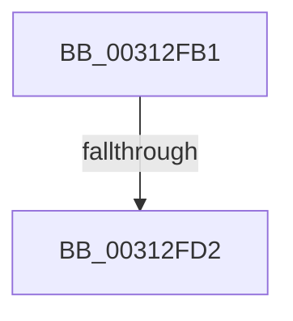

# sub_00312FB1

- RVA: `0x00312FB1`–`0x00312FD7` (길이 `38` bytes)
- VA: `0x0000000140312FB1`
- 실행 섹션: `.text`
- PDB 이름 있음: `아니요`; PDB Function 태그: `아니요`
- unwind 정보 RVA: `0x0007447C`
- 디코드: `9`개 명령, `38/38` bytes 표시
- 미해석 바이트: `0` (있으면 어셈블리에 `.byte`로 보존)

> 이 문서는 커널 이미지의 기계어와 PDB 기호를 분석해 생성했습니다. 4번과 5번은 함수 원형과 자료형을 바이너리 사용 방식에서 추정한 C 해석이며 원본 소스 복구 결과는 아닙니다.

## 1. Dependencies

- 직접 호출 지점: **1**; 고유 호출 대상: **1**
- 직접 호출자로 확인된 함수: **0**
- RIP 상대 이미지 참조: **0**

### Outgoing calls
- `0x00312FC3` → [VslFastFlushSecureRangeList](../46/VslFastFlushSecureRangeList_function_00462168.md) (function, `0x00462168`)

### Direct callers
- 이 함수 시작 RVA로 연결되는 직접 call은 확인되지 않았습니다. 간접 호출은 완전히 역산할 수 없습니다.

### Static image references
- 디코드된 RIP-relative 메모리 참조가 없습니다.

## 2. Other-region calls and transfers

- 다른 실행 섹션으로 향하는 call: **0**
- call이 아닌 외부 분기/꼬리 이동: **2**
  - `0x00312FCC` → [sub_00312E68 + 0x9](Unknown_function_00312E68.md) (`tail-transfer`)
  - `0x00312FD2` → [sub_00312E68 + 0xB2](Unknown_function_00312E68.md) (`tail-transfer`)

## 3. Assembly (complete function range)

```asm
00312FB1  4C 8D 4C 24 40                  lea r9, [rsp + 0x40]
00312FB6  88 5C 24 40                     mov byte ptr [rsp + 0x40], bl
00312FBA  45 8B C5                        mov r8d, r13d
00312FBD  49 8B D6                        mov rdx, r14
00312FC0  41 8B CA                        mov ecx, r10d
00312FC3  E8 A0 F1 14 00                  call 0x140462168
00312FC8  38 5C 24 40                     cmp byte ptr [rsp + 0x40], bl
00312FCC  0F 84 9F FE FF FF               je 0x140312e71
00312FD2  E9 43 FF FF FF                  jmp 0x140312f1a
```

## 4. C-style interpretation (structured pseudocode)

```c
__int64 __fastcall sub_00312FB1(__int64 a1, __int64 a2, __int64 a3, __int64 a4, __int64 a5, __int64 a6, __int64 a7, unsigned __int8 a8)
{
    __int64 result;
    unsigned __int8 v_stack_p40;

    v_stack_p40 = (unsigned __int8)(v_rbx);
    result = VslFastFlushSecureRangeList((unsigned int)((unsigned int)(v_r10)), v_r14, (unsigned int)((unsigned int)(v_r13)), a8);
}
```

## 5. (Beta) C Style

```c
int64_t sub_00312FB1(int64_t Arg1, int64_t Arg2, int64_t Arg3, int64_t Arg4, uint64_t Arg5, uint64_t Arg6, uint64_t Arg7, uint8_t Arg8)
{
    int64_t result;
    uint8_t v_stack_p40;

    v_stack_p40 = (uint8_t)(local_rbx);
    result = VslFastFlushSecureRangeList((uint32_t)((uint32_t)(local_r10)), local_r14, (uint32_t)((uint32_t)(local_r13)), Arg8);
}
```

## 6. Execution-region graph

[열기: 2D/3D 그래프와 함수 탐색 컨트롤 패널](../../../control-panel.html?section=text&rva=0x00312FB1&view=graph)

- 2D 그래프는 위에서 아래로 흐르고, 3D 그래프는 빈 공간을 드래그해 회전합니다. Shift+드래그는 이동, 휠은 확대·축소, 함수 노드 선택은 대상 보고서 이동입니다.

### Static fallback


