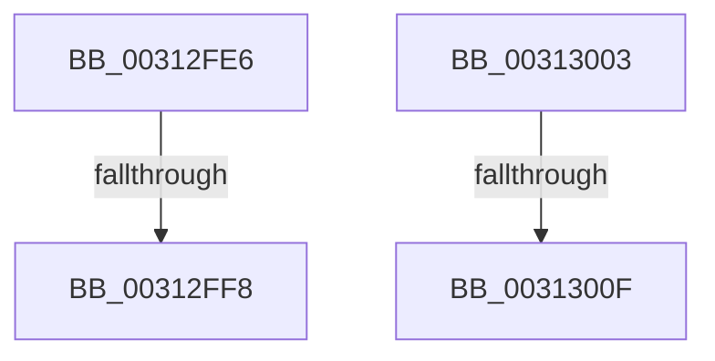

# sub_00312FE6

- RVA: `0x00312FE6`–`0x00313017` (길이 `49` bytes)
- VA: `0x0000000140312FE6`
- 실행 섹션: `.text`
- PDB 이름 있음: `아니요`; PDB Function 태그: `아니요`
- unwind 정보 RVA: `0x000744B8`
- 디코드: `12`개 명령, `49/49` bytes 표시
- 미해석 바이트: `0` (있으면 어셈블리에 `.byte`로 보존)

> 이 문서는 커널 이미지의 기계어와 PDB 기호를 분석해 생성했습니다. 4번과 5번은 함수 원형과 자료형을 바이너리 사용 방식에서 추정한 C 해석이며 원본 소스 복구 결과는 아닙니다.

## 1. Dependencies

- 직접 호출 지점: **0**; 고유 호출 대상: **0**
- 직접 호출자로 확인된 함수: **0**
- RIP 상대 이미지 참조: **0**

### Outgoing calls
- 직접 디코드된 call 명령이 없습니다.

### Direct callers
- 이 함수 시작 RVA로 연결되는 직접 call은 확인되지 않았습니다. 간접 호출은 완전히 역산할 수 없습니다.

### Static image references
- 디코드된 RIP-relative 메모리 참조가 없습니다.

## 2. Other-region calls and transfers

- 다른 실행 섹션으로 향하는 call: **0**
- call이 아닌 외부 분기/꼬리 이동: **4**
  - `0x00312FF2` → [sub_00312CB7 + 0x18](Unknown_function_00312CB7.md) (`tail-transfer`)
  - `0x00312FFE` → [sub_006E1009](../6E/Unknown_function_006E1009.md) (`tail-transfer`)
  - `0x00313009` → [sub_00312E68 + 0x92](Unknown_function_00312E68.md) (`tail-transfer`)
  - `0x00313012` → [sub_006E1009 + 0x28](../6E/Unknown_function_006E1009.md) (`tail-transfer`)

## 3. Assembly (complete function range)

```asm
00312FE6  44 8B AD A8 00 00 00            mov r13d, dword ptr [rbp + 0xa8]
00312FED  8B F3                           mov esi, ebx
00312FEF  45 85 ED                        test r13d, r13d
00312FF2  0F 84 D7 FC FF FF               je 0x140312ccf
00312FF8  49 8B D6                        mov rdx, r14
00312FFB  45 8B C5                        mov r8d, r13d
00312FFE  E9 06 E0 3C 00                  jmp 0x1406e1009
00313003  44 8B C3                        mov r8d, ebx
00313006  45 85 ED                        test r13d, r13d
00313009  0F 84 EB FE FF FF               je 0x140312efa
0031300F  45 8B DD                        mov r11d, r13d
00313012  E9 1A E0 3C 00                  jmp 0x1406e1031
```

## 4. C-style interpretation (structured pseudocode)

```c
void __fastcall sub_00312FE6(void)
{
}
```

## 5. (Beta) C Style

```c
void sub_00312FE6(void)
{
}
```

## 6. Execution-region graph

[열기: 2D/3D 그래프와 함수 탐색 컨트롤 패널](../../../control-panel.html?section=text&rva=0x00312FE6&view=graph)

- 2D 그래프는 위에서 아래로 흐르고, 3D 그래프는 빈 공간을 드래그해 회전합니다. Shift+드래그는 이동, 휠은 확대·축소, 함수 노드 선택은 대상 보고서 이동입니다.

### Static fallback


