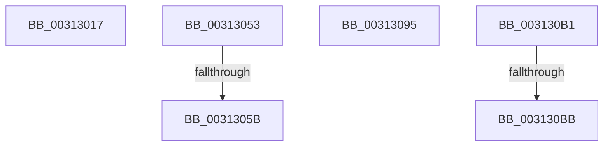

# sub_00313017

- RVA: `0x00313017`–`0x003130CE` (길이 `183` bytes)
- VA: `0x0000000140313017`
- 실행 섹션: `.text`
- PDB 이름 있음: `아니요`; PDB Function 태그: `아니요`
- unwind 정보 RVA: `0x000744D8`
- 디코드: `38`개 명령, `183/183` bytes 표시
- 미해석 바이트: `0` (있으면 어셈블리에 `.byte`로 보존)

> 이 문서는 커널 이미지의 기계어와 PDB 기호를 분석해 생성했습니다. 4번과 5번은 함수 원형과 자료형을 바이너리 사용 방식에서 추정한 C 해석이며 원본 소스 복구 결과는 아닙니다.

## 1. Dependencies

- 직접 호출 지점: **4**; 고유 호출 대상: **4**
- 직접 호출자로 확인된 함수: **0**
- RIP 상대 이미지 참조: **0**

### Outgoing calls
- `0x0031301F` → [KeDisableInterrupts](../21/KeDisableInterrupts_function_00217BE0.md) (function, `0x00217BE0`)
- `0x00313060` → [HvlpReleaseHypercallPage](HvlpReleaseHypercallPage_function_00313480.md) (function, `0x00313480`)
- `0x00313078` → [HvlpAcquireHypercallPage](../47/HvlpAcquireHypercallPage_function_00471410.md) (function, `0x00471410`)
- `0x003130C4` → [HvlpSecureFlushLargeRangeList](../6A/HvlpSecureFlushLargeRangeList_function_006A7C38.md) (function, `0x006A7C38`)

### Direct callers
- 이 함수 시작 RVA로 연결되는 직접 call은 확인되지 않았습니다. 간접 호출은 완전히 역산할 수 없습니다.

### Static image references
- 디코드된 RIP-relative 메모리 참조가 없습니다.

## 2. Other-region calls and transfers

- 다른 실행 섹션으로 향하는 call: **0**
- call이 아닌 외부 분기/꼬리 이동: **6**
  - `0x0031304E` → [sub_00312CF6 + 0x75](Unknown_function_00312CF6.md) (`tail-transfer`)
  - `0x00313055` → [sub_00312F97 + 0xA](Unknown_function_00312F97.md) (`tail-transfer`)
  - `0x00313090` → [sub_00312F97 + 0xA](Unknown_function_00312F97.md) (`tail-transfer`)
  - `0x003130AC` → [sub_00312F97 + 0x13](Unknown_function_00312F97.md) (`tail-transfer`)
  - `0x003130B5` → [sub_006E10B0 + 0x73](../6E/Unknown_function_006E10B0.md) (`tail-transfer`)
  - `0x003130C9` → [sub_00312CF6 + 0x12B](Unknown_function_00312CF6.md) (`tail-transfer`)

## 3. Assembly (complete function range)

```asm
00313017  C7 44 24 58 04 00 00 00         mov dword ptr [rsp + 0x58], 4
0031301F  E8 BC 4B F0 FF                  call 0x140217be0
00313024  88 44 24 60                     mov byte ptr [rsp + 0x60], al
00313028  B8 01 00 00 00                  mov eax, 1
0031302D  89 44 24 64                     mov dword ptr [rsp + 0x64], eax
00313031  65 48 8B 04 25 20 00 00 00      mov rax, qword ptr gs:[0x20]
0031303A  4C 8B B8 00 8C 00 00            mov r15, qword ptr [rax + 0x8c00]
00313041  8B 44 24 58                     mov eax, dword ptr [rsp + 0x58]
00313045  49 8B 7F 10                     mov rdi, qword ptr [r15 + 0x10]
00313049  48 89 7C 24 70                  mov qword ptr [rsp + 0x70], rdi
0031304E  E9 18 FD FF FF                  jmp 0x140312d6b
00313053  A8 02                           test al, 2
00313055  0F 85 46 FF FF FF               jne 0x140312fa1
0031305B  48 8D 4C 24 58                  lea rcx, [rsp + 0x58]
00313060  E8 1B 04 00 00                  call 0x140313480
00313065  41 B9 18 00 00 00               mov r9d, 0x18
0031306B  4C 8D 45 00                     lea r8, [rbp]
0031306F  48 8D 4C 24 58                  lea rcx, [rsp + 0x58]
00313074  41 8D 51 F1                     lea edx, [r9 - 0xf]
00313078  E8 93 E3 15 00                  call 0x140471410
0031307D  44 8B 54 24 50                  mov r10d, dword ptr [rsp + 0x50]
00313082  4C 8B F8                        mov r15, rax
00313085  48 8B 7C 24 70                  mov rdi, qword ptr [rsp + 0x70]
0031308A  41 B8 02 00 00 00               mov r8d, 2
00313090  E9 0C FF FF FF                  jmp 0x140312fa1
00313095  0F 10 44 24 78                  movups xmm0, xmmword ptr [rsp + 0x78]
0031309A  49 8B D8                        mov rbx, r8
0031309D  F2 0F 10 4D 88                  movsd xmm1, qword ptr [rbp - 0x78]
003130A2  41 0F 11 07                     movups xmmword ptr [r15], xmm0
003130A6  F2 41 0F 11 4F 10               movsd qword ptr [r15 + 0x10], xmm1
003130AC  E9 F9 FE FF FF                  jmp 0x140312faa
003130B1  41 83 FA 02                     cmp r10d, 2
003130B5  0F 85 68 E0 3C 00               jne 0x1406e1123
003130BB  4D 8B C6                        mov r8, r14
003130BE  41 8B D5                        mov edx, r13d
003130C1  41 8B CA                        mov ecx, r10d
003130C4  E8 6F 4B 39 00                  call 0x1406a7c38
003130C9  E9 53 FD FF FF                  jmp 0x140312e21
```

## 4. C-style interpretation (structured pseudocode)

```c
__int64 __fastcall sub_00313017(__int64 a1, __int64 a2, __int64 a3, __int64 a4, __int64 a5, __int64 a6, __int64 a7, __int64 a8, __int64 a9, __int64 a10, unsigned int a11)
{
    __int64 result;
    unsigned int v_stack_p50;
    unsigned int v_stack_p58;
    unsigned __int8 v_stack_p60;
    unsigned int v_stack_p64;
    unsigned __int64 v_stack_p70;
    unsigned __int64 v_stack_p78;

    v_stack_p58 = 4;
    result = KeDisableInterrupts(a1, a2, a3, a4);
    v_stack_p60 = (unsigned __int8)(result);
    v_stack_p64 = 1;
    v_stack_p70 = *(unsigned __int64 *)(*(unsigned __int64 *)(*(unsigned __int64 *)(gs_base + (0 + 32)) + 35840) + 16);
}
```

## 5. (Beta) C Style

```c
int64_t sub_00313017(int64_t Arg1, int64_t Arg2, int64_t Arg3, int64_t Arg4, uint64_t Arg5, uint64_t Arg6, uint64_t Arg7, uint64_t Arg8, uint64_t Arg9, uint64_t Arg10, uint32_t Arg11)
{
    int64_t result;
    uint32_t v_stack_p50;
    uint32_t v_stack_p58;
    uint8_t v_stack_p60;
    uint32_t v_stack_p64;
    uint64_t v_stack_p70;
    uint64_t v_stack_p78;

    v_stack_p58 = 4;
    result = KeDisableInterrupts(Arg1, Arg2, Arg3, Arg4);
    v_stack_p60 = (uint8_t)(result);
    v_stack_p64 = 1;
    v_stack_p70 = *(uint64_t *)(*(uint64_t *)(*(uint64_t *)(gs_base + (0 + 0x20)) + 0x8C00) + 0x10);
}
```

## 6. Execution-region graph

[열기: 2D/3D 그래프와 함수 탐색 컨트롤 패널](../../../control-panel.html?section=text&rva=0x00313017&view=graph)

- 2D 그래프는 위에서 아래로 흐르고, 3D 그래프는 빈 공간을 드래그해 회전합니다. Shift+드래그는 이동, 휠은 확대·축소, 함수 노드 선택은 대상 보고서 이동입니다.

### Static fallback


