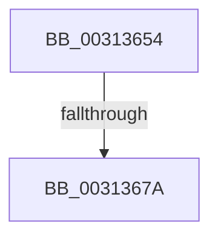

# sub_00313654

- RVA: `0x00313654`–`0x003136B2` (길이 `94` bytes)
- VA: `0x0000000140313654`
- 실행 섹션: `.text`
- PDB 이름 있음: `아니요`; PDB Function 태그: `아니요`
- unwind 정보 RVA: `0x000745C4`
- 디코드: `26`개 명령, `94/94` bytes 표시
- 미해석 바이트: `0` (있으면 어셈블리에 `.byte`로 보존)

> 이 문서는 커널 이미지의 기계어와 PDB 기호를 분석해 생성했습니다. 4번과 5번은 함수 원형과 자료형을 바이너리 사용 방식에서 추정한 C 해석이며 원본 소스 복구 결과는 아닙니다.

## 1. Dependencies

- 직접 호출 지점: **1**; 고유 호출 대상: **1**
- 직접 호출자로 확인된 함수: **0**
- RIP 상대 이미지 참조: **1**

### Outgoing calls
- `0x00313696` → `indirect target` (indirect, 간접 대상)

### Direct callers
- 이 함수 시작 RVA로 연결되는 직접 call은 확인되지 않았습니다. 간접 호출은 완전히 역산할 수 없습니다.

### Static image references
- `0x0031367D` → RVA `0x01201858` (`CFGRO`; read)

## 2. Other-region calls and transfers

- 다른 실행 섹션으로 향하는 call: **0**
- call이 아닌 외부 분기/꼬리 이동: **2**
  - `0x00313678` → [sub_003136CC](Unknown_function_003136CC.md) (`tail-transfer`)
  - `0x003136B0` → [sub_003136E0](Unknown_function_003136E0.md) (`tail-transfer`)

## 3. Assembly (complete function range)

```asm
00313654  48 89 6C 24 60                  mov qword ptr [rsp + 0x60], rbp
00313659  49 8B E8                        mov rbp, r8
0031365C  48 89 74 24 58                  mov qword ptr [rsp + 0x58], rsi
00313661  48 8B F2                        mov rsi, rdx
00313664  48 89 7C 24 50                  mov qword ptr [rsp + 0x50], rdi
00313669  48 8B D9                        mov rbx, rcx
0031366C  0F 11 44 24 20                  movups xmmword ptr [rsp + 0x20], xmm0
00313671  0F 11 44 24 30                  movups xmmword ptr [rsp + 0x30], xmm0
00313676  A8 10                           test al, 0x10
00313678  75 52                           jne 0x1403136cc
0031367A  40 32 FF                        xor dil, dil
0031367D  48 8B 05 D4 E1 EE 00            mov rax, qword ptr [rip + 0xeee1d4]
00313684  4C 8B C5                        mov r8, rbp
00313687  48 8B D6                        mov rdx, rsi
0031368A  48 8B CB                        mov rcx, rbx
0031368D  4C 8B F3                        mov r14, rbx
00313690  4C 8B FB                        mov r15, rbx
00313693  4C 8B E3                        mov r12, rbx
00313696  FF D0                           call rax
00313698  0F 1F 00                        nop dword ptr [rax]
0031369B  48 8B 74 24 58                  mov rsi, qword ptr [rsp + 0x58]
003136A0  40 84 FF                        test dil, dil
003136A3  48 8B 7C 24 50                  mov rdi, qword ptr [rsp + 0x50]
003136A8  48 8B D8                        mov rbx, rax
003136AB  48 8B 6C 24 60                  mov rbp, qword ptr [rsp + 0x60]
003136B0  75 2E                           jne 0x1403136e0
```

## 4. C-style interpretation (structured pseudocode)

```c
__int64 __fastcall sub_00313654(__int64 a1, __int64 a2, __int64 a3, __int64 a4, __int64 a5, __int64 a6, __int64 a7, __int64 a8, __int64 a9, __int64 a10, __int64 a11, __int64 a12)
{
    __int64 result;
    __int64 v_rdi;
    unsigned __int64 v_stack_p20;
    unsigned __int64 v_stack_p50;
    unsigned __int64 v_stack_p58;
    unsigned __int64 v_stack_p60;

    v_stack_p60 = v_rbp;
    v_stack_p58 = v_rsi;
    v_stack_p50 = v_rdi;
    v_stack_p20 = v_xmm0;
    a6 = v_xmm0;
    v_rdi = 0;
    result = kernel_indirect_call(a1, a2, a3, a4);
}
```

## 5. (Beta) C Style

```c
int64_t sub_00313654(int64_t Arg1, int64_t Arg2, int64_t Arg3, int64_t Arg4, uint64_t Arg5, int64_t Arg6, uint64_t Arg7, uint64_t Arg8, uint64_t Arg9, int64_t Arg10, int64_t Arg11, int64_t Arg12)
{
    int64_t result;
    int64_t local_rdi;
    uint64_t v_stack_p20;
    uint64_t v_stack_p50;
    uint64_t v_stack_p58;
    uint64_t v_stack_p60;

    v_stack_p60 = local_rbp;
    v_stack_p58 = local_rsi;
    v_stack_p50 = local_rdi;
    v_stack_p20 = v_xmm0;
    Arg6 = v_xmm0;
    local_rdi = 0;
    result = kernel_indirect_call(Arg1, Arg2, Arg3, Arg4);
}
```

## 6. Execution-region graph

[열기: 2D/3D 그래프와 함수 탐색 컨트롤 패널](../../../control-panel.html?section=text&rva=0x00313654&view=graph)

- 2D 그래프는 위에서 아래로 흐르고, 3D 그래프는 빈 공간을 드래그해 회전합니다. Shift+드래그는 이동, 휠은 확대·축소, 함수 노드 선택은 대상 보고서 이동입니다.

### Static fallback


