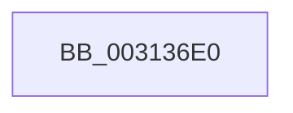

# sub_003136E0

- RVA: `0x003136E0`–`0x00313707` (길이 `39` bytes)
- VA: `0x00000001403136E0`
- 실행 섹션: `.text`
- PDB 이름 있음: `아니요`; PDB Function 태그: `아니요`
- unwind 정보 RVA: `0x00074610`
- 디코드: `10`개 명령, `39/39` bytes 표시
- 미해석 바이트: `0` (있으면 어셈블리에 `.byte`로 보존)

> 이 문서는 커널 이미지의 기계어와 PDB 기호를 분석해 생성했습니다. 4번과 5번은 함수 원형과 자료형을 바이너리 사용 방식에서 추정한 C 해석이며 원본 소스 복구 결과는 아닙니다.

## 1. Dependencies

- 직접 호출 지점: **1**; 고유 호출 대상: **1**
- 직접 호출자로 확인된 함수: **0**
- RIP 상대 이미지 참조: **0**

### Outgoing calls
- `0x003136FD` → [EtwTraceHvHypercall](../3A/EtwTraceHvHypercall_function_003A4284.md) (function, `0x003A4284`)

### Direct callers
- 이 함수 시작 RVA로 연결되는 직접 call은 확인되지 않았습니다. 간접 호출은 완전히 역산할 수 없습니다.

### Static image references
- 디코드된 RIP-relative 메모리 참조가 없습니다.

## 2. Other-region calls and transfers

- 다른 실행 섹션으로 향하는 call: **0**
- call이 아닌 외부 분기/꼬리 이동: **1**
  - `0x00313705` → [sub_003136B2](Unknown_function_003136B2.md) (`tail-transfer`)

## 3. Assembly (complete function range)

```asm
003136E0  41 C1 EE 10                     shr r14d, 0x10
003136E4  48 8D 4C 24 20                  lea rcx, [rsp + 0x20]
003136E9  41 80 E6 01                     and r14b, 1
003136ED  41 C1 EF 1F                     shr r15d, 0x1f
003136F1  45 0F B6 C6                     movzx r8d, r14b
003136F5  41 0F B7 D4                     movzx edx, r12w
003136F9  45 0F B6 CF                     movzx r9d, r15b
003136FD  E8 82 0B 09 00                  call 0x1403a4284
00313702  48 8B C3                        mov rax, rbx
00313705  EB AB                           jmp 0x1403136b2
```

## 4. C-style interpretation (structured pseudocode)

```c
__int64 __fastcall sub_003136E0(void)
{
    __int64 result;
    __int64 v_r14;
    __int64 v_r15;
    unsigned __int64 v_stack_p20;

    v_r14 = (unsigned int)((v_r14) >> (16));
    v_r14 = (unsigned __int8)((v_r14) & (1));
    v_r15 = (unsigned int)((v_r15) >> (31));
    result = EtwTraceHvHypercall(v_stack_p20, (unsigned __int16)(v_r12), (unsigned __int8)(v_r14), (unsigned __int8)(v_r15));
}
```

## 5. (Beta) C Style

```c
void sub_003136E0(void)
{
    int64_t result;
    int64_t local_r14;
    int64_t local_r15;
    uint64_t v_stack_p20;

    local_r14 = (uint32_t)((local_r14) >> (16));
    local_r14 = (uint8_t)((local_r14) & (1));
    local_r15 = (uint32_t)((local_r15) >> (31));
    result = EtwTraceHvHypercall(v_stack_p20, (uint16_t)(local_r12), (uint8_t)(local_r14), (uint8_t)(local_r15));
}
```

## 6. Execution-region graph

[열기: 2D/3D 그래프와 함수 탐색 컨트롤 패널](../../../control-panel.html?section=text&rva=0x003136E0&view=graph)

- 2D 그래프는 위에서 아래로 흐르고, 3D 그래프는 빈 공간을 드래그해 회전합니다. Shift+드래그는 이동, 휠은 확대·축소, 함수 노드 선택은 대상 보고서 이동입니다.

### Static fallback


