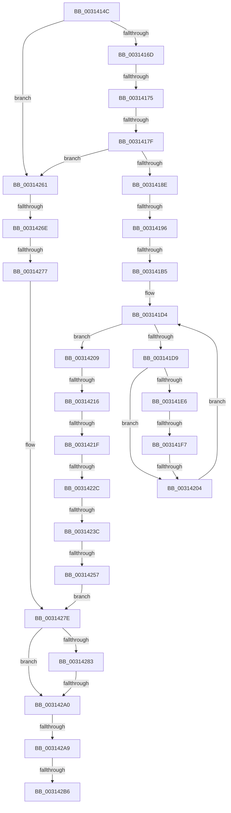

# sub_0031414C

- RVA: `0x0031414C`–`0x003142D6` (길이 `394` bytes)
- VA: `0x000000014031414C`
- 실행 섹션: `.text`
- PDB 이름 있음: `아니요`; PDB Function 태그: `아니요`
- unwind 정보 RVA: `0x000746A4`
- 디코드: `81`개 명령, `394/394` bytes 표시
- 미해석 바이트: `0` (있으면 어셈블리에 `.byte`로 보존)

> 이 문서는 커널 이미지의 기계어와 PDB 기호를 분석해 생성했습니다. 4번과 5번은 함수 원형과 자료형을 바이너리 사용 방식에서 추정한 C 해석이며 원본 소스 복구 결과는 아닙니다.

## 1. Dependencies

- 직접 호출 지점: **1**; 고유 호출 대상: **1**
- 직접 호출자로 확인된 함수: **0**
- RIP 상대 이미지 참조: **6**

### Outgoing calls
- `0x00314279` → [KxFlushEntireTb](../30/KxFlushEntireTb_function_00309094.md) (function, `0x00309094`)

### Direct callers
- 이 함수 시작 RVA로 연결되는 직접 call은 확인되지 않았습니다. 간접 호출은 완전히 역산할 수 없습니다.

### Static image references
- `0x0031415F` → RVA `0x00FC6AB8` (`ALMOSTRO`; read)
- `0x0031417F` → RVA `0x00FC6A80` (`ALMOSTRO`; read)
- `0x003141A8` → RVA `0x00FC6D20` (`ALMOSTRO`; read)
- `0x00314209` → RVA `0x01201840` (`CFGRO`; read)
- `0x0031421F` → RVA `0x00FC6A87` (`ALMOSTRO`; read)
- `0x003142A9` → RVA `0x00FC5004` (`ALMOSTRO`; read)

## 2. Other-region calls and transfers

- 다른 실행 섹션으로 향하는 call: **0**
- call이 아닌 외부 분기/꼬리 이동: **17**
  - `0x0031416F` → [sub_00314667 + 0x44](Unknown_function_00314667.md) (`tail-transfer`)
  - `0x00314179` → [sub_00314667 + 0x37](Unknown_function_00314667.md) (`tail-transfer`)
  - `0x00314190` → [sub_00314667 + 0x44](Unknown_function_00314667.md) (`tail-transfer`)
  - `0x003141AF` → [sub_00314592](Unknown_function_00314592.md) (`tail-transfer`)
  - `0x003141F1` → [sub_003143F3 + 0x14](Unknown_function_003143F3.md) (`tail-transfer`)
  - `0x003141FE` → [sub_003143F3 + 0x14](Unknown_function_003143F3.md) (`tail-transfer`)
  - `0x00314210` → [sub_003143F3](Unknown_function_003143F3.md) (`tail-transfer`)
  - `0x00314219` → [sub_00314667 + 0x4E](Unknown_function_00314667.md) (`tail-transfer`)
  - `0x00314226` → [sub_00314608](Unknown_function_00314608.md) (`tail-transfer`)
  - `0x00314236` → [sub_003143F3 + 0x9](Unknown_function_003143F3.md) (`tail-transfer`)
  - `0x00314251` → [sub_00314667 + 0x9D](Unknown_function_00314667.md) (`tail-transfer`)
  - `0x00314268` → [sub_003143F3 + 0xC7](Unknown_function_003143F3.md) (`tail-transfer`)
  - `0x00314271` → [sub_00314667 + 0xCF](Unknown_function_00314667.md) (`tail-transfer`)
  - `0x0031429A` → [sub_00314667 + 0xE5](Unknown_function_00314667.md) (`tail-transfer`)
  - `0x003142A3` → [sub_003143C3](Unknown_function_003143C3.md) (`tail-transfer`)
  - `0x003142B0` → [sub_003143C3](Unknown_function_003143C3.md) (`tail-transfer`)
  - `0x003142D0` → [sub_003143C3](Unknown_function_003143C3.md) (`tail-transfer`)

## 3. Assembly (complete function range)

```asm
0031414C  48 89 68 08                     mov qword ptr [rax + 8], rbp
00314150  8B DA                           mov ebx, edx
00314152  48 89 70 10                     mov qword ptr [rax + 0x10], rsi
00314156  8B F9                           mov edi, ecx
00314158  4C 89 68 E8                     mov qword ptr [rax - 0x18], r13
0031415C  45 33 ED                        xor r13d, r13d
0031415F  8B 05 53 29 CB 00               mov eax, dword ptr [rip + 0xcb2953]
00314165  A8 04                           test al, 4
00314167  0F 84 F4 00 00 00               je 0x140314261
0031416D  A8 02                           test al, 2
0031416F  0F 85 36 05 00 00               jne 0x1403146ab
00314175  0F BA E0 17                     bt eax, 0x17
00314179  0F 82 1F 05 00 00               jb 0x14031469e
0031417F  8B 05 FB 28 CB 00               mov eax, dword ptr [rip + 0xcb28fb]
00314185  83 F8 01                        cmp eax, 1
00314188  0F 84 D3 00 00 00               je 0x140314261
0031418E  85 DB                           test ebx, ebx
00314190  0F 85 15 05 00 00               jne 0x1403146ab
00314196  F0 44 09 2C 24                  lock or dword ptr [rsp], r13d
0031419B  44 0F 20 C6                     mov rsi, cr8
0031419F  BD 0C 00 00 00                  mov ebp, 0xc
003141A4  44 0F 22 C5                     mov cr8, rbp
003141A8  44 39 2D 71 2B CB 00            cmp dword ptr [rip + 0xcb2b71], r13d
003141AF  0F 85 DD 03 00 00               jne 0x140314592
003141B5  65 4C 8B 04 25 20 00 00 00      mov r8, qword ptr gs:[0x20]
003141BE  49 8B 40 08                     mov rax, qword ptr [r8 + 8]
003141C2  48 8B 88 B8 00 00 00            mov rcx, qword ptr [rax + 0xb8]
003141C9  41 0F B7 C5                     movzx eax, r13w
003141CD  48 8B 91 80 00 00 00            mov rdx, qword ptr [rcx + 0x80]
003141D4  66 3B 02                        cmp ax, word ptr [rdx]
003141D7  73 30                           jae 0x140314209
003141D9  0F B7 C8                        movzx ecx, ax
003141DC  4C 8B 4C CA 08                  mov r9, qword ptr [rdx + rcx*8 + 8]
003141E1  4D 85 C9                        test r9, r9
003141E4  74 1E                           je 0x140314204
003141E6  41 0F B6 88 D0 00 00 00         movzx ecx, byte ptr [r8 + 0xd0]
003141EE  66 3B C1                        cmp ax, cx
003141F1  0F 85 10 02 00 00               jne 0x140314407
003141F7  4D 3B 88 C8 00 00 00            cmp r9, qword ptr [r8 + 0xc8]
003141FE  0F 85 03 02 00 00               jne 0x140314407
00314204  66 FF C0                        inc ax
00314207  EB CB                           jmp 0x1403141d4
00314209  44 38 2D 30 D6 EE 00            cmp byte ptr [rip + 0xeed630], r13b
00314210  0F 84 DD 01 00 00               je 0x1403143f3
00314216  83 FF 03                        cmp edi, 3
00314219  0F 85 96 04 00 00               jne 0x1403146b5
0031421F  44 38 2D 61 28 CB 00            cmp byte ptr [rip + 0xcb2861], r13b
00314226  0F 85 DC 03 00 00               jne 0x140314608
0031422C  0F 20 E1                        mov rcx, cr4
0031422F  48 F7 C1 80 00 02 00            test rcx, 0x20080
00314236  0F 84 C0 01 00 00               je 0x1403143fc
0031423C  48 8B C1                        mov rax, rcx
0031423F  48 0F BA F8 07                  btc rax, 7
00314244  0F 22 E0                        mov cr4, rax
00314247  0F 22 E1                        mov cr4, rcx
0031424A  44 39 2D CF 2A CB 00            cmp dword ptr [rip + 0xcb2acf], r13d
00314251  0F 85 AD 04 00 00               jne 0x140314704
00314257  40 0F B6 C6                     movzx eax, sil
0031425B  44 0F 22 C0                     mov cr8, rax
0031425F  EB 1D                           jmp 0x14031427e
00314261  44 38 2D D8 D5 EE 00            cmp byte ptr [rip + 0xeed5d8], r13b
00314268  0F 84 4C 02 00 00               je 0x1403144ba
0031426E  83 FF 02                        cmp edi, 2
00314271  0F 85 BF 04 00 00               jne 0x140314736
00314277  8B CB                           mov ecx, ebx
00314279  E8 16 4E FF FF                  call 0x140309094
0031427E  83 FF 01                        cmp edi, 1
00314281  75 1D                           jne 0x1403142a0
00314283  65 48 8B 04 25 88 01 00 00      mov rax, qword ptr gs:[0x188]
0031428C  48 8B 88 B8 00 00 00            mov rcx, qword ptr [rax + 0xb8]
00314293  4C 39 A9 70 01 00 00            cmp qword ptr [rcx + 0x170], r13
0031429A  0F 85 AC 04 00 00               jne 0x14031474c
003142A0  83 FF 01                        cmp edi, 1
003142A3  0F 85 1A 01 00 00               jne 0x1403143c3
003142A9  44 38 2D 54 0D CB 00            cmp byte ptr [rip + 0xcb0d54], r13b
003142B0  0F 84 0D 01 00 00               je 0x1403143c3
003142B6  65 48 8B 04 25 88 01 00 00      mov rax, qword ptr gs:[0x188]
003142BF  48 8B 88 B8 00 00 00            mov rcx, qword ptr [rax + 0xb8]
003142C6  48 8B B1 70 06 00 00            mov rsi, qword ptr [rcx + 0x670]
003142CD  48 85 F6                        test rsi, rsi
003142D0  0F 84 ED 00 00 00               je 0x1403143c3
```

## 4. C-style interpretation (structured pseudocode)

```c
__int64 __fastcall sub_0031414C(int a1, int a2)
{
    __int64 result;
    __int64 v_r13;
    unsigned int v_stack_p0;

    *(unsigned __int64 *)(result + 8) = v_rbp;
    *(unsigned __int64 *)(result + 16) = v_rsi;
    *(unsigned __int64 *)(result - 24) = v_r13;
    v_r13 = 0;
    if ((((unsigned __int8)((unsigned int)(*(unsigned int *)(v_rip + 13314387)))) & (4)) == 0) goto loc_00314261;
    if (((unsigned int)((unsigned int)(*(unsigned int *)(v_rip + 13314299)))) == 1) goto loc_00314261;
loc_003141D4:
    if (0 >= (*(unsigned __int16 *)(*(unsigned __int64 *)(*(unsigned __int64 *)(*(unsigned __int64 *)(*(unsigned __int64 *)(gs_base + (0 + 32)) + 8) + 184) + 128)))) goto loc_00314209;
    if (*(unsigned __int64 *)(*(unsigned __int64 *)(*(unsigned __int64 *)(*(unsigned __int64 *)(*(unsigned __int64 *)(gs_base + (0 + 32)) + 8) + 184) + 128) + 0 * 8 + 8) == 0) goto loc_00314204;
loc_00314204:
    result = (unsigned __int16)((0) + 1);
    goto loc_003141D4;
loc_00314209:
    goto loc_0031427E;
loc_00314261:
    result = KxFlushEntireTb((unsigned int)((unsigned int)((unsigned int)(a2))), *(unsigned __int64 *)(*(unsigned __int64 *)(*(unsigned __int64 *)(*(unsigned __int64 *)(gs_base + (0 + 32)) + 8) + 184) + 128), *(unsigned __int64 *)(gs_base + (0 + 32)), *(unsigned __int64 *)(*(unsigned __int64 *)(*(unsigned __int64 *)(*(unsigned __int64 *)(*(unsigned __int64 *)(gs_base + (0 + 32)) + 8) + 184) + 128) + 0 * 8 + 8));
loc_0031427E:
    if (((unsigned int)((unsigned int)(a1))) != 1) goto loc_003142A0;
loc_003142A0:
}
```

## 5. (Beta) C Style

```c
int64_t sub_0031414C(int32_t Arg1, int32_t Arg2)
{
    int64_t result;
    int64_t local_r13;
    uint32_t v_stack_p0;

    *(uint64_t *)(result + 0x8) = local_rbp;
    *(uint64_t *)(result + 0x10) = local_rsi;
    *(uint64_t *)(result - 0x18) = local_r13;
    local_r13 = 0;
    if ((((uint8_t)((uint32_t)(*(uint32_t *)(v_rip + 0xCB2953)))) & (4)) == 0) goto loc_00314261;
    if (((uint32_t)((uint32_t)(*(uint32_t *)(v_rip + 0xCB28FB)))) == 1) goto loc_00314261;
loc_003141D4:
    if (0 >= (*(uint16_t *)(*(uint64_t *)(*(uint64_t *)(*(uint64_t *)(*(uint64_t *)(gs_base + (0 + 0x20)) + 0x8) + 0xB8) + 0x80)))) goto loc_00314209;
    if (*(uint64_t *)(*(uint64_t *)(*(uint64_t *)(*(uint64_t *)(*(uint64_t *)(gs_base + (0 + 0x20)) + 0x8) + 0xB8) + 0x80) + 0x0 * 8 + 0x8) == 0) goto loc_00314204;
loc_00314204:
    result = (uint16_t)((0) + 1);
    goto loc_003141D4;
loc_00314209:
    goto loc_0031427E;
loc_00314261:
    result = KxFlushEntireTb((uint32_t)((uint32_t)((uint32_t)(Arg2))), *(uint64_t *)(*(uint64_t *)(*(uint64_t *)(*(uint64_t *)(gs_base + (0 + 0x20)) + 0x8) + 0xB8) + 0x80), *(uint64_t *)(gs_base + (0 + 0x20)), *(uint64_t *)(*(uint64_t *)(*(uint64_t *)(*(uint64_t *)(*(uint64_t *)(gs_base + (0 + 0x20)) + 0x8) + 0xB8) + 0x80) + 0x0 * 8 + 0x8));
loc_0031427E:
    if (((uint32_t)((uint32_t)(Arg1))) != 1) goto loc_003142A0;
loc_003142A0:
}
```

## 6. Execution-region graph

[열기: 2D/3D 그래프와 함수 탐색 컨트롤 패널](../../../control-panel.html?section=text&rva=0x0031414C&view=graph)

- 2D 그래프는 위에서 아래로 흐르고, 3D 그래프는 빈 공간을 드래그해 회전합니다. Shift+드래그는 이동, 휠은 확대·축소, 함수 노드 선택은 대상 보고서 이동입니다.

### Static fallback


