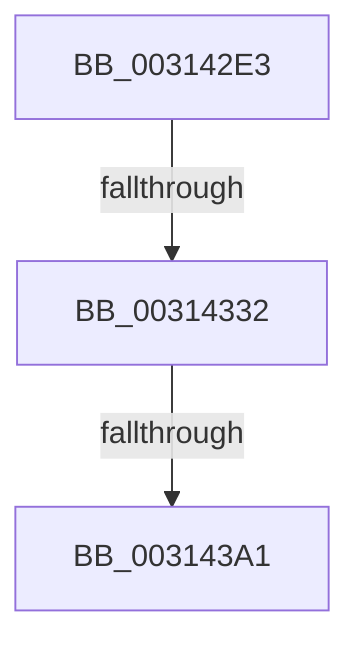

# sub_003142E3

- RVA: `0x003142E3`–`0x003143B1` (길이 `206` bytes)
- VA: `0x00000001403142E3`
- 실행 섹션: `.text`
- PDB 이름 있음: `아니요`; PDB Function 태그: `아니요`
- unwind 정보 RVA: `0x000746D4`
- 디코드: `37`개 명령, `206/206` bytes 표시
- 미해석 바이트: `0` (있으면 어셈블리에 `.byte`로 보존)

> 이 문서는 커널 이미지의 기계어와 PDB 기호를 분석해 생성했습니다. 4번과 5번은 함수 원형과 자료형을 바이너리 사용 방식에서 추정한 C 해석이며 원본 소스 복구 결과는 아닙니다.

## 1. Dependencies

- 직접 호출 지점: **2**; 고유 호출 대상: **2**
- 직접 호출자로 확인된 함수: **0**
- RIP 상대 이미지 참조: **1**

### Outgoing calls
- `0x00314303` → [VmpProcessContextLockExclusive](VmpProcessContextLockExclusive_function_003147A4.md) (function, `0x003147A4`)
- `0x0031438B` → [VmpConvertPortionVpnRangeToGpnRange](VmpConvertPortionVpnRangeToGpnRange_function_003147F0.md) (function, `0x003147F0`)

### Direct callers
- 이 함수 시작 RVA로 연결되는 직접 call은 확인되지 않았습니다. 간접 호출은 완전히 역산할 수 없습니다.

### Static image references
- `0x0031431B` → RVA `0x00F02458` (`.data`; read)

## 2. Other-region calls and transfers

- 다른 실행 섹션으로 향하는 call: **0**
- call이 아닌 외부 분기/꼬리 이동: **2**
  - `0x0031432C` → [sub_00314756](Unknown_function_00314756.md) (`tail-transfer`)
  - `0x0031439B` → [sub_00314541](Unknown_function_00314541.md) (`tail-transfer`)

## 3. Assembly (complete function range)

```asm
003142E3  4C 89 B4 24 88 00 00 00         mov qword ptr [rsp + 0x88], r14
003142EB  48 8B CE                        mov rcx, rsi
003142EE  4C 89 BC 24 80 00 00 00         mov qword ptr [rsp + 0x80], r15
003142F6  0F 11 44 24 60                  movups xmmword ptr [rsp + 0x60], xmm0
003142FB  48 89 44 24 70                  mov qword ptr [rsp + 0x70], rax
00314300  4D 8B F5                        mov r14, r13
00314303  E8 9C 04 00 00                  call 0x1403147a4
00314308  65 48 8B 0C 25 20 00 00 00      mov rcx, qword ptr gs:[0x20]
00314311  48 8B E8                        mov rbp, rax
00314314  4C 8B A1 50 8B 00 00            mov r12, qword ptr [rcx + 0x8b50]
0031431B  48 8B 0D 36 E1 BE 00            mov rcx, qword ptr [rip + 0xbee136]
00314322  49 81 C4 00 12 00 00            add r12, 0x1200
00314329  48 85 C9                        test rcx, rcx
0031432C  0F 85 24 04 00 00               jne 0x140314756
00314332  0F 57 C0                        xorps xmm0, xmm0
00314335  44 89 AC 24 C0 00 00 00         mov dword ptr [rsp + 0xc0], r13d
0031433D  48 B8 01 00 00 00 00 00 10 00   movabs rax, 0x10000000000001
00314347  4C 89 6C 24 50                  mov qword ptr [rsp + 0x50], r13
0031434C  0F 11 44 24 40                  movups xmmword ptr [rsp + 0x40], xmm0
00314351  48 89 44 24 58                  mov qword ptr [rsp + 0x58], rax
00314356  48 8D 84 24 C0 00 00 00         lea rax, [rsp + 0xc0]
0031435E  C7 44 24 30 01 00 00 00         mov dword ptr [rsp + 0x30], 1
00314366  48 89 44 24 28                  mov qword ptr [rsp + 0x28], rax
0031436B  4C 8D 4C 24 60                  lea r9, [rsp + 0x60]
00314370  48 8D 44 24 40                  lea rax, [rsp + 0x40]
00314375  41 B8 00 00 04 00               mov r8d, 0x40000
0031437B  4D 2B C6                        sub r8, r14
0031437E  48 89 44 24 20                  mov qword ptr [rsp + 0x20], rax
00314383  48 8D 54 24 50                  lea rdx, [rsp + 0x50]
00314388  48 8B CE                        mov rcx, rsi
0031438B  E8 60 04 00 00                  call 0x1403147f0
00314390  48 8B 5C 24 48                  mov rbx, qword ptr [rsp + 0x48]
00314395  4C 8B F8                        mov r15, rax
00314398  48 85 DB                        test rbx, rbx
0031439B  0F 85 A0 01 00 00               jne 0x140314541
003143A1  4C 8B BC 24 80 00 00 00         mov r15, qword ptr [rsp + 0x80]
003143A9  4C 8B B4 24 88 00 00 00         mov r14, qword ptr [rsp + 0x88]
```

## 4. C-style interpretation (structured pseudocode)

```c
__int64 __fastcall sub_003142E3(__int64 a1, __int64 a2, __int64 a3, __int64 a4, __int64 a5, __int64 a6, __int64 a7, __int64 a8, __int64 a9, __int64 a10, __int64 a11, __int64 a12, __int64 a13, __int64 a14, __int64 a15, __int64 a16, __int64 a17, __int64 a18, __int64 a19, __int64 a20, __int64 a21, __int64 a22, __int64 a23, __int64 a24)
{
    __int64 result;
    __int64 v_r12;
    unsigned __int64 v_stack_p20;
    unsigned __int64 v_stack_p28;
    unsigned int v_stack_p30;
    unsigned __int64 v_stack_p50;
    unsigned __int64 v_stack_p58;
    unsigned __int64 v_stack_p70;
    unsigned __int64 v_stack_p80;
    unsigned __int64 v_stack_p88;
    unsigned int v_stack_pC0;

    v_stack_p88 = v_r14;
    v_stack_p80 = v_r15;
    a12 = v_xmm0;
    v_stack_p70 = result;
    result = VmpProcessContextLockExclusive(v_rsi, a2, a3, a4);
    v_r12 = (*(unsigned __int64 *)(*(unsigned __int64 *)(gs_base + (0 + 32)) + 35664)) + (0x1200ULL);
    v_stack_pC0 = (unsigned int)(v_r13);
    v_stack_p50 = v_r13;
    a8 = v_xmm0;
    v_stack_p58 = result;
    v_stack_p30 = 1;
    v_stack_p28 = a24;
    a3 = ((unsigned int)(0x40000ULL)) - (v_r13);
    v_stack_p20 = a8;
    result = VmpConvertPortionVpnRangeToGpnRange(v_rsi, a10, a3, a12);
    return result;
}
```

## 5. (Beta) C Style

```c
int64_t sub_003142E3(int64_t Arg1, int64_t Arg2, int64_t Arg3, int64_t Arg4, uint64_t Arg5, uint64_t Arg6, uint64_t Arg7, int64_t Arg8, int64_t Arg9, int64_t Arg10, uint64_t Arg11, int64_t Arg12, uint64_t Arg13, uint64_t Arg14, uint64_t Arg15, int64_t Arg16, int64_t Arg17, uint64_t Arg18, uint64_t Arg19, uint64_t Arg20, uint64_t Arg21, uint64_t Arg22, uint64_t Arg23, int64_t Arg24)
{
    int64_t result;
    int64_t local_r12;
    uint64_t v_stack_p20;
    uint64_t v_stack_p28;
    uint32_t v_stack_p30;
    uint64_t v_stack_p50;
    uint64_t v_stack_p58;
    uint64_t v_stack_p70;
    uint64_t v_stack_p80;
    uint64_t v_stack_p88;
    uint32_t v_stack_pC0;

    v_stack_p88 = local_r14;
    v_stack_p80 = local_r15;
    Arg12 = v_xmm0;
    v_stack_p70 = result;
    result = VmpProcessContextLockExclusive(local_rsi, Arg2, Arg3, Arg4);
    local_r12 = (*(uint64_t *)(*(uint64_t *)(gs_base + (0 + 0x20)) + 0x8B50)) + (0x1200ULL);
    v_stack_pC0 = (uint32_t)(local_r13);
    v_stack_p50 = local_r13;
    Arg8 = v_xmm0;
    v_stack_p58 = result;
    v_stack_p30 = 1;
    v_stack_p28 = Arg24;
    Arg3 = ((uint32_t)(0x40000ULL)) - (local_r13);
    v_stack_p20 = Arg8;
    result = VmpConvertPortionVpnRangeToGpnRange(local_rsi, Arg10, Arg3, Arg12);
    return result;
}
```

## 6. Execution-region graph

[열기: 2D/3D 그래프와 함수 탐색 컨트롤 패널](../../../control-panel.html?section=text&rva=0x003142E3&view=graph)

- 2D 그래프는 위에서 아래로 흐르고, 3D 그래프는 빈 공간을 드래그해 회전합니다. Shift+드래그는 이동, 휠은 확대·축소, 함수 노드 선택은 대상 보고서 이동입니다.

### Static fallback


