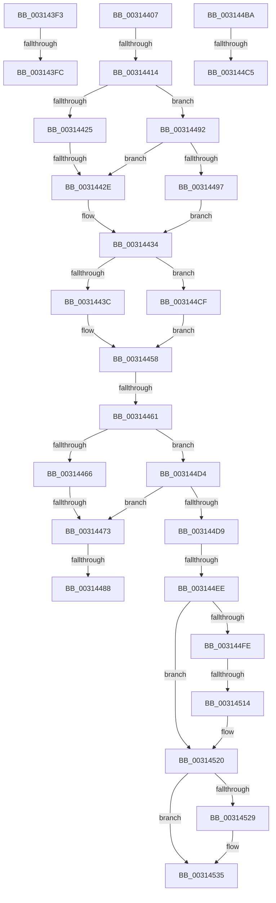

# sub_003143F3

- RVA: `0x003143F3`–`0x00314541` (길이 `334` bytes)
- VA: `0x00000001403143F3`
- 실행 섹션: `.text`
- PDB 이름 있음: `아니요`; PDB Function 태그: `아니요`
- unwind 정보 RVA: `0x00074720`
- 디코드: `76`개 명령, `334/334` bytes 표시
- 미해석 바이트: `0` (있으면 어셈블리에 `.byte`로 보존)

> 이 문서는 커널 이미지의 기계어와 PDB 기호를 분석해 생성했습니다. 4번과 5번은 함수 원형과 자료형을 바이너리 사용 방식에서 추정한 C 해석이며 원본 소스 복구 결과는 아닙니다.

## 1. Dependencies

- 직접 호출 지점: **6**; 고유 호출 대상: **5**
- 직접 호출자로 확인된 함수: **0**
- RIP 상대 이미지 참조: **5**

### Outgoing calls
- `0x00314466` → [HvlpUseExtendedProcessorSetHypercalls](../30/HvlpUseExtendedProcessorSetHypercalls_function_0030906C.md) (function, `0x0030906C`)
- `0x00314488` → [HvlpFastFlushAddressSpaceTb](HvlpFastFlushAddressSpaceTb_function_00314AF4.md) (function, `0x00314AF4`)
- `0x003144C5` → [KxFlushNonGlobalTb](KxFlushNonGlobalTb_function_00314E50.md) (function, `0x00314E50`)
- `0x003144F5` → [KxSetTimeStampBusy](KxSetTimeStampBusy_function_00314CC0.md) (function, `0x00314CC0`)
- `0x00314514` → [HvlpFastFlushAddressSpaceTb](HvlpFastFlushAddressSpaceTb_function_00314AF4.md) (function, `0x00314AF4`)
- `0x00314530` → [KiLowerIrqlProcessIrqlFlags](../4F/KiLowerIrqlProcessIrqlFlags_function_004F5698.md) (function, `0x004F5698`)

### Direct callers
- 이 함수 시작 RVA로 연결되는 직접 call은 확인되지 않았습니다. 간접 호출은 완전히 역산할 수 없습니다.

### Static image references
- `0x00314407` → RVA `0x00FC6D20` (`ALMOSTRO`; read)
- `0x0031441C` → RVA `0x01201840` (`CFGRO`; read)
- `0x00314473` → RVA `0x00FC6AB8` (`ALMOSTRO`; read)
- `0x003144EE` → RVA `0x00FCF080` (`CACHEALI`; read)
- `0x00314519` → RVA `0x00FCF080` (`CACHEALI`; read/write)

## 2. Other-region calls and transfers

- 다른 실행 섹션으로 향하는 call: **0**
- call이 아닌 외부 분기/꼬리 이동: **13**
  - `0x003143F6` → [sub_00314667 + 0x8B](Unknown_function_00314667.md) (`tail-transfer`)
  - `0x00314402` → [sub_0031414C + 0xFE](Unknown_function_0031414C.md) (`tail-transfer`)
  - `0x0031440E` → [sub_00314667 + 0x79](Unknown_function_00314667.md) (`tail-transfer`)
  - `0x00314428` → [sub_00314592 + 0x20](Unknown_function_00314592.md) (`tail-transfer`)
  - `0x0031445B` → [sub_00314592 + 0x12](Unknown_function_00314592.md) (`tail-transfer`)
  - `0x0031446D` → [sub_00314667](Unknown_function_00314667.md) (`tail-transfer`)
  - `0x00314482` → [sub_00314667 + 0x65](Unknown_function_00314667.md) (`tail-transfer`)
  - `0x0031448D` → [sub_0031414C + 0x132](Unknown_function_0031414C.md) (`tail-transfer`)
  - `0x003144BF` → [sub_00314667 + 0x5B](Unknown_function_00314667.md) (`tail-transfer`)
  - `0x003144CA` → [sub_0031414C + 0x137](Unknown_function_0031414C.md) (`tail-transfer`)
  - `0x003144E8` → [sub_00314667 + 0xAF](Unknown_function_00314667.md) (`tail-transfer`)
  - `0x0031450E` → [sub_00314667 + 0x6F](Unknown_function_00314667.md) (`tail-transfer`)
  - `0x0031453C` → [sub_0031414C + 0x154](Unknown_function_0031414C.md) (`tail-transfer`)

## 3. Assembly (complete function range)

```asm
003143F3  83 FF 01                        cmp edi, 1
003143F6  0F 85 F6 02 00 00               jne 0x1403146f2
003143FC  0F 20 D8                        mov rax, cr3
003143FF  0F 22 D8                        mov cr3, rax
00314402  E9 43 FE FF FF                  jmp 0x14031424a
00314407  44 39 2D 12 29 CB 00            cmp dword ptr [rip + 0xcb2912], r13d
0031440E  0F 85 CC 02 00 00               jne 0x1403146e0
00314414  40 0F B6 C6                     movzx eax, sil
00314418  44 0F 22 C0                     mov cr8, rax
0031441C  44 38 2D 1D D4 EE 00            cmp byte ptr [rip + 0xeed41d], r13b
00314423  74 6D                           je 0x140314492
00314425  83 FF 03                        cmp edi, 3
00314428  0F 85 84 01 00 00               jne 0x1403145b2
0031442E  4D 8B CD                        mov r9, r13
00314431  40 B6 01                        mov sil, 1
00314434  85 DB                           test ebx, ebx
00314436  0F 85 93 00 00 00               jne 0x1403144cf
0031443C  F0 44 09 2C 24                  lock or dword ptr [rsp], r13d
00314441  65 48 8B 04 25 88 01 00 00      mov rax, qword ptr gs:[0x188]
0031444A  48 8B 88 B8 00 00 00            mov rcx, qword ptr [rax + 0xb8]
00314451  48 8B 91 80 00 00 00            mov rdx, qword ptr [rcx + 0x80]
00314458  4D 85 C9                        test r9, r9
0031445B  0F 85 43 01 00 00               jne 0x1403145a4
00314461  48 85 D2                        test rdx, rdx
00314464  74 6E                           je 0x1403144d4
00314466  E8 01 4C FF FF                  call 0x14030906c
0031446B  84 C0                           test al, al
0031446D  0F 85 F4 01 00 00               jne 0x140314667
00314473  8B 05 3F 26 CB 00               mov eax, dword ptr [rip + 0xcb263f]
00314479  44 0F B6 C6                     movzx r8d, sil
0031447D  49 8B C9                        mov rcx, r9
00314480  84 C0                           test al, al
00314482  0F 89 44 02 00 00               jns 0x1403146cc
00314488  E8 67 06 00 00                  call 0x140314af4
0031448D  E9 EC FD FF FF                  jmp 0x14031427e
00314492  83 FF 01                        cmp edi, 1
00314495  75 97                           jne 0x14031442e
00314497  65 48 8B 04 25 88 01 00 00      mov rax, qword ptr gs:[0x188]
003144A0  48 8B 88 B8 00 00 00            mov rcx, qword ptr [rax + 0xb8]
003144A7  4C 8B 49 28                     mov r9, qword ptr [rcx + 0x28]
003144AB  49 81 E1 00 F0 FF FF            and r9, 0xfffffffffffff000
003144B2  40 32 F6                        xor sil, sil
003144B5  E9 7A FF FF FF                  jmp 0x140314434
003144BA  8B CB                           mov ecx, ebx
003144BC  83 FF 01                        cmp edi, 1
003144BF  0F 85 FD 01 00 00               jne 0x1403146c2
003144C5  E8 86 09 00 00                  call 0x140314e50
003144CA  E9 B4 FD FF FF                  jmp 0x140314283
003144CF  49 8B D5                        mov rdx, r13
003144D2  EB 84                           jmp 0x140314458
003144D4  83 FF 01                        cmp edi, 1
003144D7  74 9A                           je 0x140314473
003144D9  44 0F 20 C3                     mov rbx, cr8
003144DD  44 0F 22 C5                     mov cr8, rbp
003144E1  44 39 2D 38 28 CB 00            cmp dword ptr [rip + 0xcb2838], r13d
003144E8  0F 85 28 02 00 00               jne 0x140314716
003144EE  48 8D 0D 8B AB CB 00            lea rcx, [rip + 0xcbab8b]
003144F5  E8 C6 07 00 00                  call 0x140314cc0
003144FA  84 C0                           test al, al
003144FC  74 22                           je 0x140314520
003144FE  8B 05 B4 25 CB 00               mov eax, dword ptr [rip + 0xcb25b4]
00314504  33 D2                           xor edx, edx
00314506  33 C9                           xor ecx, ecx
00314508  44 0F B6 C6                     movzx r8d, sil
0031450C  84 C0                           test al, al
0031450E  0F 89 C2 01 00 00               jns 0x1403146d6
00314514  E8 DB 05 00 00                  call 0x140314af4
00314519  F0 FF 05 60 AB CB 00            lock inc dword ptr [rip + 0xcbab60]
00314520  44 39 2D F9 27 CB 00            cmp dword ptr [rip + 0xcb27f9], r13d
00314527  74 0C                           je 0x140314535
00314529  44 0F 20 C1                     mov rcx, cr8
0031452D  0F B6 D3                        movzx edx, bl
00314530  E8 63 11 1E 00                  call 0x1404f5698
00314535  0F B6 C3                        movzx eax, bl
00314538  44 0F 22 C0                     mov cr8, rax
0031453C  E9 5F FD FF FF                  jmp 0x1403142a0
```

## 4. C-style interpretation (structured pseudocode)

```c
__int64 __fastcall sub_003143F3(void)
{
    unsigned int v_stack_p0;
}
```

## 5. (Beta) C Style

```c
void sub_003143F3(void)
{
    uint32_t v_stack_p0;
}
```

## 6. Execution-region graph

[열기: 2D/3D 그래프와 함수 탐색 컨트롤 패널](../../../control-panel.html?section=text&rva=0x003143F3&view=graph)

- 2D 그래프는 위에서 아래로 흐르고, 3D 그래프는 빈 공간을 드래그해 회전합니다. Shift+드래그는 이동, 휠은 확대·축소, 함수 노드 선택은 대상 보고서 이동입니다.

### Static fallback


