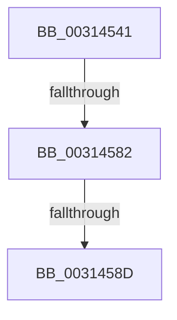

# sub_00314541

- RVA: `0x00314541`–`0x00314592` (길이 `81` bytes)
- VA: `0x0000000140314541`
- 실행 섹션: `.text`
- PDB 이름 있음: `아니요`; PDB Function 태그: `아니요`
- unwind 정보 RVA: `0x0007473C`
- 디코드: `18`개 명령, `81/81` bytes 표시
- 미해석 바이트: `0` (있으면 어셈블리에 `.byte`로 보존)

> 이 문서는 커널 이미지의 기계어와 PDB 기호를 분석해 생성했습니다. 4번과 5번은 함수 원형과 자료형을 바이너리 사용 방식에서 추정한 C 해석이며 원본 소스 복구 결과는 아닙니다.

## 1. Dependencies

- 직접 호출 지점: **2**; 고유 호출 대상: **2**
- 직접 호출자로 확인된 함수: **0**
- RIP 상대 이미지 참조: **0**

### Outgoing calls
- `0x0031455F` → [VmpInsertInvalidateListRange](../46/VmpInsertInvalidateListRange_function_00463B64.md) (function, `0x00463B64`)
- `0x0031456D` → [VmpInvalidateOutstandingFaults](../46/VmpInvalidateOutstandingFaults_function_004639AC.md) (function, `0x004639AC`)

### Direct callers
- 이 함수 시작 RVA로 연결되는 직접 call은 확인되지 않았습니다. 간접 호출은 완전히 역산할 수 없습니다.

### Static image references
- 디코드된 RIP-relative 메모리 참조가 없습니다.

## 2. Other-region calls and transfers

- 다른 실행 섹션으로 향하는 call: **0**
- call이 아닌 외부 분기/꼬리 이동: **3**
  - `0x0031457C` → [sub_00314756 + 0x29](Unknown_function_00314756.md) (`tail-transfer`)
  - `0x00314587` → [sub_003142E3 + 0xBE](Unknown_function_003142E3.md) (`tail-transfer`)
  - `0x0031458D` → [sub_003142E3 + 0x73](Unknown_function_003142E3.md) (`tail-transfer`)

## 3. Assembly (complete function range)

```asm
00314541  8B 8C 24 C0 00 00 00            mov ecx, dword ptr [rsp + 0xc0]
00314548  4D 8B CF                        mov r9, r15
0031454B  4C 8B 44 24 40                  mov r8, qword ptr [rsp + 0x40]
00314550  49 8B D4                        mov rdx, r12
00314553  89 4C 24 28                     mov dword ptr [rsp + 0x28], ecx
00314557  48 8B CE                        mov rcx, rsi
0031455A  48 89 5C 24 20                  mov qword ptr [rsp + 0x20], rbx
0031455F  E8 00 F6 14 00                  call 0x140463b64
00314564  4C 8B C3                        mov r8, rbx
00314567  49 8B D7                        mov rdx, r15
0031456A  48 8B CE                        mov rcx, rsi
0031456D  E8 3A F4 14 00                  call 0x1404639ac
00314572  4C 03 F3                        add r14, rbx
00314575  49 81 FE 00 00 04 00            cmp r14, 0x40000
0031457C  0F 83 FD 01 00 00               jae 0x14031477f
00314582  4C 39 6C 24 58                  cmp qword ptr [rsp + 0x58], r13
00314587  0F 84 14 FE FF FF               je 0x1403143a1
0031458D  E9 C4 FD FF FF                  jmp 0x140314356
```

## 4. C-style interpretation (structured pseudocode)

```c
__int64 __fastcall sub_00314541(__int64 a1, __int64 a2, __int64 a3, __int64 a4, __int64 a5, __int64 a6, __int64 a7, __int64 a8, __int64 a9, __int64 a10, __int64 a11, __int64 a12, __int64 a13, __int64 a14, __int64 a15, __int64 a16, __int64 a17, __int64 a18, __int64 a19, __int64 a20, __int64 a21, __int64 a22, __int64 a23, unsigned int a24)
{
    __int64 result;
    __int64 v_r14;
    unsigned __int64 v_stack_p20;
    unsigned int v_stack_p28;

    v_stack_p28 = (unsigned int)((unsigned int)(a24));
    v_stack_p20 = v_rbx;
    result = VmpInsertInvalidateListRange(v_rsi, v_r12, a8, v_r15);
    result = VmpInvalidateOutstandingFaults(v_rsi, v_r15, v_rbx, v_r15);
    v_r14 = (v_r14) + (v_rbx);
}
```

## 5. (Beta) C Style

```c
int64_t sub_00314541(int64_t Arg1, int64_t Arg2, int64_t Arg3, int64_t Arg4, uint64_t Arg5, uint64_t Arg6, uint64_t Arg7, int64_t Arg8, uint64_t Arg9, uint64_t Arg10, int64_t Arg11, uint64_t Arg12, uint64_t Arg13, uint64_t Arg14, uint64_t Arg15, uint64_t Arg16, uint64_t Arg17, uint64_t Arg18, uint64_t Arg19, uint64_t Arg20, uint64_t Arg21, uint64_t Arg22, uint64_t Arg23, uint32_t Arg24)
{
    int64_t result;
    int64_t local_r14;
    uint64_t v_stack_p20;
    uint32_t v_stack_p28;

    v_stack_p28 = (uint32_t)((uint32_t)(Arg24));
    v_stack_p20 = local_rbx;
    result = VmpInsertInvalidateListRange(local_rsi, local_r12, Arg8, local_r15);
    result = VmpInvalidateOutstandingFaults(local_rsi, local_r15, local_rbx, local_r15);
    local_r14 = (local_r14) + (local_rbx);
}
```

## 6. Execution-region graph

[열기: 2D/3D 그래프와 함수 탐색 컨트롤 패널](../../../control-panel.html?section=text&rva=0x00314541&view=graph)

- 2D 그래프는 위에서 아래로 흐르고, 3D 그래프는 빈 공간을 드래그해 회전합니다. Shift+드래그는 이동, 휠은 확대·축소, 함수 노드 선택은 대상 보고서 이동입니다.

### Static fallback


