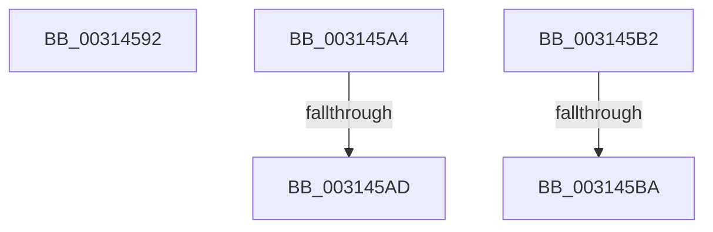

# sub_00314592

- RVA: `0x00314592`–`0x003145C5` (길이 `51` bytes)
- VA: `0x0000000140314592`
- 실행 섹션: `.text`
- PDB 이름 있음: `아니요`; PDB Function 태그: `아니요`
- unwind 정보 RVA: `0x00074764`
- 디코드: `12`개 명령, `51/51` bytes 표시
- 미해석 바이트: `0` (있으면 어셈블리에 `.byte`로 보존)

> 이 문서는 커널 이미지의 기계어와 PDB 기호를 분석해 생성했습니다. 4번과 5번은 함수 원형과 자료형을 바이너리 사용 방식에서 추정한 C 해석이며 원본 소스 복구 결과는 아닙니다.

## 1. Dependencies

- 직접 호출 지점: **1**; 고유 호출 대상: **1**
- 직접 호출자로 확인된 함수: **0**
- RIP 상대 이미지 참조: **0**

### Outgoing calls
- `0x0031459A` → [KiRaiseIrqlProcessIrqlFlags](../4F/KiRaiseIrqlProcessIrqlFlags_function_004F56FC.md) (function, `0x004F56FC`)

### Direct callers
- 이 함수 시작 RVA로 연결되는 직접 call은 확인되지 않았습니다. 간접 호출은 완전히 역산할 수 없습니다.

### Static image references
- 디코드된 RIP-relative 메모리 참조가 없습니다.

## 2. Other-region calls and transfers

- 다른 실행 섹션으로 향하는 call: **0**
- call이 아닌 외부 분기/꼬리 이동: **5**
  - `0x0031459F` → [sub_0031414C + 0x69](Unknown_function_0031414C.md) (`tail-transfer`)
  - `0x003145A7` → [sub_003143F3 + 0x80](Unknown_function_003143F3.md) (`tail-transfer`)
  - `0x003145AD` → [sub_003143F3 + 0x73](Unknown_function_003143F3.md) (`tail-transfer`)
  - `0x003145B4` → [sub_003143F3 + 0x3B](Unknown_function_003143F3.md) (`tail-transfer`)
  - `0x003145C0` → [sub_003143F3 + 0x41](Unknown_function_003143F3.md) (`tail-transfer`)

## 3. Assembly (complete function range)

```asm
00314592  40 0F B6 D5                     movzx edx, bpl
00314596  40 0F B6 CE                     movzx ecx, sil
0031459A  E8 5D 11 1E 00                  call 0x1404f56fc
0031459F  E9 11 FC FF FF                  jmp 0x1403141b5
003145A4  48 85 D2                        test rdx, rdx
003145A7  0F 84 C6 FE FF FF               je 0x140314473
003145AD  E9 B4 FE FF FF                  jmp 0x140314466
003145B2  85 FF                           test edi, edi
003145B4  0F 85 74 FE FF FF               jne 0x14031442e
003145BA  4D 8B CD                        mov r9, r13
003145BD  40 32 F6                        xor sil, sil
003145C0  E9 6F FE FF FF                  jmp 0x140314434
```

## 4. C-style interpretation (structured pseudocode)

```c
__int64 __fastcall sub_00314592(void)
{
    __int64 result;

    result = KiRaiseIrqlProcessIrqlFlags((unsigned __int8)(v_rsi), (unsigned __int8)(v_rbp), a3, a4);
}
```

## 5. (Beta) C Style

```c
void sub_00314592(void)
{
    int64_t result;

    result = KiRaiseIrqlProcessIrqlFlags((uint8_t)(local_rsi), (uint8_t)(local_rbp), a3, a4);
}
```

## 6. Execution-region graph

[열기: 2D/3D 그래프와 함수 탐색 컨트롤 패널](../../../control-panel.html?section=text&rva=0x00314592&view=graph)

- 2D 그래프는 위에서 아래로 흐르고, 3D 그래프는 빈 공간을 드래그해 회전합니다. Shift+드래그는 이동, 휠은 확대·축소, 함수 노드 선택은 대상 보고서 이동입니다.

### Static fallback


