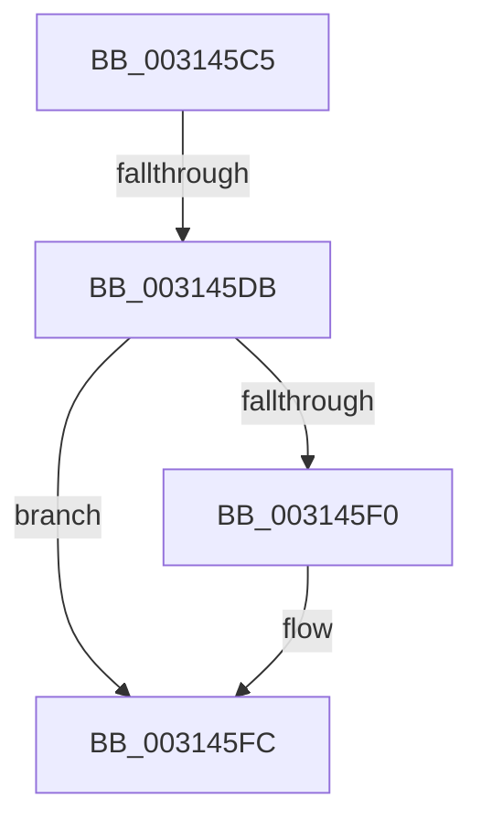

# sub_003145C5

- RVA: `0x003145C5`–`0x00314608` (길이 `67` bytes)
- VA: `0x00000001403145C5`
- 실행 섹션: `.text`
- PDB 이름 있음: `아니요`; PDB Function 태그: `아니요`
- unwind 정보 RVA: `0x00074780`
- 디코드: `17`개 명령, `67/67` bytes 표시
- 미해석 바이트: `0` (있으면 어셈블리에 `.byte`로 보존)

> 이 문서는 커널 이미지의 기계어와 PDB 기호를 분석해 생성했습니다. 4번과 5번은 함수 원형과 자료형을 바이너리 사용 방식에서 추정한 C 해석이며 원본 소스 복구 결과는 아닙니다.

## 1. Dependencies

- 직접 호출 지점: **2**; 고유 호출 대상: **2**
- 직접 호출자로 확인된 함수: **0**
- RIP 상대 이미지 참조: **1**

### Outgoing calls
- `0x003145E2` → [ExFlushTb](ExFlushTb_function_00312B34.md) (function, `0x00312B34`)
- `0x003145F7` → [KiLowerIrqlProcessIrqlFlags](../4F/KiLowerIrqlProcessIrqlFlags_function_004F5698.md) (function, `0x004F5698`)

### Direct callers
- 이 함수 시작 RVA로 연결되는 직접 call은 확인되지 않았습니다. 간접 호출은 완전히 역산할 수 없습니다.

### Static image references
- `0x003145D2` → RVA `0x00FC6D20` (`ALMOSTRO`; read)

## 2. Other-region calls and transfers

- 다른 실행 섹션으로 향하는 call: **0**
- call이 아닌 외부 분기/꼬리 이동: **2**
  - `0x003145D9` → [sub_00314657](Unknown_function_00314657.md) (`tail-transfer`)
  - `0x00314603` → [sub_003143E8](Unknown_function_003143E8.md) (`tail-transfer`)

## 3. Assembly (complete function range)

```asm
003145C5  44 0F 20 C3                     mov rbx, cr8
003145C9  B8 0F 00 00 00                  mov eax, 0xf
003145CE  44 0F 22 C0                     mov cr8, rax
003145D2  83 3D 47 27 CB 00 00            cmp dword ptr [rip + 0xcb2747], 0
003145D9  75 7C                           jne 0x140314657
003145DB  44 8B C7                        mov r8d, edi
003145DE  33 D2                           xor edx, edx
003145E0  33 C9                           xor ecx, ecx
003145E2  E8 4D E5 FF FF                  call 0x140312b34
003145E7  83 3D 32 27 CB 00 00            cmp dword ptr [rip + 0xcb2732], 0
003145EE  74 0C                           je 0x1403145fc
003145F0  44 0F 20 C1                     mov rcx, cr8
003145F4  0F B6 D3                        movzx edx, bl
003145F7  E8 9C 10 1E 00                  call 0x1404f5698
003145FC  0F B6 C3                        movzx eax, bl
003145FF  44 0F 22 C0                     mov cr8, rax
00314603  E9 E0 FD FF FF                  jmp 0x1403143e8
```

## 4. C-style interpretation (structured pseudocode)

```c
__int64 __fastcall sub_003145C5(int a1, int a2)
{
    __int64 result;

    a2 = 0;
    a1 = 0;
    result = ExFlushTb(a1, a2, (unsigned int)((unsigned int)(v_rdi)), a4);
    if ((*(unsigned int *)(v_rip + 13313842)) != 0) {
        a1 = 15;
        a2 = (unsigned __int8)(v_cr8);
        result = KiLowerIrqlProcessIrqlFlags(a1, a2, (unsigned int)((unsigned int)(v_rdi)), a4);
    }
}
```

## 5. (Beta) C Style

```c
int64_t sub_003145C5(int32_t Arg1, int32_t Arg2)
{
    int64_t result;

    Arg2 = 0;
    Arg1 = 0;
    result = ExFlushTb(Arg1, Arg2, (uint32_t)((uint32_t)(local_rdi)), a4);
    if ((*(uint32_t *)(v_rip + 0xCB2732)) != 0) {
        Arg1 = 15;
        Arg2 = (uint8_t)(v_cr8);
        result = KiLowerIrqlProcessIrqlFlags(Arg1, Arg2, (uint32_t)((uint32_t)(local_rdi)), a4);
    }
}
```

## 6. Execution-region graph

[열기: 2D/3D 그래프와 함수 탐색 컨트롤 패널](../../../control-panel.html?section=text&rva=0x003145C5&view=graph)

- 2D 그래프는 위에서 아래로 흐르고, 3D 그래프는 빈 공간을 드래그해 회전합니다. Shift+드래그는 이동, 휠은 확대·축소, 함수 노드 선택은 대상 보고서 이동입니다.

### Static fallback


