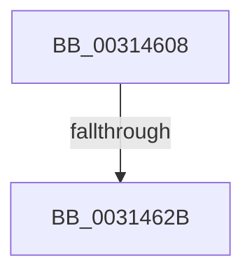

# sub_00314608

- RVA: `0x00314608`–`0x00314635` (길이 `45` bytes)
- VA: `0x0000000140314608`
- 실행 섹션: `.text`
- PDB 이름 있음: `아니요`; PDB Function 태그: `아니요`
- unwind 정보 RVA: `0x00074790`
- 디코드: `8`개 명령, `45/45` bytes 표시
- 미해석 바이트: `0` (있으면 어셈블리에 `.byte`로 보존)

> 이 문서는 커널 이미지의 기계어와 PDB 기호를 분석해 생성했습니다. 4번과 5번은 함수 원형과 자료형을 바이너리 사용 방식에서 추정한 C 해석이며 원본 소스 복구 결과는 아닙니다.

## 1. Dependencies

- 직접 호출 지점: **1**; 고유 호출 대상: **1**
- 직접 호출자로 확인된 함수: **0**
- RIP 상대 이미지 참조: **0**

### Outgoing calls
- `0x0031462B` → [KiSetUserTbFlushPending](../6B/KiSetUserTbFlushPending_function_006B20C0.md) (function, `0x006B20C0`)

### Direct callers
- 이 함수 시작 RVA로 연결되는 직접 call은 확인되지 않았습니다. 간접 호출은 완전히 역산할 수 없습니다.

### Static image references
- 디코드된 RIP-relative 메모리 참조가 없습니다.

## 2. Other-region calls and transfers

- 다른 실행 섹션으로 향하는 call: **0**
- call이 아닌 외부 분기/꼬리 이동: **2**
  - `0x00314625` → [sub_0031414C + 0xFE](Unknown_function_0031414C.md) (`tail-transfer`)
  - `0x00314630` → [sub_0031414C + 0xFE](Unknown_function_0031414C.md) (`tail-transfer`)

## 3. Assembly (complete function range)

```asm
00314608  0F 20 D8                        mov rax, cr3
0031460B  0F 22 D8                        mov cr3, rax
0031460E  65 48 8B 04 25 88 01 00 00      mov rax, qword ptr gs:[0x188]
00314617  48 8B 88 B8 00 00 00            mov rcx, qword ptr [rax + 0xb8]
0031461E  44 38 A9 60 01 00 00            cmp byte ptr [rcx + 0x160], r13b
00314625  0F 85 1F FC FF FF               jne 0x14031424a
0031462B  E8 90 DA 39 00                  call 0x1406b20c0
00314630  E9 15 FC FF FF                  jmp 0x14031424a
```

## 4. C-style interpretation (structured pseudocode)

```c
__int64 __fastcall sub_00314608(void)
{
    __int64 result;

    result = KiSetUserTbFlushPending(*(unsigned __int64 *)(*(unsigned __int64 *)(gs_base + (0 + 392)) + 184), a2, a3, a4);
}
```

## 5. (Beta) C Style

```c
void sub_00314608(void)
{
    int64_t result;

    result = KiSetUserTbFlushPending(*(uint64_t *)(*(uint64_t *)(gs_base + (0 + 0x188)) + 0xB8), a2, a3, a4);
}
```

## 6. Execution-region graph

[열기: 2D/3D 그래프와 함수 탐색 컨트롤 패널](../../../control-panel.html?section=text&rva=0x00314608&view=graph)

- 2D 그래프는 위에서 아래로 흐르고, 3D 그래프는 빈 공간을 드래그해 회전합니다. Shift+드래그는 이동, 휠은 확대·축소, 함수 노드 선택은 대상 보고서 이동입니다.

### Static fallback


