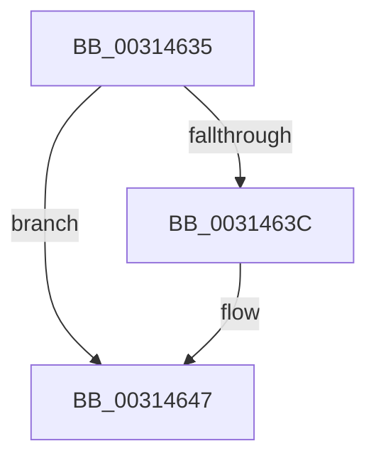

# sub_00314635

- RVA: `0x00314635`–`0x00314657` (길이 `34` bytes)
- VA: `0x0000000140314635`
- 실행 섹션: `.text`
- PDB 이름 있음: `아니요`; PDB Function 태그: `아니요`
- unwind 정보 RVA: `0x000747AC`
- 디코드: `9`개 명령, `34/34` bytes 표시
- 미해석 바이트: `0` (있으면 어셈블리에 `.byte`로 보존)

> 이 문서는 커널 이미지의 기계어와 PDB 기호를 분석해 생성했습니다. 4번과 5번은 함수 원형과 자료형을 바이너리 사용 방식에서 추정한 C 해석이며 원본 소스 복구 결과는 아닙니다.

## 1. Dependencies

- 직접 호출 지점: **2**; 고유 호출 대상: **2**
- 직접 호출자로 확인된 함수: **0**
- RIP 상대 이미지 참조: **0**

### Outgoing calls
- `0x00314642` → [VmpProcessInvalidateList](../42/VmpProcessInvalidateList_function_00428A54.md) (function, `0x00428A54`)
- `0x0031464D` → [VmpProcessContextUnlockExclusive](../48/VmpProcessContextUnlockExclusive_function_004894C8.md) (function, `0x004894C8`)

### Direct callers
- 이 함수 시작 RVA로 연결되는 직접 call은 확인되지 않았습니다. 간접 호출은 완전히 역산할 수 없습니다.

### Static image references
- 디코드된 RIP-relative 메모리 참조가 없습니다.

## 2. Other-region calls and transfers

- 다른 실행 섹션으로 향하는 call: **0**
- call이 아닌 외부 분기/꼬리 이동: **1**
  - `0x00314652` → [sub_003143B1 + 0xA](Unknown_function_003143B1.md) (`tail-transfer`)

## 3. Assembly (complete function range)

```asm
00314635  4D 39 6C 24 08                  cmp qword ptr [r12 + 8], r13
0031463A  74 0B                           je 0x140314647
0031463C  49 8B D4                        mov rdx, r12
0031463F  48 8B CE                        mov rcx, rsi
00314642  E8 0D 44 11 00                  call 0x140428a54
00314647  48 8B D5                        mov rdx, rbp
0031464A  48 8B CE                        mov rcx, rsi
0031464D  E8 76 4E 17 00                  call 0x1404894c8
00314652  E9 64 FD FF FF                  jmp 0x1403143bb
```

## 4. C-style interpretation (structured pseudocode)

```c
__int64 __fastcall sub_00314635(void)
{
    __int64 result;

    if ((*(unsigned __int64 *)(v_r12 + 8)) != v_r13) {
        a2 = v_r12;
        a1 = v_rsi;
        result = VmpProcessInvalidateList(a1, a2, a3, a4);
    }
    result = VmpProcessContextUnlockExclusive(v_rsi, v_rbp, a3, a4);
}
```

## 5. (Beta) C Style

```c
void sub_00314635(void)
{
    int64_t result;

    if ((*(uint64_t *)(local_r12 + 0x8)) != local_r13) {
        a2 = local_r12;
        a1 = local_rsi;
        result = VmpProcessInvalidateList(a1, a2, a3, a4);
    }
    result = VmpProcessContextUnlockExclusive(local_rsi, local_rbp, a3, a4);
}
```

## 6. Execution-region graph

[열기: 2D/3D 그래프와 함수 탐색 컨트롤 패널](../../../control-panel.html?section=text&rva=0x00314635&view=graph)

- 2D 그래프는 위에서 아래로 흐르고, 3D 그래프는 빈 공간을 드래그해 회전합니다. Shift+드래그는 이동, 휠은 확대·축소, 함수 노드 선택은 대상 보고서 이동입니다.

### Static fallback


