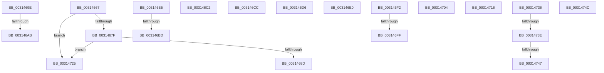

# sub_00314667

- RVA: `0x00314667`–`0x00314756` (길이 `239` bytes)
- VA: `0x0000000140314667`
- 실행 섹션: `.text`
- PDB 이름 있음: `아니요`; PDB Function 태그: `아니요`
- unwind 정보 RVA: `0x000747DC`
- 디코드: `53`개 명령, `239/239` bytes 표시
- 미해석 바이트: `0` (있으면 어셈블리에 `.byte`로 보존)

> 이 문서는 커널 이미지의 기계어와 PDB 기호를 분석해 생성했습니다. 4번과 5번은 함수 원형과 자료형을 바이너리 사용 방식에서 추정한 C 해석이며 원본 소스 복구 결과는 아닙니다.

## 1. Dependencies

- 직접 호출 지점: **10**; 고유 호출 대상: **8**
- 직접 호출자로 확인된 함수: **0**
- RIP 상대 이미지 참조: **3**

### Outgoing calls
- `0x00314694` → [HvlpFastFlushAddressSpaceTbEx](../30/HvlpFastFlushAddressSpaceTbEx_function_003065B4.md) (function, `0x003065B4`)
- `0x0031469E` → [KiIsFlushEntire](../30/KiIsFlushEntire_function_00309498.md) (function, `0x00309498`)
- `0x003146C2` → [KxFlushEntireTb](../30/KxFlushEntireTb_function_00309094.md) (function, `0x00309094`)
- `0x003146CC` → [HvlpSlowFlushAddressSpaceTb](../44/HvlpSlowFlushAddressSpaceTb_function_004402C4.md) (function, `0x004402C4`)
- `0x003146D6` → [HvlpSlowFlushAddressSpaceTb](../44/HvlpSlowFlushAddressSpaceTb_function_004402C4.md) (function, `0x004402C4`)
- `0x003146E8` → [KiLowerIrqlProcessIrqlFlags](../4F/KiLowerIrqlProcessIrqlFlags_function_004F5698.md) (function, `0x004F5698`)
- `0x0031470C` → [KiLowerIrqlProcessIrqlFlags](../4F/KiLowerIrqlProcessIrqlFlags_function_004F5698.md) (function, `0x004F5698`)
- `0x0031471B` → [KiRaiseIrqlProcessIrqlFlags](../4F/KiRaiseIrqlProcessIrqlFlags_function_004F56FC.md) (function, `0x004F56FC`)
- `0x0031472C` → [HvlpSlowFlushAddressSpaceTbEx](../6A/HvlpSlowFlushAddressSpaceTbEx_function_006A7D48.md) (function, `0x006A7D48`)
- `0x0031474C` → [VslFlushSecureAddressSpace](../4B/VslFlushSecureAddressSpace_function_004BC6FC.md) (function, `0x004BC6FC`)

### Direct callers
- 이 함수 시작 RVA로 연결되는 직접 call은 확인되지 않았습니다. 간접 호출은 완전히 역산할 수 없습니다.

### Static image references
- `0x00314667` → RVA `0x00FC6A90` (`ALMOSTRO`; read)
- `0x0031467F` → RVA `0x00FC6AB8` (`ALMOSTRO`; read)
- `0x003146F2` → RVA `0x00FC6A87` (`ALMOSTRO`; read)

## 2. Other-region calls and transfers

- 다른 실행 섹션으로 향하는 call: **0**
- call이 아닌 외부 분기/꼬리 이동: **18**
  - `0x00314699` → [sub_0031414C + 0x132](Unknown_function_0031414C.md) (`tail-transfer`)
  - `0x003146A5` → [sub_0031414C + 0x33](Unknown_function_0031414C.md) (`tail-transfer`)
  - `0x003146B0` → [sub_003143F3 + 0x29](Unknown_function_003143F3.md) (`tail-transfer`)
  - `0x003146B7` → [sub_003143F3 + 0x9](Unknown_function_003143F3.md) (`tail-transfer`)
  - `0x003146BD` → [sub_0031414C + 0xD3](Unknown_function_0031414C.md) (`tail-transfer`)
  - `0x003146C7` → [sub_0031414C + 0x154](Unknown_function_0031414C.md) (`tail-transfer`)
  - `0x003146D1` → [sub_0031414C + 0x132](Unknown_function_0031414C.md) (`tail-transfer`)
  - `0x003146DB` → [sub_003143F3 + 0x126](Unknown_function_003143F3.md) (`tail-transfer`)
  - `0x003146ED` → [sub_003143F3 + 0x21](Unknown_function_003143F3.md) (`tail-transfer`)
  - `0x003146F9` → [sub_00314608](Unknown_function_00314608.md) (`tail-transfer`)
  - `0x003146FF` → [sub_0031414C + 0xE0](Unknown_function_0031414C.md) (`tail-transfer`)
  - `0x00314711` → [sub_0031414C + 0x10B](Unknown_function_0031414C.md) (`tail-transfer`)
  - `0x00314720` → [sub_003143F3 + 0xFB](Unknown_function_003143F3.md) (`tail-transfer`)
  - `0x00314731` → [sub_0031414C + 0x132](Unknown_function_0031414C.md) (`tail-transfer`)
  - `0x00314738` → [sub_006E122E](../6E/Unknown_function_006E122E.md) (`tail-transfer`)
  - `0x00314741` → [sub_0031414C + 0x12B](Unknown_function_0031414C.md) (`tail-transfer`)
  - `0x00314747` → [sub_006E122E](../6E/Unknown_function_006E122E.md) (`tail-transfer`)
  - `0x00314751` → [sub_0031414C + 0x154](Unknown_function_0031414C.md) (`tail-transfer`)

## 3. Assembly (complete function range)

```asm
00314667  8B 05 23 24 CB 00               mov eax, dword ptr [rip + 0xcb2423]
0031466D  C1 E8 08                        shr eax, 8
00314670  83 E0 0F                        and eax, 0xf
00314673  83 C0 05                        add eax, 5
00314676  83 F8 0E                        cmp eax, 0xe
00314679  0F 87 A6 00 00 00               ja 0x140314725
0031467F  8B 05 33 24 CB 00               mov eax, dword ptr [rip + 0xcb2433]
00314685  84 C0                           test al, al
00314687  0F 89 98 00 00 00               jns 0x140314725
0031468D  44 0F B6 C6                     movzx r8d, sil
00314691  49 8B C9                        mov rcx, r9
00314694  E8 1B 1F FF FF                  call 0x1403065b4
00314699  E9 E0 FB FF FF                  jmp 0x14031427e
0031469E  E8 F5 4D FF FF                  call 0x140309498
003146A3  84 C0                           test al, al
003146A5  0F 84 D4 FA FF FF               je 0x14031417f
003146AB  BD 0C 00 00 00                  mov ebp, 0xc
003146B0  E9 67 FD FF FF                  jmp 0x14031441c
003146B5  85 FF                           test edi, edi
003146B7  0F 84 3F FD FF FF               je 0x1403143fc
003146BD  E9 5D FB FF FF                  jmp 0x14031421f
003146C2  E8 CD 49 FF FF                  call 0x140309094
003146C7  E9 D4 FB FF FF                  jmp 0x1403142a0
003146CC  E8 F3 BB 12 00                  call 0x1404402c4
003146D1  E9 A8 FB FF FF                  jmp 0x14031427e
003146D6  E8 E9 BB 12 00                  call 0x1404402c4
003146DB  E9 39 FE FF FF                  jmp 0x140314519
003146E0  44 0F 20 C1                     mov rcx, cr8
003146E4  40 0F B6 D6                     movzx edx, sil
003146E8  E8 AB 0F 1E 00                  call 0x1404f5698
003146ED  E9 22 FD FF FF                  jmp 0x140314414
003146F2  44 38 2D 8E 23 CB 00            cmp byte ptr [rip + 0xcb238e], r13b
003146F9  0F 85 09 FF FF FF               jne 0x140314608
003146FF  E9 28 FB FF FF                  jmp 0x14031422c
00314704  44 0F 20 C1                     mov rcx, cr8
00314708  40 0F B6 D6                     movzx edx, sil
0031470C  E8 87 0F 1E 00                  call 0x1404f5698
00314711  E9 41 FB FF FF                  jmp 0x140314257
00314716  B2 0C                           mov dl, 0xc
00314718  0F B6 CB                        movzx ecx, bl
0031471B  E8 DC 0F 1E 00                  call 0x1404f56fc
00314720  E9 C9 FD FF FF                  jmp 0x1403144ee
00314725  44 0F B6 C6                     movzx r8d, sil
00314729  49 8B C9                        mov rcx, r9
0031472C  E8 17 36 39 00                  call 0x1406a7d48
00314731  E9 48 FB FF FF                  jmp 0x14031427e
00314736  85 FF                           test edi, edi
00314738  0F 84 F0 CA 3C 00               je 0x1406e122e
0031473E  83 FF 01                        cmp edi, 1
00314741  0F 84 30 FB FF FF               je 0x140314277
00314747  E9 E2 CA 3C 00                  jmp 0x1406e122e
0031474C  E8 AB 7F 1A 00                  call 0x1404bc6fc
00314751  E9 4A FB FF FF                  jmp 0x1403142a0
```

## 4. C-style interpretation (structured pseudocode)

```c
__int64 __fastcall sub_00314667(__int64 a1, __int64 a2, __int64 a3, __int64 a4)
{
    __int64 result;

    result = (unsigned int)(((unsigned int)(*(unsigned int *)(v_rip + 13313059))) >> (8));
    result = (unsigned int)((result) & (15));
    result = (unsigned int)((result) + (5));
    if (((unsigned int)(result)) > 14) goto loc_00314725;
    if (!sign_flag) goto loc_00314725;
    result = HvlpFastFlushAddressSpaceTbEx(a4, a2, (unsigned __int8)(v_rsi), a4);
loc_00314725:
    result = HvlpSlowFlushAddressSpaceTbEx(a4, a2, (unsigned __int8)(v_rsi), a4);
}
```

## 5. (Beta) C Style

```c
int64_t sub_00314667(int64_t Arg1, int64_t Arg2, int64_t Arg3, int64_t Arg4)
{
    int64_t result;

    result = (uint32_t)(((uint32_t)(*(uint32_t *)(v_rip + 0xCB2423))) >> (8));
    result = (uint32_t)((result) & (15));
    result = (uint32_t)((result) + (5));
    if (((uint32_t)(result)) > 14) goto loc_00314725;
    if (!sign_flag) goto loc_00314725;
    result = HvlpFastFlushAddressSpaceTbEx(Arg4, Arg2, (uint8_t)(local_rsi), Arg4);
loc_00314725:
    result = HvlpSlowFlushAddressSpaceTbEx(Arg4, Arg2, (uint8_t)(local_rsi), Arg4);
}
```

## 6. Execution-region graph

[열기: 2D/3D 그래프와 함수 탐색 컨트롤 패널](../../../control-panel.html?section=text&rva=0x00314667&view=graph)

- 2D 그래프는 위에서 아래로 흐르고, 3D 그래프는 빈 공간을 드래그해 회전합니다. Shift+드래그는 이동, 휠은 확대·축소, 함수 노드 선택은 대상 보고서 이동입니다.

### Static fallback


