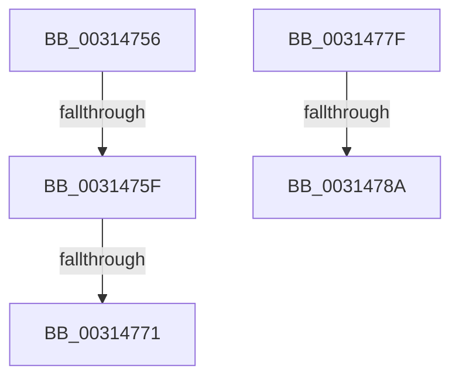

# sub_00314756

- RVA: `0x00314756`–`0x0031479B` (길이 `69` bytes)
- VA: `0x0000000140314756`
- 실행 섹션: `.text`
- PDB 이름 있음: `아니요`; PDB Function 태그: `아니요`
- unwind 정보 RVA: `0x000747F8`
- 디코드: `16`개 명령, `69/69` bytes 표시
- 미해석 바이트: `0` (있으면 어셈블리에 `.byte`로 보존)

> 이 문서는 커널 이미지의 기계어와 PDB 기호를 분석해 생성했습니다. 4번과 5번은 함수 원형과 자료형을 바이너리 사용 방식에서 추정한 C 해석이며 원본 소스 복구 결과는 아닙니다.

## 1. Dependencies

- 직접 호출 지점: **3**; 고유 호출 대상: **3**
- 직접 호출자로 확인된 함수: **0**
- RIP 상대 이미지 참조: **0**

### Outgoing calls
- `0x00314764` → [tlgKeywordOn](../42/tlgKeywordOn_function_0042EAA0.md) (function, `0x0042EAA0`)
- `0x00314775` → [VmpLogTbFlushSlatFlushEntire](../64/VmpLogTbFlushSlatFlushEntire_function_0064DD64.md) (function, `0x0064DD64`)
- `0x00314790` → [VmpProcessInvalidateList](../42/VmpProcessInvalidateList_function_00428A54.md) (function, `0x00428A54`)

### Direct callers
- 이 함수 시작 RVA로 연결되는 직접 call은 확인되지 않았습니다. 간접 호출은 완전히 역산할 수 없습니다.

### Static image references
- 디코드된 RIP-relative 메모리 참조가 없습니다.

## 2. Other-region calls and transfers

- 다른 실행 섹션으로 향하는 call: **0**
- call이 아닌 외부 분기/꼬리 이동: **5**
  - `0x00314759` → [sub_003142E3 + 0x4F](Unknown_function_003142E3.md) (`tail-transfer`)
  - `0x0031476B` → [sub_003142E3 + 0x4F](Unknown_function_003142E3.md) (`tail-transfer`)
  - `0x0031477A` → [sub_003142E3 + 0x4F](Unknown_function_003142E3.md) (`tail-transfer`)
  - `0x00314784` → [sub_006E123B](../6E/Unknown_function_006E123B.md) (`tail-transfer`)
  - `0x00314796` → [sub_006E123B](../6E/Unknown_function_006E123B.md) (`tail-transfer`)

## 3. Assembly (complete function range)

```asm
00314756  44 39 29                        cmp dword ptr [rcx], r13d
00314759  0F 86 D3 FB FF FF               jbe 0x140314332
0031475F  BA 00 01 00 00                  mov edx, 0x100
00314764  E8 37 A3 11 00                  call 0x14042eaa0
00314769  84 C0                           test al, al
0031476B  0F 84 C1 FB FF FF               je 0x140314332
00314771  48 8B 56 68                     mov rdx, qword ptr [rsi + 0x68]
00314775  E8 EA 95 33 00                  call 0x14064dd64
0031477A  E9 B3 FB FF FF                  jmp 0x140314332
0031477F  4D 39 6C 24 08                  cmp qword ptr [r12 + 8], r13
00314784  0F 84 B1 CA 3C 00               je 0x1406e123b
0031478A  49 8B D4                        mov rdx, r12
0031478D  48 8B CE                        mov rcx, rsi
00314790  E8 BF 42 11 00                  call 0x140428a54
00314795  90                              nop
00314796  E9 A0 CA 3C 00                  jmp 0x1406e123b
```

## 4. C-style interpretation (structured pseudocode)

```c
__int64 __fastcall sub_00314756(__int64 a1)
{
    __int64 result;

    result = tlgKeywordOn(a1, 256, a3, a4);
    result = VmpLogTbFlushSlatFlushEntire(a1, *(unsigned __int64 *)(v_rsi + 104), a3, a4);
}
```

## 5. (Beta) C Style

```c
int64_t sub_00314756(void *Arg1)
{
    uint8_t *arg1 = (uint8_t *)Arg1;

    int64_t result;

    result = tlgKeywordOn(Arg1, 256, a3, a4);
    result = VmpLogTbFlushSlatFlushEntire(Arg1, *(uint64_t *)(local_rsi + 0x68), a3, a4);
}
```

### 관측된 메모리 오프셋

구조체 형식이 확인되지 않은 접근은 인자 기준의 오프셋으로만 기록했습니다.

| 기준 인자 | 오프셋 표현 | 폭 (bit) | 접근 |
|---|---:|---:|---|
| `Arg1` | `+ 0x0` | `32` | `R` |

## 6. Execution-region graph

[열기: 2D/3D 그래프와 함수 탐색 컨트롤 패널](../../../control-panel.html?section=text&rva=0x00314756&view=graph)

- 2D 그래프는 위에서 아래로 흐르고, 3D 그래프는 빈 공간을 드래그해 회전합니다. Shift+드래그는 이동, 휠은 확대·축소, 함수 노드 선택은 대상 보고서 이동입니다.

### Static fallback


