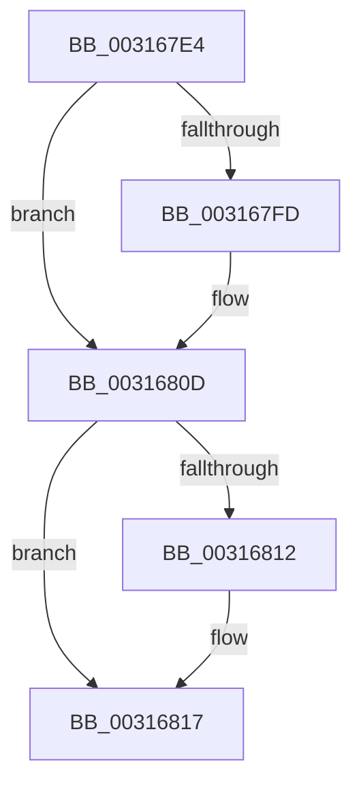

# sub_003167E4

- RVA: `0x003167E4`–`0x00316832` (길이 `78` bytes)
- VA: `0x00000001403167E4`
- 실행 섹션: `.text`
- PDB 이름 있음: `아니요`; PDB Function 태그: `아니요`
- unwind 정보 RVA: `0x00074994`
- 디코드: `20`개 명령, `78/78` bytes 표시
- 미해석 바이트: `0` (있으면 어셈블리에 `.byte`로 보존)

> 이 문서는 커널 이미지의 기계어와 PDB 기호를 분석해 생성했습니다. 4번과 5번은 함수 원형과 자료형을 바이너리 사용 방식에서 추정한 C 해석이며 원본 소스 복구 결과는 아닙니다.

## 1. Dependencies

- 직접 호출 지점: **2**; 고유 호출 대상: **2**
- 직접 호출자로 확인된 함수: **0**
- RIP 상대 이미지 참조: **0**

### Outgoing calls
- `0x003167EC` → [KeAbPreAcquire](../21/KeAbPreAcquire_function_00210230.md) (function, `0x00210230`)
- `0x00316808` → [ExfAcquirePushLockExclusiveEx](../20/ExfAcquirePushLockExclusiveEx_function_0020FC90.md) (function, `0x0020FC90`)

### Direct callers
- 이 함수 시작 RVA로 연결되는 직접 call은 확인되지 않았습니다. 간접 호출은 완전히 역산할 수 없습니다.

### Static image references
- 디코드된 RIP-relative 메모리 참조가 없습니다.

## 2. Other-region calls and transfers

- 다른 실행 섹션으로 향하는 call: **0**
- call이 아닌 외부 분기/꼬리 이동: **1**
  - `0x0031682D` → [MiObtainReferencedVadEx + 0xD5](MiObtainReferencedVadEx_function_00316690.md) (`tail-transfer`)

## 3. Assembly (complete function range)

```asm
003167E4  4C 89 7C 24 50                  mov qword ptr [rsp + 0x50], r15
003167E9  33 D2                           xor edx, edx
003167EB  90                              nop
003167EC  E8 3F 9A EF FF                  call 0x140210230
003167F1  F0 48 0F BA 6B 28 00            lock bts qword ptr [rbx + 0x28], 0
003167F8  4C 8B F8                        mov r15, rax
003167FB  73 10                           jae 0x14031680d
003167FD  4C 8D 43 28                     lea r8, [rbx + 0x28]
00316801  48 8B D0                        mov rdx, rax
00316804  48 8D 4B 28                     lea rcx, [rbx + 0x28]
00316808  E8 83 94 EF FF                  call 0x14020fc90
0031680D  4D 85 FF                        test r15, r15
00316810  74 05                           je 0x140316817
00316812  41 C6 47 0A 01                  mov byte ptr [r15 + 0xa], 1
00316817  8B 87 A8 05 00 00               mov eax, dword ptr [rdi + 0x5a8]
0031681D  4C 8B 7C 24 50                  mov r15, qword ptr [rsp + 0x50]
00316822  0F BA E8 07                     bts eax, 7
00316826  89 87 A8 05 00 00               mov dword ptr [rdi + 0x5a8], eax
0031682C  90                              nop
0031682D  E9 33 FF FF FF                  jmp 0x140316765
```

## 4. C-style interpretation (structured pseudocode)

```c
__int64 __fastcall sub_003167E4(__int64 a1, int a2, __int64 a3, __int64 a4, __int64 a5, __int64 a6, __int64 a7, __int64 a8, __int64 a9, __int64 a10)
{
    __int64 result;
    unsigned __int64 v_stack_p50;

    v_stack_p50 = v_r15;
    a2 = 0;
    result = KeAbPreAcquire(a1, a2, a3, a4);
    if (!(condition_is_above_or_equal)) {
        a3 = v_rbx + 40;
        a2 = result;
        a1 = v_rbx + 40;
        result = ExfAcquirePushLockExclusiveEx(a1, a2, a3, a4);
    }
    if (result != 0) {
        *(unsigned __int8 *)(result + 10) = 1;
    }
    *(unsigned int *)(v_rdi + 1448) = (unsigned int)((unsigned int)(*(unsigned int *)(v_rdi + 1448)));
}
```

## 5. (Beta) C Style

```c
int64_t sub_003167E4(int64_t Arg1, int32_t Arg2, int64_t Arg3, int64_t Arg4, uint64_t Arg5, uint64_t Arg6, uint64_t Arg7, uint64_t Arg8, uint64_t Arg9, int64_t Arg10)
{
    int64_t result;
    uint64_t v_stack_p50;

    v_stack_p50 = local_r15;
    Arg2 = 0;
    result = KeAbPreAcquire(Arg1, Arg2, Arg3, Arg4);
    if (!(condition_is_above_or_equal)) {
        Arg3 = local_rbx + 40;
        Arg2 = result;
        Arg1 = local_rbx + 40;
        result = ExfAcquirePushLockExclusiveEx(Arg1, Arg2, Arg3, Arg4);
    }
    if (result != 0) {
        *(uint8_t *)(result + 0xA) = 1;
    }
    *(uint32_t *)(local_rdi + 0x5A8) = (uint32_t)((uint32_t)(*(uint32_t *)(local_rdi + 0x5A8)));
}
```

## 6. Execution-region graph

[열기: 2D/3D 그래프와 함수 탐색 컨트롤 패널](../../../control-panel.html?section=text&rva=0x003167E4&view=graph)

- 2D 그래프는 위에서 아래로 흐르고, 3D 그래프는 빈 공간을 드래그해 회전합니다. Shift+드래그는 이동, 휠은 확대·축소, 함수 노드 선택은 대상 보고서 이동입니다.

### Static fallback


