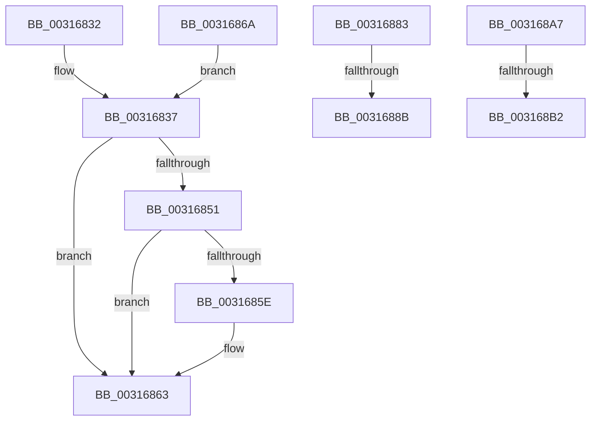

# sub_00316832

- RVA: `0x00316832`–`0x003168BD` (길이 `139` bytes)
- VA: `0x0000000140316832`
- 실행 섹션: `.text`
- PDB 이름 있음: `아니요`; PDB Function 태그: `아니요`
- unwind 정보 RVA: `0x000749A8`
- 디코드: `37`개 명령, `139/139` bytes 표시
- 미해석 바이트: `0` (있으면 어셈블리에 `.byte`로 보존)

> 이 문서는 커널 이미지의 기계어와 PDB 기호를 분석해 생성했습니다. 4번과 5번은 함수 원형과 자료형을 바이너리 사용 방식에서 추정한 C 해석이며 원본 소스 복구 결과는 아닙니다.

## 1. Dependencies

- 직접 호출 지점: **5**; 고유 호출 대상: **5**
- 직접 호출자로 확인된 함수: **0**
- RIP 상대 이미지 참조: **0**

### Outgoing calls
- `0x00316841` → [MiUnlockVadTree](../29/MiUnlockVadTree_function_00297020.md) (function, `0x00297020`)
- `0x0031685E` → [KiCheckForKernelApcDelivery](../2E/KiCheckForKernelApcDelivery_function_002E2C80.md) (function, `0x002E2C80`)
- `0x00316891` → [MiUnlockVadShared](../2E/MiUnlockVadShared_function_002E2420.md) (function, `0x002E2420`)
- `0x0031689C` → [MiLockVad](../29/MiLockVad_function_00295810.md) (function, `0x00295810`)
- `0x003168B2` → [MiUnlockAndDereferenceVadShared](../2A/MiUnlockAndDereferenceVadShared_function_002AEF10.md) (function, `0x002AEF10`)

### Direct callers
- 이 함수 시작 RVA로 연결되는 직접 call은 확인되지 않았습니다. 간접 호출은 완전히 역산할 수 없습니다.

### Static image references
- 디코드된 RIP-relative 메모리 참조가 없습니다.

## 2. Other-region calls and transfers

- 다른 실행 섹션으로 향하는 call: **0**
- call이 아닌 외부 분기/꼬리 이동: **5**
  - `0x00316865` → [MiObtainReferencedVadEx + 0x12E](MiObtainReferencedVadEx_function_00316690.md) (`tail-transfer`)
  - `0x00316885` → [sub_006E13DC](../6E/Unknown_function_006E13DC.md) (`tail-transfer`)
  - `0x003168A2` → [sub_006E13DC](../6E/Unknown_function_006E13DC.md) (`tail-transfer`)
  - `0x003168AC` → [sub_006E13DC + 0x2F](../6E/Unknown_function_006E13DC.md) (`tail-transfer`)
  - `0x003168B8` → [sub_006E13DC + 0x34](../6E/Unknown_function_006E13DC.md) (`tail-transfer`)

## 3. Assembly (complete function range)

```asm
00316832  B8 0A 01 00 C0                  mov eax, 0xc000010a
00316837  41 0F B6 D6                     movzx edx, r14b
0031683B  41 89 04 24                     mov dword ptr [r12], eax
0031683F  33 C9                           xor ecx, ecx
00316841  E8 DA 07 F8 FF                  call 0x140297020
00316846  90                              nop
00316847  66 83 87 E6 01 00 00 01         add word ptr [rdi + 0x1e6], 1
0031684F  75 12                           jne 0x140316863
00316851  48 8D 87 98 00 00 00            lea rax, [rdi + 0x98]
00316858  90                              nop
00316859  48 39 00                        cmp qword ptr [rax], rax
0031685C  74 05                           je 0x140316863
0031685E  E8 1D C4 FC FF                  call 0x1402e2c80
00316863  33 C0                           xor eax, eax
00316865  E9 54 FF FF FF                  jmp 0x1403167be
0031686A  41 8B 8D F4 01 00 00            mov ecx, dword ptr [r13 + 0x1f4]
00316871  B8 0A 01 00 C0                  mov eax, 0xc000010a
00316876  F6 C1 20                        test cl, 0x20
00316879  B9 A0 00 00 C0                  mov ecx, 0xc00000a0
0031687E  0F 44 C1                        cmove eax, ecx
00316881  EB B4                           jmp 0x140316837
00316883  85 ED                           test ebp, ebp
00316885  0F 84 51 AB 3C 00               je 0x1406e13dc
0031688B  48 8B D3                        mov rdx, rbx
0031688E  48 8B CF                        mov rcx, rdi
00316891  E8 8A BB FC FF                  call 0x1402e2420
00316896  48 8B D3                        mov rdx, rbx
00316899  48 8B CF                        mov rcx, rdi
0031689C  E8 6F EF F7 FF                  call 0x140295810
003168A1  90                              nop
003168A2  E9 35 AB 3C 00                  jmp 0x1406e13dc
003168A7  48 8B CB                        mov rcx, rbx
003168AA  85 ED                           test ebp, ebp
003168AC  0F 84 59 AB 3C 00               je 0x1406e140b
003168B2  E8 59 86 F9 FF                  call 0x1402aef10
003168B7  90                              nop
003168B8  E9 53 AB 3C 00                  jmp 0x1406e1410
```

## 4. C-style interpretation (structured pseudocode)

```c
__int64 __fastcall sub_00316832(int a1)
{
    __int64 result;

loc_00316837:
    *(unsigned int *)(v_r12) = (unsigned int)((unsigned int)(0xC000010AULL));
    a1 = 0;
    result = MiUnlockVadTree(a1, (unsigned __int8)(v_r14), a3, a4);
    if (condition_is_not_equal) goto loc_00316863;
    result = v_rdi + 152;
    if ((*(unsigned __int64 *)(v_rdi + 152)) != (v_rdi + 152)) {
        result = KiCheckForKernelApcDelivery(a1, (unsigned __int8)(v_r14), a3, a4);
    }
    result = 0;
}
```

## 5. (Beta) C Style

```c
int64_t sub_00316832(int32_t Arg1)
{
    int64_t result;

loc_00316837:
    *(uint32_t *)(local_r12) = (uint32_t)((uint32_t)(0xC000010AULL));
    Arg1 = 0;
    result = MiUnlockVadTree(Arg1, (uint8_t)(local_r14), a3, a4);
    if (condition_is_not_equal) goto loc_00316863;
    result = local_rdi + 152;
    if ((*(uint64_t *)(local_rdi + 0x98)) != (local_rdi + 152)) {
        result = KiCheckForKernelApcDelivery(Arg1, (uint8_t)(local_r14), a3, a4);
    }
    result = 0;
}
```

## 6. Execution-region graph

[열기: 2D/3D 그래프와 함수 탐색 컨트롤 패널](../../../control-panel.html?section=text&rva=0x00316832&view=graph)

- 2D 그래프는 위에서 아래로 흐르고, 3D 그래프는 빈 공간을 드래그해 회전합니다. Shift+드래그는 이동, 휠은 확대·축소, 함수 노드 선택은 대상 보고서 이동입니다.

### Static fallback


