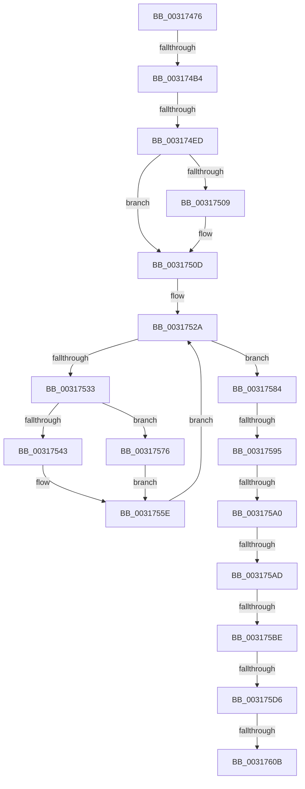

# sub_00317476

- RVA: `0x00317476`–`0x0031763B` (길이 `453` bytes)
- VA: `0x0000000140317476`
- 실행 섹션: `.text`
- PDB 이름 있음: `아니요`; PDB Function 태그: `아니요`
- unwind 정보 RVA: `0x00074A58`
- 디코드: `123`개 명령, `453/453` bytes 표시
- 미해석 바이트: `0` (있으면 어셈블리에 `.byte`로 보존)

> 이 문서는 커널 이미지의 기계어와 PDB 기호를 분석해 생성했습니다. 4번과 5번은 함수 원형과 자료형을 바이너리 사용 방식에서 추정한 C 해석이며 원본 소스 복구 결과는 아닙니다.

## 1. Dependencies

- 직접 호출 지점: **2**; 고유 호출 대상: **2**
- 직접 호출자로 확인된 함수: **0**
- RIP 상대 이미지 참조: **0**

### Outgoing calls
- `0x00317567` → [SMKM_STORE_MGR<SM_TRAITS>::SmWorkItemFreeResource](SMKM_STORE_MGR_SM_TRAITS_SmWorkItemFreeResource_function_003179B4.md) (function, `0x003179B4`)
- `0x0031761F` → [SmWorkItemQueue](SmWorkItemQueue_function_0031799C.md) (function, `0x0031799C`)

### Direct callers
- 이 함수 시작 RVA로 연결되는 직접 call은 확인되지 않았습니다. 간접 호출은 완전히 역산할 수 없습니다.

### Static image references
- 디코드된 RIP-relative 메모리 참조가 없습니다.

## 2. Other-region calls and transfers

- 다른 실행 섹션으로 향하는 call: **0**
- call이 아닌 외부 분기/꼬리 이동: **9**
  - `0x003174AE` → [sub_003176F1](Unknown_function_003176F1.md) (`tail-transfer`)
  - `0x003174E7` → [sub_00317914 + 0x6B](Unknown_function_00317914.md) (`tail-transfer`)
  - `0x0031758F` → [sub_003176F1 + 0x1A8](Unknown_function_003176F1.md) (`tail-transfer`)
  - `0x0031759A` → [sub_003176F1 + 0x197](Unknown_function_003176F1.md) (`tail-transfer`)
  - `0x003175A7` → [sub_003176F1 + 0x74](Unknown_function_003176F1.md) (`tail-transfer`)
  - `0x003175B8` → [sub_003176F1 + 0x6C](Unknown_function_003176F1.md) (`tail-transfer`)
  - `0x003175D0` → [sub_003176CF](Unknown_function_003176CF.md) (`tail-transfer`)
  - `0x00317605` → [sub_003176F1 + 0x1A0](Unknown_function_003176F1.md) (`tail-transfer`)
  - `0x00317639` → [sub_0031763B + 0x1E](Unknown_function_0031763B.md) (`tail-transfer`)

## 3. Assembly (complete function range)

```asm
00317476  4C 89 70 C8                     mov qword ptr [rax - 0x38], r14
0031747A  0F 57 C0                        xorps xmm0, xmm0
0031747D  45 8B 31                        mov r14d, dword ptr [r9]
00317480  48 8D 45 FF                     lea rax, [rbp - 1]
00317484  41 83 E6 07                     and r14d, 7
00317488  48 89 45 07                     mov qword ptr [rbp + 7], rax
0031748C  4C 89 45 FF                     mov qword ptr [rbp - 1], r8
00317490  49 8B F9                        mov rdi, r9
00317493  44 89 75 D7                     mov dword ptr [rbp - 0x29], r14d
00317497  41 8B D8                        mov ebx, r8d
0031749A  48 89 55 E7                     mov qword ptr [rbp - 0x19], rdx
0031749E  45 8B E8                        mov r13d, r8d
003174A1  4C 89 45 DF                     mov qword ptr [rbp - 0x21], r8
003174A5  F3 0F 7F 45 0F                  movdqu xmmword ptr [rbp + 0xf], xmm0
003174AA  41 83 FE 02                     cmp r14d, 2
003174AE  0F 84 3D 02 00 00               je 0x1403176f1
003174B4  4C 8B 75 67                     mov r14, qword ptr [rbp + 0x67]
003174B8  48 8B 0A                        mov rcx, qword ptr [rdx]
003174BB  8B 07                           mov eax, dword ptr [rdi]
003174BD  48 83 E1 F8                     and rcx, 0xfffffffffffffff8
003174C1  83 E0 07                        and eax, 7
003174C4  48 83 C1 08                     add rcx, 8
003174C8  48 0B C8                        or rcx, rax
003174CB  48 89 0F                        mov qword ptr [rdi], rcx
003174CE  8B 02                           mov eax, dword ptr [rdx]
003174D0  83 E0 07                        and eax, 7
003174D3  48 0B C7                        or rax, rdi
003174D6  48 89 02                        mov qword ptr [rdx], rax
003174D9  48 8D 45 DF                     lea rax, [rbp - 0x21]
003174DD  48 8B D7                        mov rdx, rdi
003174E0  48 89 55 E7                     mov qword ptr [rbp - 0x19], rdx
003174E4  48 3B F8                        cmp rdi, rax
003174E7  0F 84 92 04 00 00               je 0x14031797f
003174ED  0F 10 45 DF                     movups xmm0, xmmword ptr [rbp - 0x21]
003174F1  48 8D 55 DF                     lea rdx, [rbp - 0x21]
003174F5  4C 89 45 DF                     mov qword ptr [rbp - 0x21], r8
003174F9  48 89 55 E7                     mov qword ptr [rbp - 0x19], rdx
003174FD  4D 8B C8                        mov r9, r8
00317500  0F 11 45 FF                     movups xmmword ptr [rbp - 1], xmm0
00317504  48 85 DB                        test rbx, rbx
00317507  74 04                           je 0x14031750d
00317509  4C 89 6D 0F                     mov qword ptr [rbp + 0xf], r13
0031750D  48 85 DB                        test rbx, rbx
00317510  4C 89 75 17                     mov qword ptr [rbp + 0x17], r14
00317514  49 8B C0                        mov rax, r8
00317517  4D 8D A7 A8 06 00 00            lea r12, [r15 + 0x6a8]
0031751E  48 0F 44 C3                     cmove rax, rbx
00317522  41 8B F0                        mov esi, r8d
00317525  48 8B D8                        mov rbx, rax
00317528  33 FF                           xor edi, edi
0031752A  48 8D 45 DF                     lea rax, [rbp - 0x21]
0031752E  48 3B D0                        cmp rdx, rax
00317531  74 51                           je 0x140317584
00317533  49 8B 01                        mov rax, qword ptr [r9]
00317536  48 83 E0 F8                     and rax, 0xfffffffffffffff8
0031753A  48 89 45 DF                     mov qword ptr [rbp - 0x21], rax
0031753E  4C 3B CA                        cmp r9, rdx
00317541  74 33                           je 0x140317576
00317543  48 8B 0A                        mov rcx, qword ptr [rdx]
00317546  48 8B C1                        mov rax, rcx
00317549  83 E1 07                        and ecx, 7
0031754C  48 C1 E8 03                     shr rax, 3
00317550  48 8D 04 C5 F8 FF FF FF         lea rax, [rax*8 - 8]
00317558  48 0B C1                        or rax, rcx
0031755B  48 89 02                        mov qword ptr [rdx], rax
0031755E  4D 8B C6                        mov r8, r14
00317561  49 8B D1                        mov rdx, r9
00317564  49 8B CF                        mov rcx, r15
00317567  E8 48 04 00 00                  call 0x1403179b4
0031756C  48 8B 55 E7                     mov rdx, qword ptr [rbp - 0x19]
00317570  4C 8B 4D DF                     mov r9, qword ptr [rbp - 0x21]
00317574  EB B4                           jmp 0x14031752a
00317576  48 8D 45 DF                     lea rax, [rbp - 0x21]
0031757A  48 89 7D DF                     mov qword ptr [rbp - 0x21], rdi
0031757E  48 89 45 E7                     mov qword ptr [rbp - 0x19], rax
00317582  EB DA                           jmp 0x14031755e
00317584  48 8B 7D 7F                     mov rdi, qword ptr [rbp + 0x7f]
00317588  44 8B 75 D7                     mov r14d, dword ptr [rbp - 0x29]
0031758C  48 85 DB                        test rbx, rbx
0031758F  0F 85 04 03 00 00               jne 0x140317899
00317595  45 33 ED                        xor r13d, r13d
00317598  85 F6                           test esi, esi
0031759A  0F 88 E8 02 00 00               js 0x140317888
003175A0  8B 5D 77                        mov ebx, dword ptr [rbp + 0x77]
003175A3  41 83 FE 02                     cmp r14d, 2
003175A7  0F 84 B8 01 00 00               je 0x140317765
003175AD  48 8B 55 07                     mov rdx, qword ptr [rbp + 7]
003175B1  48 8D 45 FF                     lea rax, [rbp - 1]
003175B5  48 3B D0                        cmp rdx, rax
003175B8  0F 84 9F 01 00 00               je 0x14031775d
003175BE  4C 8B 4D FF                     mov r9, qword ptr [rbp - 1]
003175C2  49 8B 01                        mov rax, qword ptr [r9]
003175C5  48 83 E0 F8                     and rax, 0xfffffffffffffff8
003175C9  48 89 45 FF                     mov qword ptr [rbp - 1], rax
003175CD  4C 3B CA                        cmp r9, rdx
003175D0  0F 84 F9 00 00 00               je 0x1403176cf
003175D6  48 8B 0A                        mov rcx, qword ptr [rdx]
003175D9  48 8B C1                        mov rax, rcx
003175DC  83 E1 07                        and ecx, 7
003175DF  48 C1 E8 03                     shr rax, 3
003175E3  48 8D 04 C5 F8 FF FF FF         lea rax, [rax*8 - 8]
003175EB  48 0B C1                        or rax, rcx
003175EE  48 89 02                        mov qword ptr [rdx], rax
003175F1  8B C3                           mov eax, ebx
003175F3  25 FF 03 00 00                  and eax, 0x3ff
003175F8  8B C8                           mov ecx, eax
003175FA  48 C1 E9 05                     shr rcx, 5
003175FE  49 8B 14 CF                     mov rdx, qword ptr [r15 + rcx*8]
00317602  48 85 D2                        test rdx, rdx
00317605  0F 84 86 02 00 00               je 0x140317891
0031760B  83 E0 1F                        and eax, 0x1f
0031760E  48 8D 0C 80                     lea rcx, [rax + rax*4]
00317612  48 8D 0C CA                     lea rcx, [rdx + rcx*8]
00317616  48 8B 09                        mov rcx, qword ptr [rcx]
00317619  45 33 C0                        xor r8d, r8d
0031761C  49 8B D1                        mov rdx, r9
0031761F  E8 78 03 00 00                  call 0x14031799c
00317624  49 8B DD                        mov rbx, r13
00317627  41 8B F5                        mov esi, r13d
0031762A  48 89 5D 0F                     mov qword ptr [rbp + 0xf], rbx
0031762E  4C 8B B4 24 80 00 00 00         mov r14, qword ptr [rsp + 0x80]
00317636  48 85 DB                        test rbx, rbx
00317639  74 1E                           je 0x140317659
```

## 4. C-style interpretation (structured pseudocode)

```c
__int64 __fastcall sub_00317476(__int64 a1, __int64 a2, __int64 a3, __int64 a4, __int64 a5, __int64 a6, __int64 a7, __int64 a8, __int64 a9, __int64 a10, __int64 a11, __int64 a12, __int64 a13, __int64 a14, __int64 a15, __int64 a16)
{
    __int64 result;
    __int64 v_r13;
    __int64 v_r14;
    __int64 v_rdi;

    *(unsigned __int64 *)(result - 56) = v_r14;
    v_r14 = (unsigned int)(((unsigned int)(*(unsigned int *)(a4))) & (7));
    *(unsigned __int64 *)(v_rbp + 7) = v_rbp - 1;
    *(unsigned __int64 *)(v_rbp - 1) = a3;
    *(unsigned int *)(v_rbp - 41) = (unsigned int)(v_r14);
    *(unsigned __int64 *)(v_rbp - 25) = a2;
    *(unsigned __int64 *)(v_rbp - 33) = a3;
    *(unsigned __int64 *)(v_rbp + 15) = v_xmm0;
    a1 = (*(unsigned __int64 *)(a2)) & (-8);
    result = (unsigned int)(((unsigned int)(*(unsigned int *)(a4))) & (7));
    a1 = (a1) + (8);
    a1 = (a1) | (result);
    *(unsigned __int64 *)(a4) = a1;
    result = (unsigned int)(((unsigned int)(*(unsigned int *)(a2))) & (7));
    result = (result) | (a4);
    *(unsigned __int64 *)(a2) = result;
    *(unsigned __int64 *)(v_rbp - 25) = a4;
    *(unsigned __int64 *)(v_rbp - 33) = a3;
    *(unsigned __int64 *)(v_rbp - 25) = v_rbp - 33;
    *(unsigned __int64 *)(v_rbp - 1) = v_xmm0;
    if ((unsigned int)((unsigned int)(a3)) != 0) {
        *(unsigned __int64 *)(v_rbp + 15) = (unsigned int)((unsigned int)(a3));
    }
    *(unsigned __int64 *)(v_rbp + 23) = *(unsigned __int64 *)(v_rbp + 103);
    if ((unsigned int)((unsigned int)(a3)) == 0) { a3 = (unsigned int)((unsigned int)(a3)); }
    v_rdi = 0;
loc_0031752A:
    if ((v_rbp - 33) == (v_rbp - 33)) goto loc_00317584;
    result = (*(unsigned __int64 *)(a3)) & (-8);
    *(unsigned __int64 *)(v_rbp - 33) = result;
    if (a3 == (v_rbp - 33)) goto loc_00317576;
    a1 = (unsigned int)((*(unsigned __int64 *)(v_rbp - 33)) & (7));
    result = (*(unsigned __int64 *)(v_rbp - 33)) >> (3);
    result = (result * 8 - 8) | (a1);
    *(unsigned __int64 *)(v_rbp - 33) = result;
loc_0031755E:
    result = SMKM_STORE_MGR_SM_TRAITS___SmWorkItemFreeResource(v_r15, a3, *(unsigned __int64 *)(v_rbp + 103), a3);
    goto loc_0031752A;
loc_00317576:
    *(unsigned __int64 *)(v_rbp - 33) = 0;
    *(unsigned __int64 *)(v_rbp - 25) = v_rbp - 33;
    goto loc_0031755E;
loc_00317584:
    v_r13 = 0;
    result = (*(unsigned __int64 *)(*(unsigned __int64 *)(v_rbp - 1))) & (-8);
    *(unsigned __int64 *)(v_rbp - 1) = result;
    a1 = (unsigned int)((*(unsigned __int64 *)(*(unsigned __int64 *)(v_rbp + 7))) & (7));
    result = (*(unsigned __int64 *)(*(unsigned __int64 *)(v_rbp + 7))) >> (3);
    result = (result * 8 - 8) | (a1);
    *(unsigned __int64 *)(*(unsigned __int64 *)(v_rbp + 7)) = result;
    result = (unsigned int)(((unsigned int)((unsigned int)((unsigned int)(*(unsigned int *)(v_rbp + 119))))) & (0x3FFULL));
    a1 = ((unsigned int)((unsigned int)(result))) >> (5);
    result = (unsigned int)((result) & (31));
    a3 = 0;
    result = SmWorkItemQueue(*(unsigned __int64 *)(*(unsigned __int64 *)(v_r15 + a1 * 8) + result + result * 4 * 8), *(unsigned __int64 *)(v_rbp - 1), a3, *(unsigned __int64 *)(v_rbp - 1));
    *(unsigned __int64 *)(v_rbp + 15) = 0;
}
```

## 5. (Beta) C Style

```c
int64_t sub_00317476(int64_t Arg1, void *Arg2, int64_t Arg3, void *Arg4, uint64_t Arg5, uint64_t Arg6, uint64_t Arg7, uint64_t Arg8, uint64_t Arg9, uint64_t Arg10, uint64_t Arg11, uint64_t Arg12, uint64_t Arg13, uint64_t Arg14, uint64_t Arg15, int64_t Arg16)
{
    uint8_t *arg2 = (uint8_t *)Arg2;
    uint8_t *arg4 = (uint8_t *)Arg4;

    int64_t result;
    int64_t local_r13;
    int64_t local_r14;
    int64_t local_rdi;

    *(uint64_t *)(result - 0x38) = local_r14;
    local_r14 = (uint32_t)(((uint32_t)(*(uint32_t *)(arg4))) & (7));
    *(uint64_t *)(local_rbp + 0x7) = local_rbp - 1;
    *(uint64_t *)(local_rbp - 0x1) = Arg3;
    *(uint32_t *)(local_rbp - 0x29) = (uint32_t)(local_r14);
    *(void **)(local_rbp - 0x19) = Arg2;
    *(uint64_t *)(local_rbp - 0x21) = Arg3;
    *(uint64_t *)(local_rbp + 0xF) = v_xmm0;
    Arg1 = (*(uint64_t *)(arg2)) & (-8);
    result = (uint32_t)(((uint32_t)(*(uint32_t *)(arg4))) & (7));
    Arg1 = (Arg1) + (8);
    Arg1 = (Arg1) | (result);
    *(uint64_t *)(arg4) = Arg1;
    result = (uint32_t)(((uint32_t)(*(uint32_t *)(arg2))) & (7));
    result = (result) | (Arg4);
    *(uint64_t *)(arg2) = result;
    *(void **)(local_rbp - 0x19) = Arg4;
    *(uint64_t *)(local_rbp - 0x21) = Arg3;
    *(uint64_t *)(local_rbp - 0x19) = local_rbp - 33;
    *(uint64_t *)(local_rbp - 0x1) = v_xmm0;
    if ((uint32_t)((uint32_t)(Arg3)) != 0) {
        *(uint64_t *)(local_rbp + 0xF) = (uint32_t)((uint32_t)(Arg3));
    }
    *(uint64_t *)(local_rbp + 0x17) = *(uint64_t *)(local_rbp + 0x67);
    if ((uint32_t)((uint32_t)(Arg3)) == 0) { Arg3 = (uint32_t)((uint32_t)(Arg3)); }
    local_rdi = 0;
loc_0031752A:
    if ((local_rbp - 33) == (local_rbp - 33)) goto loc_00317584;
    result = (*(uint64_t *)(Arg3)) & (-8);
    *(uint64_t *)(local_rbp - 0x21) = result;
    if (Arg3 == (local_rbp - 33)) goto loc_00317576;
    Arg1 = (uint32_t)((*(uint64_t *)(local_rbp - 0x21)) & (7));
    result = (*(uint64_t *)(local_rbp - 0x21)) >> (3);
    result = (result * 8 - 8) | (Arg1);
    *(uint64_t *)(local_rbp - 0x21) = result;
loc_0031755E:
    result = SMKM_STORE_MGR_SM_TRAITS___SmWorkItemFreeResource(local_r15, Arg3, *(uint64_t *)(local_rbp + 0x67), Arg3);
    goto loc_0031752A;
loc_00317576:
    *(uint64_t *)(local_rbp - 0x21) = 0;
    *(uint64_t *)(local_rbp - 0x19) = local_rbp - 33;
    goto loc_0031755E;
loc_00317584:
    local_r13 = 0;
    result = (*(uint64_t *)(*(uint64_t *)(local_rbp - 0x1))) & (-8);
    *(uint64_t *)(local_rbp - 0x1) = result;
    Arg1 = (uint32_t)((*(uint64_t *)(*(uint64_t *)(local_rbp + 0x7))) & (7));
    result = (*(uint64_t *)(*(uint64_t *)(local_rbp + 0x7))) >> (3);
    result = (result * 8 - 8) | (Arg1);
    *(uint64_t *)(*(uint64_t *)(local_rbp + 0x7)) = result;
    result = (uint32_t)(((uint32_t)((uint32_t)((uint32_t)(*(uint32_t *)(local_rbp + 0x77))))) & (0x3FFULL));
    Arg1 = ((uint32_t)((uint32_t)(result))) >> (5);
    result = (uint32_t)((result) & (31));
    Arg3 = 0;
    result = SmWorkItemQueue(*(uint64_t *)(*(uint64_t *)(local_r15 + Arg1 * 8) + result + result * 4 * 8), *(uint64_t *)(local_rbp - 0x1), Arg3, *(uint64_t *)(local_rbp - 0x1));
    *(uint64_t *)(local_rbp + 0xF) = 0;
}
```

### 관측된 메모리 오프셋

구조체 형식이 확인되지 않은 접근은 인자 기준의 오프셋으로만 기록했습니다.

| 기준 인자 | 오프셋 표현 | 폭 (bit) | 접근 |
|---|---:|---:|---|
| `Arg2` | `+ 0x0` | `32` | `R` |
| `Arg2` | `+ 0x0` | `64` | `R` |
| `Arg2` | `+ 0x0` | `64` | `W` |
| `Arg4` | `+ 0x0` | `32` | `R` |
| `Arg4` | `+ 0x0` | `64` | `W` |

## 6. Execution-region graph

[열기: 2D/3D 그래프와 함수 탐색 컨트롤 패널](../../../control-panel.html?section=text&rva=0x00317476&view=graph)

- 2D 그래프는 위에서 아래로 흐르고, 3D 그래프는 빈 공간을 드래그해 회전합니다. Shift+드래그는 이동, 휠은 확대·축소, 함수 노드 선택은 대상 보고서 이동입니다.

### Static fallback


