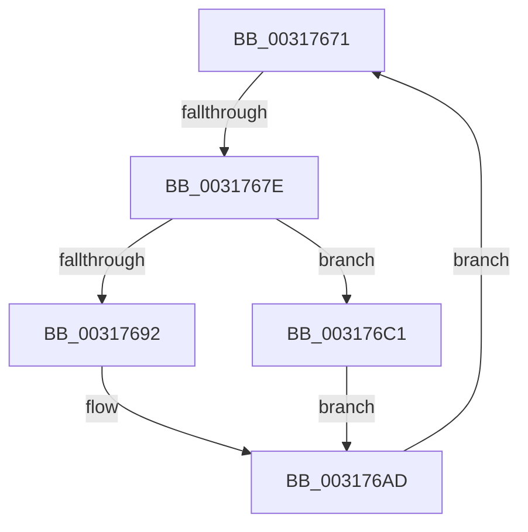

# sub_00317671

- RVA: `0x00317671`–`0x003176CF` (길이 `94` bytes)
- VA: `0x0000000140317671`
- 실행 섹션: `.text`
- PDB 이름 있음: `아니요`; PDB Function 태그: `아니요`
- unwind 정보 RVA: `0x00074A7C`
- 디코드: `26`개 명령, `94/94` bytes 표시
- 미해석 바이트: `0` (있으면 어셈블리에 `.byte`로 보존)

> 이 문서는 커널 이미지의 기계어와 PDB 기호를 분석해 생성했습니다. 4번과 5번은 함수 원형과 자료형을 바이너리 사용 방식에서 추정한 C 해석이며 원본 소스 복구 결과는 아닙니다.

## 1. Dependencies

- 직접 호출 지점: **1**; 고유 호출 대상: **1**
- 직접 호출자로 확인된 함수: **0**
- RIP 상대 이미지 참조: **0**

### Outgoing calls
- `0x003176BA` → [SMKM_STORE_MGR<SM_TRAITS>::SmWorkItemFreeResource](SMKM_STORE_MGR_SM_TRAITS_SmWorkItemFreeResource_function_003179B4.md) (function, `0x003179B4`)

### Direct callers
- 이 함수 시작 RVA로 연결되는 직접 call은 확인되지 않았습니다. 간접 호출은 완전히 역산할 수 없습니다.

### Static image references
- 디코드된 RIP-relative 메모리 참조가 없습니다.

## 2. Other-region calls and transfers

- 다른 실행 섹션으로 향하는 call: **0**
- call이 아닌 외부 분기/꼬리 이동: **1**
  - `0x0031767C` → [sub_003176E0](Unknown_function_003176E0.md) (`tail-transfer`)

## 3. Assembly (complete function range)

```asm
00317671  48 8B 55 07                     mov rdx, qword ptr [rbp + 7]
00317675  48 8D 45 FF                     lea rax, [rbp - 1]
00317679  48 3B D0                        cmp rdx, rax
0031767C  74 62                           je 0x1403176e0
0031767E  4C 8B 4D FF                     mov r9, qword ptr [rbp - 1]
00317682  49 8B 01                        mov rax, qword ptr [r9]
00317685  48 83 E0 F8                     and rax, 0xfffffffffffffff8
00317689  48 89 45 FF                     mov qword ptr [rbp - 1], rax
0031768D  4C 3B CA                        cmp r9, rdx
00317690  74 2F                           je 0x1403176c1
00317692  48 8B 0A                        mov rcx, qword ptr [rdx]
00317695  48 8B C1                        mov rax, rcx
00317698  83 E1 07                        and ecx, 7
0031769B  48 C1 E8 03                     shr rax, 3
0031769F  48 8D 04 C5 F8 FF FF FF         lea rax, [rax*8 - 8]
003176A7  48 0B C1                        or rax, rcx
003176AA  48 89 02                        mov qword ptr [rdx], rax
003176AD  49 C7 C0 FF FF FF FF            mov r8, 0xffffffffffffffff
003176B4  49 8B D1                        mov rdx, r9
003176B7  49 8B CF                        mov rcx, r15
003176BA  E8 F5 02 00 00                  call 0x1403179b4
003176BF  EB B0                           jmp 0x140317671
003176C1  48 8D 45 FF                     lea rax, [rbp - 1]
003176C5  4C 89 6D FF                     mov qword ptr [rbp - 1], r13
003176C9  48 89 45 07                     mov qword ptr [rbp + 7], rax
003176CD  EB DE                           jmp 0x1403176ad
```

## 4. C-style interpretation (structured pseudocode)

```c
__int64 __fastcall sub_00317671(void)
{
    __int64 result;

    result = (*(unsigned __int64 *)(*(unsigned __int64 *)(v_rbp - 1))) & (-8);
    *(unsigned __int64 *)(v_rbp - 1) = result;
    if ((*(unsigned __int64 *)(v_rbp - 1)) == (*(unsigned __int64 *)(v_rbp + 7))) goto loc_003176C1;
    a1 = (unsigned int)((*(unsigned __int64 *)(*(unsigned __int64 *)(v_rbp + 7))) & (7));
    result = (*(unsigned __int64 *)(*(unsigned __int64 *)(v_rbp + 7))) >> (3);
    result = (result * 8 - 8) | (a1);
    *(unsigned __int64 *)(*(unsigned __int64 *)(v_rbp + 7)) = result;
loc_003176AD:
    result = SMKM_STORE_MGR_SM_TRAITS___SmWorkItemFreeResource(v_r15, *(unsigned __int64 *)(v_rbp - 1), -1, *(unsigned __int64 *)(v_rbp - 1));
    goto loc_00317671;
loc_003176C1:
    *(unsigned __int64 *)(v_rbp - 1) = v_r13;
    *(unsigned __int64 *)(v_rbp + 7) = v_rbp - 1;
    goto loc_003176AD;
}
```

## 5. (Beta) C Style

```c
void sub_00317671(void)
{
    int64_t result;

    result = (*(uint64_t *)(*(uint64_t *)(local_rbp - 0x1))) & (-8);
    *(uint64_t *)(local_rbp - 0x1) = result;
    if ((*(uint64_t *)(local_rbp - 0x1)) == (*(uint64_t *)(local_rbp + 0x7))) goto loc_003176C1;
    a1 = (uint32_t)((*(uint64_t *)(*(uint64_t *)(local_rbp + 0x7))) & (7));
    result = (*(uint64_t *)(*(uint64_t *)(local_rbp + 0x7))) >> (3);
    result = (result * 8 - 8) | (a1);
    *(uint64_t *)(*(uint64_t *)(local_rbp + 0x7)) = result;
loc_003176AD:
    result = SMKM_STORE_MGR_SM_TRAITS___SmWorkItemFreeResource(local_r15, *(uint64_t *)(local_rbp - 0x1), -1, *(uint64_t *)(local_rbp - 0x1));
    goto loc_00317671;
loc_003176C1:
    *(uint64_t *)(local_rbp - 0x1) = local_r13;
    *(uint64_t *)(local_rbp + 0x7) = local_rbp - 1;
    goto loc_003176AD;
}
```

## 6. Execution-region graph

[열기: 2D/3D 그래프와 함수 탐색 컨트롤 패널](../../../control-panel.html?section=text&rva=0x00317671&view=graph)

- 2D 그래프는 위에서 아래로 흐르고, 3D 그래프는 빈 공간을 드래그해 회전합니다. Shift+드래그는 이동, 휠은 확대·축소, 함수 노드 선택은 대상 보고서 이동입니다.

### Static fallback


