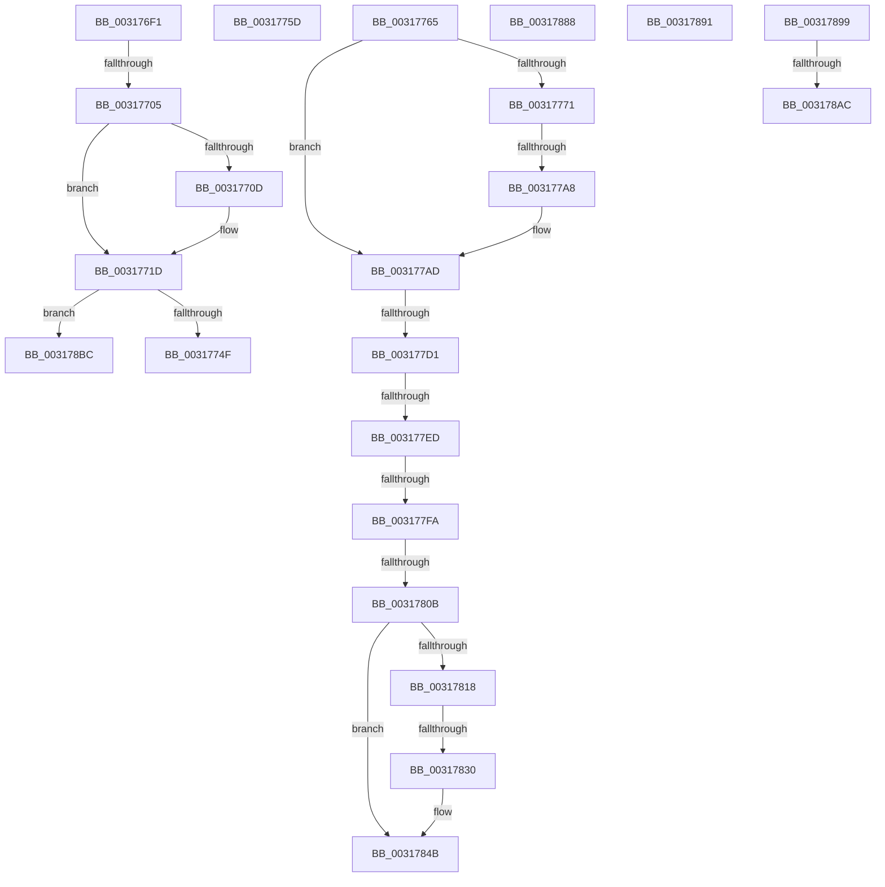

# sub_003176F1

- RVA: `0x003176F1`–`0x003178C4` (길이 `467` bytes)
- VA: `0x00000001403176F1`
- 실행 섹션: `.text`
- PDB 이름 있음: `아니요`; PDB Function 태그: `아니요`
- unwind 정보 RVA: `0x00074AC0`
- 디코드: `110`개 명령, `467/467` bytes 표시
- 미해석 바이트: `0` (있으면 어셈블리에 `.byte`로 보존)

> 이 문서는 커널 이미지의 기계어와 PDB 기호를 분석해 생성했습니다. 4번과 5번은 함수 원형과 자료형을 바이너리 사용 방식에서 추정한 C 해석이며 원본 소스 복구 결과는 아닙니다.

## 1. Dependencies

- 직접 호출 지점: **6**; 고유 호출 대상: **6**
- 직접 호출자로 확인된 함수: **0**
- RIP 상대 이미지 참조: **1**

### Outgoing calls
- `0x0031773A` → [SmFpAllocate](SmFpAllocate_function_00317D10.md) (function, `0x00317D10`)
- `0x003177A8` → [SmpStoreMgrCallback](SmpStoreMgrCallback_function_003173D0.md) (function, `0x003173D0`)
- `0x003177FD` → [PsGetIoPriorityThread](../34/PsGetIoPriorityThread_function_00343930.md) (function, `0x00343930`)
- `0x0031786C` → [KeQueryPriorityThread](../38/KeQueryPriorityThread_function_0038F4F0.md) (function, `0x0038F4F0`)
- `0x0031787E` → [SMKM_STORE_MGR<SM_TRAITS>::SmAsyncReadQueueInsert](../39/SMKM_STORE_MGR_SM_TRAITS_SmAsyncReadQueueInsert_function_0039120C.md) (function, `0x0039120C`)
- `0x003178B2` → [MmUnmapLockedPages](../24/MmUnmapLockedPages_function_00246E60.md) (function, `0x00246E60`)

### Direct callers
- 이 함수 시작 RVA로 연결되는 직접 call은 확인되지 않았습니다. 간접 호출은 완전히 역산할 수 없습니다.

### Static image references
- `0x00317798` → RVA `0x003173D0` (`SmpStoreMgrCallback`; read)

## 2. Other-region calls and transfers

- 다른 실행 섹션으로 향하는 call: **0**
- call이 아닌 외부 분기/꼬리 이동: **15**
  - `0x003176FF` → [sub_00317476 + 0x3E](Unknown_function_00317476.md) (`tail-transfer`)
  - `0x00317758` → [sub_00317476 + 0xB2](Unknown_function_00317476.md) (`tail-transfer`)
  - `0x00317760` → [sub_00317476 + 0x17B](Unknown_function_00317476.md) (`tail-transfer`)
  - `0x003177A2` → [sub_00317914 + 0x74](Unknown_function_00317914.md) (`tail-transfer`)
  - `0x003177CB` → [sub_00317914 + 0x11](Unknown_function_00317914.md) (`tail-transfer`)
  - `0x003177E7` → [sub_00317476 + 0x137](Unknown_function_00317476.md) (`tail-transfer`)
  - `0x003177F4` → [sub_00317476 + 0x137](Unknown_function_00317476.md) (`tail-transfer`)
  - `0x00317805` → [sub_00317476 + 0x137](Unknown_function_00317476.md) (`tail-transfer`)
  - `0x0031782A` → [sub_00317914](Unknown_function_00317914.md) (`tail-transfer`)
  - `0x00317883` → [sub_00317476 + 0x1AE](Unknown_function_00317476.md) (`tail-transfer`)
  - `0x0031788C` → [sub_00317476 + 0x1B8](Unknown_function_00317476.md) (`tail-transfer`)
  - `0x00317894` → [sub_00317476 + 0x1A0](Unknown_function_00317476.md) (`tail-transfer`)
  - `0x003178A6` → [sub_00317914 + 0x19](Unknown_function_00317914.md) (`tail-transfer`)
  - `0x003178B7` → [sub_00317476 + 0x11F](Unknown_function_00317476.md) (`tail-transfer`)
  - `0x003178BF` → [sub_00317476 + 0x42](Unknown_function_00317476.md) (`tail-transfer`)

## 3. Assembly (complete function range)

```asm
003176F1  41 8B 8F D0 07 00 00            mov ecx, dword ptr [r15 + 0x7d0]
003176F8  4D 8B 69 10                     mov r13, qword ptr [r9 + 0x10]
003176FC  F6 C1 02                        test cl, 2
003176FF  0F 84 AF FD FF FF               je 0x1403174b4
00317705  41 8B C0                        mov eax, r8d
00317708  F6 C1 01                        test cl, 1
0031770B  74 10                           je 0x14031771d
0031770D  41 81 7D 28 00 10 00 00         cmp dword ptr [r13 + 0x28], 0x1000
00317715  B9 01 00 00 00                  mov ecx, 1
0031771A  0F 46 C1                        cmovbe eax, ecx
0031771D  4C 8B 75 67                     mov r14, qword ptr [rbp + 0x67]
00317721  4D 8D A7 A8 06 00 00            lea r12, [r15 + 0x6a8]
00317728  4D 8B C6                        mov r8, r14
0031772B  89 44 24 20                     mov dword ptr [rsp + 0x20], eax
0031772F  49 8B CC                        mov rcx, r12
00317732  4D 8B CD                        mov r9, r13
00317735  BA 05 00 00 00                  mov edx, 5
0031773A  E8 D1 05 00 00                  call 0x140317d10
0031773F  48 8B 55 E7                     mov rdx, qword ptr [rbp - 0x19]
00317743  48 8B D8                        mov rbx, rax
00317746  48 85 C0                        test rax, rax
00317749  0F 85 6D 01 00 00               jne 0x1403178bc
0031774F  4C 8B 4D DF                     mov r9, qword ptr [rbp - 0x21]
00317753  BE 9A 00 00 C0                  mov esi, 0xc000009a
00317758  E9 CB FD FF FF                  jmp 0x140317528
0031775D  4D 8B CD                        mov r9, r13
00317760  E9 8C FE FF FF                  jmp 0x1403175f1
00317765  4D 8B 8F D8 07 00 00            mov r9, qword ptr [r15 + 0x7d8]
0031776C  4D 85 C9                        test r9, r9
0031776F  74 3C                           je 0x1403177ad
00317771  48 8B 45 67                     mov rax, qword ptr [rbp + 0x67]
00317775  48 8D 55 EF                     lea rdx, [rbp - 0x11]
00317779  66 44 89 6D FD                  mov word ptr [rbp - 3], r13w
0031777E  41 B8 05 00 00 00               mov r8d, 5
00317784  66 89 5D FB                     mov word ptr [rbp - 5], bx
00317788  49 8B CF                        mov rcx, r15
0031778B  48 8B 00                        mov rax, qword ptr [rax]
0031778E  48 89 45 EF                     mov qword ptr [rbp - 0x11], rax
00317792  8B 47 18                        mov eax, dword ptr [rdi + 0x18]
00317795  89 45 F7                        mov dword ptr [rbp - 9], eax
00317798  48 8D 05 31 FC FF FF            lea rax, [rip - 0x3cf]
0031779F  4C 3B C8                        cmp r9, rax
003177A2  0F 85 E0 01 00 00               jne 0x140317988
003177A8  E8 23 FC FF FF                  call 0x1403173d0
003177AD  65 4C 8B 14 25 88 01 00 00      mov r10, qword ptr gs:[0x188]
003177B6  8B CB                           mov ecx, ebx
003177B8  81 E1 FF 03 00 00               and ecx, 0x3ff
003177BE  8B C1                           mov eax, ecx
003177C0  48 C1 E8 05                     shr rax, 5
003177C4  49 8B 14 C7                     mov rdx, qword ptr [r15 + rax*8]
003177C8  48 85 D2                        test rdx, rdx
003177CB  0F 84 54 01 00 00               je 0x140317925
003177D1  83 E1 1F                        and ecx, 0x1f
003177D4  48 8D 04 89                     lea rax, [rcx + rcx*4]
003177D8  4C 8D 0C C2                     lea r9, [rdx + rax*8]
003177DC  4D 8B 09                        mov r9, qword ptr [r9]
003177DF  41 F6 81 95 1A 00 00 04         test byte ptr [r9 + 0x1a95], 4
003177E7  0F 84 C0 FD FF FF               je 0x1403175ad
003177ED  F7 47 08 00 00 00 04            test dword ptr [rdi + 8], 0x4000000
003177F4  0F 84 B3 FD FF FF               je 0x1403175ad
003177FA  49 8B CA                        mov rcx, r10
003177FD  E8 2E C1 02 00                  call 0x140343930
00317802  83 F8 02                        cmp eax, 2
00317805  0F 8C A2 FD FF FF               jl 0x1403175ad
0031780B  4C 8B 45 07                     mov r8, qword ptr [rbp + 7]
0031780F  48 8D 45 FF                     lea rax, [rbp - 1]
00317813  4C 3B C0                        cmp r8, rax
00317816  74 33                           je 0x14031784b
00317818  48 8B 4D FF                     mov rcx, qword ptr [rbp - 1]
0031781C  48 8B 01                        mov rax, qword ptr [rcx]
0031781F  48 83 E0 F8                     and rax, 0xfffffffffffffff8
00317823  48 89 45 FF                     mov qword ptr [rbp - 1], rax
00317827  49 3B C8                        cmp rcx, r8
0031782A  0F 84 E4 00 00 00               je 0x140317914
00317830  49 8B 10                        mov rdx, qword ptr [r8]
00317833  48 8B C2                        mov rax, rdx
00317836  83 E2 07                        and edx, 7
00317839  48 C1 E8 03                     shr rax, 3
0031783D  48 8D 04 C5 F8 FF FF FF         lea rax, [rax*8 - 8]
00317845  48 0B C2                        or rax, rdx
00317848  49 89 00                        mov qword ptr [r8], rax
0031784B  0F 57 C0                        xorps xmm0, xmm0
0031784E  49 8D 9F D0 01 00 00            lea rbx, [r15 + 0x1d0]
00317855  0F 11 47 28                     movups xmmword ptr [rdi + 0x28], xmm0
00317859  49 8B CA                        mov rcx, r10
0031785C  0F 11 47 38                     movups xmmword ptr [rdi + 0x38], xmm0
00317860  0F 11 47 48                     movups xmmword ptr [rdi + 0x48], xmm0
00317864  4C 89 4F 48                     mov qword ptr [rdi + 0x48], r9
00317868  48 89 5F 50                     mov qword ptr [rdi + 0x50], rbx
0031786C  E8 7F 7C 07 00                  call 0x14038f4f0
00317871  44 8B C8                        mov r9d, eax
00317874  4C 8D 47 28                     lea r8, [rdi + 0x28]
00317878  48 8B D3                        mov rdx, rbx
0031787B  49 8B CF                        mov rcx, r15
0031787E  E8 89 99 07 00                  call 0x14039120c
00317883  E9 9C FD FF FF                  jmp 0x140317624
00317888  48 8B 5D 0F                     mov rbx, qword ptr [rbp + 0xf]
0031788C  E9 9D FD FF FF                  jmp 0x14031762e
00317891  49 8B CD                        mov rcx, r13
00317894  E9 7D FD FF FF                  jmp 0x140317616
00317899  49 8B 44 24 70                  mov rax, qword ptr [r12 + 0x70]
0031789E  49 8B 5D 18                     mov rbx, qword ptr [r13 + 0x18]
003178A2  48 3B 45 67                     cmp rax, qword ptr [rbp + 0x67]
003178A6  0F 84 81 00 00 00               je 0x14031792d
003178AC  49 8B D5                        mov rdx, r13
003178AF  48 8B CB                        mov rcx, rbx
003178B2  E8 A9 F5 F2 FF                  call 0x140246e60
003178B7  E9 D9 FC FF FF                  jmp 0x140317595
003178BC  45 33 C0                        xor r8d, r8d
003178BF  E9 F4 FB FF FF                  jmp 0x1403174b8
```

## 4. C-style interpretation (structured pseudocode)

```c
__int64 __fastcall sub_003176F1(__int64 a1, __int64 a2, int a3, __int64 a4)
{
    __int64 result;
    unsigned int v_stack_p20;

    result = (unsigned int)(a3);
    if ((((unsigned __int8)((unsigned int)(*(unsigned int *)(v_r15 + 2000)))) & (1)) != 0) {
        a1 = 1;
        result = (unsigned int)(a3);
        if ((*(unsigned int *)(*(unsigned __int64 *)(a4 + 16) + 40)) <= 0x1000ULL) { result = (unsigned int)(a1); }
    }
    v_stack_p20 = (unsigned int)(result);
    result = SmFpAllocate(v_r15 + 1704, 5, *(unsigned __int64 *)(v_rbp + 103), *(unsigned __int64 *)(a4 + 16));
    if (result != 0) goto loc_003178BC;
loc_003178BC:
    a3 = 0;
}
```

## 5. (Beta) C Style

```c
int64_t sub_003176F1(int64_t Arg1, int64_t Arg2, int32_t Arg3, void *Arg4)
{
    uint8_t *arg4 = (uint8_t *)Arg4;

    int64_t result;
    uint32_t v_stack_p20;

    result = (uint32_t)(Arg3);
    if ((((uint8_t)((uint32_t)(*(uint32_t *)(local_r15 + 0x7D0)))) & (1)) != 0) {
        Arg1 = 1;
        result = (uint32_t)(Arg3);
        if ((*(uint32_t *)(*(uint64_t *)(arg4 + 0x10) + 0x28)) <= 0x1000ULL) { result = (uint32_t)(Arg1); }
    }
    v_stack_p20 = (uint32_t)(result);
    result = SmFpAllocate(local_r15 + 1704, 5, *(uint64_t *)(local_rbp + 0x67), *(uint64_t *)(arg4 + 0x10));
    if (result != 0) goto loc_003178BC;
loc_003178BC:
    Arg3 = 0;
}
```

### 관측된 메모리 오프셋

구조체 형식이 확인되지 않은 접근은 인자 기준의 오프셋으로만 기록했습니다.

| 기준 인자 | 오프셋 표현 | 폭 (bit) | 접근 |
|---|---:|---:|---|
| `Arg4` | `+ 0x10` | `64` | `R` |

## 6. Execution-region graph

[열기: 2D/3D 그래프와 함수 탐색 컨트롤 패널](../../../control-panel.html?section=text&rva=0x003176F1&view=graph)

- 2D 그래프는 위에서 아래로 흐르고, 3D 그래프는 빈 공간을 드래그해 회전합니다. Shift+드래그는 이동, 휠은 확대·축소, 함수 노드 선택은 대상 보고서 이동입니다.

### Static fallback


