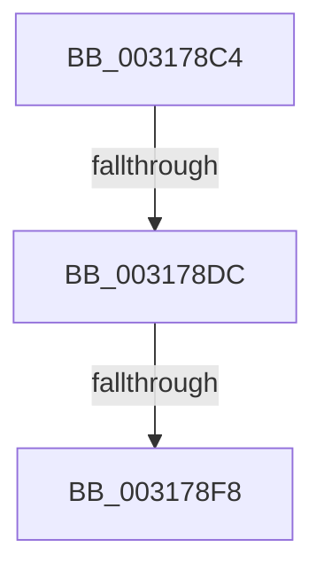

# sub_003178C4

- RVA: `0x003178C4`–`0x00317914` (길이 `80` bytes)
- VA: `0x00000001403178C4`
- 실행 섹션: `.text`
- PDB 이름 있음: `아니요`; PDB Function 태그: `아니요`
- unwind 정보 RVA: `0x00074AE0`
- 디코드: `19`개 명령, `80/80` bytes 표시
- 미해석 바이트: `0` (있으면 어셈블리에 `.byte`로 보존)

> 이 문서는 커널 이미지의 기계어와 PDB 기호를 분석해 생성했습니다. 4번과 5번은 함수 원형과 자료형을 바이너리 사용 방식에서 추정한 C 해석이며 원본 소스 복구 결과는 아닙니다.

## 1. Dependencies

- 직접 호출 지점: **3**; 고유 호출 대상: **3**
- 직접 호출자로 확인된 함수: **0**
- RIP 상대 이미지 참조: **0**

### Outgoing calls
- `0x003178CF` → [SmpFpReleaseResource](../4F/SmpFpReleaseResource_function_004FAC90.md) (function, `0x004FAC90`)
- `0x003178E7` → [MmUnmapReservedMapping](../3E/MmUnmapReservedMapping_function_003E7BE0.md) (function, `0x003E7BE0`)
- `0x0031790A` → [KeSetEvent](../33/KeSetEvent_function_0033F310.md) (function, `0x0033F310`)

### Direct callers
- 이 함수 시작 RVA로 연결되는 직접 call은 확인되지 않았습니다. 간접 호출은 완전히 역산할 수 없습니다.

### Static image references
- 디코드된 RIP-relative 메모리 참조가 없습니다.

## 2. Other-region calls and transfers

- 다른 실행 섹션으로 향하는 call: **0**
- call이 아닌 외부 분기/꼬리 이동: **3**
  - `0x003178D6` → [sub_0031763B + 0x13](Unknown_function_0031763B.md) (`tail-transfer`)
  - `0x003178F2` → [sub_0031763B + 0x1E](Unknown_function_0031763B.md) (`tail-transfer`)
  - `0x0031790F` → [sub_0031763B + 0x1E](Unknown_function_0031763B.md) (`tail-transfer`)

## 3. Assembly (complete function range)

```asm
003178C4  4C 8B C7                        mov r8, rdi
003178C7  BA 05 00 00 00                  mov edx, 5
003178CC  49 8B CC                        mov rcx, r12
003178CF  E8 BC 33 1E 00                  call 0x1404fac90
003178D4  85 C0                           test eax, eax
003178D6  0F 84 72 FD FF FF               je 0x14031764e
003178DC  4C 8B C3                        mov r8, rbx
003178DF  BA 73 6D 52 6D                  mov edx, 0x6d526d73
003178E4  48 8B CF                        mov rcx, rdi
003178E7  E8 F4 02 0D 00                  call 0x1403e7be0
003178EC  41 80 7C 24 5E 00               cmp byte ptr [r12 + 0x5e], 0
003178F2  0F 85 61 FD FF FF               jne 0x140317659
003178F8  49 8B C5                        mov rax, r13
003178FB  49 8D 4C 24 08                  lea rcx, [r12 + 8]
00317900  49 87 44 24 70                  xchg qword ptr [r12 + 0x70], rax
00317905  45 33 C0                        xor r8d, r8d
00317908  33 D2                           xor edx, edx
0031790A  E8 01 7A 02 00                  call 0x14033f310
0031790F  E9 45 FD FF FF                  jmp 0x140317659
```

## 4. C-style interpretation (structured pseudocode)

```c
__int64 __fastcall sub_003178C4(void)
{
    __int64 result;

    result = SmpFpReleaseResource(v_r12, 5, v_rdi, a4);
    result = MmUnmapReservedMapping(v_rdi, (unsigned int)(0x6D526D73ULL), v_rbx, a4);
    a3 = 0;
    a2 = 0;
    result = KeSetEvent(v_r12 + 8, a2, a3, a4);
}
```

## 5. (Beta) C Style

```c
void sub_003178C4(void)
{
    int64_t result;

    result = SmpFpReleaseResource(local_r12, 5, local_rdi, a4);
    result = MmUnmapReservedMapping(local_rdi, (uint32_t)(0x6D526D73ULL), local_rbx, a4);
    a3 = 0;
    a2 = 0;
    result = KeSetEvent(local_r12 + 8, a2, a3, a4);
}
```

## 6. Execution-region graph

[열기: 2D/3D 그래프와 함수 탐색 컨트롤 패널](../../../control-panel.html?section=text&rva=0x003178C4&view=graph)

- 2D 그래프는 위에서 아래로 흐르고, 3D 그래프는 빈 공간을 드래그해 회전합니다. Shift+드래그는 이동, 휠은 확대·축소, 함수 노드 선택은 대상 보고서 이동입니다.

### Static fallback


