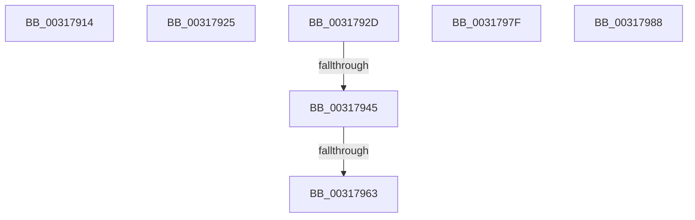

# sub_00317914

- RVA: `0x00317914`–`0x00317995` (길이 `129` bytes)
- VA: `0x0000000140317914`
- 실행 섹션: `.text`
- PDB 이름 있음: `아니요`; PDB Function 태그: `아니요`
- unwind 정보 RVA: `0x00074AFC`
- 디코드: `31`개 명령, `129/129` bytes 표시
- 미해석 바이트: `0` (있으면 어셈블리에 `.byte`로 보존)

> 이 문서는 커널 이미지의 기계어와 PDB 기호를 분석해 생성했습니다. 4번과 5번은 함수 원형과 자료형을 바이너리 사용 방식에서 추정한 C 해석이며 원본 소스 복구 결과는 아닙니다.

## 1. Dependencies

- 직접 호출 지점: **4**; 고유 호출 대상: **4**
- 직접 호출자로 확인된 함수: **0**
- RIP 상대 이미지 참조: **0**

### Outgoing calls
- `0x00317938` → [SmpFpReleaseResource](../4F/SmpFpReleaseResource_function_004FAC90.md) (function, `0x004FAC90`)
- `0x00317950` → [MmUnmapReservedMapping](../3E/MmUnmapReservedMapping_function_003E7BE0.md) (function, `0x003E7BE0`)
- `0x00317975` → [KeSetEvent](../33/KeSetEvent_function_0033F310.md) (function, `0x0033F310`)
- `0x0031798B` → [guard_dispatch_icall](../6B/guard_dispatch_icall_function_006BAAD0.md) (function, `0x006BAAD0`)

### Direct callers
- 이 함수 시작 RVA로 연결되는 직접 call은 확인되지 않았습니다. 간접 호출은 완전히 역산할 수 없습니다.

### Static image references
- 디코드된 RIP-relative 메모리 참조가 없습니다.

## 2. Other-region calls and transfers

- 다른 실행 섹션으로 향하는 call: **0**
- call이 아닌 외부 분기/꼬리 이동: **7**
  - `0x00317920` → [sub_003176F1 + 0x15A](Unknown_function_003176F1.md) (`tail-transfer`)
  - `0x00317928` → [sub_003176F1 + 0xEB](Unknown_function_003176F1.md) (`tail-transfer`)
  - `0x0031793F` → [sub_003176F1 + 0x1BB](Unknown_function_003176F1.md) (`tail-transfer`)
  - `0x0031795D` → [sub_00317476 + 0x122](Unknown_function_00317476.md) (`tail-transfer`)
  - `0x0031797A` → [sub_00317476 + 0x122](Unknown_function_00317476.md) (`tail-transfer`)
  - `0x00317983` → [sub_00317476 + 0x8E](Unknown_function_00317476.md) (`tail-transfer`)
  - `0x00317990` → [sub_003176F1 + 0xBC](Unknown_function_003176F1.md) (`tail-transfer`)

## 3. Assembly (complete function range)

```asm
00317914  48 8D 45 FF                     lea rax, [rbp - 1]
00317918  4C 89 6D FF                     mov qword ptr [rbp - 1], r13
0031791C  48 89 45 07                     mov qword ptr [rbp + 7], rax
00317920  E9 26 FF FF FF                  jmp 0x14031784b
00317925  4D 8B CD                        mov r9, r13
00317928  E9 AF FE FF FF                  jmp 0x1403177dc
0031792D  4C 8B C3                        mov r8, rbx
00317930  BA 05 00 00 00                  mov edx, 5
00317935  49 8B CC                        mov rcx, r12
00317938  E8 53 33 1E 00                  call 0x1404fac90
0031793D  85 C0                           test eax, eax
0031793F  0F 84 67 FF FF FF               je 0x1403178ac
00317945  4D 8B C5                        mov r8, r13
00317948  BA 73 6D 52 6D                  mov edx, 0x6d526d73
0031794D  48 8B CB                        mov rcx, rbx
00317950  E8 8B 02 0D 00                  call 0x1403e7be0
00317955  45 33 ED                        xor r13d, r13d
00317958  45 38 6C 24 5E                  cmp byte ptr [r12 + 0x5e], r13b
0031795D  0F 85 35 FC FF FF               jne 0x140317598
00317963  41 8B C5                        mov eax, r13d
00317966  49 8D 4C 24 08                  lea rcx, [r12 + 8]
0031796B  49 87 44 24 70                  xchg qword ptr [r12 + 0x70], rax
00317970  45 33 C0                        xor r8d, r8d
00317973  33 D2                           xor edx, edx
00317975  E8 96 79 02 00                  call 0x14033f310
0031797A  E9 19 FC FF FF                  jmp 0x140317598
0031797F  4C 8B 4D DF                     mov r9, qword ptr [rbp - 0x21]
00317983  E9 7C FB FF FF                  jmp 0x140317504
00317988  49 8B C1                        mov rax, r9
0031798B  E8 40 31 3A 00                  call 0x1406baad0
00317990  E9 18 FE FF FF                  jmp 0x1403177ad
```

## 4. C-style interpretation (structured pseudocode)

```c
__int64 __fastcall sub_00317914(void)
{
    *(unsigned __int64 *)(v_rbp - 1) = v_r13;
    *(unsigned __int64 *)(v_rbp + 7) = v_rbp - 1;
}
```

## 5. (Beta) C Style

```c
void sub_00317914(void)
{
    *(uint64_t *)(local_rbp - 0x1) = local_r13;
    *(uint64_t *)(local_rbp + 0x7) = local_rbp - 1;
}
```

## 6. Execution-region graph

[열기: 2D/3D 그래프와 함수 탐색 컨트롤 패널](../../../control-panel.html?section=text&rva=0x00317914&view=graph)

- 2D 그래프는 위에서 아래로 흐르고, 3D 그래프는 빈 공간을 드래그해 회전합니다. Shift+드래그는 이동, 휠은 확대·축소, 함수 노드 선택은 대상 보고서 이동입니다.

### Static fallback


