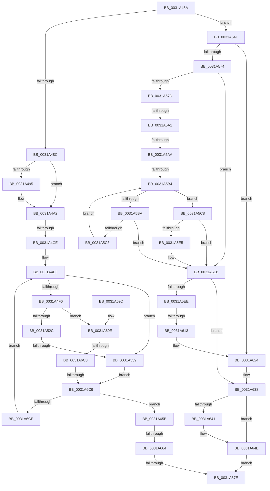

# sub_0031A46A

- RVA: `0x0031A46A`–`0x0031A6E4` (길이 `634` bytes)
- VA: `0x000000014031A46A`
- 실행 섹션: `.text`
- PDB 이름 있음: `아니요`; PDB Function 태그: `아니요`
- unwind 정보 RVA: `0x00074CC4`
- 디코드: `163`개 명령, `634/634` bytes 표시
- 미해석 바이트: `0` (있으면 어셈블리에 `.byte`로 보존)

> 이 문서는 커널 이미지의 기계어와 PDB 기호를 분석해 생성했습니다. 4번과 5번은 함수 원형과 자료형을 바이너리 사용 방식에서 추정한 C 해석이며 원본 소스 복구 결과는 아닙니다.

## 1. Dependencies

- 직접 호출 지점: **3**; 고유 호출 대상: **2**
- 직접 호출자로 확인된 함수: **0**
- RIP 상대 이미지 참조: **6**

### Outgoing calls
- `0x0031A49D` → [KiLowerIrqlProcessIrqlFlags](../4F/KiLowerIrqlProcessIrqlFlags_function_004F5698.md) (function, `0x004F5698`)
- `0x0031A649` → [KiLowerIrqlProcessIrqlFlags](../4F/KiLowerIrqlProcessIrqlFlags_function_004F5698.md) (function, `0x004F5698`)
- `0x0031A670` → [MiEmptyPteBins](MiEmptyPteBins_function_0031AAE4.md) (function, `0x0031AAE4`)

### Direct callers
- 이 함수 시작 RVA로 연결되는 직접 call은 확인되지 않았습니다. 간접 호출은 완전히 역산할 수 없습니다.

### Static image references
- `0x0031A48C` → RVA `0x00FC6D20` (`ALMOSTRO`; read)
- `0x0031A4AA` → RVA `0x00E376A8` (`.data`; read)
- `0x0031A4B7` → RVA `0x00E37668` (`.data`; read)
- `0x0031A4BE` → RVA `0x00E376B0` (`.data`; read)
- `0x0031A5F1` → RVA `0x00000000` (`image boundary/outside`; read)
- `0x0031A62A` → RVA `0x00E37688` (`.data`; read)

## 2. Other-region calls and transfers

- 다른 실행 섹션으로 향하는 call: **0**
- call이 아닌 외부 분기/꼬리 이동: **10**
  - `0x0031A4C8` → [sub_0031A6F6 + 0xDC](Unknown_function_0031A6F6.md) (`tail-transfer`)
  - `0x0031A533` → [sub_0031A6F6](Unknown_function_0031A6F6.md) (`tail-transfer`)
  - `0x0031A59B` → [sub_0031A6F6 + 0x209](Unknown_function_0031A6F6.md) (`tail-transfer`)
  - `0x0031A5A4` → [sub_0031A6F6 + 0x1BA](Unknown_function_0031A6F6.md) (`tail-transfer`)
  - `0x0031A5AE` → [sub_0031A6F6 + 0x6D](Unknown_function_0031A6F6.md) (`tail-transfer`)
  - `0x0031A60D` → [sub_0031A6F6 + 0x8](Unknown_function_0031A6F6.md) (`tail-transfer`)
  - `0x0031A65E` → [sub_0031A6F6 + 0x121](Unknown_function_0031A6F6.md) (`tail-transfer`)
  - `0x0031A678` → [sub_0031A6F6 + 0x3DE](Unknown_function_0031A6F6.md) (`tail-transfer`)
  - `0x0031A6BA` → [sub_0031A6F6 + 0x65](Unknown_function_0031A6F6.md) (`tail-transfer`)
  - `0x0031A6C3` → [sub_0031A6F6 + 0x121](Unknown_function_0031A6F6.md) (`tail-transfer`)

## 3. Assembly (complete function range)

```asm
0031A46A  48 89 6C 24 70                  mov qword ptr [rsp + 0x70], rbp
0031A46F  48 89 7C 24 40                  mov qword ptr [rsp + 0x40], rdi
0031A474  4C 89 6C 24 38                  mov qword ptr [rsp + 0x38], r13
0031A479  48 83 BB B0 8F 00 00 FF         cmp qword ptr [rbx + 0x8fb0], -1
0031A481  4C 89 7C 24 30                  mov qword ptr [rsp + 0x30], r15
0031A486  0F 85 B5 00 00 00               jne 0x14031a541
0031A48C  83 3D 8D C8 CA 00 00            cmp dword ptr [rip + 0xcac88d], 0
0031A493  74 0D                           je 0x14031a4a2
0031A495  44 0F 20 C1                     mov rcx, cr8
0031A499  40 0F B6 D6                     movzx edx, sil
0031A49D  E8 F6 B1 1D 00                  call 0x1404f5698
0031A4A2  40 0F B6 C6                     movzx eax, sil
0031A4A6  44 0F 22 C0                     mov cr8, rax
0031A4AA  48 8B 35 F7 D1 B1 00            mov rsi, qword ptr [rip + 0xb1d1f7]
0031A4B1  33 FF                           xor edi, edi
0031A4B3  4C 8D 7F FF                     lea r15, [rdi - 1]
0031A4B7  48 8D 1D AA D1 B1 00            lea rbx, [rip + 0xb1d1aa]
0031A4BE  4C 8B 1D EB D1 B1 00            mov r11, qword ptr [rip + 0xb1d1eb]
0031A4C5  4D 85 DB                        test r11, r11
0031A4C8  0F 85 04 03 00 00               jne 0x14031a7d2
0031A4CE  4C 8B 13                        mov r10, qword ptr [rbx]
0031A4D1  48 8B D7                        mov rdx, rdi
0031A4D4  48 8B 5B 08                     mov rbx, qword ptr [rbx + 8]
0031A4D8  49 3B F2                        cmp rsi, r10
0031A4DB  48 0F 42 D6                     cmovb rdx, rsi
0031A4DF  4D 8D 4A FF                     lea r9, [r10 - 1]
0031A4E3  49 8B C1                        mov rax, r9
0031A4E6  89 7C 24 78                     mov dword ptr [rsp + 0x78], edi
0031A4EA  48 2B C2                        sub rax, rdx
0031A4ED  48 FF C0                        inc rax
0031A4F0  48 83 F8 01                     cmp rax, 1
0031A4F4  72 43                           jb 0x14031a539
0031A4F6  0F B6 CA                        movzx ecx, dl
0031A4F9  48 8B C2                        mov rax, rdx
0031A4FC  48 C1 E8 06                     shr rax, 6
0031A500  80 E1 3F                        and cl, 0x3f
0031A503  4C 8D 04 C3                     lea r8, [rbx + rax*8]
0031A507  49 8B C1                        mov rax, r9
0031A50A  48 C1 E8 06                     shr rax, 6
0031A50E  48 8D 2C C3                     lea rbp, [rbx + rax*8]
0031A512  B8 01 00 00 00                  mov eax, 1
0031A517  48 D3 E0                        shl rax, cl
0031A51A  49 8B 08                        mov rcx, qword ptr [r8]
0031A51D  48 FF C8                        dec rax
0031A520  48 0B C8                        or rcx, rax
0031A523  49 3B CF                        cmp rcx, r15
0031A526  0F 85 72 01 00 00               jne 0x14031a69e
0031A52C  49 83 C0 08                     add r8, 8
0031A530  4C 3B C5                        cmp r8, rbp
0031A533  0F 86 BD 01 00 00               jbe 0x14031a6f6
0031A539  4D 8B C7                        mov r8, r15
0031A53C  E9 88 01 00 00                  jmp 0x14031a6c9
0031A541  33 FF                           xor edi, edi
0031A543  4C 8D 7F FF                     lea r15, [rdi - 1]
0031A547  41 BC 40 00 00 00               mov r12d, 0x40
0031A54D  48 8D 83 B0 8F 00 00            lea rax, [rbx + 0x8fb0]
0031A554  4C 89 64 24 20                  mov qword ptr [rsp + 0x20], r12
0031A559  48 8B 4C 24 20                  mov rcx, qword ptr [rsp + 0x20]
0031A55E  48 FF C9                        dec rcx
0031A561  48 89 44 24 28                  mov qword ptr [rsp + 0x28], rax
0031A566  4C 8B 44 24 28                  mov r8, qword ptr [rsp + 0x28]
0031A56B  4D 85 F6                        test r14, r14
0031A56E  0F 84 B0 00 00 00               je 0x14031a624
0031A574  48 8D 41 01                     lea rax, [rcx + 1]
0031A578  49 3B C6                        cmp rax, r14
0031A57B  72 6B                           jb 0x14031a5e8
0031A57D  4D 8B 08                        mov r9, qword ptr [r8]
0031A580  4C 8B D9                        mov r11, rcx
0031A583  4D 2B DE                        sub r11, r14
0031A586  49 8B D0                        mov rdx, r8
0031A589  49 FF C3                        inc r11
0031A58C  49 8B C3                        mov rax, r11
0031A58F  48 C1 E8 06                     shr rax, 6
0031A593  49 8D 2C C0                     lea rbp, [r8 + rax*8]
0031A597  49 83 FE 7F                     cmp r14, 0x7f
0031A59B  0F 87 5E 03 00 00               ja 0x14031a8ff
0031A5A1  4D 3B F4                        cmp r14, r12
0031A5A4  0F 83 06 03 00 00               jae 0x14031a8b0
0031A5AA  49 83 FE 01                     cmp r14, 1
0031A5AE  0F 87 AF 01 00 00               ja 0x14031a763
0031A5B4  49 83 F9 FF                     cmp r9, -1
0031A5B8  75 0E                           jne 0x14031a5c8
0031A5BA  48 83 C2 08                     add rdx, 8
0031A5BE  48 3B D5                        cmp rdx, rbp
0031A5C1  77 25                           ja 0x14031a5e8
0031A5C3  4C 8B 0A                        mov r9, qword ptr [rdx]
0031A5C6  EB EC                           jmp 0x14031a5b4
0031A5C8  49 F7 D1                        not r9
0031A5CB  4C 8B D2                        mov r10, rdx
0031A5CE  4D 2B D0                        sub r10, r8
0031A5D1  49 C1 FA 03                     sar r10, 3
0031A5D5  49 0F BC C1                     bsf rax, r9
0031A5D9  49 C1 E2 06                     shl r10, 6
0031A5DD  4C 03 D0                        add r10, rax
0031A5E0  4D 3B D3                        cmp r10, r11
0031A5E3  77 03                           ja 0x14031a5e8
0031A5E5  4D 8B FA                        mov r15, r10
0031A5E8  49 83 FF FF                     cmp r15, -1
0031A5EC  74 4A                           je 0x14031a638
0031A5EE  41 8B CF                        mov ecx, r15d
0031A5F1  4C 8D 25 08 5A CE FF            lea r12, [rip - 0x31a5f8]
0031A5F8  83 E1 07                        and ecx, 7
0031A5FB  49 8B EF                        mov rbp, r15
0031A5FE  48 C1 ED 03                     shr rbp, 3
0031A602  49 03 E8                        add rbp, r8
0031A605  4A 8D 04 31                     lea rax, [rcx + r14]
0031A609  48 83 F8 08                     cmp rax, 8
0031A60D  0F 87 EB 00 00 00               ja 0x14031a6fe
0031A613  43 0F B6 84 34 90 C8 02 00      movzx eax, byte ptr [r12 + r14 + 0x2c890]
0031A61C  49 8B FF                        mov rdi, r15
0031A61F  D2 E0                           shl al, cl
0031A621  08 45 00                        or byte ptr [rbp], al
0031A624  8B 8B B8 8F 00 00               mov ecx, dword ptr [rbx + 0x8fb8]
0031A62A  48 8B 05 57 D0 B1 00            mov rax, qword ptr [rip + 0xb1d057]
0031A631  48 03 CF                        add rcx, rdi
0031A634  48 8D 3C C8                     lea rdi, [rax + rcx*8]
0031A638  83 3D E1 C6 CA 00 00            cmp dword ptr [rip + 0xcac6e1], 0
0031A63F  74 0D                           je 0x14031a64e
0031A641  44 0F 20 C1                     mov rcx, cr8
0031A645  40 0F B6 D6                     movzx edx, sil
0031A649  E8 4A B0 1D 00                  call 0x1404f5698
0031A64E  40 0F B6 CE                     movzx ecx, sil
0031A652  44 0F 22 C1                     mov cr8, rcx
0031A656  48 8B C7                        mov rax, rdi
0031A659  EB 23                           jmp 0x14031a67e
0031A65B  4D 3B C7                        cmp r8, r15
0031A65E  0F 85 B3 01 00 00               jne 0x14031a817
0031A664  45 8B C4                        mov r8d, r12d
0031A667  48 8D 0D FA CF B1 00            lea rcx, [rip + 0xb1cffa]
0031A66E  33 D2                           xor edx, edx
0031A670  E8 6F 04 00 00                  call 0x14031aae4
0031A675  48 85 C0                        test rax, rax
0031A678  0F 85 56 04 00 00               jne 0x14031aad4
0031A67E  4C 8B 7C 24 30                  mov r15, qword ptr [rsp + 0x30]
0031A683  4C 8B 6C 24 38                  mov r13, qword ptr [rsp + 0x38]
0031A688  48 8B 7C 24 40                  mov rdi, qword ptr [rsp + 0x40]
0031A68D  48 8B 6C 24 70                  mov rbp, qword ptr [rsp + 0x70]
0031A692  48 83 C4 48                     add rsp, 0x48
0031A696  41 5E                           pop r14
0031A698  41 5C                           pop r12
0031A69A  5E                              pop rsi
0031A69B  5B                              pop rbx
0031A69C  C3                              ret
0031A69D  CC                              int3
0031A69E  4C 2B C3                        sub r8, rbx
0031A6A1  48 F7 D1                        not rcx
0031A6A4  48 0F BC C1                     bsf rax, rcx
0031A6A8  49 C1 F8 03                     sar r8, 3
0031A6AC  49 C1 E0 06                     shl r8, 6
0031A6B0  4C 03 C0                        add r8, rax
0031A6B3  89 44 24 78                     mov dword ptr [rsp + 0x78], eax
0031A6B7  4D 3B C1                        cmp r8, r9
0031A6BA  0F 87 9B 00 00 00               ja 0x14031a75b
0031A6C0  4D 3B C7                        cmp r8, r15
0031A6C3  0F 85 4E 01 00 00               jne 0x14031a817
0031A6C9  48 85 D2                        test rdx, rdx
0031A6CC  74 8D                           je 0x14031a65b
0031A6CE  4C 8D 4E 01                     lea r9, [rsi + 1]
0031A6D2  48 8B D7                        mov rdx, rdi
0031A6D5  4D 3B CA                        cmp r9, r10
0031A6D8  4D 0F 47 CA                     cmova r9, r10
0031A6DC  49 FF C9                        dec r9
0031A6DF  E9 FF FD FF FF                  jmp 0x14031a4e3
```

## 4. C-style interpretation (structured pseudocode)

```c
__int64 __fastcall sub_0031A46A(__int64 a1, __int64 a2, __int64 a3, __int64 a4, __int64 a5, __int64 a6, __int64 a7, __int64 a8, __int64 a9, __int64 a10, __int64 a11, __int64 a12, __int64 a13, __int64 a14)
{
    __int64 result;
    __int64 v_r10;
    __int64 v_r11;
    __int64 v_r15;
    __int64 v_rbp;
    __int64 v_rdi;
    __int64 v_rsp;
    unsigned __int64 v_stack_p20;
    unsigned __int64 v_stack_p28;
    unsigned __int64 v_stack_p30;
    unsigned __int64 v_stack_p38;
    unsigned __int64 v_stack_p40;
    unsigned __int64 v_stack_p70;
    unsigned int v_stack_p78;
    unsigned int v_stack_pE0;

    v_stack_p70 = v_rbp;
    v_stack_p40 = v_rdi;
    v_stack_p38 = v_r13;
    v_stack_p30 = v_r15;
    if ((*(unsigned __int64 *)(v_rbx + 36784)) != -1) goto loc_0031A541;
    if ((*(unsigned int *)(v_rip + 13289613)) != 0) {
        a1 = v_cr8;
        a2 = (unsigned __int8)(v_rsi);
        result = KiLowerIrqlProcessIrqlFlags(a1, a2, a3, a4);
    }
    v_rdi = 0;
    a2 = 0;
    if ((*(unsigned __int64 *)(v_rip + 11653623)) < (*(unsigned __int64 *)(v_rip + 11653546))) { a2 = *(unsigned __int64 *)(v_rip + 11653623); }
loc_0031A4E3:
    v_stack_p78 = 0;
    result = (*(unsigned __int64 *)(v_rip + 11653546) - 1) - (a2);
    result = (result) + 1;
    if (result < 1) goto loc_0031A539;
    result = (a2) >> (6);
    a1 = (unsigned __int8)(((unsigned __int8)(a2)) & (63));
    result = (*(unsigned __int64 *)(v_rip + 11653546) - 1) >> (6);
    result = (1) << ((unsigned __int8)(a1));
    result = (result) - 1;
    a1 = (*(unsigned __int64 *)(*(unsigned __int64 *)(v_rip + 11653546 + 8) + result * 8)) | (result);
    if (a1 != (v_rdi - 1)) goto loc_0031A69E;
    a3 = (*(unsigned __int64 *)(v_rip + 11653546 + 8) + result * 8) + (8);
loc_0031A539:
    goto loc_0031A6C9;
loc_0031A541:
    v_rdi = 0;
    v_stack_p20 = 64;
    a1 = (v_stack_p20) - 1;
    v_stack_p28 = *(unsigned __int64 *)(v_rip + 11653546 + 8) + 36784;
    if (v_r14 == 0) goto loc_0031A624;
    if ((a1 + 1) < v_r14) goto loc_0031A5E8;
    v_r11 = (a1) - (v_r14);
    v_r11 = (v_r11) + 1;
    result = (v_r11) >> (6);
loc_0031A5B4:
    if ((*(unsigned __int64 *)(a5)) != -1) goto loc_0031A5C8;
    a2 = (a5) + (8);
    if (a2 > (a5 + result * 8)) goto loc_0031A5E8;
    goto loc_0031A5B4;
loc_0031A5C8:
    a4 = ~(*(unsigned __int64 *)(a2));
    v_r10 = (a2) - (a5);
    v_r10 = (v_r10) >> (3);
    v_r10 = (v_r10) << (6);
    v_r10 = (v_r10) + (result);
    v_r15 = v_rdi - 1;
    if (v_r10 <= v_r11) {
        v_r15 = v_r10;
    }
    if (v_r15 == -1) goto loc_0031A638;
    a1 = (unsigned int)(((unsigned int)((unsigned int)(v_r15))) & (7));
    v_rbp = (v_r15) >> (3);
    v_rbp = (v_rbp) + (a5);
    result = (unsigned __int8)((*(unsigned __int8 *)(v_rip - 3253752 + v_r14 * 1 + 182416)) << ((unsigned __int8)(a1)));
loc_0031A624:
    a1 = ((unsigned int)(*(unsigned int *)(*(unsigned __int64 *)(v_rip + 11653546 + 8) + 36792))) + (v_r15);
loc_0031A638:
    result = *(unsigned __int64 *)(v_rip + 11653207);
    if ((*(unsigned int *)(v_rip + 13289185)) != 0) {
        a1 = (unsigned __int8)(v_rsi);
        a2 = (unsigned __int8)(*(unsigned __int64 *)(v_rip + 11653623));
        result = KiLowerIrqlProcessIrqlFlags(a1, a2, a5, a4);
    }
    goto loc_0031A67E;
loc_0031A65B:
    a2 = 0;
    result = MiEmptyPteBins(v_rip + 11653114, a2, (unsigned int)((unsigned int)(v_rip - 3253752)), a4);
loc_0031A67E:
    v_rsp = (v_rsp) + (72);
    return result;
loc_0031A69E:
    a3 = ((unsigned int)((unsigned int)(v_rip - 3253752))) - (*(unsigned __int64 *)(v_rip + 11653546 + 8));
    a1 = ~(v_rip + 11653114);
    a3 = (a3) >> (3);
    a3 = (a3) << (6);
    a3 = (a3) + (result);
    v_stack_pE0 = (unsigned int)(result);
loc_0031A6C9:
    if (0 == 0) goto loc_0031A65B;
    a4 = *(unsigned __int64 *)(v_rip + 11653623) + 1;
    if ((*(unsigned __int64 *)(v_rip + 11653623) + 1) > v_r10) { a4 = v_r10; }
    a4 = (a4) - 1;
    goto loc_0031A4E3;
}
```

## 5. (Beta) C Style

```c
int64_t sub_0031A46A(int64_t Arg1, int64_t Arg2, int64_t Arg3, int64_t Arg4, void *Arg5, int64_t Arg6, int64_t Arg7, int64_t Arg8, uint64_t Arg9, uint64_t Arg10, uint64_t Arg11, uint64_t Arg12, uint64_t Arg13, int64_t Arg14)
{
    uint8_t *arg5 = (uint8_t *)Arg5;

    int64_t result;
    int64_t local_r10;
    int64_t local_r11;
    int64_t local_r15;
    int64_t local_rbp;
    int64_t local_rdi;
    int64_t local_rsp;
    uint64_t v_stack_p20;
    uint64_t v_stack_p28;
    uint64_t v_stack_p30;
    uint64_t v_stack_p38;
    uint64_t v_stack_p40;
    uint64_t v_stack_p70;
    uint32_t v_stack_p78;
    uint32_t v_stack_pE0;

    v_stack_p70 = local_rbp;
    v_stack_p40 = local_rdi;
    v_stack_p38 = local_r13;
    v_stack_p30 = local_r15;
    if ((*(uint64_t *)(local_rbx + 0x8FB0)) != -1) goto loc_0031A541;
    if ((*(uint32_t *)(v_rip + 0xCAC88D)) != 0) {
        Arg1 = v_cr8;
        Arg2 = (uint8_t)(local_rsi);
        result = KiLowerIrqlProcessIrqlFlags(Arg1, Arg2, Arg3, Arg4);
    }
    local_rdi = 0;
    Arg2 = 0;
    if ((*(uint64_t *)(v_rip + 0xB1D1F7)) < (*(uint64_t *)(v_rip + 0xB1D1AA))) { Arg2 = *(uint64_t *)(v_rip + 0xB1D1F7); }
loc_0031A4E3:
    v_stack_p78 = 0;
    result = (*(uint64_t *)(v_rip + 0xB1D1AA) - 1) - (Arg2);
    result = (result) + 1;
    if (result < 1) goto loc_0031A539;
    result = (Arg2) >> (6);
    Arg1 = (uint8_t)(((uint8_t)(Arg2)) & (63));
    result = (*(uint64_t *)(v_rip + 0xB1D1AA) - 1) >> (6);
    result = (1) << ((uint8_t)(Arg1));
    result = (result) - 1;
    Arg1 = (*(uint64_t *)(*(uint64_t *)(v_rip + 0xB1D1AA + 0x8) + result * 8)) | (result);
    if (Arg1 != (local_rdi - 1)) goto loc_0031A69E;
    Arg3 = (*(uint64_t *)(v_rip + 0xB1D1AA + 0x8) + result * 8) + (8);
loc_0031A539:
    goto loc_0031A6C9;
loc_0031A541:
    local_rdi = 0;
    v_stack_p20 = 64;
    Arg1 = (v_stack_p20) - 1;
    v_stack_p28 = *(uint64_t *)(v_rip + 0xB1D1AA + 0x8) + 36784;
    if (local_r14 == 0) goto loc_0031A624;
    if ((Arg1 + 1) < local_r14) goto loc_0031A5E8;
    local_r11 = (Arg1) - (local_r14);
    local_r11 = (local_r11) + 1;
    result = (local_r11) >> (6);
loc_0031A5B4:
    if ((*(uint64_t *)(arg5)) != -1) goto loc_0031A5C8;
    Arg2 = (Arg5) + (8);
    if (Arg2 > (Arg5 + result * 8)) goto loc_0031A5E8;
    goto loc_0031A5B4;
loc_0031A5C8:
    Arg4 = ~(*(uint64_t *)(Arg2));
    local_r10 = (Arg2) - (Arg5);
    local_r10 = (local_r10) >> (3);
    local_r10 = (local_r10) << (6);
    local_r10 = (local_r10) + (result);
    local_r15 = local_rdi - 1;
    if (local_r10 <= local_r11) {
        local_r15 = local_r10;
    }
    if (local_r15 == -1) goto loc_0031A638;
    Arg1 = (uint32_t)(((uint32_t)((uint32_t)(local_r15))) & (7));
    local_rbp = (local_r15) >> (3);
    local_rbp = (local_rbp) + (Arg5);
    result = (uint8_t)((*(uint8_t *)(v_rip - 0x31A5F8 + local_r14 * 1 + 0x2C890)) << ((uint8_t)(Arg1)));
loc_0031A624:
    Arg1 = ((uint32_t)(*(uint32_t *)(*(uint64_t *)(v_rip + 0xB1D1AA + 0x8) + 0x8FB8))) + (local_r15);
loc_0031A638:
    result = *(uint64_t *)(v_rip + 0xB1D057);
    if ((*(uint32_t *)(v_rip + 0xCAC6E1)) != 0) {
        Arg1 = (uint8_t)(local_rsi);
        Arg2 = (uint8_t)(*(uint64_t *)(v_rip + 0xB1D1F7));
        result = KiLowerIrqlProcessIrqlFlags(Arg1, Arg2, Arg5, Arg4);
    }
    goto loc_0031A67E;
loc_0031A65B:
    Arg2 = 0;
    result = MiEmptyPteBins(v_rip + 11653114, Arg2, (uint32_t)((uint32_t)(v_rip - 3253752)), Arg4);
loc_0031A67E:
    local_rsp = (local_rsp) + (72);
    return result;
loc_0031A69E:
    Arg3 = ((uint32_t)((uint32_t)(v_rip - 3253752))) - (*(uint64_t *)(v_rip + 0xB1D1AA + 0x8));
    Arg1 = ~(v_rip + 11653114);
    Arg3 = (Arg3) >> (3);
    Arg3 = (Arg3) << (6);
    Arg3 = (Arg3) + (result);
    v_stack_pE0 = (uint32_t)(result);
loc_0031A6C9:
    if (0 == 0) goto loc_0031A65B;
    Arg4 = *(uint64_t *)(v_rip + 0xB1D1F7) + 1;
    if ((*(uint64_t *)(v_rip + 0xB1D1F7) + 1) > local_r10) { Arg4 = local_r10; }
    Arg4 = (Arg4) - 1;
    goto loc_0031A4E3;
}
```

### 관측된 메모리 오프셋

구조체 형식이 확인되지 않은 접근은 인자 기준의 오프셋으로만 기록했습니다.

| 기준 인자 | 오프셋 표현 | 폭 (bit) | 접근 |
|---|---:|---:|---|
| `Arg5` | `+ 0x0` | `64` | `R` |
| `Arg5` | `+ 0x0 + rax*8` | `64` | `R` |

## 6. Execution-region graph

[열기: 2D/3D 그래프와 함수 탐색 컨트롤 패널](../../../control-panel.html?section=text&rva=0x0031A46A&view=graph)

- 2D 그래프는 위에서 아래로 흐르고, 3D 그래프는 빈 공간을 드래그해 회전합니다. Shift+드래그는 이동, 휠은 확대·축소, 함수 노드 선택은 대상 보고서 이동입니다.

### Static fallback


